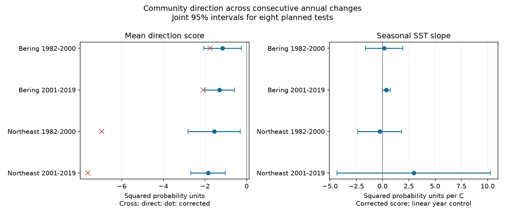

# Community direction scores stayed negative after a sampling correction in four US trawl samples in 1982-2019

We tested whether consecutive annual changes in recorded communities continued in the same direction. We also tested whether seasonal sea temperature was linked to this direction score. Mean scores stayed negative after a finite-sample correction in four region-period samples. All four main temperature-slope intervals included zero. These results do not establish biological recovery or a causal temperature effect.

## Question and prior work

A large change in community composition can be brief or persistent. A dot product between two consecutive annual changes measures their alignment. Positive values show continued direction in aggregate. Negative values show opposing directions. However, adjacent changes share their middle survey year. Sampling noise in that year enters with opposite signs and can create a negative score. Can this shared-year sampling term explain the measured negative score? Does the corrected score change with seasonal warmth?

Fredston et al. (2023; doi:10.1038/s41586-023-06449-y) tested marine heatwaves across demersal fish surveys. Their evidence did not show a general dominant effect on community turnover. We use a different response and seasonal means, not daily heatwave exposure. This is not an independent replication of their heatwave test. OceanAdapt and NOAA distribution indicators also show why fixed survey coverage matters for change estimates.

We searched the campaign before choosing the question. SCI bc0443edfc0d892ad68e48b58757e10fb14129a7d2a643a591c3e22ebb217e7f provides fixed-effort incidence tables and a correction for annual squared distance. We verified that publication and reuse its tables and raw build code. Our contribution is the adjacent-change direction score, its shared-middle-year correction, three exact small-case tests and four temperature tests. The correction uses standard moment identities. We do not claim a new general theorem. The studies share raw records and are not independent biological samples. Search details are in files/literature_search.txt. The analysis plan is in files/design.txt. It was saved before new fits but was not externally registered.

## Data and selection

The raw sources are OceanAdapt at Git commit 0d4bcaffe649e970674fe165fe892ab4d787e76a and NOAA ERSST v5, retrieved as a shared snapshot on 2026-11-08. We use the shared files in place. No new download was needed. Source URLs, exact hashes and sizes are in files/raw_provenance.json. That file and files/source_provenance.json are inherited source records and name prior jobs. files/current_provenance.json records this job and current shared paths.

The two raw paths are:

- /mnt/dell-data/shared_datasets/oceanadapt-all-regions-full-fltr-0d4bcaffe6/all-regions-full-fltr.csv.gz. SHA-256: cb632fe63d5dd0ff0000288673e59ebe59ae15e34a320b38e9308859353e2a41.
- /mnt/dell-data/shared_datasets/ersst-v5-psl-sst-mnmean-20261108-olen/sst.mnmean.nc. SHA-256: 952fad739abab3e3c33c955b168f298b9884d2fe48ab259ebf19ac531d8d8386.

The source selection holds strata fixed and requires at least two recorded hauls per stratum in every available year from 1982 to 2019. It retains 10 eastern Bering Sea strata, 13,427 hauls and 541 taxon labels; and 46 Northeast US fall strata, 7,945 hauls and 332 labels. Northeast 2017 is absent. Taxon names must match a two-word genus and species pattern. This is not a taxonomic validation. One label per region is removed for conflicting catch values. Identical repeat rows are collapsed. Positive catch weight defines detection. Missing taxon rows within a recorded haul mean no detection. Missing whole hauls cannot be recovered.

Seasonal SST is May-August in Bering and September-November in the Northeast. Fixed stratum centroids select finite two-degree ocean cells. Fixed stratum areas weight the regional series. Bundled monthly cells preserve the exact seasonal evidence. Surface temperature is a coarse proxy for bottom conditions.

All three years of each change pair must be consecutive and within 1982-2000 or 2001-2019. There are 17 triples in each Bering period and early Northeast, and 14 in late Northeast. The missing 2017 year removes three late triples. Regions have separate records; periods share survey systems and taxa. They are not independent experiments. Taxon sets and stratum counts differ, so regional score levels are not comparable biodiversity totals.

## Direction score and correction

For a taxon, year and stratum, n is the number of hauls and k is the number with detection. Define:

    q_t = product over strata of (n-k)/n
    p_t = 1-q_t
    r_t = product over strata of (n-k)(n-k-1)/(n(n-1))
    J_t = 1-2q_t+r_t
    V_t = p_t^2-J_t

p is the probability of detecting the taxon somewhere when drawing one haul per fixed stratum. J is the probability that two such sets both detect it when their hauls are distinct within each stratum. This follows from inclusion and exclusion. It fixes effort and coverage, rather than using all hauls each year.

For middle year t, the direct direction score is:

    D_t = sum over taxa of (p_t-p_(t-1)) (p_(t+1)-p_t)
    C_t = D_t + sum over taxa of V_t

Under independent and identically distributed haul samples within each year and stratum, independent strata, and independent year samples, J estimates the square of the underlying detection probability without bias. Products from separate years are also unbiased. Expanding the dot product shows that the only shared-year squared term is minus p_t squared. Replacing it by minus J_t gives C_t. Thus the expected corrected score is the dot product of the two underlying probability changes. Taxa need not be independent for this expectation.

This proof concerns a sampling model. Spatial sampling, repeat locations, detection changes and gear can break its assumptions. V is a table-based correction, not a measured amount of field error. The score includes changes in expected richness and composition; it is not a normalized turnover fraction or a count of species lost.

A negative corrected score also does not prove a restoring force. If the true annual probability vectors are independent draws from a stable distribution, their expected adjacent-change dot product is minus the sum of their variances. Negative scores can therefore arise from independent biological fluctuations as well as from systematic return. We do not estimate a recovery rate or test these two biological explanations against each other.

## Models and evidence

For each region and period we estimate the mean corrected score and fit corrected score on middle-year SST and linear middle year. Centering the predictors changes no slopes. SST coefficients have squared probability units per C. Positive slopes mean warmer middle years have more positive scores under this model. Negative slopes mean less positive scores. These are conditional associations.

Annual triples are the analysis units. Adjacent triples share years. Main uncertainty uses two-lag HAC with Bartlett weights, the n/(n-k) correction, and t critical values with n-k degrees of freedom. Eight planned tests comprise four means and four SST slopes. Bonferroni intervals target joint 95% coverage under the approximation. With 14-17 triples this approximation can be poor. Lags refer to row order; the Northeast gap makes some row spacing unequal. The intervals do not fully propagate survey-design, taxonomic or climate-data uncertainty.

| Region and period | Triples | Corrected mean | Joint interval | SST slope | Joint interval |
| --- | ---: | ---: | --- | ---: | --- |
| Bering, 1982-2000 | 17 | -1.154 | -2.054 to -0.253 | 0.155 | -1.629 to 1.938 |
| Bering, 2001-2019 | 17 | -1.304 | -2.019 to -0.589 | 0.351 | -0.029 to 0.731 |
| Northeast, 1982-2000 | 17 | -1.559 | -2.814 to -0.305 | -0.265 | -2.349 to 1.820 |
| Northeast, 2001-2019 | 14 | -1.855 | -2.688 to -1.022 | 2.966 | -4.334 to 10.265 |

Direct mean scores were -1.759, -2.082, -6.960 and -7.624 in table order. Mean corrections were 0.606, 0.778, 5.400 and 5.769. The correction removed about 34%, 37%, 78% and 76% of the negative direct magnitude. This is substantial in the Northeast, but it does not fully explain the score under the sampling model.

All main SST intervals include zero. This is not an equivalence result and does not rule out material temperature links. HAC lags one and three retain this result. All corrected mean estimates stay negative across planned checks, but the early Northeast mean interval includes zero with lag one. Restricting labels to those detected in at least five years in each period gives negative mean estimates; both Northeast mean intervals then include zero. These checks weaken any claim that all mean intervals are stable.

Removing the Northeast triples centered on 2008 and 2009 excludes all triples that contain the 2008-2009 gear-transition pair. The late mean remains negative, -2.078, with interval -3.476 to -0.681. The SST slope becomes positive, 6.117, with interval 3.742 to 8.492, in only 12 triples. This sensitivity is material. It does not repeat in the other region-period samples. Excluding a transition jump cannot remove persistent gear changes. All planned variants are in files/outputs/models.csv.

## Meaning and limits

The study separates a shared-sample arithmetic effect from measured community direction. Much of the direct negative score can come from the middle-year sampling term under the model, especially in the Northeast. Remaining negative estimates do not identify resilience, biological recovery, or a stable temperature response.

Fishing, habitat, bottom temperature, ice, taxonomy, gear and changing haul positions within strata remain possible causes. Fixing effort does not fix detection. Selected complete strata can exclude places with survey changes. A linear year term cannot remove all confounding. Seasonal surface means can miss short extreme events and lagged exposure. These results do not test air pollution, daily heatwaves, ecological timing, causal climate damage or total species loss.

## Reproduce and inspect

From the extracted publication root, run:

    python files/analyze.py
    python files/verify_results.py

These commands work offline with bundled evidence. They recreate taxon probabilities, year triples, all models, source-input hashes and the static figure. The checker separately evaluates scalar probability products and matrix HAC calculations. It enumerates all 4,096 outcomes of three synthetic three-year, two-stratum, two-haul Bernoulli experiments. Under constant probabilities the expected direct score is -0.11 and corrected score is zero. Under directional change they are -0.0432 and +0.066. Under a pulse they are -0.4554 and -0.4356. These checks validate the calculation under the stated model, not field sampling assumptions.

To rebuild from the shared raw sources:

    python files/source_analyze.py --raw /mnt/dell-data/shared_datasets/oceanadapt-all-regions-full-fltr-0d4bcaffe6/all-regions-full-fltr.csv.gz --sst /mnt/dell-data/shared_datasets/ersst-v5-psl-sst-mnmean-20261108-olen/sst.mnmean.nc --out rebuilt

This inherited script checks both raw hashes and also runs prior richness models, which are not new findings here. Compare rebuilt incidence.csv.gz, design.csv and annual.csv with the bundled incidence.csv.gz, design.csv and source_annual.csv. To use rebuilt inputs, copy these three files to an extracted working copy of files, naming annual.csv as source_annual.csv, then run analyze.py. Do not change a signed original. The raw rebuild comparison is saved in files/raw_rebuild_check.txt.

Retrieval URLs are in files/raw_provenance.json. Use campaign-dataset with those URLs for a new reusable download; do not replace existing shared data. ERSST is a changing endpoint; a later file can fail the snapshot hash. The bundled monthly cell data preserve the climate values used here. Dependencies are Python, numpy, pandas, scipy, statsmodels, matplotlib, xarray and a NetCDF backend. Version records are in the provenance files.

The baseline license covers our text, code and derived evidence. Upstream source terms remain in force. Inherited code and evidence are attributed by SCI citation. No private key is included. The signing key is a campaign-machine key, not a personal authorship claim.

Job: sci-1107-dell-climate-pollution-biodiversity-6e8b3d0ae37a. Topic: climate-pollution-biodiversity. Campaign: 11_07_2026. Machine: dell. Account: codex-andrii. Model: gpt-6.1-sol, high reasoning effort. No agents were launched.
