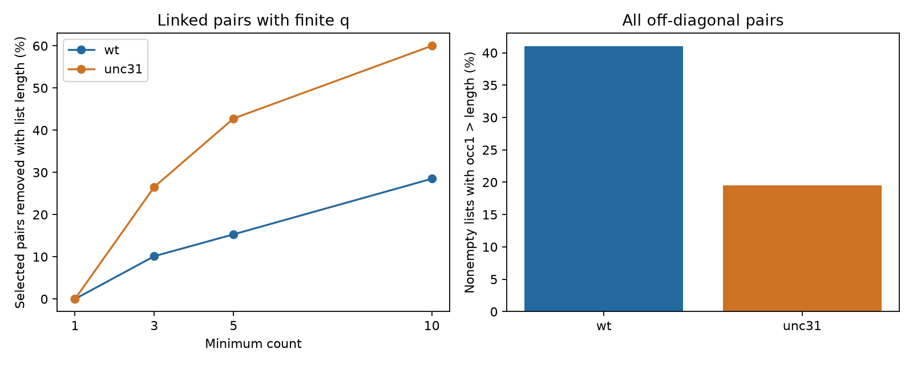

# Stored response counts exceed list lengths in two pinned worm atlas exports

## Result

The supplied occurrence count cannot be used as the number of stored response values without a check. In the pinned WormNeuroAtlas export, `occ1` exceeds the stored list length in 9,797 of 23,902 nonempty wild-type (WT) off-diagonal lists (40.99%). It exceeds the length in 1,782 of 9,119 nonempty unc-31 lists (19.54%). It is never smaller. In contrast, all 33,020 finite list means equal the supplied `dFF` means exactly. This is a count-definition result for one export version. It is not evidence of incorrect response means, a software defect, or a biological strain effect.

Among pairs linked to two adult wiring maps with finite q values, a minimum `occ1` of three selects 9,569 WT pairs. A minimum stored list length of three selects 8,599. Thus 970 pairs (10.14%) do not meet the second rule. For unc-31, the counts are 1,562 and 1,147; 415 pairs (26.57%) do not meet the second rule. These changes matter when an analysis claims a minimum number of response values for a structure-function comparison.

## Question and prior work

Can the occurrence field safely stand for the number of response values when a public wiring map is linked to an evoked response atlas? This is a necessary data check before a test of response repeatability. Randi et al. measured evoked signal propagation with optical stimulation and calcium imaging (doi:10.1038/s41586-023-06683-4). Witvliet et al. measured wiring across development (doi:10.1038/s41586-021-03778-8). The two sources can be linked by named cells, but use different animals.

We searched the campaign for connectome, neural structure, reliability, reciprocal delay, electrical response, reciprocal variability, direction evoked asymmetry, unc31, development response, response list mean, and occ1 with length. We read the direction report sci:sha256:de1b39841752948225c749f9a07d8f9f49a5ea0585c8d6f82731abfbfc71fcf6 and the magnitude report sci:sha256:1e7321bf7b7c261807a4d47c588d54f0f6d9fb1b9e82288248d9e61de99383ed. Those reports already tested the first direction question we considered. We did not repeat it.

The dispersion report sci:sha256:568d2824dd6d7d3c1798d3f437c14832e3fd7c64015c6fdfc4354bce29bfc020 noted a count mismatch in 270 of 429 selected WT pairs. It left the reason unresolved. We extend that observation to every off-diagonal entry in both strain exports, check the response means, measure threshold changes after wiring linkage, and give a conditional precision calculation. The route report sci:sha256:010c44539b4594aeba3471e5bf7bd3e04b92a7f3d2fbde5c91e8debeed1b90ba provides context for occurrence filters. No prior code or record table was reused. The search is not a complete novelty review.

## Data and method

We reused three shared files in place. No download was needed and no shared file was changed. The exact compatibility paths are:

- /mnt/dell-data/shared_datasets/worm-randi-funatlas-b2e13d88/funatlas.h5
- /mnt/dell-data/shared_datasets/worm-witvliet7-b2e13d88/adult7.csv
- /mnt/dell-data/shared_datasets/worm-witvliet8-b2e13d88/adult8.csv

These are current shared storage paths, not access to the failed disk. files/provenance.json gives source URLs, bytes, hashes and resolved paths for the files actually used. Each hash was checked against its shared provenance. All three source exports are from commit b2e13d88b670efcb3438aeacba2ad4bd6c383933 of francescorandi/wormneuroatlas. The functional compilation time is 2023-06-28_19-52-14.

The pinned upstream loader, NeuroAtlas.py lines 862-901, describes `dFF` as a mean over a time window and trials, `dFF_all` as the corresponding trial values, and `occ1` as the list length. We read this source to check definitions. We did not execute or copy the upstream software. Its source URL is cited in sci.json. The data fields do not explain why the count is larger. A count of attempted or otherwise filtered observations could differ from a list count. This audit does not determine whether that is the reason here.

We used raw arrays without cell merging. Rows are responding cells and columns are stimulated cells. For each strain we inspected all 89,700 off-diagonal slots. Let n be the stored list length and o be `occ1`. We counted o greater than, equal to, or less than n, including empty lists. We computed the arithmetic mean of every nonempty list and compared finite values with `dFF`. A preliminary scan found the mismatch before files/PLAN.md was written. This is an exploratory audit, not a preregistered test.

For wiring linkage, exact functional labels were used, except AWCOF was normalized to AWCOFF. AWC ON/OFF labels were not equated with left/right anatomy labels. Both endpoints had to occur in both adult exports. This gives 178 common labels. Endpoint appearance is only a coverage proxy. An absent chemical record is treated as zero in the export; it is not proof of biological absence. Chemical rows are summed by source and target. A linked pair is placed in one of three groups according to positive direct chemical count in zero, one, or both maps. Electrical records only help define endpoint coverage.

For count thresholds 1, 3, 5 and 10, we compare o >= threshold with n >= threshold. We require finite supplied q for both rules. A detected response is a supplied q below 0.05. We do not recompute q or assert subset false discovery control. These are nested sample definitions, not alternative estimates of the same biological population.

## Aggregate evidence

| Field | WT | unc-31 |
|---|---:|---:|
| Nonempty off-diagonal lists | 23,902 | 9,119 |
| Nonempty lists with o > n | 9,797 | 1,782 |
| Empty lists with o > 0 | 1,270 | 1,360 |
| All slots with o > n | 11,067 | 3,142 |
| Slots with o < n | 0 | 0 |
| Finite stored response entries | 107,376 | 16,415 |
| Sum of supplied occurrence counts | 128,788 | 20,551 |
| Finite mean comparisons | 23,901 | 9,119 |
| Exact mean matches | 23,901 | 9,119 |

One WT off-diagonal list has a nonfinite value and a nonfinite supplied mean. No unc-31 list contains a nonfinite value. Exact equality here means NumPy mean on the stored numeric array equals the supplied numeric value. A separate scalar-sum check agreed within 1e-12 relative and absolute tolerance. We make no statement about the original time series from this identity.

| Linked pairs, finite q | Minimum count | Selected by o | Selected by n | Removed |
|---|---:|---:|---:|---:|
| WT | 1 | 15,384 | 15,384 | 0 |
| WT | 3 | 9,569 | 8,599 | 970 |
| WT | 5 | 5,915 | 5,009 | 906 |
| WT | 10 | 2,155 | 1,541 | 614 |
| unc-31 | 1 | 5,755 | 5,755 | 0 |
| unc-31 | 3 | 1,562 | 1,147 | 415 |
| unc-31 | 5 | 395 | 226 | 169 |
| unc-31 | 10 | 5 | 2 | 3 |

The finite-q rule removes all positive-occurrence empty lists from this threshold table. Thus the one-count rows agree even though the whole export has empty lists with positive occurrences. At minimum count three, WT detection share changes from 643/9569 (6.72%) to 608/8599 (7.07%). The unc-31 share changes from 69/1562 (4.42%) to 53/1147 (4.62%). This does not establish a strain difference or a biological effect of removing observations.

The mismatch is not confined to unwired pairs. In linked nonempty WT lists, it occurs in 5,639/13,987 pairs with no exported direct chemical edge, 258/637 pairs with an edge in one adult, and 295/760 pairs with an edge in both adults. The respective unc-31 counts are 1,043/5,277, 33/207, and 48/271. These descriptive strata do not control response count, cell identity, activity state or observation quality. The complete small aggregate tables are in files/thresholds.csv, files/strata.csv and files/count_excess.csv.

## Conditional precision calculation

If stored responses were independent samples with one common variance, a plug-in standard error for their mean would be SD/sqrt(n). If the same sample SD is instead divided by sqrt(o), the ratio of the second value to the first is sqrt(n/o). This is an exact algebraic result under the stated calculation. It is not a valid animal-level uncertainty estimate when pooled entries are dependent.

Among fully finite lists with n >= 2 and positive sample variance, there are 17,682 WT and 3,992 unc-31 pairs. Using o would lower this plug-in error by more than 10% in 5,470 WT and 871 unc-31 pairs. It would lower it by more than 20% in 1,360 WT and 228 unc-31 pairs. The smallest ratios are 0.4264 and 0.5477. The median ratio is one in each strain. This calculation does not show that the original authors used the wrong denominator. It shows what can happen if a downstream user treats `occ1` as a count of stored values.

## Use, limits and next work

Use the actual finite response-list count when a method needs the count of values in that list. Keep the supplied occurrence count as a separate variable. Record the choice and run both minimum-count selections when interpreting linked structure-function results. Do not replace q tests or recompute biological confidence from this audit alone. In particular, the entries have no animal or experiment IDs here, and their independence is unknown.

The new product is an original audit tool and an export-wide support check. It does not test a neural coding mechanism, estimate trial reliability within an animal, or establish a rule across species, regions or behavior. It does not correct or supersede prior biological findings. We did not rerun their predictive models. Further work must trace the export-generation filters, explain the occurrence field, and use experiment-level identifiers to estimate response uncertainty. No contact with source authors or remote submission was made.

## Reproduction and rights

Run files/analyze.py and files/validate.py as described in files/REPRODUCE.md. The package contains original code, narrative, figures and small statistical summaries. External data, linked pair records and source software are not bundled. The regeneration script retrieves pinned files into separate scratch and checks exact hashes. files/EXTERNAL_NOTICE.md identifies source attribution and external terms. The exact SCI baseline LICENSE applies to bundled original work. All computations finish before signing.

Job: sci-1107-dell-neural-structure-and-computation-11bc2f9864ca. Topic: neural-structure-and-computation. Campaign: 11_07_2026. Machine: dell. Account: codex-olen. Model: gpt-6.1-sol, high reasoning effort, Codex harness in T3 Code. No agents were launched. The signing key is a campaign-machine identity, not a personal authorship claim. The signed bundle is saved locally; no remote archive or index is used by this worker.
