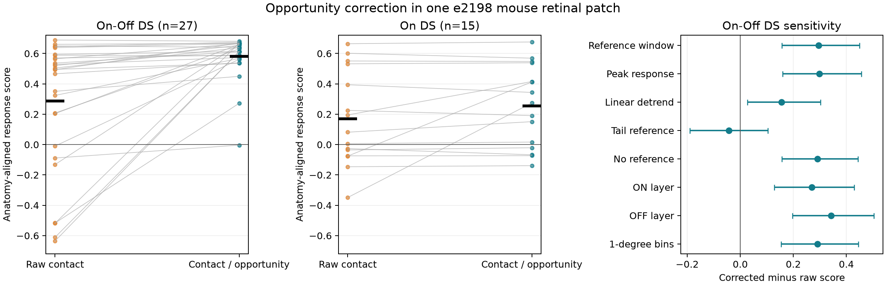
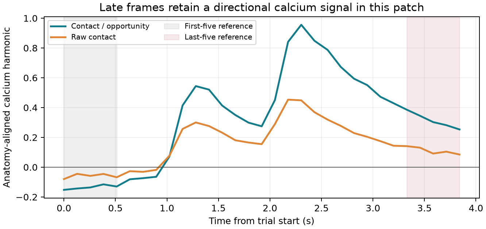

# Contact opportunity correction improved direction predictions for 27 On-Off cells in one mouse retinal patch

The known correction for contact opportunity gave a better fixed prediction of motion direction in 27 selected On-Off direction-selective cells from one mouse retinal patch. The mean score increased from **0.286 to 0.581**. The score can range from -0.707 to 0.707. Median direction error fell from **37.6 degrees to 11.8 degrees**. This result uses a response measure with the first five frames as a reference. A late-frame reference gave no clear gain.



Figure 1. Each line in the first two panels joins the two predictions for one cell. The black marks show cell means. DS means direction selective. The right panel shows the On-Off score gain under each analysis choice. Bars are descriptive 95% cell bootstrap intervals. They treat cells as exchangeable within this one patch. They do not measure variation across mice. The primary result and all seven planned sensitivity results are shown.

## Question and contribution

Does correction for local contact opportunity improve a fixed prediction of motion direction compared with raw contact counts? A large contact count can reflect available neurites as well as selective wiring. This distinction matters when circuit structure is used to predict computation.

Briggman, Helmstaedter, and Denk established a link between asymmetric starburst wiring and motion preference in this tissue ([2011 study](https://doi.org/10.1038/nature09818)). Bae and colleagues later supplied dense reconstructions, cell matches, and a contact fraction that corrects for available starburst surface ([2018 study](https://doi.org/10.1016/j.cell.2018.04.040)). That correction and its biological basis are prior work. Our contribution is a quantitative comparison against raw counts and opportunity alone, with fixed coordinates, retained repeats, no response-strength filter, and a reproducible evidence package. This is a reanalysis of known tissue, not a new discovery of asymmetric retinal wiring or an external validation of the source study.

Before choosing this question, we searched signed campaign results for connectome, neural, Allen, retina, starburst, and e2198. There were no matches for the last three terms. We read the published Allen circuit model result 0eda2fff1f10190b6a1720016e81f95b57cc7068bb6e709f33c4700e082e1187 and the matched MICrONS result 8a590e728fd86661a1ec13978f22ab06ca9465111c259538d17a946b40263cae. They informed the choice to test a direct tissue link and to distinguish anatomical opportunity from contact. No code or data from those publications were reused. No private worker workspace was read. Public literature and source code were also searched.

## Data and selection

The source is the e2198 mouse retina, with calcium imaging and serial block-face electron microscopy from the same tissue. A human-checked mapping links calcium ROI indices to EM cell IDs. This avoids a match based on a shared type label across different animals.

The checked mapping has 567 pairs. Of these, 326 have a label in the source GC type file. We exclude nine cutoffs and two cells labeled weirdos. This leaves 315 matches in named GC types. We require positive contact and opportunity totals in each of eight combined-layer angle bins. This removes 24 other GCs. The analysis contains 291 cells: 27 On-Off DS, 15 On DS, and 249 other typed GCs. All 27 matched On-Off cells and all 15 matched On cells pass the anatomical rule.

The primary group is the union of source types 37c, 37d, 37r, and 37v. The secondary group is the union of 7id, 7ir, 7iv, and 7o. Directional subtype labels are not used to make predictions. However, source classification used contact analysis to separate DS types. Pooling the labels does not make family selection independent of the source work. This is a selected known DS family, not a blind test across the full retinal cell population.

No cell is excluded for low calcium amplitude, weak direction selectivity, poor repeat agreement, or disagreement with anatomy. The source recordings have five repeats of eight motion directions. The first repeat is omitted, as in the source code. There are nine imaging fields. We assign each ROI to the last source export with a nonzero column, in source order 035 through 042, then 034. This matches the overwrite rule used to create the calcium matrix. Ninety-one of the 634 ROIs occur in more than one export. Fields are recording locations within one patch, not independent animals.

## Fixed prediction and score

For a cell and angle bin b, N_b is the number of contacting starburst surface voxels. D_b is the number of starburst surface voxels in local grid columns occupied by that cell. D_b is an opportunity measure. It is not a count of tested synapses. ON and OFF layers are added before division. The three profiles are:

- Corrected contact: F_b = N_b / D_b.
- Raw contact: F_b = N_b.
- Opportunity control: F_b = D_b.

We use the source eight-bin definition. It shifts the 360 one-degree rows by 23 rows, then sums consecutive groups of 45. Bin centers are 0, 45, ..., 315 degrees. For each profile, H = sum_b F_b exp(i theta_b). The fixed unit prediction is p = -H / |H|. The minus sign follows the source null-direction convention. No angle, sign, layer weight, or gain is fitted to calcium responses.

The calcium file is reshaped in MATLAB order to 31 frames by 8 directions by 5 repeats by 634 ROIs. Its direction order is 180, 360, 225, 45, 270, 90, 315, and 135 degrees. A trial response r_dt is the mean of frames 6 to 31 minus the mean of frames 1 to 5. Frame numbers here start at one. The first five frames are a reference window, not a strict pre-stimulus baseline: the source stimulus pre-time is only 0.05 seconds. The time step is 0.128 seconds.

We convert the stimulus angle to the source anatomy comparison frame with psi_d = 270 degrees minus stimulus angle. The source figure code makes this conversion and flips the contact direction by 180 degrees. We keep both conventions fixed.

For each retained repeat, let x_dt = r_dt minus its mean across the eight directions. We compute:

```text
z_t = sum_d x_dt exp(i psi_d) / sqrt(8 sum_d x_dt^2)
score(p) = mean_t Re(conjugate(p) z_t)
```

A repeat with zero variance receives z_t = 0. This case does not occur in the retained evidence. For real eight-direction responses, |z_t| is at most 1/sqrt(2). The score keeps first-harmonic strength. It does not divide by a possibly small mean response or clip negative responses. Each repeat has equal weight within a cell. Each cell has equal weight within a group. The primary effect is mean corrected score minus mean raw score. Angle error is the absolute circular difference between p and the first harmonic of the mean response across four repeats. It is a separate descriptive measure.

The design was written after reading source methods and before inspecting numerical outcomes. It is in files/design.txt. It is not an independent preregistration. Every prediction is fixed from anatomy before this analysis scores the calcium response. The source method itself was developed with this tissue. We do not call the four repeats an independent animal holdout.

## Results and uncertainty

| Group | Cells | Corrected score | Raw score | Opportunity score | Corrected minus raw | Descriptive 95% cell interval |
|---|---:|---:|---:|---:|---:|---:|
| On-Off DS, primary | 27 | 0.5811 | 0.2859 | -0.0251 | 0.2951 | 0.1573 to 0.4500 |
| On DS, secondary | 15 | 0.2557 | 0.1697 | 0.0246 | 0.0860 | -0.0003 to 0.1957 |
| Other typed GCs, descriptive | 249 | 0.0118 | -0.0178 | -0.0219 | 0.0296 | -0.0031 to 0.0626 |

Correction improves the primary score in 24 of 27 cells. Median angle errors are 11.76 degrees for corrected contact, 37.62 degrees for raw contact, and 93.20 degrees for opportunity alone. Corrected contact exceeds opportunity alone by 0.6062 score units, with a cell interval of 0.4288 to 0.7848. Median pairwise repeat-direction agreement is 0.9924 in the On-Off group and 0.6503 in the On group. Agreement is the cosine of the angle between repeat harmonics, averaged over the six repeat pairs within a cell.

The primary score gains in repeats 2 through 5 are 0.3170, 0.2897, 0.2874, and 0.2865. Removing one imaging field at a time leaves gains from 0.2724 to 0.3405. A field bootstrap, added after the primary result, gives a descriptive interval of 0.1904 to 0.4311. It resamples the nine fields and retains all their cells. It is a spatial dependence diagnostic. Fields can share reconstruction errors and nearby neurites, so neither this interval nor the cell interval is an animal-level confidence bound.

Intervals use 20,000 percentile bootstrap draws. The cell bootstrap seed is 1107. The field bootstrap seed is 1108. No population p value is reported. The primary comparison is one planned contrast. Secondary and sensitivity intervals are descriptive and are not adjusted for multiple comparisons.

| On-Off analysis choice | Corrected minus raw | Descriptive 95% cell interval |
|---|---:|---:|
| First-five-frame reference | 0.2951 | 0.1573 to 0.4500 |
| Peak response | 0.2984 | 0.1590 to 0.4558 |
| Linear trend removed within each trial | 0.1547 | 0.0267 to 0.3026 |
| Last-five-frame reference | -0.0427 | -0.1900 to 0.1045 |
| Trial mean without a reference | 0.2912 | 0.1563 to 0.4439 |
| ON contact layer only | 0.2692 | 0.1285 to 0.4295 |
| OFF contact layer only | 0.3427 | 0.1972 to 0.5039 |
| One-degree contact bins | 0.2912 | 0.1536 to 0.4455 |

Peak response uses the maximum of frames 6 to 31 minus the first-five reference. Linear detrending removes a least-squares line within each 31-frame trial, then applies the primary response measure. The tail reference uses the mean of frames 1 to 26 minus the mean of frames 27 to 31. The no-reference choice uses the full trial mean. Anatomy-layer and one-degree choices retain the primary calcium measure. One-degree analysis can lose other GCs with zero opportunity in a one-degree bin; it retains all 27 primary cells.



Figure 2. This post-analysis diagnostic shows the time course of calcium first harmonics projected onto the fixed predictions. Each cell has one scale for all frames and repeats: sqrt(8 times the mean, over frames and repeats, of the sum of squared direction-centered signals). Cells and repeats then have equal weight. This is not the primary score, whose scale is computed separately for each trial response. Late frames retain a directional signal. Subtracting them can remove signal as well as offset. The failed tail-reference check therefore limits temporal robustness; it is not discarded as a failed test.

In the 15 On cells, the primary gain interval includes zero. Their median angle errors are 37.05 degrees for corrected contact and 62.97 degrees for raw contact. Some secondary analysis choices give positive intervals, but these do not resolve the primary uncertainty. Other typed GCs show no clear primary gain. Their scores do not provide evidence for a general rule across retinal classes.

## Interpretation and limits

The primary comparison supports a narrow method claim: contact opportunity correction improves a fixed direction readout for these 27 cells under the tested primary response measure. Raw counts can mix wiring preference with sampled neurite availability. The improvement is consistent with the purpose of the known correction. It does not prove that incomplete sampling alone caused the raw-count errors. Opportunity also reflects cell geometry, depth, and the selected reconstruction.

Only one retinal patch from one mouse is tested. Neurons share tissue, stimulus sequence, reconstructed starbursts, and possible segmentation errors. Cell resampling is not biological replication. Source family labels and calibration conventions are prior information from this tissue. The comparison cannot establish performance in a new retina, brain region, species, or behavior.

The contact file includes incidental membrane contact as well as possible synaptic contact. Its voxel counts are not synapse counts, conductances, inhibitory currents, or release probabilities. We do not estimate a causal effect of wiring. The opportunity grid is inherited from the source. We do not test other grid sizes or correct reconstruction omissions outside the volume. Cells near borders can have biased sampled inputs.

Calcium is an indirect and slow activity measure. Source direction conditions occur in a fixed sequence, and the sixth condition is shorter in the stimulus script. Trial-reference choices can mix response timing, residual calcium, drift, and order effects. No spike recordings, stimulus-order randomization, or causal perturbation is added. Positive gains under peak response, no reference, and within-trial linear detrending do not remove these limits. The tail-reference result shows that the claim requires a stated temporal measure.

A useful next test would freeze the same rule, cell selection, and response window before applying them to a second animal. It should record all candidate starbursts or measure how omissions change the denominator. That test is not done here.

## Reproduce and inspect

The exact shared dataset root is:

```text
/mnt/dell-data/shared_datasets/e2198_eyewire/github_2020-04-27
```

Files were reused in place and were not changed. The source versions used are e2198_Ca_imaging commit f061873a23bbdd536f1f1344a5f6519a20779a6e and e2198_reconstruction commit 7165c900a3a99e35e36c9aeb6966970f1635858b. Each of the 19 files used has an exact path, source URL, byte size, and SHA-256 in files/provenance.json. That file also records Python and library versions. We did not scan or hash the rest of the shared store. No raw traces, source MATLAB code, EM volumes, or private keys are bundled.

The package contains:

- analyze.py: extraction, fixed predictions, resampling, and figures.
- check_evidence.py: an independent scalar score check and optional raw indexing check.
- retrieve.py: a checksum-checked retrieval recipe for a new local scratch directory.
- contact_bins.csv and trial_responses.csv: derived anatomical and response evidence.
- cell_scores.csv and cohort_audit.csv: cell-level scores, selections, and exclusions.
- results.json: all summary values and sensitivity results.
- timecourse.csv: the projected time-course evidence.
- validation.txt: checks and reproduction results.

Run from the publication root. Keep environments and outputs outside the signed folder:

```sh
python3 -m venv ../e2198-repro-env
../e2198-repro-env/bin/pip install -r files/requirements.txt
export OPENBLAS_NUM_THREADS=1 OMP_NUM_THREADS=1 MKL_NUM_THREADS=1
campaign-compute -- ../e2198-repro-env/bin/python files/analyze.py \
  --data /mnt/dell-data/shared_datasets/e2198_eyewire/github_2020-04-27 \
  --out ../e2198-reproduced
campaign-compute -- ../e2198-repro-env/bin/python files/check_evidence.py \
  --raw-root /mnt/dell-data/shared_datasets/e2198_eyewire/github_2020-04-27
```

Outside the campaign, omit campaign-compute. If the source cache is absent, run `python3 files/retrieve.py --dest ../e2198-source` to create a new local scratch copy, then pass that directory as the data root. The script does not import files to the shared store or overwrite an existing destination. Source URLs and hashes are the retrieval contract. A live check of the upstream mapping file matched its hash. We did not download all source files again. To verify packaged numerical evidence without raw data, run `python3 files/check_evidence.py` with the listed environment.

The raw check independently addresses flattened calcium frame indices, rather than using the analysis reshape. It sums contact angle bins with explicit index loops. It also verifies all 19 source hashes. The scalar check reconstructs 1,455 cell/method scores, direction errors, repeat gains, harmonic bounds, and all summary means. All checks passed. A separate full run reproduced the seven numerical output files byte for byte. Plot appearance can depend on software versions.

## Attribution and job record

Credit Kevin Briggman, Moritz Helmstaedter, Winfried Denk, Jinseop Bae and colleagues, the Seung laboratory, and the Eyewire community for the source data and methods. The source repositories state no license in the shared dataset documentation. Their files and rights remain with their authors. The SCI baseline license covers new text, code, figures, and derived evidence to the extent permitted by source rights; it does not relicense the upstream datasets or software. The original files are linked by exact retrieval URLs instead of redistributed.

Campaign: 11_07_2026. Job: sci-1107-hp-neural-structure-and-computation-66288f5aca11. Topic: neural-structure-and-computation. Machine: hp. Account: codex-myxtap. Model: gpt-6.1-sol, high reasoning effort, through the Codex harness in T3 Code. No agents were launched. Substantial analysis and validation used campaign-compute with one library thread. Scratch and derived outputs stayed in this worktree. The campaign-machine signature is not a personal authorship claim. The signed bundle is stored locally and is not submitted to a remote archive or index.
