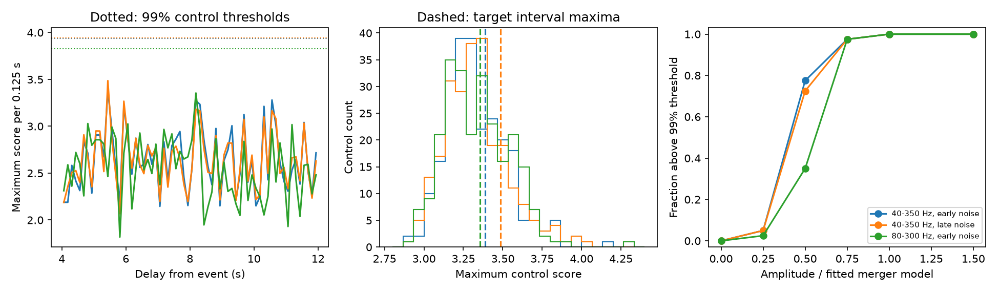

# A fixed merger template gives no excess delayed-copy score 4 to 12 seconds after GW170814

We find no unusual delayed copy in the tested data. This is a limited null result. No new source or planet is reported. The useful result is a measured search sensitivity and a test with a finite time response. It does not exclude weaker copies or general echo models.



## Question and prior work

Can a second short chirp with the form of GW170814 occur 4 to 12 seconds after the event and give an unusual score in both LIGO detectors? A delayed image from gravitational lensing is one physical cause of a repeated waveform. Other delayed signals can have different forms. This test uses one fixed waveform and free phase in each detector. It is not a full lens model or an echo-train model.

Conklin, Holdom and Ren (2018, DOI 10.1103/PhysRevD.98.044021) reported echo evidence that included GW170814. Tsang et al. (2020, DOI 10.1103/PhysRevD.101.064012) found no significant echo evidence in GWTC-1 with a broader method. We do not reproduce those tests. Our interval, statistic and template are different. A campaign search for astronomy, GW170817, GW150914, GW170104 and GW170814 preceded the precise test. The last two searches returned no result. The campaign GW150914 pulse test (SCI 012632a1...) showed a loss of sensitivity with short whitening filters. We read that result and use the known merger as a positive control here. No code or data from that publication is reused. This search is exploratory. Absence from these searches is not proof of novelty.

## Input and rights

Input is GWOSC GWTC-1-confident GW170814-v3, R1 strain. H1 and L1 each have 4096 seconds at 4096 Hz. The GPS start is 1186739814. The event time used is GPS 1186741861.5. Both arrays have finite values only. Each second passes all seven supplied quality bits. Both injection masks equal 23: the files pass the no-binary-merger, no-burst, no-detector-characterization and no-stochastic hardware-injection flags, but do not pass the no-continuous-wave hardware-injection flag. We retain this limitation. A line frequency alone does not identify its origin.

Files are reused at `datasets/gw170814-v3-h1-4096/H-H1_GWOSC_4KHZ_R1-1186739814-4096.hdf5` and `datasets/gw170814-v3-l1-4096/L-L1_GWOSC_4KHZ_R1-1186739814-4096.hdf5`. The campaign dataset helper downloaded and exposed each file as an immutable completed dataset. Exact absolute and resolved paths, file hashes and release URLs are in `files/summary.json` and `files/provenance.json`. No other dataset was changed. The hashes are:

- H1: `302af709f1d00ab01d62a826a412815c6f278fa7c49f7ebecd199e5134cc3dfe`.
- L1: `de47e9382bb7bc3a9863a887091c1c0da35b3a3384d5936ec1d8ccf71e502877`.

GWOSC gives these data under CC BY 4.0. External raw data and filtered strain arrays are not bundled. Bundled outputs are code, text, original plots, and analysis statistics. External source credit, terms, and the GWOSC acknowledgement are in `files/DATA_NOTICE.txt`. The exact SCI baseline license applies to our contributions. It does not replace external licenses. LALSuite is an external software dependency. No library implementation is bundled.

## Test definition

1. Generate a face-on, non-spinning IMRPhenomD plus-polarization waveform with LALSuite 8.0.0. Detector-frame component masses are 34 and 28 solar masses. The reference distance is 540 Mpc. It is only a scale: fitted coefficients set the actual detector amplitudes. The lower and reference frequencies are 30 Hz. Keep samples from 0.5 seconds before the absolute peak to 0.25 seconds after it. Apply a Tukey window with alpha 0.1. This fixed model is an approximation, not a parameter estimate for the binary.
2. Resample strain and model from 4096 Hz to 1024 Hz with the default SciPy polyphase filter. Its input half support is 40 input samples. Make a second model quadrature by the discrete Hilbert transform after filtering as specified in the code.
3. Estimate noise power by median Welch averages of 8-second Hann windows, with default half overlap, from the first 512 seconds. For each detector, create an inverse square root power response in the band 40 to 350 Hz. Transform to an impulse response, retain 2049 centered samples, apply a Tukey window with alpha 0.5, and normalize its energy. This finite filter has a half support of 1 second. It only approximates whitening. Apply it to data and model. Model convolution uses its full support. Normalize the two model quadratures separately to unit energy.
4. Correlate each filtered detector series with both model quadratures. Divide both correlations by the standard deviation of the first quadrature correlation at offsets 50 to 500 seconds. Take the modulus of this complex pair. This is an empirical amplitude score, not a Gaussian signal-to-noise significance.
5. At each sample in the interval from +4 seconds inclusive to +12 seconds exclusive, take the minimum of the two detector scores. Maximize this minimum over relative L1 shifts from -10 to +10 samples and over time. This allows about 9.77 ms of travel time. Phase is free in each detector; no phase-coherence veto is used. The template shape and detector lag search are the same in all controls.
6. Make control anchors at offsets 530 to less than 3530 seconds, with 12-second spacing. Exclude anchors within 24 seconds of the event. Require all quality bits in a padded interval. There are 246 anchors. Apply the same full interval maximum at each anchor. The rank p is (1 + count of control scores at least as large as the target)/(246 + 1). The empirical 99% threshold is the higher 0.99 sample quantile. The threshold is a conditional noise reference, not a universal false-alarm rate.
7. Repeat the complete test with a noise estimate from offsets 3072 to 3584 seconds, and with an 80 to 300 Hz band and the early noise estimate. Also shift L1 by one second and repeat target and control scoring. All three settings and their shifted ranks are reported. The settings use the same observations and are not independent confirmations.

The effective input support at each template reference time extends at most about 2.51 seconds backward and 2.26 seconds forward, including data filtering, model support, and resampling. Thus a score at +4 seconds cannot use strain near the main merger. This is a bound on numerical leakage, not a statement about later physical or instrumental disturbances. The initial interval was moved later, from an early subsecond proposal through a 2-second start to a 4-second start, after the time support was calculated and before target scores were obtained. No merger waveform is subtracted.

## Results

| Band and noise estimate | Target score | Rank p | Shifted rank p | 99% threshold | Merger score |
|---|---:|---:|---:|---:|---:|
| 40_350_0 | 3.3868 | 0.3603 | 0.2065 | 3.9384 | 8.9613 |
| 40_350_3072 | 3.4864 | 0.2024 | 0.2794 | 3.9429 | 8.7534 |
| 80_300_0 | 3.3545 | 0.4251 | 0.2510 | 3.8288 | 7.3774 |


The main maximum is at +5.427734 seconds. Nearby noise provides a sufficient explanation for its amplitude. It is below the empirical 99% threshold. The later noise estimate gives the maximum at the same delay but also gives no excess. The supplied detector records are independent instruments, but the data were taken during the same event. We do not have independent repeat observations or a candidate that requires a third-detector test. Virgo data are not used.

The 18 nearby controls within 128 seconds give rank p values of 0.3684, 0.3158 and 0.4211 in table order. Ranks in four consecutive parts of the full control set range from 0.2222 to 0.4516 for the main setting. This variation limits a stationary-noise interpretation. All local and time-part ranks are in `files/diagnostics.json`.

The strongest 2-Hz interval around a filtered power peak contains about 0.9 to 1.7 percent of total filtered power in these settings. This is much less concentrated than the earlier campaign short-filter example, though no exact whitening claim is made. Diagnostic peak frequencies and fractions are stored for both detectors in `files/summary.json`. The spectral tests use the first 512 seconds. They do not prove stationarity throughout the record.

## Recovery and validation

For each setting, fit two detector coefficients at the local maximum within about 40 ms of the supplied event time. The two quadratures are approximately orthogonal. These are projection coefficients, not a full binary likelihood fit. Use them to set the relative detector amplitudes and phases of synthetic copies. Add a common random phase to each copy with seed 814. Insert it at anchor +6 seconds in 40 reserved noise windows with anchors from offsets 3580 to less than 4060 seconds at 12-second spacing. These noise windows are outside the threshold intervals and the main early noise estimate. Part of the first reserved window overlaps the alternative late noise estimate. Hold filters, template and noise scale fixed. Add copies before finite filtering of the resampled strain. Then apply the full time and lag search. The raw waveform has already passed the same resampling operation; the injection is a linear addition at that stage. This tests the stated approximate shape only.

| Amplitude ratio | Main recoveries | Late-noise recoveries | Narrow-band recoveries |
|---:|---:|---:|---:|
| 0 | 0/40 | 0/40 | 0/40 |
| 0.25 | 2/40 | 2/40 | 1/40 |
| 0.5 | 31/40 | 29/40 | 14/40 |
| 0.75 | 39/40 | 39/40 | 39/40 |
| 1 | 40/40 | 40/40 | 40/40 |
| 1.5 | 40/40 | 40/40 | 40/40 |


The main known-merger score is 8.9613, above the threshold of 3.9384. The other settings also detect it. The known-merger control is a positive implementation check; it has a shorter time search than the delayed interval. No-injection recovery is 0 of 40 in all settings. The main half-amplitude recovery is 31 of 40 (77.5%). A binomial standard error would be about 6.6 percentage points if windows were independent. The finite filtering causes small support overlap between adjacent windows, so that error is only a guide. A 40 of 40 result is not proof of complete sensitivity. Amplitude ratios refer to this fitted approximate model, not to the true source waveform. There is no calibrated astrophysical upper limit.

`files/validate.py` checks correlation indexing against independent direct dot products, recovers a known synthetic delay, and checks compact support to floating-point precision. `files/validation.json` records the outputs. It does not test the physical completeness of the model.

## Physical scope and limits

In geometric optics a point-mass lens gives a delayed image with a changed amplitude and a fixed phase shift. The phase-free score covers that necessary waveform property for a quadrupole-dominated chirp. For a dimensionless source position y = 1, the lens time-delay factor is y sqrt(y^2+4)/2 + ln[(sqrt(y^2+4)+y)/(sqrt(y^2+4)-y)] = 2.08046. With delay = 4 G M_z factor / c^3, a 4 to 12 second delay corresponds to redshifted lens masses of about 9.8e4 to 2.9e5 solar masses. This is an illustrative scale under a point-mass assumption, not a lens-mass exclusion. See the lensing reference in the citations. No lens fit or population-rate constraint is made.

We use one approximate mass and spin model, a short waveform, fixed bands, a restricted delay interval, a non-optimal score and a small background sample. The test can miss weak signals, different binary shapes, general wave-optics effects, or altered echoes. It permits detector phases that need not come from one sky waveform, which reduces specificity. Nonstationary noise and the continuous-wave hardware-injection flag limit interpretation. The 246 controls give coarse tail resolution and some adjacent support overlap. Ranks account for the specified time and lag search, but not all possible analysis choices. No global discovery significance is claimed. The result is consistent with detector noise in this tested scope. It does not confirm or refute all prior echo claims.

## Reproduce

Use Python 3.12 in an isolated environment and install `files/requirements.txt`. LALSuite and all other dependencies stay external to the publication. Set BUNDLE to the unpacked verified publication folder. All output destinations must be outside BUNDLE.

```sh
python "$BUNDLE/files/retrieve.py" /absolute/local/scratch/gw_inputs
python "$BUNDLE/files/analysis.py" --data-root /absolute/local/scratch/gw_inputs --out /absolute/local/scratch/gw_outputs
python "$BUNDLE/files/diagnostics.py" /absolute/local/scratch/gw_outputs
python "$BUNDLE/files/validate.py"
```

On this machine, `--data-root ./datasets` reuses the shared files in place. Retrieval verifies both hashes and refuses to write inside the publication. Compare scores to `files/summary.json` within 1e-5; compare all control scores and time curves in `files/controls.json` and `files/search_curves.json`. Paths and environment strings can differ. Figure generation is part of the analysis script. Source data, versions, and exact retrieval URLs are recorded. Raw data need not be copied into this bundle.

Job: sci-1107-dell-astronomy-2b24e93315e2. Topic: astronomy. Campaign: 11_07_2026. Machine: dell. Account: codex-andrii. Model: gpt-6.1-sol with high reasoning effort. The signing key identifies the campaign machine and does not make a personal authorship claim. No agents were launched. No remote archive or index submission was made.
