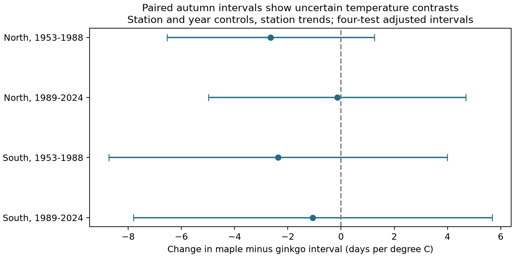

# Autumn warmth gave no clear maple and ginkgo interval difference at 37 Japan stations in 1953-2024

We tested whether autumn warmth changes the difference between maple and ginkgo in the time from leaf colour change to leaf fall. We used 1,789 matched station-years at 37 Japan stations. All four region and period estimates were negative. All four adjusted uncertainty intervals included zero. The data do not establish a common difference in temperature response. They also do not establish equal responses.

## Question and prior work

A delay in leaf colour change does not by itself show a longer period before leaf fall. The two dates can move together. We test a further contrast: does the interval for maple change more than the interval for ginkgo under warm autumn conditions at the same station and in the same year?

Doi and Takahashi (2008; DOI 10.1111/j.1466-8238.2008.00398.x) studied both dates and their difference in Japan in 1953-2005. Thus the interval is an existing measure. Nan et al. (2022; DOI 10.1111/geb.13581) studied temperature and the rate of leaf colour progression. The JMA interval starts much later than first colour, so it need not have the same response as the full period of colour change.

We ran SCI searches for phenology, climate, pollution and bloom in the shared campaign. The verification pass was slow. We stopped our searches and queried the partial local search cache of verified published metadata. We read the published ginkgo temperature study, SCI sha256:a760f4dbf8854d509208c7a8cf9893d7e3f64848ea08a03cee2804c1eaa6678d, and the matched maple and ginkgo trend study, SCI sha256:36c396f72837ae8d4c95949d94b0b54f43f0a2f0e611fba67a1983423ac36961. Both reported uncertain contrasts. The second tested trends in time; the present study tests a direct temperature slope for the matched interval difference. We refined the question after this search. This is an exploratory extension on the same observation network, not an independent national replication or a registered test. We did not use private worker files.

## Data and selection

We used JMA annual phenology files 013-016. Ginkgo is the standard ginkgo target. Maple is the standard JMA kaede target category. Leaf colour change is the first date when most leaves have autumn colour and little green remains. Leaf fall is the first date when about 80 percent of leaves have fallen. Their difference is not total leaf life, the period from first colour to last leaf, or a measure of carbon uptake.

We decoded the files as CP932. Zero values are missing or outside the statistical or observation scope. Dates are month times 100 plus day. For these autumn events, January-June dates are assigned to the next calendar year under the recorded autumn year. The study ends in 2024 to avoid incomplete recent autumn records. Dates use actual calendar days, including leap years.

We first paired colour and fall dates within each tree category, station and year. We kept standard-target flags 8 and 9 and required the same flag for both dates. Flag 8 means station grounds; flag 9 means nearby. Substitute-target flags 6 and 7 were excluded. Some nearby observations before 1988 have flag 8. This known coding limit remains.

Station positions came from NOAA ISD station history. We matched JMA three-digit station codes to the WMO 47xxx portion of the ISD USAF code. If more than one coordinate record existed, we used the record with the latest end date. These positions are a proxy for the historical tree position. They are not a verified history of tree or station moves. All 8,111 raw complete event pairs had a coordinate match.

We required at least ten matched station-years in each half of 1953-1988 and 1989-2024 for each tree category. This gave 3,549 ginkgo pairs at 65 stations and 3,151 maple pairs at 57 stations. We then matched both categories at the same station-year, required the same flag for all four dates, and again required ten records per half. The final panel has 1,789 station-years at 37 stations. Of these, 31 station-years have at least one date in the following calendar year. No raw complete pair had a negative interval.

Weather is NOAA PSL GHCN-CAMS monthly air temperature, version 3.01, at the nearest 0.5-degree grid cell. The primary exposure is the equal-month September-November mean. August-October and October-December are checks. These are fixed windows, not windows selected from each observed event date. Panel temperatures are stored in native Kelvin; a change of one Kelvin equals a change of one degree C. All reported slopes are per degree C. The September-November window can include weather after colour change or leaf fall, especially in the North. The model is a retrospective seasonal association, not a forecast.

Exact source URLs, shared paths, file sizes and computed SHA-256 hashes are in files/provenance.json. The shared files are:

- /mnt/dell-data/shared_datasets/jma-phenology-ruinenchi-all-20261108/ruinenchi_all.zip
- /mnt/dell-data/shared_datasets/noaa-isd-history-20261108/isd-history.csv
- /mnt/dell-data/shared_datasets/noaa-psl-ghcncams-air-mon-mean-20261105/air.mon.mean.nc

No existing shared dataset was changed. Raw files retain their source terms. The baseline license covers our text, figures, code and derived evidence.

## Method

The outcome is `(maple fall day - maple colour day) - (ginkgo fall day - ginkgo colour day)`. A negative temperature slope means that the maple interval becomes shorter relative to the ginkgo interval in warmer autumns.

Each model includes station-by-observation-flag intercepts, year intercepts, and station-specific linear trends. One reference station trend is omitted with year effects to give a full-rank design. A station effect controls fixed differences in place and tree. A flag effect controls a recorded change between station grounds and nearby sites. Year effects remove changes shared across the sample in a year. Station trends remove gradual local changes. The remaining slope uses local temperature departures from these controls. It does not estimate the effect of national warming.

Four primary fits use North (latitude at least 36 N) and South (below 36 N), each in 1953-1988 and 1989-2024. Each fit has separate controls. Regions have different stations; periods have different years. Stations recur across periods and weather can remain correlated across regions. These are separated validation samples, not fully independent experiments. Each station-year has equal weight.

We removed the nuisance design by QR-based least squares and fit the residual slope. Uncertainty uses station plus year minus station-year cluster covariance, with cluster-count corrections and the `(N-1)/(N-K)` correction. The t reference has the smaller of the station and year counts minus one degrees of freedom. Four primary intervals use nominal 98.75 percent coverage each. Bonferroni gives nominal 95 percent family coverage if the cluster approximation holds. Small cluster counts and residual dependence can make that approximation inaccurate. Sensitivity checks and pooled estimates are exploratory.

## Results

| Region | Period | Records | Stations | Days per C | Four-test adjusted interval |
| --- | --- | ---: | ---: | ---: | --- |
| North | 1953-1988 | 347 | 15 | -2.642 | -6.539 to +1.255 |
| North | 1989-2024 | 358 | 15 | -0.146 | -4.982 to +4.690 |
| South | 1953-1988 | 514 | 22 | -2.372 | -8.728 to +3.985 |
| South | 1989-2024 | 570 | 22 | -1.060 | -7.799 to +5.679 |

All four estimates have the same negative sign. None excludes zero, even before the four-test correction. The intervals allow differences of several days per C in either direction. The pooled slope is -0.668 days per C, with a marginal 95 percent interval of -2.317 to +0.981. This is not an equivalence test. We did not estimate a formal change in the slope between periods.

The mean observed maple-minus-ginkgo interval is +2.01 days in the North and +2.70 in the South. These selected-record means do not establish a climate effect. On identical matched records, the colour-date gap slope is -0.746 days per C and the fall-date gap slope is -1.414. Their difference equals the interval-contrast slope, as it must. Both stage-gap intervals include zero.

Pooled checks with August-October temperature, October-December temperature, no station trends, station-ground records only, and no calendar-boundary dates do not establish a clear contrast. The full results, including separate regional checks for the alternative windows, are in files/paired_estimates.csv. The broader single-category exploratory fits are in files/estimates.csv and files/effects.png. Those use different sample sets and do not directly test a difference between tree categories. One later ginkgo fit has a marginal interval below zero. It is one of many exploratory checks and does not establish a repeated cross-category result.

## Observation bias and limits

The four-date match controls place, year, target status and the recorded observation category. It reduces changes caused by different sample coverage between the two trees. It cannot show that the same observer visited both trees on the same days. Missing visit logs, different tree positions, replacement trees, age, pruning, irrigation, urban heat, storms, drought and pollution can affect the result. Fixed effects and trends do not remove all such changes.

Complete-pair and long-record rules select station-years. We did not fit a missingness model. Equal station-year weights give more weight to stations with more records. ISD coordinates are approximate and may differ from historical specimen positions. The coarse weather grid can miss local conditions, and fixed calendar windows can extend after the event. A linear response and approximate cluster inference are assumptions. Removing shared year changes can remove much of the climate signal as well as confounding.

The study concerns monitored specimen trees in Japan. It does not measure forest diversity, species range change, pollution exposure, damaging daily extremes or a causal effect of human-caused climate change. A clear temperature mechanism would need daily local weather, specimen histories and visit records. A test in another country would provide stronger external evidence.

## Reproduction and worker record

See files/REPRODUCE.md. The package contains parsed events, all raw event pairs, the weather panel, the final four-date panel, source hashes, code, estimates, figures and numerical checks. Full-design least squares reproduces all residual-slope estimates to less than 1e-8. A separate statsmodels fit checks the pooled slope and its two-way cluster standard error. Date identities, unique station-years, four-way flag matches and equal weather exposures are checked.

Campaign: 11_07_2026. Job: sci-1107-syam2-climate-pollution-biodiversity-f58386c86d13. Topic: climate-pollution-biodiversity. Machine: syam2. Account: codex-myxtap. Model: gpt-6.1-sol, high reasoning effort, through T3 Code and the Codex harness. Analysis date: 2026-11-08 UTC. The campaign-machine signing key is not a personal authorship claim. The bundle is stored locally and is not sent to a remote archive or index.
