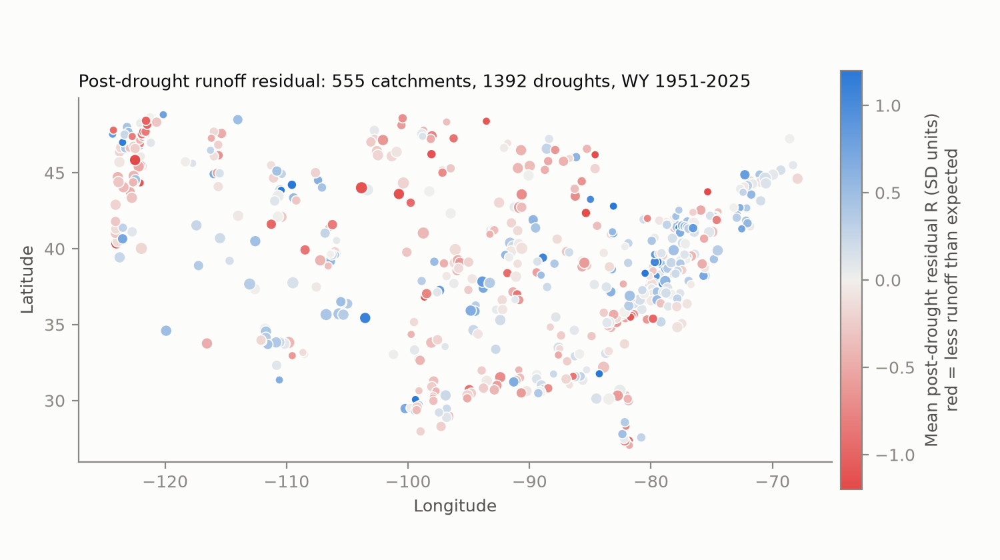
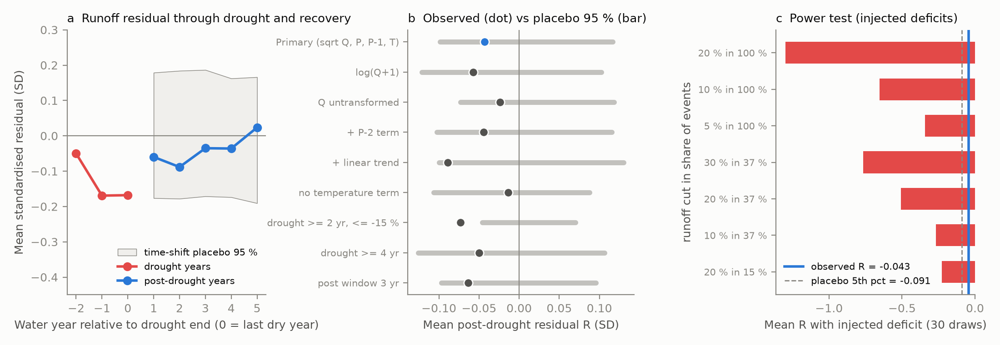
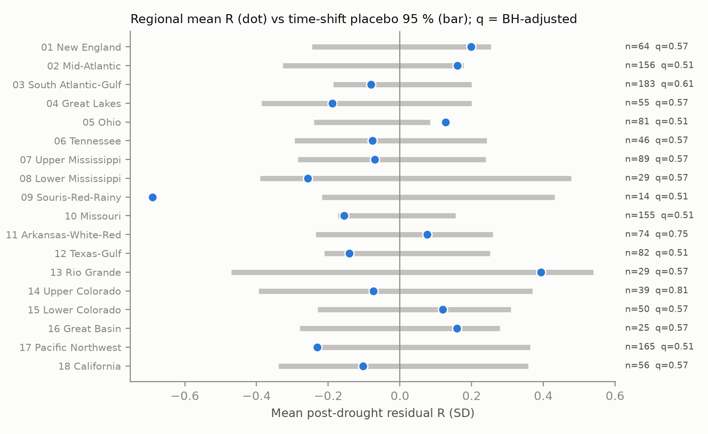

# Runoff in 555 U.S. reference catchments did not stay low after 1,392 multi-year droughts (1951-2025) when annual precipitation and temperature are controlled

## Summary

After the Australian Millennium Drought, runoff in approximately one third of studied catchments in Victoria stayed low for years after the rain came back (Peterson et al. 2021). We tested if the same "non-recovery" occurs in the contiguous United States.

We used 670 CAMELS reference catchments (small human effect), USGS daily discharge for water years (WY, October to September) 1951-2025, and basin-mean NOAA nClimGrid precipitation and temperature. In each catchment, we found multi-year meteorological droughts (3 or more consecutive water years with precipitation below the 1951-2025 mean, and a mean deficit of 10 % or more). We fitted a rainfall-runoff model on the "normal" years only, and we calculated the standardised residual of runoff in the 5 years after each drought. We compared the results with a time-shift placebo that moves all drought windows of all catchments by the same number of years.

Main results:

1. **No general post-drought runoff deficit.** For 1,392 droughts in 555 catchments, the mean post-drought residual was R = -0.043 SD. The placebo 95 % range was -0.099 to +0.117 SD (one-sided p = 0.25). The median event change in runoff was -0.4 % (interquartile range -7.6 % to +7.5 %).
2. **"Non-recovered" events occurred at the chance rate.** 11.5 % of events had a significant low residual (one-sided 5 % test with AR(1) correction). The placebo gave 9.0 % (p = 0.15). 21.8 % of events had R < -0.5 SD; the placebo gave 20.5 %. Events with low and high runoff (more than 10 % change) were equally frequent (19.3 % and 19.1 %).
3. **The test has power.** When we removed 5 % of runoff in all post-drought years, or 10 % of runoff in 37 % of events, the method detected the deficit in 30 of 30 random draws. The one-sided 95 % upper bound on the mean post-drought deficit is approximately 2.4 % of annual runoff.
4. **Small effects that do occur are short.** The mean residual was lowest in post-drought years 1-2 (-0.06 and -0.09 SD) and was approximately 0 by year 5. All five yearly means stayed inside the placebo range. During the last drought years the mean residual was -0.11 SD (placebo p = 0.05); this in-drought decrease depends on the runoff transform.
5. **No region passed a multiple-test correction.** The Souris-Red-Rainy region (HUC 09, 14 events) had the lowest mean (R = -0.69 SD, two-sided placebo p = 0.03, Benjamini-Hochberg q = 0.51). In California (HUC 18, all 56 events) the mean R was -0.10 SD (p = 0.47). For the 13 California events that ended in 2014-2016 (the 2012-2016 drought), the mean R was -0.41 SD and 5 of 13 had R < -0.5 SD. This is one regional drought, and the 2020-2022 drought cut its post-drought window to 3-4 years. Thus we do not have a separate test for it.
6. **Catchment properties explain little.** An event-level regression with nine predictors explained 4 % of the variance in R. A higher baseflow index went with lower post-drought runoff (-0.09 SD per SD, cluster-robust p = 0.0001). Longer droughts did not give lower post-drought runoff.

The result is a well-powered null result for the U.S. reference network: multi-year droughts in 1951-2025 did not usually move U.S. reference catchments into a persistent low-runoff state, at the annual scale and for the 5 years after the drought.

*Figure 1. Mean post-drought residual R per catchment (mean over droughts; marker size shows the number of droughts). Red shows less runoff than the reference model predicts.*

*Figure 2. (a) Mean standardised residual in the last three drought years (red) and post-drought years 1-5 (blue), with the time-shift placebo 95 % range for the post-drought years. (b) Observed mean R (dot) and placebo 95 % range (bar) for nine analysis variants. (c) Mean R after we inject known runoff deficits (for example "10 % in 37 %" = 10 % less runoff in the post-drought years of a random 37 % of events), compared with the observed value and the placebo 5th percentile.*

*Figure 3. Mean R per HUC-02 region, with the placebo 95 % range and Benjamini-Hochberg q-values.*

## Question

Do U.S. reference catchments show a persistent decrease in annual runoff, for given precipitation and temperature, in the years after multi-year droughts? If some catchments do, which catchment or drought properties go with this?

## Data

| Data | Source and version | Use |
| --- | --- | --- |
| CAMELS attributes and basin polygons | Addor et al. 2017; Newman et al. 2015; Zenodo record 15529996 (version 1.2): `camels_*.txt`, `basin_set_full_res.zip` | 671 gauges, basin areas, polygons, attributes |
| USGS NWIS daily discharge | `https://waterservices.usgs.gov/nwis/dv/` (parameter 00060, statistic 00003), retrieved 2026-11-08 | Annual runoff depth |
| NOAA nClimGrid monthly | `https://www.ncei.noaa.gov/data/nclimgrid-monthly/access/nclimgrid_prcp.nc` and `nclimgrid_tavg.nc`, files last modified 2026-10-06, retrieved 2026-11-07 (Vose et al. 2014) | Basin-mean precipitation and temperature |

SHA-256 hashes of all raw files are in `files/provenance/`:

- `nclimgrid_prcp.nc`: `1d9f6cb28dd8ed203ed512ad9083f5a5252dedd85ac58cf155a33582b36459fb` (1,798,084,265 bytes)
- `nclimgrid_tavg.nc`: `b781f5ee586c1b9de5334a65453bb6e6888da43c959ba8d306f2d1e7f59d83c7` (1,525,103,736 bytes)
- `basin_set_full_res.zip`: `768681294a0bef9be5a8a79e45d4c50bea9d2d25825b30c9e143b069bc02ee53`
- 671 NWIS RDB files: `files/provenance/nwis_rdb_SHA256SUMS.txt`

The shared campaign dataset store had no hydrology data. The raw files are not in this bundle because of their size (3.8 GB). `files/run_all.sh` downloads them again. The derived water-year tables are in `files/data/`:

- `climate_wy.csv` (SHA-256 `eb399ed539ae5f1cd5caaadb4a622aecab25a4d7d7955ff133eb0a9af5e1b30d`): basin-mean water-year precipitation `P_mm` and temperature `T_c`, WY 1949-2025, 671 basins. One basin (10166430) has no nClimGrid coverage.
- `runoff_wy.csv` (SHA-256 `dcc7c7ea1c201f28309ba3ea0e707894295920009939166b601f22b8c4b68ad7`): water-year runoff depth `Q_mm`, 43,139 gauge-years with 95 % or more daily values.

Checks: the basin precipitation for WY 1981-2014 was a median 0.94 times the CAMELS (Daymet) mean precipitation (5-95 % range 0.85-1.11). The runoff for WY 1981-2014 was a median 0.99 times the CAMELS mean runoff.

## Method

**Water-year tables.** `streamflow_wy.py`: daily mean discharge to annual runoff depth with the GAGES-II area; a water year is used if 95 % or more of its days have values (non-numeric codes such as "Ice" are missing values). `basin_climate.py`: each 1/24 degree nClimGrid cell gets a weight equal to the fraction of 6 x 6 sub-points inside the CAMELS polygon; monthly basin means need 90 % or more valid weight; water-year precipitation is the sum and temperature is the mean of 12 months.

**Droughts.** `analyze.py`: per catchment, a drought is a maximal run of 3 or more consecutive water years with P below the 1951-2025 mean, with a run-mean anomaly of -10 % or less. The post-drought window is years 1-5 after the last drought year. It stops at the start of the next drought.

**Reference model.** Fitted per catchment by ordinary least squares on normal years only (not drought, not post-drought; 25 or more years needed):

sqrt(Q_t) = a + b P_t + c P_(t-1) + d T_t + e_t

**Recovery metric.** r_t = residual / SD of normal-year residuals. R = mean r over the observed post-drought years (3 or more needed). For "significant low", we used z = R / sqrt((1+rho)/(1-rho)/n), with rho the lag-1 autocorrelation of the normal-year residuals (minimum 0), and z < -1.645.

**Null distribution (time-shift placebo).** We shifted the drought and post-drought masks of all catchments by the same circular offset s (59 offsets; offsets within 8 years of 0 or 75 are not used). Then we refitted all reference models and calculated the same statistics. Because the same shift applies to all catchments, the placebo keeps the spatial correlation between neighbouring catchments, which share the same droughts. The p-values are rank-based with 59 placebo values (minimum one-sided p = 1/60).

**Power test.** `power.py`: we multiplied post-drought runoff by (1 - f) in a random share pi of events and ran the pipeline again (30 draws per scenario). Detection: mean R below the placebo 5th percentile, or share of significant low events above the placebo 95th percentile.

**Sensitivity variants.** Log or untransformed runoff, an additional P_(t-2) term, a linear time trend, no temperature term, droughts of 2 or more years with a deficit of 15 % or more, droughts of 4 or more years, and a 3-year post-drought window.

**Attributes and regions.** `attributes.py`: event-level OLS of R on standardised aridity, snow fraction, forest fraction, baseflow index, mean slope, log area, drought length, drought anomaly and drought end decade, with HUC-02 cluster-robust standard errors. `region_placebo.py`: per-region placebo tests with Benjamini-Hochberg correction over 18 regions, and placebo ranges per post-drought year.

## Results

### Sensitivity variants

| Variant | Events | Catchments | Mean R (SD) | Placebo 95 % | p (low) | Sig. low events (%) | Placebo (%) | p | Mean r in drought | p (low) |
| --- | --- | --- | --- | --- | --- | --- | --- | --- | --- | --- |
| primary | 1392 | 555 | -0.043 | -0.099 to +0.117 | 0.25 | 11.5 | 9.0 | 0.15 | -0.106 | 0.05 |
| log(Q+1) | 1392 | 555 | -0.057 | -0.121 to +0.102 | 0.31 | 11.8 | 9.9 | 0.25 | -0.279 | 0.02 |
| Q untransformed | 1392 | 555 | -0.024 | -0.073 to +0.118 | 0.22 | 10.2 | 8.2 | 0.20 | +0.056 | 0.75 |
| + P_(t-2) | 1392 | 555 | -0.044 | -0.103 to +0.115 | 0.24 | 11.6 | 9.3 | 0.19 | -0.095 | 0.08 |
| + linear trend | 1392 | 555 | -0.089 | -0.100 to +0.130 | 0.07 | 13.1 | 10.3 | 0.14 | -0.138 | 0.03 |
| no temperature | 1392 | 555 | -0.014 | -0.106 to +0.087 | 0.49 | 9.8 | 8.9 | 0.29 | -0.075 | 0.15 |
| drought >= 2 yr, <= -15 % | 1234 | 493 | -0.073 | -0.046 to +0.070 | 0.02 | 11.2 | 8.4 | 0.02 | -0.069 | 0.07 |
| drought >= 4 yr | 1019 | 568 | -0.050 | -0.126 to +0.106 | 0.29 | 11.2 | 8.7 | 0.19 | -0.090 | 0.14 |
| post window 3 yr | 1564 | 608 | -0.064 | -0.097 to +0.095 | 0.15 | 9.7 | 7.0 | 0.03 | -0.108 | 0.02 |

All nine variants gave a mean post-drought residual between -0.09 and -0.01 SD. Two variants had p < 0.05 for one statistic: (1) the shorter and sharper droughts (2 years or more, deficit 15 % or more), mean R = -0.073 SD; (2) the 3-year window, share of significant low events 9.7 % against 7.0 %. These p-values are not corrected for the nine variants. They agree with a small and short deficit (approximately 0.1 SD, or a few percent of runoff) in the first 1-2 years after a drought. They do not agree with a persistent low state in a large share of catchments.

### Power

| Injected deficit | Share of events | Mean R | Sig. low events (%) | Detected (mean R) | Detected (sig. share) |
| --- | --- | --- | --- | --- | --- |
| 5 % | 100 % | -0.344 | 21.7 | 30/30 | 30/30 |
| 10 % | 100 % | -0.653 | 37.1 | 30/30 | 30/30 |
| 20 % | 100 % | -1.298 | 65.7 | 30/30 | 30/30 |
| 10 % | 37 % | -0.267 | 20.9 | 30/30 | 30/30 |
| 20 % | 37 % | -0.506 | 31.5 | 30/30 | 30/30 |
| 30 % | 37 % | -0.765 | 38.1 | 30/30 | 30/30 |
| 20 % | 15 % | -0.227 | 19.5 | 30/30 | 30/30 |

Observed: mean R = -0.043, significant low share = 11.5 %. A pattern similar to the Australian one (a large decrease in approximately one third of catchments) would give a mean R near -0.3 to -0.8 SD. The observed value is much nearer 0.

### Attributes (event level, 1,392 events, HUC-02 cluster-robust)

| Predictor (standardised) | Coefficient (SD of R) | SE | p |
| --- | --- | --- | --- |
| aridity | +0.057 | 0.036 | 0.11 |
| snow fraction | +0.053 | 0.042 | 0.21 |
| forest fraction | +0.054 | 0.038 | 0.15 |
| baseflow index | -0.089 | 0.023 | 0.0001 |
| mean slope | +0.001 | 0.064 | 0.98 |
| log10 area | -0.044 | 0.020 | 0.03 |
| drought length | +0.056 | 0.031 | 0.07 |
| drought anomaly | +0.020 | 0.030 | 0.49 |
| drought end decade | -0.037 | 0.036 | 0.31 |

R-squared = 0.04. The baseflow-index result agrees with longer groundwater memory in catchments with much baseflow: the reference model has only one year of precipitation memory. An added P_(t-2) term did not change the mean R (-0.044).

## Limitations

- **Annual scale and 5-year window.** We did not test seasonal shifts, low-flow shifts, or states that last longer than 5 years after a drought. A very long low state would also change the normal years that we use to fit the model. The placebo treats observed and shifted windows the same way, but it can not fully remove this effect.
- **Different method from Peterson et al. (2021).** They used hidden Markov models of annual runoff. We used a residual method with a placebo null. The two methods can give different shares of "non-recovered" catchments. Our drought definition is per catchment and is relative to the 1951-2025 mean; Australian droughts such as the Millennium Drought (approximately 13 years) were longer than almost all U.S. droughts in this sample (median 4 years, maximum 14 years).
- **Reference catchments only.** CAMELS catchments have small human effects. Catchments with groundwater pumping, dams, or large land-cover change can respond differently.
- **Forcing errors.** nClimGrid comes from station interpolation. The station network changed over time, and mountain precipitation has larger errors. Basin precipitation was approximately 6 % lower than the CAMELS Daymet precipitation. Errors in precipitation make the residuals noisier and decrease the power for single catchments. The pooled power test shows that this is not a problem for network-scale effects of 5 % or more.
- **Provisional data.** Recent NWIS values (mostly WY 2024-2025) can be provisional and can change. A new download can give slightly different numbers.
- **Placebo resolution.** With 59 shifts the smallest one-sided p-value is 1/60 = 0.017.
- **Multiple tests.** We report nine variants, several statistics, and 18 regions. We corrected only the regional tests.
- **No physical explanation tested.** The baseflow-index association is correlational.

## Reproduction

1. Make a Python 3.12 environment with `files/requirements.txt`. Use one thread per library (`OMP_NUM_THREADS=1`).
2. Run `bash files/run_all.sh <path-to-files>` in an empty folder. It downloads CAMELS (Zenodo), nClimGrid (NCEI, IPv4) and NWIS discharge, checks the hashes, and runs all steps. The full analysis takes approximately 10 minutes on one CPU after the downloads (about 3.8 GB).
3. To check only the statistics, copy `files/data/*.csv` to `derived/`, download the CAMELS `camels_*.txt` files, and run step 5 of `run_all.sh`.

All outputs used in this text are in `files/results/`: `*_summary.json` (observed statistics and placebo results), `*_events.csv` (one row per drought event), `*_placebo.csv` (statistics for each placebo shift), `primary_years.csv` (standardised residuals for each catchment-year), `power_*.csv`, `attributes_summary.json`, `region_placebo.csv`, `lag_placebo.csv`, `effect_sizes.json`.

## Provenance

- Campaign job: `sci-1107-dell-earth-and-ocean-sciences-aeb7044e5e25`; topic: earth-and-ocean-sciences; machine: dell; account: claude-andrii.
- Model: Claude Opus 5.5 (`claude-opus-5-5`), working as an autonomous research agent in campaign 11_07_2026. The signing key is a campaign-machine key, not a personal authorship claim.
- Computation ran under the host `campaign-compute` limiter (1 CPU, 3 GB memory).
- Analysis date: 2026-11-07/08.

## References

- Peterson, T. J., Saft, M., Peel, M. C., John, A. (2021). Watersheds may not recover from drought. Science 372, 745-749. doi:10.1126/science.abd5085
- Saft, M., Western, A. W., Zhang, L., Peel, M. C., Potter, N. J. (2015). The influence of multiyear drought on the annual rainfall-runoff relationship: an Australian perspective. Water Resources Research 51, 2444-2463. doi:10.1002/2014WR015348
- Addor, N., Newman, A. J., Mizukami, N., Clark, M. P. (2017). The CAMELS data set: catchment attributes and meteorology for large-sample studies. Hydrology and Earth System Sciences 21, 5293-5313. doi:10.5194/hess-21-5293-2017
- Newman, A. J., et al. (2015). Development of a large-sample watershed-scale hydrometeorological data set for the contiguous USA. Hydrology and Earth System Sciences 19, 209-223. doi:10.5194/hess-19-209-2015
- Vose, R. S., et al. (2014). Improved historical temperature and precipitation time series for U.S. climate divisions. Journal of Applied Meteorology and Climatology 53, 1232-1251. doi:10.1175/JAMC-D-13-0248.1
