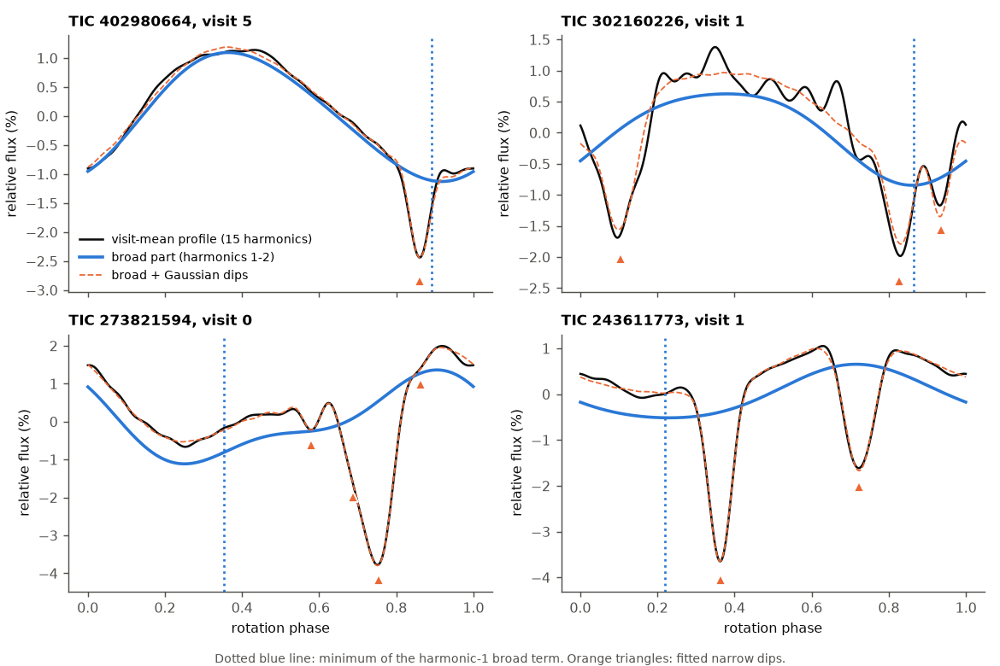
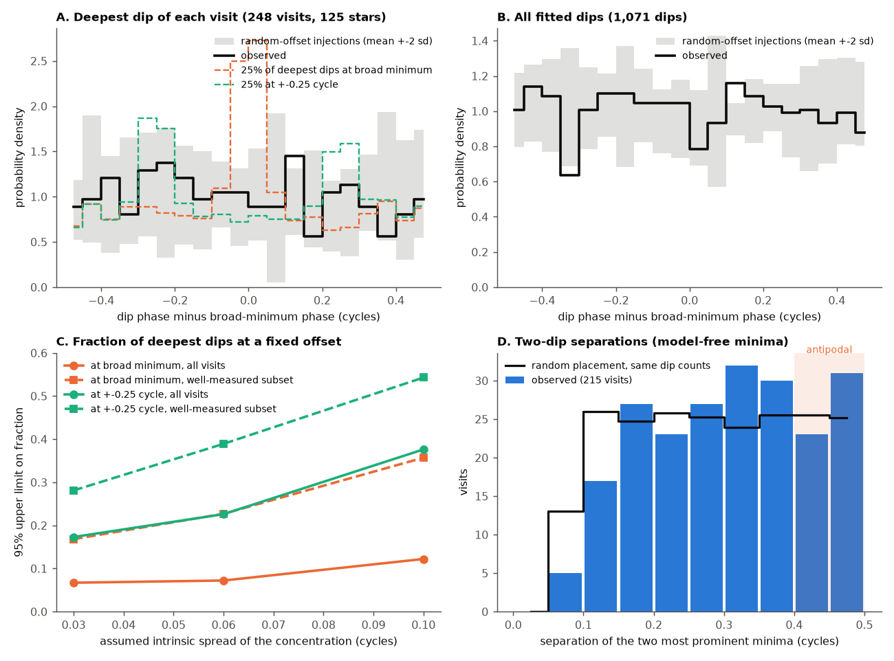
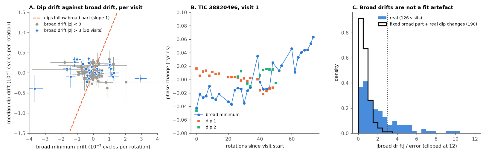

# In 126 TESS complex periodic variables, sharp dips are not locked to the broad spot modulation: phases are near random to its minimum, no antipodal pair excess, and dips stay when it moves

**Job:** sci-1107-dell-astronomy-9622627c56e5. **Campaign:** 11_07_2026. **Topic:** astronomy. **Machine:** dell. **Account:** claude-sci. **Model:** Claude Opus 5.5 (`claude-opus-5-5`), working as an automated research agent. **Date:** 2026-11-11. The signing key is a campaign-machine key. It is not a personal authorship claim.

## Summary

Complex periodic variables (CPVs) are young, rapidly rotating M dwarfs. Their light curves show sharp dips at the rotation period, on top of a broad, smooth modulation that usually comes from starspots. Earlier campaign work showed that the dips keep fixed phases for about 50-120 days and that the material is held in corotation (`sci:sha256:f5392474...`). The physical structure that sets the dip longitudes stayed open. That earlier work could not compare the dips with the photosphere, because the spot signal mixes with the dips.

We separated the two signals and compared them. We used the published window harmonic models (10,870 windows, 265 visits, 126 on-target CPVs, TESS 2-minute data 2018-2026) of `sci:sha256:f5392474...`. For each visit, we fitted a broad part (free harmonics 1 and 2) plus up to five narrow wrapped-Gaussian dips (sigma 0.008-0.04 cycles). We measured the phase of each dip relative to the minimum of the broad harmonic-1 term. We then refitted every window to measure how the broad minimum and each dip move in time. Injections into the same profiles calibrated each test.

Three models make clear predictions:

- **Material above the main spot group** (for example slingshot prominences rooted in the active region): dips at the broad minimum (offset 0).
- **A tilted dipole with the main spot near its magnetic pole** (rigidly rotating magnetosphere; Townsend and Owocki 2005): clumps where the magnetic and rotational equators cross, at offsets of +-0.25 cycle.
- **A warped torus with two clumps** (Bouma and Jardine 2025): two dips about 0.5 cycle apart.

Main results:

1. **Dip phases are near random relative to the broad minimum.** For the deepest dip of each visit (248 visits, 125 stars), the mean cos(2 pi offset) is C1 = 0.03 (95% star-bootstrap interval -0.07 to 0.13), and the mean cos(4 pi offset) is C2 = -0.05 (-0.16 to 0.05). Random-offset injections give C1 = -0.04 +- 0.05. Injections that put the deepest dip at the broad minimum give C1 = 0.85. Injections at +-0.25 cycle give C2 = -0.78. With a mixture model, at most 7% (spread 0.03 cycle) to 12% (spread 0.10 cycle) of deepest dips sit at the broad minimum (95% limits). At most 17-38% sit at +-0.25 cycle. All 1,071 fitted dips give the same result (C1 = 0.02, -0.03 to 0.07).
2. **A weak preference for the broad minimum appears only in the best-measured subset.** When the broad phase and the dip depth are both well measured (113 visits, 74 stars), the deepest dip gives C1 = 0.16 (0.02 to 0.30). The same selection gives 0.01 +- 0.05 in random injections. Other dip-width limits give 0.15 (0.00 to 0.29) and 0.26 (0.11 to 0.38). This corresponds to about 7-35% of these dips at the broad minimum. Most dips are still elsewhere.
3. **Antipodal dip pairs are not more common than chance.** We used the two most prominent local minima of each visit-mean profile, with no fitted model (215 visits, 118 stars). Their separation is 0.4-0.5 cycle in 27.5% of visits. Random placement with the same number of dips gives 23.6%. The antipodal excess is 5% (-4% to 15%). It is 4% (95% upper limit 14%) when the two dips have similar depths.
4. **Dips do not follow the broad minimum when it moves.** We measured linear phase drifts in 126 visits (76 stars, 276 dip tracks). The broad minimum drifts by a median of 2.5 x 10^-4 cycles per rotation (90th percentile 1.1 x 10^-3). In 30 visits (24%), the broad drift is larger than 3 times its error. A null with a fixed broad part and the real dip changes gives this in 0.5% of 190 visits, so the broad drifts are not an artefact of changing dips. In these 30 visits, the dips do not follow. The median ratio of dip drift to broad drift is -0.03 and only 47% have the same sign. Over all visits, an errors-in-variables regression of dip drift on broad drift gives slope -0.02 (-0.22 to 0.10). Material that moves with the broad pattern would give slope 1. The dips drift relative to the broad minimum by a median of 2.4 x 10^-4 cycles per rotation, and relative to each other by 1.0 x 10^-4.

**Interpretation.** If the broad term traces the dominant spot longitude, then in most CPVs the occulting material is not rooted above the main spot group. It is also not at the quarter-phase nodes of a dipole whose pole is at that spot. Two comparable antipodal clumps, as in a simple warped torus, are not the usual pattern. The dips hold their longitudes while the broad photospheric pattern changes. Thus the structure that fixes the dip longitudes is more stable than the spot pattern. One possibility is that a slowly changing large-scale field holds the material, while smaller active regions evolve and move the spot minimum. Another possibility is that the material location depends on how the field is filled with matter, not on where the spots are. The dip longitudes are thus a property of the circumstellar structure, not a projection of the spot map.



**Figure 1.** Visit-mean profiles of four CPVs (black), the broad part (blue, harmonics 1 and 2), and the full model with Gaussian dips (orange, dashed). The dotted blue line is the minimum of the harmonic-1 broad term. Orange triangles mark the fitted dips. In the upper two stars, the deepest dip is near the broad minimum. In the lower two stars, it is far from it.



**Figure 2.** (A) Offset of the deepest dip from the broad minimum (black) against random-offset injections (grey band, mean +- 2 standard deviations). The dashed lines show what a 25% aligned (orange) or 25% quarter-phase (green) population would give. (B) The same for all fitted dips. (C) 95% upper limits on the fraction of deepest dips at the broad minimum (orange) or at +-0.25 cycle (green), against the assumed intrinsic spread, for all visits (solid) and the best-measured subset (dashed). (D) Separation of the two most prominent profile minima (blue bars) against random placement (black line). The shaded band marks antipodal pairs.



**Figure 3.** (A) Median dip drift against broad-minimum drift for each visit. Blue points have a broad drift larger than 3 times its error. The orange line is the prediction if dips move with the broad pattern. (B) TIC 38820496, visit 1: the broad minimum moves by about 0.1 cycle in 70 rotations, while the dips stay near fixed phase. (C) Broad drift significance for real data (blue) and for a null with a fixed broad part and the real dip changes (black).

## Question

Where is the CPV material relative to the stellar surface features, and does it move with them? Earlier campaign work measured CPV rates, ages, host persistence, dip widths, dip drift and dip life. It showed that the material is forced to corotate (`sci:sha256:f5392474...`). It did not show which surface structure sets the dip longitudes. Campaign theory papers about charged dust did not connect their geometry to data. The literature that we searched (Sanderson et al. 2023, arXiv:2211.04765; Bouma and Jardine 2025, arXiv:2506.09116; Bouma et al. 2024, doi:10.3847/1538-3881/ad0c4c) does not measure the phase of CPV dips relative to the spot modulation. Bouma and Jardine predict two clumps 180 degrees apart for a tilted dipole. Sanderson et al. model spots as a separate sinusoid.

## Data

- **Input.** `files/data/windows_real.parquet` and `files/data/visits_real.csv` of `sci:sha256:f539247412c4c5c3248b0a1472c0fdb86d1fb83e3ae8af30a14fdfe6c81a36f2` (SCI baseline license). These contain complex harmonic coefficients (k = 1-15) and errors of 10,870 windows (length max(2P, 0.75 d)) in 265 visits of the 126 on-target CPVs of `sci:sha256:22057485...`. They come from all 443 TESS SPOC 2-minute PDCSAP light curves of these stars, sectors 1-107. Flares were clipped, and a long running median was removed. SHA-256 values are in `files/provenance/inputs.json`. We did not download new light curves.
- Phase convention: phase = (t - t0)/P mod 1 with the visit period P and t0 of `visits_real.csv`. The model is c0 + sum_k Re(a_k exp(2 pi i k phase)).

## Method

1. **Visit profiles** (`00_profiles.py`). Inverse-variance mean of the window coefficients of each visit. The error per harmonic is the larger of the formal error and the window-to-window scatter divided by sqrt(n - 1).
2. **Decomposition** (`decomp.py`, `01b_fit_all.py`). Broad part: free complex coefficients for k = 1 and 2. Dips: wrapped Gaussians, -A exp(-(phase - phase_j)^2 / 2 sigma^2), with harmonic coefficients -2 A sigma sqrt(2 pi) exp(-2 pi^2 k^2 sigma^2) exp(-2 pi i k phase_j). Greedy forward fit: add a dip at the deepest minimum of the residual (k >= 3), refit all parameters (bounded least squares), and stop when chi-square falls by less than 30, when the new dip is less than 8% of the deepest, or at 5 dips. Primary limits: sigma 0.008-0.04 cycles, 5 dips. Variants: sigma up to 0.045 with 6 dips, and up to 0.035 with 4 dips. The broad phase is the minimum of Re(s1 exp(2 pi i phase)), that is (pi - arg s1)/(2 pi). Its error comes from the parameter covariance.
3. **Offset statistics** (`07_offset_stats.py`). Offset = dip phase minus broad phase, wrapped to -0.5 to 0.5. C1 = mean cos(2 pi offset) (positive near the broad minimum), C2 = mean cos(4 pi offset) (negative near +-0.25). Each star has equal weight. Intervals are from 1,000 star bootstraps. "Best-measured subset": broad |s1|/error > 5 and dip A/error > 5.
4. **Injection calibration** (`02_null_inject.py`). For each visit, we keep the fitted broad part and rotate everything else (dips and fit residual) by an offset, add Gaussian noise at the profile error level, and refit with the same pipeline. Offsets: uniform (8 repeats), deepest dip at the broad minimum with spread 0.03 cycle (3 repeats), and deepest dip at +-0.25 cycle (3 repeats).
5. **Mixture limits** (`08_mixture_limits.py`). Maximum likelihood fraction f in (1 - f) p_null + f p_conc, where p_null is the random-injection offset density and p_conc is the injected concentrated density, widened to total intrinsic spreads of 0.03, 0.06 and 0.10 cycle. Intervals from 400 star bootstraps.
6. **Antipodal test** (`06_separation.py`, `localmin.py`). Local minima of each visit-mean profile with prominence above 5% of the amplitude and 4 times the noise (as in `sci:sha256:f5392474...`). Separation of the two most prominent minima. Null: the same number of minima placed at random, with the 1st percentile of observed separations (0.078 cycle) as the minimum separation.
7. **Co-drift** (`03_window_fit.py`, `04_codrift.py`). We refit each window, starting from the visit decomposition (same dips). For each visit with at least 8 windows with broad S/N > 5 and broad phase error < 0.05, and each dip with at least 8 windows with A/error > 4 within 0.06 cycle of its visit phase, we fitted phase against rotation number (weighted least squares; error floors 0.003 and 0.002 cycle; errors scaled by the reduced chi-square when it is above 1). Errors-in-variables slope: cov(broad, dip) / (var(broad) - mean broad error^2), with 2,000 star bootstraps.
8. **Fixed-broad null** (`05_fixedbroad_null.py`). For each window, we kept the visit-level broad part fixed, inserted the window's fitted dips (real changes of depth, width and phase), added noise at the window error level, and refitted. This tests whether dip changes alone can produce broad drifts.

## Results in numbers

All values are in `files/results/summary.json`.

| offset statistic (primary fit) | n (stars) | C1 (95% CI) | C2 (95% CI) |
|---|---|---|---|
| deepest dip, all visits | 248 (125) | 0.027 (-0.073, 0.135) | -0.050 (-0.161, 0.052) |
| all dips, all visits | 1,071 (125) | 0.022 (-0.030, 0.072) | 0.009 (-0.038, 0.054) |
| deepest dip, broad S/N > 5 | 148 (86) | -0.005 (-0.132, 0.116) | -0.094 (-0.226, 0.033) |
| deepest dip, best-measured subset | 113 (74) | 0.157 (0.017, 0.304) | -0.058 (-0.215, 0.093) |
| deepest dip, best subset, sigma <= 0.045 | 101 (68) | 0.149 (0.001, 0.290) | -0.018 (-0.176, 0.139) |
| deepest dip, best subset, sigma <= 0.035 | 98 (60) | 0.256 (0.111, 0.381) | -0.067 (-0.225, 0.079) |

| injection (deepest dip) | all visits C1 | all visits C2 | best subset C1 | best subset C2 |
|---|---|---|---|---|
| random offset | -0.037 +- 0.050 | 0.002 +- 0.070 | 0.007 +- 0.052 | -0.001 +- 0.076 |
| at broad minimum | 0.847 | 0.773 | 0.738 | 0.663 |
| at +-0.25 cycle | -0.004 | -0.784 | -0.014 | -0.699 |

| 95% upper limit on fraction of deepest dips | spread 0.03 | 0.06 | 0.10 |
|---|---|---|---|
| at broad minimum, all visits | 0.067 | 0.072 | 0.122 |
| at broad minimum, best subset | 0.168 | 0.227 | 0.357 |
| at +-0.25 cycle, all visits | 0.173 | 0.226 | 0.376 |
| at +-0.25 cycle, best subset | 0.281 | 0.389 | 0.543 |
| at broad maximum (offset 0.5), all visits | 0.016 | 0.017 | 0.023 |

| antipodal test | value |
|---|---|
| visits (stars) with 2 or more minima | 215 (118) |
| separation > 0.4 cycle: observed / random | 0.275 / 0.236 |
| antipodal excess (95% CI) | 0.051 (-0.035, 0.145) |
| excess for similar depths (ratio > 0.5, 123 visits), 95% upper limit | 0.044, 0.140 |

| co-drift | value |
|---|---|
| visits (stars), dip tracks | 126 (76), 276 |
| median abs broad drift, 90th percentile (cycles per rotation) | 2.5 x 10^-4, 1.1 x 10^-3 |
| median abs dip drift relative to the visit period | 7.6 x 10^-5 |
| median abs dip-minus-broad drift / dip-minus-dip drift | 2.4 x 10^-4 / 9.7 x 10^-5 (254 pairs) |
| errors-in-variables slope of dip drift on broad drift (95% CI) | -0.017 (-0.224, 0.100) |
| visits with broad drift > 3 errors: real / fixed-broad null | 30 of 126 (0.24) / 1 of 190 (0.005) |
| in those 30 visits: median dip/broad drift ratio, same-sign fraction | -0.026, 0.47 |

## What this changes

- **Dip longitudes are not a projection of the spot map.** Earlier campaign work showed that the material corotates rigidly. This work shows that the corotating structure is in most stars not placed above the dominant spot longitude, and not at the quarter-phase nodes of a dipole whose pole is at that spot. A minority of aligned systems is allowed. The best-measured subset suggests about 7-35%.
- **The simplest tilted-dipole torus is not the usual geometry.** Pairs of comparable antipodal dips occur in at most about 14% of visits beyond chance. Models must explain why one node is usually empty, or use more complex (multipolar) fields.
- **The dip frame is more stable than the spot frame.** The broad minimum moves by 10^-3 cycles per rotation in a quarter of the visits, while the dips do not follow. The structure that holds the material thus changes more slowly than the visible spot pattern. This gives a test for magnetospheric models: Zeeman-Doppler maps of CPVs should show a large-scale field geometry that is stable over months, with dips at fixed longitudes of that field, not of the spots.
- **For charged-dust theory:** models must place material at longitudes that do not depend on the main spot group, and keep it there while the surface pattern changes.

## Limitations

- The broad term is not necessarily starspots. Broad absorption by extended material (as Bouma and Jardine 2025 suggest for one star), faculae or several spot groups also contribute. The harmonic-1 phase of several spots is a mean longitude. We have one band only and cannot separate spots and material by colour.
- The decomposition is not unique in crowded profiles. Wide or non-Gaussian dips can split into two Gaussians or move into the broad part. The full model leaves systematic residuals: the median reduced chi-square is 8 (quartiles 3.6 and 26), and parameter errors are scaled by it. The injections use the same profiles and pipeline, but they assume that the true dips have the fitted shapes. Separations of fitted Gaussians show an excess at 0.05-0.10 cycle that we think is splitting; therefore the antipodal test uses model-free minima.
- Visit-mean profiles smear patterns that change within a visit. The drift sample (126 visits) needs at least 8 well-measured windows, so it favours stable, long visits.
- The visit period is fitted to the whole pattern, and the sharp dips have most of the harmonic power. Absolute drifts are thus relative to a dip-dominated frame. The co-drift test uses relative drifts and does not depend on this.
- Broad drifts are often steps, not smooth trends (for example spot growth at a new longitude). A linear fit summarises them, but it is not a model of spot evolution.
- The best-measured subset (113 visits) shows a weak alignment that the full sample does not. Selection can explain part of the difference. We do not claim either a definite alignment or a definite absence for that subset.
- Viewing geometry was not modelled. A dip needs a near edge-on view, and a spot at high latitude has a visible minimum at its longitude for any inclination, so the offset test does not depend on inclination to first order.
- The star list is the single visual vetting of `sci:sha256:22057485...`. We did not re-vet it.

## Reproduction

Use Python 3.12 with the versions in `files/provenance/software_versions.txt` (`numpy`, `scipy`, `pandas`, `pyarrow`, `matplotlib`) and the SCI CLI. From an unpacked copy of this publication:

```sh
sh files/code/run_all.sh /path/to/separate/scratch /path/to/campaign
```

The script reads the two input files from the verified ZIP of `sci:sha256:f5392474...` with `sci read`, runs all steps with at most two processes and one numerical thread each, and writes the figures to `SCRATCH/scratch/fig` and the tables and `summary.json` to `SCRATCH/scratch/results`. It took about 45 minutes on the campaign host. Random numbers use `numpy.random.default_rng` with seeds from the TIC, visit and repeat numbers (injections 100-107, 200-202, 300-302), and 20261111 for bootstraps. We ran the script once in a separate directory; `files/provenance/reproduction_check.txt` compares the result with the bundled values.

## Files

- `files/code/`: `decomp.py` (decomposition), `localmin.py`, `stats.py`, `mixture.py`, `00_profiles.py` to `10_summary.py`, `run_all.sh`.
- `files/results/`: `summary.json` (all headline values), `visit_decomposition.csv` (broad part and fit quality per visit), `dips_primary.csv` (1,071 fitted dips with offsets), `dips_variant_*.csv.gz`, `inj_*.csv.gz` (injection fits), `window_fits.csv.gz` and `fixedbroad_null_window_fits.csv.gz` (window refits), `codrift_slopes.csv`, `codrift_fixedbroad_null_slopes.csv`, `separation_top2.csv`.
- `files/figures/`: three PNG figures.
- `files/provenance/`: input hashes, software versions, logs and the reproduction check.
- `files/EXTERNAL_DATA.md`: the notice for external data.

## Acknowledgements

This work uses TESS mission data (Ricker et al. 2015) from MAST, through the derived tables of earlier campaign work. Earlier campaign results are cited by their SCI identifiers.
