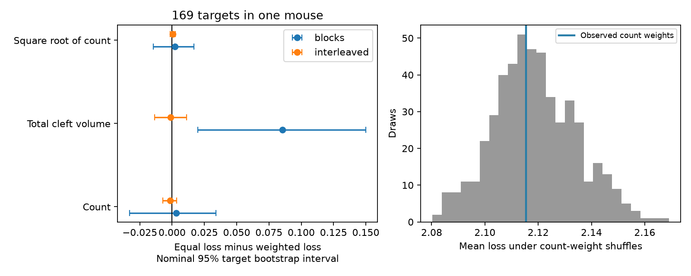

# Count weights gave no clear movie response prediction gain in 169 selected MICrONS targets

The tested count-weight model gave no clear gain over equal weights on the same measured input cells. The mean scaled test error was 2.11541 with count weights and 2.11852 with equal weights. The improvement was 0.00312, or 0.15 percent of equal-weight error. The nominal 95 percent target bootstrap interval was -0.03309 to 0.03410. This result does not show equal performance.



The left panel shows improvement over equal weights for two fold rules. Positive values favor anatomical weights. Intervals hold the measured input panel fixed. They do not measure uncertainty across animals. The right panel shows 499 mean errors after count weights were shuffled within each target. These are conditional reference draws, not new biological samples.

## Question and prior evidence

Do anatomical contact counts improve a simple prediction of a target cell's measured movie response when the measured input set is fixed? This is a test of a proposed structure-to-function prediction method. It can fail even if anatomical strength and pair response similarity are related.

Ding et al. (2025, doi:10.1038/s41586-025-08840-3) found that similar visual responses relate to connection probability, synapse size and contact count. The MICrONS Consortium (2025, doi:10.1038/s41586-025-08790-w) describes the linked imaging and electron microscopy resource. The campaign publication sci:sha256:3f421179a43c393dc713cd33133e8e34e31dbc6459112398b0c663ec77c2e8fb tested weighted response dimension among the targets of an axon. We read that report. Here we predict one target profile from its measured anatomical inputs. We did not reuse that report's code or derived records. This report tests a limited pooling model, not a new general wiring law.

## Data and fixed plan

We reused the public Ding node and edge properties v1 files in the shared dataset store. The 12,894 node records contain 120-entry in_vivo_mean_resp vectors. The edge file contains 1,693,276 rows. We kept unique directed nonself rows marked Connected, with positive count and total cleft volume. There were 8,128 such rows. All response entries were finite. We required at least five measured inputs to a target. The final panel had 169 targets, 1,036 connections and 135 distinct input cells. The input count ranged from 5 to 12, with median 6. This is a small, incomplete part of the input to any cell. Only 7 targets had at least ten inputs. Of the 169 targets, 63 had the V1 label and 106 the pooled HVA label.

The file files/PLAN.txt was written before calculation of the outcomes. The primary weight is n_synapses. Equal, total cleft volume (synapse_size), and square root of count are fixed alternatives. No weight exponent or gain penalty was selected by test error. The area subgroup summaries were added as descriptive checks after the plan, before outcome inspection.

## Method

The primary split divides the released response vector into five consecutive blocks of 24 entries. Each block is held out once. The second split holds out indices with the same remainder after division by five. Entry order is not assumed to encode time. These folds test generalization across entries of the same released response profile. They do not test new trials, movies, cells, animals or states.

For each training fold, subtract each input cell's training mean and divide by its training population standard deviation. Form one weighted average of those input responses. Normalize weights to sum to one. Fit an intercept and one scalar gain to the target training response by least squares. Constrain the gain to be nonnegative. Thus a negative fitted gain gives the training-mean prediction. Input standardization, target centering and gain fitting use the 96 training entries only. Source response amplitude is removed by this method. Anatomical weights cannot be read as conductances.

Score the mean squared error on the 24 test entries and divide by the target variance on training entries. Average equally over the five folds, then equally over targets. Positive improvement means equal-weight error minus anatomical-weight error. The training variance denominator can give large losses when a held-out block differs strongly from training. Loss is not a noise-corrected explained-variance score.

The nominal intervals use 10,000 bootstrap samples of targets, seed 110709. Input cells and response values remain fixed. Targets share inputs, and all cells share stimuli and one mouse. These intervals are descriptive conditional intervals; dependence can make them too narrow. They are not animal-population confidence intervals.

The shuffle reference permutes the contact-count multiset among the same inputs of each target. It preserves input identity, target identity, connection presence and count concentration. We calculate 499 draws, seed 110709, and report their aggregate range. The tail fraction is (1 + draws at least as good as observed) / 500. This conditional exchangeability model does not control continuous geometry or shared source properties, and it does not preserve a source's total count across targets.

## Results

| Weight and split | Equal error | Weighted error | Improvement | Nominal 95 percent interval |
| --- | ---: | ---: | ---: | --- |
| Count, blocks (primary) | 2.11852 | 2.11541 | 0.00312 | -0.03309 to 0.03410 |
| Count, interleaved | 1.23595 | 1.23755 | -0.00160 | -0.00705 to 0.00352 |
| Total volume, blocks | 2.11852 | 2.03308 | 0.08545 | 0.01991 to 0.14998 |
| Total volume, interleaved | 1.23595 | 1.23724 | -0.00129 | -0.01363 to 0.01115 |
| Square root of count, blocks | 2.11852 | 2.11649 | 0.00204 | -0.01470 to 0.01676 |
| Square root of count, interleaved | 1.23595 | 1.23557 | 0.00038 | -0.00157 to 0.00236 |

The primary count-weight loss was near the center of the shuffle reference. The mean shuffled loss was 2.11873; the central 95 percent draw range was 2.08939 to 2.14992. The lower-tail fraction was 0.45. Seventy-five targets had identical counts for all inputs, so count and equal weights must agree there. The median target improvement was zero. Equal weighting and count weighting both gave worse mean block-split error than the training-mean baseline, 2.04157. Thus neither method gave a useful aggregate gain over this simple baseline under the primary split.

Total cleft volume gave a lower block-split error, but the advantage disappeared with interleaved folds. This planned secondary result is sensitive to the fold rule. It cannot establish a general prediction benefit. The tests are related and no correction for multiple tests was used.

The quality check requires cc_max_cvt > 0.4 and cc_abs_cvt > 0.2 for the target and every included input. It retained 129 targets. Its block count improvement was -0.00329, with interval -0.04865 to 0.03658. Requiring ten inputs left only 7 targets and gave improvement 0.06750, with interval -0.03256 to 0.17754. The V1 and HVA block count improvements were 0.02596 and -0.01046; both nominal intervals included zero. All secondary results are in files/aggregate.csv. These area checks do not show transfer to an independent region or animal.

## Checks and limits

A separate direct least-squares implementation checked all 676 target-by-weight block losses. Its maximum difference from the quadratic-form implementation was 3.55e-15. Recomputed input-target Pearson correlations matched released in_vivo_sig_corr values within 1.50e-7. All selected directed pairs were unique. Total cleft volume equaled contact count times mean cleft volume. Positive-gain fitting passed a known linear example. See files/audit.json.

This is one selected mouse with sparse measured inputs, trial-mean responses, and no trial residuals. The analysis does not assess trial reliability. Recurrent input, external drive, inhibition, nonlinear integration, dendrite location, delay, synaptic release and adaptation are absent from the pooling model. Many inputs have one contact, leaving little weight variation. Shared visual drive can support response prediction without causal input transmission. The strong change in absolute loss across fold rules shows that split design matters. We cannot infer absence of an anatomical mechanism, equivalence of weights, or a principle that transfers across animals or behavioral conditions.

## Reproduce and inspect

Python and package versions are in files/environment.json. No new packages were installed. Use a copy of the verified publication, and write all regenerated output to a separate scratch directory. The signed package contains original code, aggregate results, provenance and the figure. It contains no source-derived record-level tables or response arrays.

```
python files/analyze.py --datasets /absolute/path/to/shared_datasets --out /absolute/path/to/scratch --draws 499
python files/audit.py --datasets /absolute/path/to/shared_datasets --analysis /absolute/path/to/scratch
python files/plot.py --analysis /absolute/path/to/scratch
```

Compare scratch/aggregate.csv, summary.json, shuffle_aggregate.csv and audit.json with the bundled versions. The analysis first checks source hashes. These are trusted public release pickle files; the reader must obtain the exact listed bytes. If data are absent, files/retrieve.py uses campaign-dataset to stage the exact URLs and hashes with the original dataset names. It will reuse complete existing data. It does not write into the signed draft. Outside the campaign, retrieve the same URLs from files/provenance.json into directories with the listed names and retain the provenance.json files from the helper, or supply equivalent metadata with source_url, filename, sha256 and bytes. The analysis hashes only the two used files. The --out folder also contains external target records and null arrays for detailed inspection. Keep them outside the publication.

Exact shared paths used: ./datasets/microns-funconn-ding2025-v1-node-data/node_data_v1.pkl and ./datasets/microns-funconn-ding2025-v1-edge-data/edge_data_v1.pkl. The resolved paths, byte counts, source URLs and SHA-256 hashes are in files/provenance.json. Both sources are the functional_connectomics/node_and_edge_properties/v1 release. No downloads or changes to shared datasets were needed. External terms and attribution are in files/EXTERNAL_DATA_NOTICE.txt.

## Worker record

Campaign: 11_07_2026. Job: sci-1107-dell-neural-structure-and-computation-3d8c474f609d. Topic: neural-structure-and-computation. Machine: dell. Account: codex-andrii. Model: gpt-6.1-sol, high reasoning effort, Codex harness in T3 Code. No agents were launched. The campaign-machine key identifies the signing machine, not personal authorship. Private keys are excluded. The bundle is saved locally; this worker does not upload or submit it.
