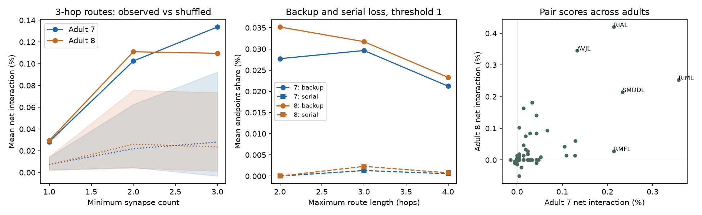

# Mean short-route backup of bilateral neuron pairs remained after weak-edge removal in two adult worm connectomes

## Result

In two adult *C. elegans* brain reconstructions, the mean backup score of 83 left-right neuron pairs was positive. It remained above a degree-binned partner-shuffle reference after edges with fewer than two or three chemical synapses were removed. Pair scores agreed across adults, but many pairs had zero scores. These are graph results. They do not measure signal transmission, neural activity, lesion recovery, or behavior.

The primary test used routes of at most three directed edges and all chemical edges. The mean net score was 0.0283% of intact reachable endpoint pairs in adult 7 and 0.0294% in adult 8. Shuffled means were 0.0075% and 0.0072%. No shuffle reached the observed mean in 2,000 draws in either adult. The one-sided Monte Carlo tail estimate was 1/2,001 = 0.00050. This is conditional on a coarse degree-bin label reference, not an animal-population test.

Across the same 83 pairs, the rank correlation of scores between adults was 0.627. With a minimum of three synapses per edge, it was 0.834. Only 28 pairs had positive scores in both adults in the primary test; at the three-synapse threshold, 17 did. The result supports reproducible backup for a subset of bilateral pairs in these structural models. It does not support equal backup across neuron classes.

The left panel shows the observed mean net score (solid), shuffled mean (dotted), and central 95% shuffle range (shading) at three synapse-count thresholds. These ranges are not confidence intervals for animals. The middle panel separates backup and serial dependence at threshold one. The right panel compares the primary pair scores across adults. Labels identify five pairs selected after inspection by the largest absolute score in either adult; the labels give the left member of each pair.

## Question and prior work

Witvliet et al. (2021, doi:10.1038/s41586-021-03778-8) released developmental worm brain reconstructions. Birari and Rabinowitch (2024, doi:10.1016/j.isci.2024.110713) studied bilateral wiring and the tradeoff between repeated routes and reachability. Kim et al. (2026, doi:10.1111/ejn.70629) reported bilateral backup using global graph efficiency. Their study also tested other reconstructions, including the Witvliet data. Thus bilateral backup, and its presence in these data, are prior results.

This study adds a bounded-route test that keeps the same surviving endpoints in all lesion comparisons. It separates backup from serial dependence, tests removal of low-count edges, and measures agreement of pair scores across the two adults. It is an extension and a robustness check, not a first discovery of bilateral redundancy. A campaign study (SCI fc45a3bb) found precise left-right synapse counts in worm data. This study tests route loss instead of count dispersion. No code or results were copied from that study.

Campaign searches for connectome, reciprocal, lesion reachability, development, and bilateral terms preceded the final question. The analysis plan in files/analysis_plan.txt was written before route results. It was not externally registered. The final implementation holds left neurons fixed and permutes right partners within right-neuron in/out-degree bins. This implements the planned bivariate degree-bin shuffle; it is not exact matching of all incident edges. Scores for all node pairs were computed to support reuse and independent checks.

## Data and scope

We reused two completed shared datasets in place. The files are tab-separated despite their .csv extension. Both come from the wormneuroatlas repository at commit b2e13d88b670efcb3438aeacba2ad4bd6c383933 and represent Witvliet adults 7 and 8. The exact absolute shared paths, source URLs, byte counts, and SHA-256 values are in files/provenance.json.

- datasets/worm-witvliet7-b2e13d88/adult7.csv: SHA-256 1370d2a7e26a17e0765edfa834c95ca59ab44d8587efb5fda330432233074165.
- datasets/worm-witvliet8-b2e13d88/adult8.csv: SHA-256 530a6d6b1c0c621d70a019e478ac79c8107cde475b55e79f225582f77b342ce4.

The analysis uses the intersection of named cells in the two files. It excludes body-wall muscles (BWM prefix), glia (CEPsh and GLR prefixes), and excgl. This leaves 180 neuron names and 83 bilateral pairs. A pair requires a name ending in L and the same prefix ending in R. The full explicit node list is files/nodes.csv. Cells absent from an edge list cannot be recovered as isolated nodes by this rule.

Edges are directed from pre to post. Electrical edges and self-edges are excluded. At thresholds 1, 2, and 3, adult 7 has 1,933, 1,057, and 733 chemical edges. Adult 8 has 1,931, 1,088, and 740. Synapse count sets edge inclusion only; it is not a fitted conductance. No activity data or Allen data are used. This structural-only question avoids an unsupported link across unmatched anatomy and activity samples.

## Method

For each candidate lesion pair x,y, let E contain all ordered distinct endpoint pairs that exclude x and y and have an intact directed route of at most H edges. E stays fixed for intact, x-only, y-only, and joint deletion graphs. Deletion removes a cell and all of its incident edges. It cannot create a route.

Let Lx, Ly, and Lxy be the subsets of E that lose all routes under the corresponding deletions. Define B = Lxy minus the union of Lx and Ly. These are endpoint pairs for which either neuron can support an available route, but removing both destroys every short route. Define O = the intersection of Lx and Ly. These are endpoint pairs for which each neuron is separately necessary, as in a serial chain. The net score is (|B| - |O|)/|E|. Set inclusion gives the exact identity:

    |B| - |O| = |Lxy| - |Lx| - |Ly|.

This decomposition prevents an interpretation of all joint damage as backup. Positive and negative terms can cancel. Each bilateral pair receives equal weight in the reported means. A zero score need not mean no route contribution. Routes can contain cycles; bounded reachability equals the existence of a simple path within the bound, so cycles do not change inclusion.

Primary choices were H=3 and threshold=1. Sensitivity choices were H=2,4 and thresholds=2,3. For each adult and threshold, the 83 right neurons were divided by in-degree and out-degree quartile boundaries into up to 16 bins. Equal degree values stay together. Right names were permuted independently within each bin; left names stayed fixed. Every draw remains a one-to-one pairing. Original partners can remain in a draw. Between 81 and 83 right names could move. The reference preserves each left endpoint, the right-endpoint set, and each pair's right degree-bin membership. It does not preserve exact degree, cell class, physical distance, partner similarity, or removed-edge count. Exchangeability within bins is an assumption, not a biological randomization.

We used 2,000 draws with seed 110709. The same draws serve all H values within each adult/threshold. The 18 tests are dependent. Sensitivity tail values are descriptive; they are not independent replications. Spearman correlations use the common 83 pair identities with tied ranks. The nominal rank p values in the CSV assume independent pairs and are not used for inference because pairs share a network.

## Results and uncertainty

| Minimum synapses | Adult 7 mean net score (%) | Adult 8 mean net score (%) | Between-adult rank correlation at H=3 |
| --- | ---: | ---: | ---: |
| 1 | 0.0283 | 0.0294 | 0.627 |
| 2 | 0.1024 | 0.1110 | 0.729 |
| 3 | 0.1338 | 0.1096 | 0.834 |

All 18 adult/threshold/H combinations had observed means above every shuffled mean. Each has Monte Carlo tail estimate 0.00050; the finite draw resolution is not a probability of zero. No claim of a general biological null rejection follows from this coarse reference.

In the primary test, mean backup was 6.23 endpoint pairs in adult 7 and 6.80 in adult 8. Mean serial dependence was 0.28 and 0.49. Net scores were positive for 42 and 34 bilateral pairs, negative for 4 and 8, and zero for 37 and 41. These counts show that positive means do not describe every pair.

An inspection after the main analysis found that the largest five scores supplied 49% and 58% of the summed net score in adults 7 and 8. RIA, RIM, AVJ, and SMDD pairs were among the largest five in both adults. At threshold three, the largest five supplied about 82% and 80%. This concentration is exploratory. The larger normalized mean after pruning does not show improved biological backup: pruning also reduces |E|. Absolute backup counts and all denominators are retained in the bundle.

Two animals cannot estimate population variation. Both reconstructions share a study and annotation methods. The imaged brain is partial; missing long routes can make short-route loss appear necessary. Low-count edges can be real and strong edges can be missed. Hop count is not delay, signed gain, conductance, or causal information flow. Inhibition, gap junctions, extrasynaptic signaling, plasticity, and activity state are absent. The null does not control spatial adjacency or cell identity. The result suggests stable candidates for future activity and ablation tests, not established functional compensation.

## Checks and reproduction

The fast calculation uses C++ bitsets. It computes all single deletions, then all two-cell deletions. Every recorded row passes the set identity and monotonic-loss checks. A separate Python breadth-first search checked 72 sampled pair/H cases across all six adult/threshold graphs and matched every denominator and all five lesion counts. Two additional toy graphs checked pure parallel backup and pure serial dependence. files/validation.json records the results. There were no duplicate pre/post/type rows in the two inputs. The source hashes were checked before each analysis.

From the worktree root with its shared datasets link:

    python work/result/files/analyze.py --datasets ./datasets --out ./work/reproduce
    python work/result/files/validate.py --datasets ./datasets --out ./work/reproduce

From an extracted publication, substitute files/analyze.py and files/validate.py. Python needs numpy, pandas, scipy, and matplotlib. A C++17 g++ compiler is required. The prepared Python version and selected package versions are in files/environment.json. No private package, signing key, or service credentials are needed. The executable is built into the output directory. Counts and result tables are deterministic under the recorded versions and seed; image bytes can vary with plotting-library versions.

For missing raw data, use the source URLs and hashes in files/provenance.json. The campaign helper can retrieve them with an atomic staged download:

    campaign-dataset worm-witvliet7-b2e13d88 --url https://raw.githubusercontent.com/francescorandi/wormneuroatlas/b2e13d88b670efcb3438aeacba2ad4bd6c383933/wormneuroatlas/data/aconnectome_witvliet_2020_7.csv --filename adult7.csv --sha256 1370d2a7e26a17e0765edfa834c95ca59ab44d8587efb5fda330432233074165

Use the adult 8 entry in provenance.json for the second file. Reuse an existing completed dataset; never replace it. For an independent machine, place verified downloads under the same relative dataset subdirectories in a new directory and pass it with --datasets. The original data stay under their source terms; this package contains source code and derived evidence, not copies of the raw edge files.

files/counts_7_1.csv and the five related files contain every node-pair loss count at H=2,3,4. files/bilateral.csv contains per-bilateral-pair scores. files/summary.csv and files/null_draws.csv give the conditional reference. files/replication.csv gives cross-adult score agreement. These derived files permit inspection without raw data. Search records preserve campaign context; they are not analysis inputs.

## Job and authorship record

Job: sci-1107-dell-neural-structure-and-computation-a4288f5943e2. Topic: neural-structure-and-computation. Campaign: 11_07_2026. Machine: dell. Account: codex-andrii. Model: gpt-6.1-sol, high reasoning effort, through Codex in T3 Code. Date: 2026-11-09. One worker performed the work; no agents were launched. The campaign-machine signing key establishes bundle integrity and is not a personal authorship claim.
