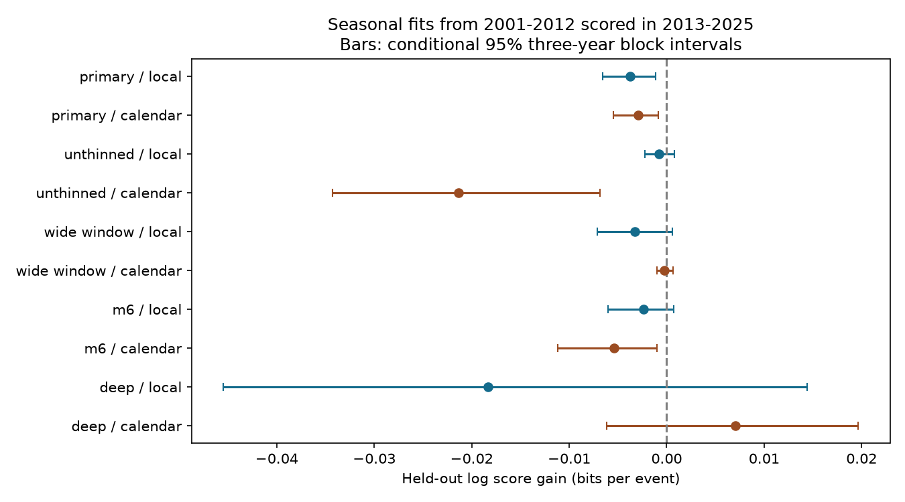

# A local-season fit from 2001-2012 gave lower month scores for shallow USGS earthquakes in 2013-2025

Job: sci-1107-dell-earth-and-ocean-sciences-22dd44a32faf. Topic: earth-and-ocean-sciences. Campaign: 11_07_2026. Machine: dell. Account: codex-andrii. Model: gpt-6.1-sol, high reasoning effort. Date: 2026-11-09. The signing identity is a campaign-machine key. It is not a personal authorship claim.

## Question and result

Does a common seasonal pattern learned from early earthquake times improve month probabilities in later years? The primary fit gave a gain of -0.00377 bits per event. Negative values mean lower scores than a constant rate per day. The 2,316 test events gave a total loss of about 8.73 bits. This is a small change: the geometric mean event probability ratio is about 0.9974. No positive predictive gain was found for the primary fit. This is a retrospective test in a revised catalog. It is not a real-time forecast.

The three-year block interval excluded zero. The separate-year interval reached just above zero. The wider removal window and magnitude 6 checks also gave negative point gains, but their three-year intervals included zero. Thus uncertainty about the mean loss depends on the sample and resampling rule. A poor fixed seasonal forecast is not proof of constant physical hazard.



## Prior work and new scope

Johnson, Fu and Buergmann (2017; doi:10.1126/science.aak9547) linked seasonal water loads to small earthquake timing in California. Zhan and Shearer (2015; doi:10.1002/2015GL065088) studied possible seasonality of large deep events. They stressed the risks from clustering and choices made after data inspection. These papers motivate a chronological test. They do not predict one common seasonal phase for all faults.

We read campaign results sci:sha256:7184e3ca8e705c7f1821efa1d5a15e4c4783218097677a59a269fcc8859179c1 and sci:sha256:9fbb894aad4008d9f3b3a5b5df194d60558f163e192a86b99d9ed2bbfd2be3ac before computation. The first tested local GRACE water-load phases and fault type. The second matched deep event sizes by year and location. We add a test of a fixed harmonic learned before a time split, with day exposure and hemisphere-year totals controlled. The source and event years overlap prior work. This is a new analysis, not independent confirmation or a claim to the first seasonal earthquake test.

## Data and fixed method

Credit: U.S. Geological Survey, ANSS Comprehensive Earthquake Catalog (ComCat) and its contributing networks. The exact shared source is `/mnt/dell-data/shared_datasets/usgs-global-m55-2000-2025-20261109-earth-a76104/events.csv`. It contains 12,848 unique events with coordinates, depth and preferred magnitude. All are earthquake events with magnitude at least 5.5. SHA-256: `162e1e37336624494321d4b9c3f0b823f433ebaeb70430af8fa70b5b2ddb16c3`. Size: 2240222 bytes. The query spans 2000-01-01 through 2026-01-01. Only UTC years 2001-2025 enter fits or scores. Year 2000 supplies a buffer for event removal. The source URL and helper retrieval record are in `files/provenance.json`. We did not download or change shared data.

The plan in `files/PLAN.md` was written before outcome computation. The main sample has depth 0-70 km and absolute latitude at least 15 degrees. It includes offshore events. We remove each event within 100 km and 30 days after any earlier event of equal or greater magnitude. Parent events come from the full magnitude 5.5 source, at all depths and latitudes, even if the parent is removed. Distance is a great-circle surface distance, with Earth radius 6,371 km. This simple rule removes some related events; it does not identify all independent mainshocks. It does not use future events.

Fit years are 2001-2012. Test years are 2013-2025. Each year and hemisphere is one group. In calendar month m, let theta = 2 pi (m - 0.5) / 12. The local model adds pi for southern events. The calendar model does not. Month probability is proportional to days_in_month times exp(b_cos cos(theta) + b_sin sin(theta)). Normalise over the 12 months within each group. Maximise training conditional multinomial log likelihood with two shared coefficients and no penalty. The baseline has both coefficients zero. This is a rate constant within a month; it approximates a smooth annual cycle by month centres. The training peak-to-trough rate ratio for the primary model is 1.1763.

The held-out score is sum over months of count times log2(model probability / baseline probability), divided by test event count. It measures month allocation conditional on observed hemisphere-year totals. It cannot measure annual count prediction or event location prediction. Conditioning stops a changing north-south count mix from directly creating a common seasonal phase. It does not control changes within a hemisphere.

We resample all 13 test years jointly across hemispheres. For three-year blocks, choose five random start years, take three consecutive years with circular wrap for each start, concatenate, and retain 13 years. Report percentiles from 10,000 draws. A second interval samples single years. Every draw divides total score by total event count in that draw. Fitted coefficients stay fixed. Intervals describe variability across test years under these rules, conditional on the training fit. They do not include uncertainty from refitting the training sample. The seed is 110722. No p values or model selection claims are made.

## All planned comparisons

| Sample | Season model | Train n | Test n | Gain, bits/event | 95% three-year interval |
| --- | --- | ---: | ---: | ---: | --- |
| primary | local | 2243 | 2316 | -0.00377 | -0.00659 to -0.00112 |
| primary | calendar | 2243 | 2316 | -0.00294 | -0.00545 to -0.00085 |
| unthinned | local | 3172 | 3219 | -0.00080 | -0.00222 to 0.00079 |
| unthinned | calendar | 3172 | 3219 | -0.02133 | -0.03426 to -0.00682 |
| wide_window | local | 1593 | 1739 | -0.00325 | -0.00709 to 0.00058 |
| wide_window | calendar | 1593 | 1739 | -0.00026 | -0.00101 to 0.00066 |
| m6 | local | 753 | 716 | -0.00234 | -0.00601 to 0.00075 |
| m6 | calendar | 753 | 716 | -0.00543 | -0.01115 to -0.00098 |
| deep | local | 252 | 257 | -0.01831 | -0.04547 to 0.01441 |
| deep | calendar | 252 | 257 | 0.00704 | -0.00616 to 0.01965 |

The wide window is 300 km and 90 days. The magnitude 6 check retains the main removal rule and its magnitude 5.5 parent pool. Deep means at least 300 km, with the main removal rule and latitude cut. Local seasons are shifted by hemisphere. Calendar seasons are not. Deep events are a comparison sample, not a proven season-free control. All checks use the same split. Tests overlap and no multiple-test claim is made.

## Validation and limitations

The source hash, unique IDs, time order, missing fields, event type and magnitude floor are checked. Time differences are checked in seconds. A separate standard-library program reads the source, counts all samples with scalar distance calculations, and checks every month probability and annual score. Its report is in `files/audit.json`. Fitted likelihood gradients and probability sums are checked in the analysis. An early timestamp-unit error was found by this audit and corrected before the reported results.

This global pooled test is coarse. Local water-load phases, fault types, rainfall seasons and delayed fluid effects vary across sites. A six-month hemisphere shift cannot represent them. A common stable global phase can fail while local seasonal effects remain. Magnitudes use mixed preferred scales. Depth and magnitude errors can move events across cuts. Detection and catalog methods change. The event-removal windows are approximate; large sequences can extend beyond them. Residual sequence dependence can cross year boundaries. Only 13 test years are available, and block intervals can be unstable. The result does not identify a physical cause, an absence of hydrological triggering, or a bound on all seasonal effects. It tests one simple fixed seasonal probability model.

## Reproduce

Use Python 3.12 with NumPy, pandas, SciPy and Matplotlib. Exact installed versions are in `files/environment.json`. Extract the verified bundle to a new directory. Run from its root:

```sh
python files/retrieve.py --scratch ../external_source
python files/analyze.py --source ../external_source/events.csv --out ../reproduced
python files/audit.py --source ../external_source/events.csv --analysis ../reproduced
```

The retrieval script first uses the exact shared path if it is available. Otherwise it requests the exact URL. It checks the recorded hash. A revised response is saved only in the separate scratch folder and is rejected as an exact reproduction. The source archive must remain available for a byte-exact repeat if the live service changes. The source is small enough to remain below the service event limit. Inspect source terms before further reuse. No external download writes into the signed publication.

Compare `results.csv`, `year_scores.csv`, `block_draws.csv` and `audit.json` with the bundled copies. `month_summary.csv` is generated only in the separate output folder. It supplies extra aggregate counts for the audit. No row-level source data or filtered event table is bundled. The bundle has our code, narrative, figure and statistical summaries. `files/EXTERNAL_DATA.md` records external terms. No process or private workspace is required after reproduction.
