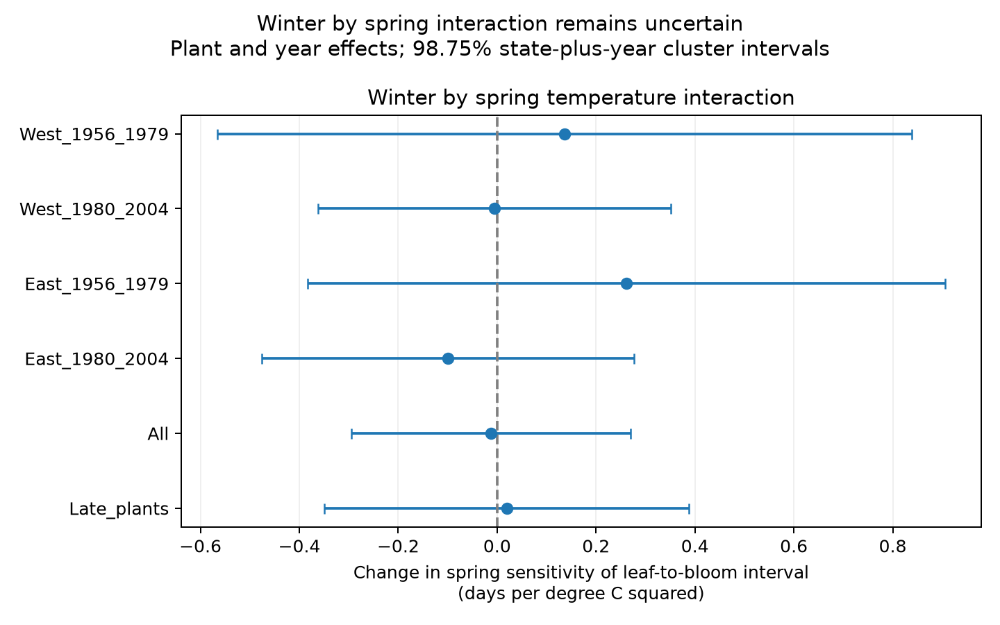

# Winter warmth gave no clear common change in spring leaf-to-bloom slopes in four US shrub samples in 1961-2004

We tested whether winter warmth changes the link between spring temperature and the time from first leaf to first bloom. The four region and period samples did not show a clear common interaction. This result does not show that the interaction is zero. The uncertainty permits changes that could matter for plant timing.

## Question and prior work

Different responses of leaf and flower development can change the order and separation of spring events. We ask whether January-February warmth changes the March-April temperature association with their separation. This is one part of the campaign objective: weather and ecological timing. We do not measure air pollution, extreme weather, species distributions or wild community diversity.

Geng et al. (doi:10.1111/geb.13463) studied different temperature responses of leaf-out and flowering. Work on chilling, forcing and the interval between these events (doi:10.1111/1365-2745.13558) gives a reason to test winter and spring together. Monthly winter temperature is not chilling accumulation. Our test cannot confirm or reject a physiological chilling model.

We searched published campaign results with SCI. The search and selected records are in files/search_notes.json. The closest interval test (SCI c99b37186d53a28610a507f946d107a2ae6c7869f244ac3c442515129d7e0588) used the March-April contrast. The closest winter interaction test (SCI 551302875a5c81f37d7854aa0bbefe4669a61810d9d3573f192717bbbf19b501) used first bloom alone. We add a winter by spring interaction for the paired interval. We rebuild from raw data. These publications share the source archive; agreement is not replication with new data. This study is exploratory, with no external registration. files/design.txt records the question before fit output.

## Data and observation controls

We use USA-NPN lilac and honeysuckle workbook v13, its v14 field guide, and NOAA PSL GHCN-CAMS monthly air temperature version 3.01. The source paper is Rosemartin et al. (doi:10.1038/sdata.2015.38). NOAA PSL, Boulder, Colorado, USA provided temperature data. Exact shared paths, source URLs, byte counts and verified SHA-256 hashes are in files/provenance.json. We did not change shared raw files or download new data.

We select historical Dataset_ID 7 or 8, years 1956-2004, latitude 25-49.5 N and longitude 125-66 W. We stop before a reported 2005 leaf-rule change. Dataset numbers stay as numbers because the field guide and source description differ in their historic network labels. First-bloom definitions also differ by program. The models do not assume that those definitions are the same.

A reporting unit is the combination of program, site, species and individual identifier. Some identifiers can represent plant groups. For each phase we require exactly one record per unit and year. We pair first leaf and first bloom in that year. We require a reported US state for uncertainty estimates. Both dates must be on day 1-220; the bloom-minus-leaf interval must be 0-100 days. Negative intervals are outside this leaf-first scope. Each unit must supply at least 10 paired years in the full selection and at least five in a fitted sample. We keep source outlier flags because a temperature-based flag can remove real weather responses. These restrictions select long and complete records.

The saved panel has 10,114 pairs, 647 reporting units and 454 sites. Species counts are {'36': 3229, '35': 2788, '1198': 2157, '20': 1940}. Species IDs 36 and 35 are common and cloned lilac; 20 and 1198 are Arnold Red and Zabeli honeysuckle. These plants are cultivated indicators, not a random sample of biodiversity. Coordinates are fixed within every source reporting unit in this selected time range.

West is longitude below -100; East is the other sites. The selection periods are 1956-1979 and 1980-2004. The retained paired data start in 1961, so the first period contains records from 1961-1979. These samples use separate records. Units can occur in both periods, weather can covary across regions, and plant types differ by region. They are not four independent experiments. Program, species and fixed site differences enter the unit effect. Unmeasured changes within units remain possible.

files/coverage.csv gives unique-pair coverage among unit-years with either event. The range is 57.7-90.1%. Years with no report cannot enter this denominator. Pairing controls some differences in which units report; it cannot recover missed events or visits. We lack visit histories, care records, plant replacement dates and observer changes. The bounds on dates and intervals also restrict the outcome distribution.

We take temperature from the nearest 0.5-degree cell and convert Kelvin to degrees Celsius. Winter W is the equal-month January-February mean. Spring S is the equal-month March-April mean. These fixed windows avoid a window whose end depends on the observed event. They can still include weather after leaf or bloom. The day-120 bloom fractions are in coverage.csv. Monthly means cannot identify frost, heat waves, daily forcing or winter chilling hours.

## Model and uncertainty

For each sample we fit:

`bloom_day - leaf_day = unit_effect + year_effect + bW*W + bM*March + bA*April + bI*(W-unit_mean_W)*(S-unit_mean_S) + error`.

Means in the product use the observed paired years of each unit within that fit. Separate month main terms allow March and April to have different associations. The interaction uses anomalies within units, rather than differences in mean climate between sites. A positive bI means that winter warmth makes the interval response to uniform spring warmth more positive. Its unit is days per degree Celsius squared. This is a conditional statistical association. It is not an effect of the national warming trend: year effects remove shared annual changes.

Repeated mean subtraction removes unit and year effects, then least squares estimates four coefficients. The independent indicator regression check, full phase-value source check and phase identity check are in files/audit.json. The bloom coefficient minus the leaf coefficient equals the interval coefficient on the same rows. This identity is a calculation check, not independent evidence.

We use state-cluster score variance plus year-cluster score variance, without subtraction of their intersection. Each component has its cluster-count correction. We also multiply by `(N-1)/(N-units-years-3)` to allow for absorbed parameters, assuming a connected unit-year panel. If the panel has more than one connected component, this factor is slightly conservative. We use a t reference with the smaller state or year count minus one degrees of freedom. Adding both covariance components gives wider intervals than the standard subtract-intersection estimate under its assumptions. It does not guarantee correct coverage. Few clusters, unequal cluster sizes and weather dependence across states can make intervals inaccurate.

The four primary interaction intervals are 98.75% intervals: Bonferroni gives nominal 95% family coverage if the individual intervals are valid. Other terms and subgroup fits are descriptive and do not receive an additional family guarantee. The primary tests and the coarse proxy do not establish a biological null.

## Results

| Sample | Pairs | Units | States | Interaction, days/C squared | 98.75% interval |
| --- | ---: | ---: | ---: | ---: | --- |
| West_1956_1979 | 3918 | 407 | 14 | +0.137 | -0.565 to +0.839 |
| West_1980_2004 | 2373 | 264 | 13 | -0.006 | -0.363 to +0.351 |
| East_1956_1979 | 1679 | 166 | 22 | +0.261 | -0.383 to +0.905 |
| East_1980_2004 | 1560 | 145 | 19 | -0.100 | -0.476 to +0.276 |

The coefficients do not establish a clear common interaction across both regions and periods. The full coefficient table includes separate leaf and bloom fits. It also includes pooled, period, program and species fits. These overlap the primary samples and are checks of model scope, not new replications. A late-plant check keeps units with median leaf day at least 91 and median bloom day at least 121. This check reduces typical post-event exposure; it does not ensure that every temperature month ends before every event.

## Limits and next use

The model assumes a common linear interaction within each fit. Missing records, visit error, plant care, different phase rules, spatial weather error and selection can mask or create associations. Fixed effects remove constant reporting differences, but not changes in observation. Winter means do not measure chilling. The interval cannot identify which physiological process changed. Cultivated shrubs cannot establish effects on wild species richness, pollinators or extinction. No causal climate-change or pollution claim follows from this analysis.

A stronger test should use daily temperatures and observed visit histories, retain the same plant types across regions, specify the exposure windows before data inspection, and test new regions or periods. The present panel and code provide a transparent monthly-data check for that work.

## Reproduction and identity

See files/reproduce.txt. The signed bundle preserves the paired panel, code, all estimates, coverage, input hashes, design and calculation checks. A fit-only run uses the saved panel. A full run reads the shared raw files in place. The data files retain their source attribution and terms. The baseline license applies to our code, text, figure and derived outputs.

Job: sci-1107-dell-climate-pollution-biodiversity-636b4d11c265. Topic: climate-pollution-biodiversity. Campaign: 11_07_2026. Machine: dell. Account: codex-andrii. Model: gpt-6.1-sol, high reasoning effort. The campaign-machine key signs the bundle. It does not claim personal authorship. No private key is included. No remote archive or index submission was made.
