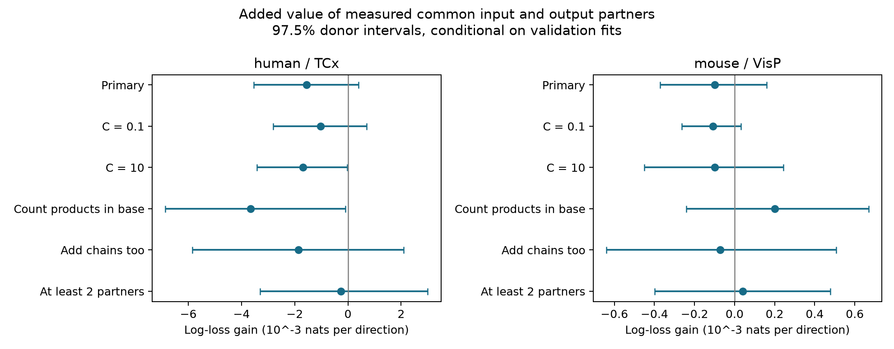
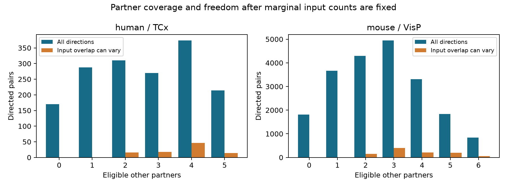

# Common partner counts gave no clear connection prediction gain in selected Allen mouse and human slices

We tested whether common input and output partners improve prediction of a detected chemical connection after other measured wiring features are known. We used Allen Synaptic Physiology r2.1 and excluded whole inferred donors from fitting. The samples had 18,906 mouse VisP directions from 732 inferred donors and 1,456 human TCx directions from 42 inferred donors. Base models used cell labels, distance, probe counts, the reverse call, local marginal connection counts, and recording density. Adding common partner counts gave log-loss gains of -0.000100 and -0.001553 nats per direction. Conditional 97.5% donor intervals were [-0.000371, 0.000161] and [-0.003547, 0.000404]. Neither primary test gave a clear gain. With local marginal counts fixed, either overlap count could vary in only 8.65% of mouse directions and 12.64% of human directions. This is a conditional completion benchmark, not a test of unmeasured whole circuits or neural activity. Sparse overlap, slice detection, inferred donor labels, model choice, and intervals that omit refit uncertainty limit inference. We supply selected calls, predictions, overlap bounds, source hashes, code, figures, and an independent audit.

We tested whether shared input and output partners improve prediction of a directed chemical connection in a donor that was excluded from model fitting. This question matters for circuit models that use local wiring to define cell assemblies. The test asks for added prediction value after measured cell connection counts and reverse connections are known. It does not ask whether shared partners have any biological role.

## Prior work and data link

Perin, Berger, and Markram reported a common neighbor rule in rat cortical pyramidal cells (2011, [doi:10.1073/pnas.1016051108](https://doi.org/10.1073/pnas.1016051108)). Song and colleagues reported nonrandom local cortical wiring (2005, [doi:10.1371/journal.pbio.0030068](https://doi.org/10.1371/journal.pbio.0030068)). These studies motivate the question. Our pooled cell classes and prediction target differ from those studies. This report is not a direct replication of their experiments.

Campagnola, Seeman, and colleagues supplied the Allen connectivity survey (2022, [doi:10.1126/science.abj5861](https://doi.org/10.1126/science.abj5861)). Pair, cell, recording, and slice IDs give exact links within each experiment. No animal or atlas match is needed. A positive call means that a chemical connection was detected in a slice recording. It is a physiological transmission measurement. It is not an anatomical synapse count or an in vivo activity measurement. The [Allen data registry](https://registry.opendata.aws/allen-synphys/) describes the public resource.

We searched the local signed campaign before we chose the precise question. Search records are in files/campaign_search_*.json. We read SCI 414a5fdf7b2bfa816a2edb8d758ac60cdfcffabdec9431c5009649522149c036, which found prediction value in the reverse connection call. We adapted its SQL, selection rule, donor parser, and prediction code. We add shared-partner features, controls for their marginal counts, and an independent feature audit. We also read SCI 83649ada8903f2b1240c58889e37817022d512554e24c848412d290438545ce4. It found little variation in three-cell motif counts after graph constraints in a smaller, different sample. This report uses a larger conditional prediction task and reports local overlap bounds. We do not claim to invent the common neighbor rule, overlap bounds, or logistic regression.

## Selection and inputs

We used Allen Synaptic Physiology r2.1 small, schema 22, dated 2023-01-26. files/query.sql gives the exact table join. Each direction must have an explicit connection call, source and target nonsynaptic classes ex or in, more than 10 correct-sign test spikes, and a positive distance of at most 500 micrometres. Both directions must pass. We use mouse VisP and human TCx. We exclude unknown and mixed classes. Missing Cre and layer labels form an unknown category. The spike rule follows the pinned Allen pair_was_probed definition. We use no pulse train arrays.

There are 115,974 source directions in the two regions. Known calls and classes retain 37,441; spike and distance rules retain 23,649; the reverse-direction rule retains 22,340. The last group has 20,714 mouse directions and 1,626 human directions. The primary test also requires at least one eligible other cell.

For a focal direction a to b, a cell k is eligible only when all four directions a to k, k to a, b to k, and k to b pass selection. Neither a nor b can be k. Let n be the number of eligible cells and Aij be the detected connection from i to j. We compute:

- Four marginal counts: output from a, input to a, output from b, and input to b, within this same eligible set.
- Common input: sum of Aka Akb over eligible k.
- Common output: sum of Aak Abk over eligible k.
- In a separate check, forward and reverse two-edge paths: sum of Aak Akb and sum of Abk Aka.

Every predictor excludes the focal call. The reverse call and all other selected calls in the test donor are deliberately available. This defines completion of one missing call from a partly measured recording. It does not define prediction of a wholly unmeasured circuit. The recording connection rate excludes both focal directions and uses smoothing (other positives + 1)/(other tests + 2).

Donor labels are inferred from lims_specimen_name with the parser used in the prior report: the unique six-digit mouse number or the human Hxx.xx.xxx prefix. All selected names pass. We hash the parsed labels for the exported evidence. These groups are not verified registry donor IDs. Entire inferred donors, recordings, cells, and both pair directions stay within one validation fold.

| Sample | Directions | Unordered pairs | Positive calls | Cells | Recordings | Inferred donors |
|---|---:|---:|---:|---:|---:|---:|
| mouse / VisP | 18,906 | 9,453 | 1,589 | 5,531 | 1,342 | 732 |
| human / TCx | 1,456 | 728 | 130 | 421 | 100 | 42 |

## Prediction and uncertainty

files/plan.txt was saved before the new outcome summaries and model fits. It is an internal exploratory plan, not a public preregistration. We fit separate L2 logistic models in each species-region sample. The base model includes the joint ordered source and target class, Cre, and layer label; distance and its square; log(1 + probing count) in each direction; the reverse call; n; the four local marginal counts; the other-call recording rate; and log(1 + other-call count). The added model includes common input and common output counts. Numeric features are standardized and categories are encoded using training rows only. Unseen categories have zero indicators. Each directed pair has equal weight. There is no class weighting.

Five folds exclude entire inferred donors. Seeds 110711, 110712, and 110713 give three allocations. The primary inverse penalty is C = 1. Checks use C = 0.1 and C = 10. One check adds the four marginal count products divided by n to the base model. These products give expected overlap or path counts under independent placement within the eligible set. That check asks whether actual matching partners help beyond these simple nonlinear count terms. Another check adds both two-edge path counts with common input and output. A final check requires at least two eligible partners and refits with C = 1. The path model was planned as exploratory. Other checks test robustness on the same data.

Gain is base minus added natural-log loss, averaged across the three allocations and directions. Positive gain means better prediction. Brier scores are descriptive. We resample whole inferred donors 5,000 times using seed 1107119. Each draw is the ratio of summed direction gains to summed direction counts. Thus larger sampled recordings and donors receive more weight. We use the 1.25 and 98.75 percentiles to give 97.5% intervals for each of the two primary samples. This applies a Bonferroni interval rule across those two samples. Check intervals are descriptive.

These intervals condition on the fitted validation predictions. They omit model refit uncertainty and dependence through shared training data. They are approximate uncertainty summaries, not exact population bounds. We also supply all 15 fold gains in each setting. Changing the fold allocation, penalty, and predictors does not give independent replications.

## Results and available overlap variation

| Sample | Setting | Directions | Base loss | Added loss | Gain | Conditional 97.5% interval |
|---|---|---:|---:|---:|---:|---|
| mouse | Primary | 18,906 | 0.220621 | 0.220720 | -0.000100 | [-0.000371, 0.000161] |
| mouse | C = 0.1 | 18,906 | 0.224415 | 0.224523 | -0.000108 | [-0.000264, 0.000033] |
| mouse | C = 10 | 18,906 | 0.223905 | 0.224005 | -0.000100 | [-0.000449, 0.000245] |
| mouse | Count products in base | 18,906 | 0.220838 | 0.220638 | 0.000200 | [-0.000241, 0.000669] |
| mouse | Add two-edge paths | 18,906 | 0.220621 | 0.220692 | -0.000071 | [-0.000640, 0.000506] |
| mouse | At least two partners | 15,236 | 0.209744 | 0.209703 | 0.000041 | [-0.000398, 0.000477] |
| human | Primary | 1,456 | 0.291127 | 0.292680 | -0.001553 | [-0.003547, 0.000404] |
| human | C = 0.1 | 1,456 | 0.288574 | 0.289600 | -0.001026 | [-0.002804, 0.000695] |
| human | C = 10 | 1,456 | 0.297199 | 0.298894 | -0.001695 | [-0.003428, -0.000019] |
| human | Count products in base | 1,456 | 0.294065 | 0.297717 | -0.003651 | [-0.006860, -0.000092] |
| human | Add two-edge paths | 1,456 | 0.291127 | 0.292982 | -0.001855 | [-0.005853, 0.002091] |
| human | At least two partners | 1,168 | 0.300783 | 0.301056 | -0.000273 | [-0.003306, 0.003001] |



Neither primary interval excludes zero. The primary Brier score changes from 0.061963 to 0.061970 in mouse and from 0.079246 to 0.079328 in human. These small increases are descriptive. No check has an interval fully above zero. The mouse point estimates become positive with count-product controls and with at least two partners, but their intervals include zero. Human C = 10 and count-product check intervals lie below zero. Those same-data check intervals are descriptive and do not establish that common partners are harmful. The two-partner cohorts have 15,236 directions from 520 inferred mice and 1,168 directions from 30 inferred human donors.

A raw association can coexist with no useful added prediction. In mouse directions, the detected-connection rate is 25.25% with at least one common input, versus 7.65% with none. It is 31.86% with at least one common output, versus 7.53% with none. The human rates are 12.07% versus 8.80% for common input, and 12.96% versus 8.77% for common output. These are pooled descriptive rates without covariate adjustment or independence assumptions. In this comparison the base model already knows the reverse call, measured marginal counts, and other listed inputs. Its controls can remove information carried by shared partners. This result does not show that those controls are biologically prior to shared partners or that they explain a causal mechanism.

For either overlap count, let u and v be the two relevant marginal counts among n partners. The count lies between max(0, u + v - n) and min(u, v). These are elementary set-intersection bounds. When n = 1, overlap equals u times v. Shared partner counts then carry no information beyond a full nonlinear specification of the two marginals. Even with more partners, many sparse marginal configurations fix the overlap at zero.

In the primary mouse sample, common input can vary within these bounds in 1,012 of 18,906 directions, and common output in 864. Either can vary in 1,636 directions (818 unordered pairs), or 8.65%. In the human sample, the counts are 94, 98, and 184 of 1,456 directions (92 unordered pairs), or 12.64%. The other directions have both overlap counts fixed by their local marginals. There are 3,670 mouse and 288 human directions with only one eligible partner. The overlap model can still alter their predictions through a new interaction term; it cannot supply a new partner-matching fact once both marginals are fully specified.



These bounds concern two marginal counts within the local eligible set. They do not hold every other cell's degree or every graph feature fixed. We do not use the number of variable directions as an independent sample size. Both directions of each pair have the same input and output overlap freedom.

## Scope and limits

The contribution is a reproducible conditional completion benchmark and a count of opportunities for overlap to vary. It tests a specific prediction claim on unseen inferred donors. A null or uncertain gain under these models does not refute cell assemblies, the original common neighbor experiment, or a biological effect of shared partners. A small gain would also not identify a circuit growth mechanism.

Only sampled cells in damaged slices are observed. Axon cuts, missed weak connections, recording quality, class selection, and the rule that both directions must pass can change the sample. Probe counts are incomplete controls for detection. Many cell label combinations are sparse. Partner class and partner geometry are pooled; a rule restricted to excitatory partners or one subtype can be missed. The model uses additive common-count effects, with no exhaustive nonlinear or subtype search. Donor inference can be wrong. We did not audit raw waveforms or model call errors.

Mouse and human samples differ in both species and region. They also have different cell composition and sample size. We make no causal species comparison and no claim of transfer across brain areas, laboratories, behavioral conditions, or intact-brain states. The conditional task has access to other test-donor calls. It cannot predict an entire unseen wiring graph without those measurements. No linked spontaneous activity, neural representation, feedback gain, or behavior is tested here. Larger measured circuits with repeated activity or perturbation outcomes are needed for those questions.

## Inspect and reproduce

The raw file remains external to this bundle:

`/mnt/dell-data/shared_datasets/allen_synphys/r2.1_small_2023-01-26/synphys_r2.1_small.sqlite`

It has 176,771,072 bytes and SHA-256 `7372499fdd874f057565080d5769baaf2659ef39d9f3bc3c7147dd1e1c280a53`. Source: https://allen-synphys.s3-us-west-2.amazonaws.com/synphys_r2.1_small.sqlite. Version: r2.1 small, schema 22; S3 Last-Modified 2023-01-26 02:29:36 UTC. The analysis checks the actual bytes and opens SQLite read-only. No raw download or shared data change was needed.

We also inspected the shared connectivity.py file at `/mnt/dell-data/shared_datasets/allen_synphys_graph_definitions/b264d8b61abf11d015222865ca081f80655d33d4/connectivity.py`. Its SHA-256 is `34ce63fc44e715741990724fd8454f6e7da184aaee67836797ca33e43568458e`. files/source_notes.json gives the exact source URL, file size, license, and use. That source commit is not asserted to be the database build commit. No upstream Allen code is redistributed.

If the raw file is absent, use the locked campaign helper under an unused dataset name:

```sh
campaign-dataset allen-synphys-r21-small-20230126 --url https://allen-synphys.s3-us-west-2.amazonaws.com/synphys_r2.1_small.sqlite --filename synphys_r2.1_small.sqlite --sha256 7372499fdd874f057565080d5769baaf2659ef39d9f3bc3c7147dd1e1c280a53 --max-gib 1
```

From the root of an unpacked publication, Python 3.12.15 and files/requirements.txt specify the recorded environment. A private environment can be used:

```sh
python3 -m venv venv
venv/bin/pip install -r files/requirements.txt
venv/bin/python files/check_evidence.py
OPENBLAS_NUM_THREADS=1 OMP_NUM_THREADS=1 MKL_NUM_THREADS=1 venv/bin/python files/analyze.py --db /path/to/synphys_r2.1_small.sqlite --out reproduced
venv/bin/python files/compare_run.py reproduced
```

files/reproduce.sh gives the same workflow when the current Python already has these packages. The library thread settings make a small regression workload efficient; they are not campaign limits. No service, compute queue, or extra agent is needed. Numerical results, not PNG or gzip bytes, define a successful repeat.

files/evidence/pairs.csv includes all selected directions, including zero-partner rows for the audit. It contains source pair and cell IDs, calls, anonymous donor groups, and every model input. predictions.csv.gz gives every test probability and fold. coefficients.csv gives all numeric feature coefficients. bootstrap.csv.gz gives all 60,000 interval draws. results.csv, fold_scores.csv, raw_rates.csv, and coverage.csv give the result summaries. provenance.json gives the source hash, selection counts, seeds, and software versions.

The independent checker uses explicit partner loops rather than the analysis matrix products. It flips each focal call and verifies that its predictors do not change. It also checks reverse joins, overlap bounds, whole-donor folds, all probabilities and scores, every bootstrap draw, and interval endpoints. The complete audit passed for 22,340 selected directions, 354,642 held-out probabilities, and all 60,000 bootstrap draws. files/validation.json records the result. The first complete audit process ended with status 143 before it returned a report. A retry on the same account completed with exit status zero. The earlier feature-only audit also passed. All scientific model fits completed with no convergence failure. A second full fit from the raw database was not run; the supplied comparator and source recipe support that separate repeat. The primary fold gains were positive in 8 of 15 mouse folds and 6 of 15 human folds. These fold signs are descriptive and do not change the primary score or intervals.

## Attribution and job record

Job: sci-1107-hp-neural-structure-and-computation-d74a5db4e2dd. Topic: neural-structure-and-computation. Campaign: 11_07_2026. Machine: hp. Account: codex-andrii. Model: gpt-6.1-sol, high reasoning effort, through the Codex harness in T3 Code. Date: 2026-11-08 UTC. No agents were used. files/job.json records this information.

Credit the Allen Institute for Brain Science and Campagnola, Seeman, and colleagues for the measurements. Original data retain the [Allen terms](https://alleninstitute.org/legal/terms-use/). The SCI baseline license applies to our new text, code, figures, and derived evidence to the extent allowed by source terms. It does not replace source terms. The prior SCI code was adapted under its MIT terms. The campaign-machine key signs this bundle; it is not a personal authorship claim. This publication is stored locally only.
