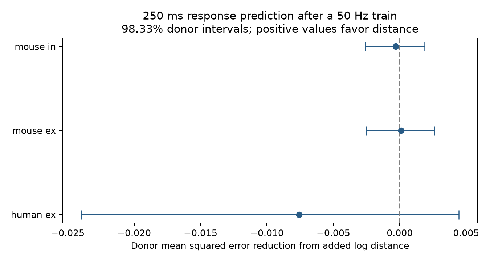

# Distance gave no clear added 250 ms response prediction value in three selected Allen slice groups

Cell-body distance gave no clear prediction gain for the first response after a 250 ms pause in selected Allen cortical connections. The test held whole inferred donors out. It controlled for early and late responses during the same 50 Hz protocol, response scale, and cell labels. All three primary intervals included zero. This result limits one conditional prediction rule. It does not show that distance has no biological effect.

Points show equal-donor mean squared error reductions from adding log distance. Positive values favor distance. Bars show nominal 98.33% donor bootstrap intervals. They hold fitted predictions fixed and do not include model fitting or source fit uncertainty. Units are squared normalized response amplitude.

## Question and prior work

Circuit models need both wiring and a response rule for each connection. We ask whether cell-body separation predicts the response after recent activity when the response during that activity is known.

Campagnola, Seeman, and colleagues (Science 2022, doi:10.1126/science.abj5861) measured connectivity and synaptic dynamics in mouse and human cortex. They reported cell-class dependence of dynamics. Seeman and colleagues (eLife 2018, doi:10.7554/eLife.37349) described class and distance dependence of recurrent connectivity. These studies motivate the question but do not establish the conditional rule tested here.

We searched campaign publications for connectome, electrical coupling, paired pulse similarity, plasticity, recovery distance, and recovery before modeling. We read the paired-pause recovery report (SCI 1bd3e107) and the axon-label prediction report (SCI 1c66112e). The first showed why recovery measures must retain stimulus frequency. The second tested axon labels for train responses. Our question concerns distance and a post-train response. We reused no prior code or numeric tables. This is an exploratory benchmark, not an externally registered study. The plan preceded outcome modeling and is in files/analysis_plan.txt.

## Data and link

The database was read in place:
 /mnt/dell-data/shared_datasets/allen_synphys/r2.1_small_2023-01-26/synphys_r2.1_small.sqlite

Source: https://allen-synphys.s3-us-west-2.amazonaws.com/synphys_r2.1_small.sqlite .
Version: r2.1 small, schema 22, last modified 2023-01-26. Size: 176771072 bytes.
Checked SHA-256:
7372499fdd874f057565080d5769baaf2659ef39d9f3bc3c7147dd1e1c280a53.

Pair, synapse, dynamics, cell, experiment, and slice IDs link distance and activity for the same cell pair. These are small multipatch physiological graphs in slices, not full anatomical connectomes. We require a detected chemical connection, a monosynaptic row, and passing dynamics QC. We retain mouse VisP and human TCx separately. Species and region differ together.

We inspected dynamics.py and schema_dynamics.py at:
 /mnt/dell-data/shared_datasets/allen_synphys_source/b264d8b61abf11d015222865ca081f80655d33d4/

The database build commit is unknown. This pinned implementation supports field interpretation, but does not validate all source measurements. Exact paths, sizes, and checked hashes for shared files used are in files/source_hashes.json. No shared file was changed. No data were downloaded.

The stored recovery scalar pools frequencies. We instead use the JSON protocol summary for current clamp, exactly 50 Hz and a normalized 0.25 s pause. The source maps measured pauses within 5 ms to standard values. We require exactly one matching entry. We use no pulse-amplitude arrays, which have a documented list-alias error. The selected summaries are calculated directly from pulse-number keys.

There are 2037 region-eligible detected QC connections. Of these, 1847 have one matching protocol entry. There are 823 complete edges after requiring finite early, late, and recovery values, at least five trial summaries for each, positive finite distance, and nonzero finite reference amplitude. All extracted rows and selection flags are preserved. No edge is removed because of response sign or magnitude.

## Response and fixed test

For each trial, the outcome is (A9-A1)/Q. A1 is the first fitted response; A9 is the first fitted response after eight pulses and the pause. Q is a signed amplitude reference: the 90th percentile for excitation and the 10th percentile for inhibition. The protocol summary is a median across trials. Positive values indicate a larger response magnitude than the initial response; negative values indicate a smaller magnitude. This is not a fraction of vesicle recovery or a time constant.

Early response is the median of (A2-A1)/Q. Late response is the median of (median(A6,A7,A8)-A1)/Q. All three measures come from the same protocol. Eligible trial subsets can differ. Shared fits and normalization can relate their errors.

The baseline model uses early response, late response, log absolute Q, and separate source and target Cre, stored target-layer, and nonsynaptic-class labels. Here target-layer is the layer annotation for each cell, including the source. Missing labels become unknown. The extended model adds log cell-body distance in micrometres. This is a spatial proxy, not axon path length or synapse position.

We use ridge regression with penalty 10, an unpenalized intercept, training-fold numeric standardization, and one-hot labels. Unknown validation labels map to zero. Training edges get inverse donor-size weights rescaled to mean one.

Mouse donors use the unique six-digit number in the specimen name. Human donors use the first H-number and the next two dot-separated fields. A slice-ID fallback is specified but was not needed. Donors are inferred, not verified in a donor registry.

For each group, sorted donors are shuffled with NumPy seed 1107 and assigned cyclically to five folds. Every prediction comes from a model that did not train on that donor. Losses are averaged within donors and then equally across donors. Gain is baseline MSE minus extended MSE.

We resample paired donor losses 19999 times with seed 11071108. Percentiles 0.8333 and 99.1667 give nominal 98.3333% intervals, an approximate Bonferroni adjustment for three primary groups. Coverage is not exact. Predictions and folds stay fixed. Primary groups need at least 50 edges and 20 donors. Human inhibition is descriptive.

## Results

| Group | Edges | Donors | Recordings | Baseline MSE | Extended MSE | Gain | 98.33% interval |
|---|---:|---:|---:|---:|---:|---:|---|
| Mouse excitation | 262 | 153 | 188 | 0.094716 | 0.094627 | 0.000090 | -0.002530 to 0.002603 |
| Mouse inhibition | 465 | 226 | 274 | 0.113091 | 0.113388 | -0.000297 | -0.002597 to 0.001875 |
| Human excitation | 85 | 30 | 54 | 0.101636 | 0.109211 | -0.007575 | -0.023983 to 0.004438 |

Relative error reductions are 0.09%, -0.26%, and -7.45%. No primary interval is clearly positive. We set no equivalence margin and do not claim equal performance.

Human inhibition has 11 edges from five donors and five recordings. Its descriptive gain is 0.001348, or 0.82%. It cannot support a general claim. Donor counts across groups overlap.

Distance ranges are 12.2 to 373.7 um for mouse excitation, 12.2 to 577.9 um for mouse inhibition, and 18.4 to 516.7 um for human excitation. These ranges do not imply uniform coverage.

Descriptive checks use penalties 1 and 100, fold seeds 23 and 47, or linear distance. Relative gains range from -1.24% to 0.39% in mouse excitation, -0.65% to 0.45% in mouse inhibition, and -8.10% to 2.31% in human excitation. Signs change with model and folds. These are not added confirmatory tests. Full values are in files/evidence/results.json.

## Limits and scientific use

This is a conditional prediction test. The baseline can absorb distance effects that act through early responses. We tested one simple distance term, not every spatial model. Fixed regularization is reproducible but need not be optimal.

Detection, slice damage, missing summaries, broad cell labels, selected human tissue, and noisy fits limit transfer. The baseline and outcome share amplitude fits and Q. One split and conditional donor intervals omit training uncertainty. Inferred donors may group tissue incorrectly.

These data do not test behavior, population dynamics, or reliable representations directly. They do not establish a common rule across regions. A useful next test would use known donor IDs, balanced protocols, trial-level error estimates, axon path lengths, and a new cohort. The present result cautions against assuming that cell-body separation supplies extra post-train response information once measured train dynamics are known.

## Reproduce and inspect

The package includes code, scalar evidence, fold predictions, donor losses, bootstrap draws, results, hashes, checks, and a static PNG. Raw data and Allen code are not redistributed.

Use Python 3.12 and files/requirements.txt in a private environment. From an extracted publication:

    python files/analyze.py --edges files/evidence/edges.csv --out reproduced
    python files/check_evidence.py
    python files/validate_reproduction.py files/evidence reproduced

For a raw-data run:

    python files/analyze.py --db /mnt/dell-data/shared_datasets/allen_synphys/r2.1_small_2023-01-26/synphys_r2.1_small.sqlite --out reproduced_raw

If data are absent, files/retrieve.py downloads to a new scratch filename and checks the hash. Use the campaign dataset helper to add reusable shared data. The exact query is in analyze.py.

The independent standard-library checker passed selection, linkage, donor-fold, squared-loss, and equal-donor-gain checks. Raw and CSV-only results and all bootstrap arrays agree to tolerance 1e-12. The figure was inspected. Checks do not validate raw response fits, donor identity, or interval coverage.

## Job and attribution

Campaign: 11_07_2026. Job: sci-1107-syam2-neural-structure-and-computation-a378ce81a127.
Topic: neural-structure-and-computation. Machine: syam2. Account: codex-myxtap.
Model: gpt-6.1-sol, high reasoning effort, through the Codex harness in T3 Code.
Date: 2026-11-08. No other agents were launched.

Credit the Allen Institute for Brain Science and the original authors. Source data remain under https://alleninstitute.org/legal/terms-use/ . The baseline license applies to new material only to the extent permitted by source terms. It does not replace those terms. The campaign-machine key is not a personal authorship claim. This publication is local only.
