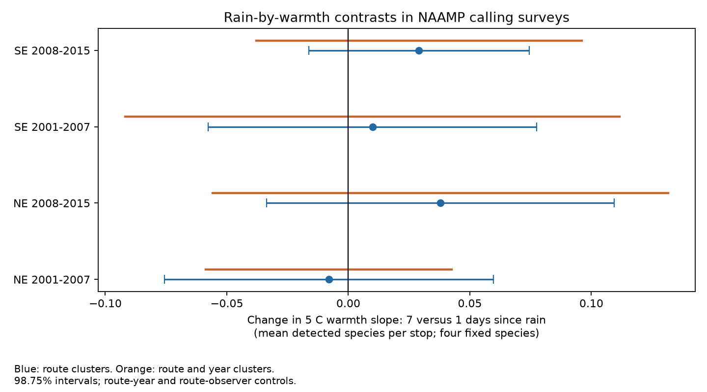

# Rain recency gave no clear warmth slope change in four eastern US frog-call samples in 2001-2015

## Question and result

Does rain recency change the link between survey-night warmth and the number of frog species heard? The four main tests gave no clear repeated change. All four adjusted intervals include zero. These intervals also allow effects that can matter for a calling index. They do not show an absence of weather effects.

| Region | Period | Runs | Routes | Contrast | 98.75% interval | Two-way interval |
|---|---|---:|---:|---:|---|---|
| NE | 2001-2007 | 1194 | 175 | -0.0080 | -0.0757 to +0.0596 | -0.0586 to +0.0425 |
| NE | 2008-2015 | 1401 | 175 | +0.0379 | -0.0337 to +0.1095 | -0.0558 to +0.1316 |
| SE | 2001-2007 | 1409 | 272 | +0.0099 | -0.0576 to +0.0774 | -0.0918 to +0.1117 |
| SE | 2008-2015 | 2569 | 336 | +0.0291 | -0.0163 to +0.0745 | -0.0379 to +0.0961 |

The contrast is the change in the slope for 5 C of warmth between one and seven days since rain. Units are detected species per stop from a fixed set of four species. NE means Northeast. SE means Southeast and Mid-Atlantic. Periods have no common years. Regions have no common routes. The same routes can occur in both periods. The four tests are not four independent data sources.



## Why this test is new

Campaign study sci:sha256:00fa5e9404f5c28c027c79ca3bc0e3ede118a63b563838d41de45d8e4ad459b1 found a link between spring warmth and calling-season timing. It used these source records and these region rules. It did not test rain recency. This study tests a different observation path: rain recency by survey-night warmth. We do not re-test its seasonal-shift claim. Campaign searches included phenology, pollution biodiversity, cherry temperature, ozone warming, North Wales, NAAMP wind and NAAMP rain. The rain search found only that study. The saved rain search is in files/prior_search.json. The small ozone experiment was inspected but not used in this analysis because the campaign already has many tests of it.

Weir and colleagues studied detection and occupancy on Maryland routes in 2005 (USGS publication 5224605). Playback work (doi:10.1002/ece3.4752) found weather effects on acoustic detection. These studies support a need for observation controls; they do not supply an expected interaction size here. USGS survey rules select nights by temperature, wind and rain. Some southern regions required a survey within three days of rain. Thus sampled dry nights are a selected subset.

## Data and sample

Foreman, T. M., Grant, E. H. C., and Weir, L. A. (2017), NAAMP anuran detection data from the eastern and central United States, 1994-2015, doi:10.5066/F7G44NG0. We used Runs.csv, Stops.csv and Counts.csv from the shared store. files/provenance.json gives exact shared paths, source URLs, byte counts and SHA-256 hashes. The source snapshot was added to the store on 12 November 2026 UTC (11 November in local Pacific time). The release metadata state no access or use constraints. files/consulted_metadata.json records the exact metadata path and hash. The metadata and the USGS program page were consulted for interpretation. They are not copied into this bundle.

The main sample has 6,573 runs on 689 routes. The eligible unified-protocol pool had 11,754 runs. Of these, 8,201 had a rain-recency report from 0 to 30 days. The final filters leave 55.9 percent of the pool. files/flow.csv gives counts by region and period. files/reporting.csv gives counts by state and period. Missing rain reports cannot be treated as random. In the full source, Minnesota, Missouri and Michigan have no rain-recency reports. We rejected a Midwest comparison before the model fits.

NE states: Maine, New Hampshire, Vermont, Massachusetts, New York, Pennsylvania and New Jersey. SE states: Delaware, Maryland, Virginia, West Virginia, North Carolina, South Carolina, Georgia, Florida, Tennessee, Kentucky, Alabama, Mississippi, Louisiana and Texas. Not all listed states pass the filters in each period.

Use only unified surveys in 2001-2015 with dates in the stated year, run numbers 1-3, known observer, start wind class 0-3, at least five unskipped stops, valid air temperature at at least 80 percent of those stops, and rain recency 0-30 days. Convert air temperature with the run scale. Keep temperatures from -5 to 40 C. The outcome is the mean number of these four exactly named species heard per unskipped stop: Pseudacris crucifer, Anaxyrus americanus, Lithobates clamitans and Lithobates catesbeianus. Count each species once per stop if CallingIndex is positive. A surveyed stop without a record for one of these species is a non-detection. Complex labels are not assigned to these four species. The fixed species list avoids selection based on fitted effects. It spans early and late callers but does not represent all anurans.

## Method

files/PLAN.md was written before the outcome fits. This is an internal analysis plan, not an independent registration. The added state-specific season curves were a post-fit check. The alternative 0-to-3-day rain contrast in the plan is algebraically the same as the main contrast under this model. It is not a separate test.

Fit a linear model of the mean calling index. Let T=(temperature C-15)/5 and R=log(1+days since rain). Include T, T squared, R, R squared, T times R, a five-df cubic day-of-year spline, categorical start wind, state by run-number effects, route-year effects and route-observer effects. The route-year effects remove fixed annual differences on each route. Route-observer effects remove fixed differences between observers on a route. These controls do not remove all effects of survey choice or within-season population change. Curved main weather terms reduce one source of false interaction. The linear outcome model can predict outside 0-4; it estimates an average association, not a probability model.

The contrast is log(4) times the T-by-R coefficient. We remove fixed effects by repeated group demeaning to a 1e-10 change tolerance, then solve least squares. Redundant constant columns have zero rank after this step. Primary sandwich uncertainty clusters scores by route, with G/(G-1) correction and a t reference with G-1 degrees of freedom. It does not add an absorbed-parameter rank correction. The main intervals have coverage 98.75 percent each to give nominal 95 percent family coverage for four pre-specified tests under the model and cluster assumptions. The two-way check adds route and year score covariance and subtracts route-year covariance. It uses a t reference with years minus one degrees of freedom. Only 7 or 8 years occur per test, so this check is approximate. No interval here accounts for systematic missingness or model bias.

Singleton route-years have no within-year outcome contrast. They remain in the row counts but their fully demeaned rows have zero information. files/design.csv reports their counts. files/support.csv reports temperature by rain-bin counts. Only 90, 102, 73 and 140 runs in the four samples, respectively, have rain recency of at least seven days. The continuous log model borrows information from all recencies. It is not a local randomized comparison at exactly one and seven days.

## Checks and interpretation

All four intervals still cross zero with ten-stop runs, without 2012, with start sky and survey hour, and with state-specific seasonal curves. Without route-year effects, the later SE estimate is +0.0388 with a route-cluster interval from +0.0038 to +0.0739. Its two-way interval crosses zero. This isolated result is not stable to the main annual site control. It does not establish a general interaction. Full estimates are in files/estimates.csv.

An independent fit with explicit sparse dummy columns agrees with all four main estimates to less than 9e-12. A response generated with known coefficients and arbitrary fixed effects recovers the target coefficient to less than 2e-15. These checks test the numerical projection. They do not test ecological assumptions or confidence-interval coverage. Code and results are in files/check_fit.py and files/checks.json.

This null result applies to a selected acoustic index. A run can miss a species because it is absent, silent, distant or masked by noise. These data alone cannot separate those causes. Rain recency is an observer report, not a measure of soil drought, rainfall amount or a regional extreme. Survey-night temperature is not long-term climate change. The periods are short. Seasonal curves may miss local calling peaks. Stop relocation, false positives, water conditions and changing noise can remain. No air-pollution data or climate-trend attribution was tested. Future work should link independent daily rain data, record survey opportunities as well as visits, and use repeat or automated acoustic observations to separate activity from site use. A useful next test is whether missing rain reports depend on independently measured dry spells.

## Reproduce

Use Python 3.12 with numpy, pandas, scipy, patsy and matplotlib. Exact versions are in files/versions.json. From the campaign worktree, run:

```sh
OMP_NUM_THREADS=1 OPENBLAS_NUM_THREADS=1 MKL_NUM_THREADS=1 python work/result/files/analyze.py --store ./datasets --out ./work/reanalysis
python work/result/files/check_fit.py --out ./work/reanalysis
```

From an extracted publication, run files/analyze.py with --store set to the shared dataset root and --out set to a separate scratch folder. If the store is unavailable, files/retrieve.py can fetch the three exact source files to a new external scratch store. It checks their hashes. The script refuses to write into the publication. The remote download was not re-tested because the shared files were available. If a source URL changes, use the DOI release and match the recorded hashes. The analysis writes a record-level panel into scratch for inspection. That panel is not bundled. No code depends on the private worktree surviving. No remote publication or index submission was made by this worker.

## Identity and rights

Job: sci-1107-dell-climate-pollution-biodiversity-fde5f85f2a6b. Topic: climate-pollution-biodiversity. Campaign: 11_07_2026. Machine: dell. Account: codex-olen. Model: gpt-6.1-sol, high reasoning effort. The signing key is a campaign-machine identity. It is not a personal authorship claim. This package contains original code, text, figure and aggregate analysis outputs. Source records remain in the shared store. See files/EXTERNAL_DATA.md for source attribution and external-data terms. The exact SCI baseline LICENSE applies to the bundled work.
