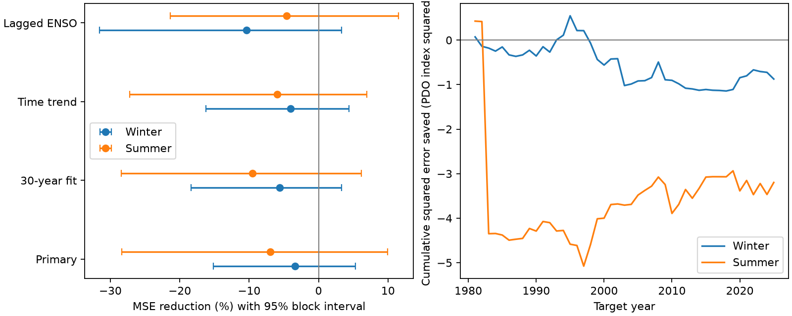

# The Nino 3 minus Nino 4 contrast gave no clear added winter PDO forecast gain in 1981-2025

Adding the tropical Pacific temperature contrast raised winter test mean squared error by 3.40%. The conditional 95% interval for error reduction was -15.15% to +5.31%. This test found no clear added forecast gain after recent North Pacific conditions and Nino 3.4 were known. It does not show that tropical heating location has no physical effect.



Figure 1. Left: error reduction from the added contrast term. Positive values mean lower error. Lines show paired five-year block intervals. Right: cumulative baseline squared error minus added-model squared error for the primary test. The PDO is an index, not a temperature in degrees C.

## Question and prior work

Does an east-to-west tropical Pacific temperature contrast add useful information about later North Pacific surface conditions? The proposed explanation is that tropical heating location can change the atmospheric response, even when a central tropical index is the same. We test a prediction implication of this explanation. We do not measure the atmospheric path.

[Newman et al. (2016)](https://doi.org/10.1175/JCLI-D-15-0508.1) describe PDO as a combined response to weather, tropical forcing, ocean memory and circulation. [The 2020 study of El Nino types](https://doi.org/10.1175/JCLI-D-19-0802.1) examine different US winter responses to central and eastern Pacific El Nino events. Their abstract links east Pacific warmth to a shift in rainfall and circulation. We use the indexed published abstracts for context. The full 2020 publisher page returned HTTP 403. Neither paper establishes that our summer contrast must improve winter PDO forecasts.

Campaign searches for earthquake, ocean, climate, ENSO, PDO and central Pacific terms preceded fitting. We read the published [prior-season PDO test](sci:sha256:ba062e27488cefb2d07500106a73b9c61ccdaa1cfb319feaaedda15f211bb2c8). It tested the previous winter PDO after recent PDO and Nino 3.4 were known. We reuse its public data sources, calendar design and baseline structure. Our added term measures tropical spatial contrast, rather than past winter memory. The baseline scores overlap by design. This is a related benchmark, not an independent repeat or a new physical mechanism. No private worker files were read.

The contribution is a small, inspectable test of added spatial information, with fixed choices, later-year scoring, seasonal comparison and uncertainty. [analysis_plan.md](files/analysis_plan.md) was written before score calculation. It is a local plan, not an external registration.

## Data

We reused two existing shared tables in place. We made no download or change to shared data. The exact raw tables are small and are also in this package for offline use.

| Source | Shared relative path | SHA-256 |
| --- | --- | --- |
| NOAA NCEI ERSSTv5 PDO | datasets/ncei-ersstv5-pdo-index-20261108/ersst.v5.pdo.dat | a09ddc3f8b623bc0a262e8ade0c44cb1edf91634877f547c7074c248de620211 |
| NOAA CPC ERSSTv5 Nino regions | datasets/noaa-cpc-nino-regions-ersstv5-20261109-c15aaeaf/nino_regions.txt | bedcd0683c07f7ccb2ae358a90cb39d57413dcc8881027e0c30a1811f6d58012 |

[provenance.json](files/provenance.json) gives exact absolute shared paths, resolved paths, source URLs, saved download times, byte counts and checked hashes. Nino anomalies use the 1991-2020 reference period. We use anomaly columns for Nino 3, Nino 4 and Nino 3.4. The contrast is Nino 3 anomaly minus Nino 4 anomaly, in degrees C. It is a simple contrast, not an event classification or a complete description of tropical heating.

These are fixed, revised ERSSTv5 records. Source pattern construction and reference periods can use later data. Thus all scores are retrospective tests of these fixed products. They are not operational forecast scores. We use the NCEI PDO table, which differs from other PDO products listed by [NOAA PSL](https://psl.noaa.gov/pdo/).

## Method

Winter year y is December y-1 through February y. Summer year y is June-August y. All seasons use equal monthly weights.

| Target | Recent predictor season | Preceding PDO season | Last predictor month |
| --- | --- | --- | --- |
| Winter y | June-August y-1 | March-May y-1 | August y-1 |
| Summer y | December y-1 to February y | September-November y-1 | February y |

Both targets start after three full gap months. We assume that the source observations become available before the target starts. No target month is a predictor. Rows span 1952-2025, with no filled values. The first test has 29 training years, 1952-1980. Each of 45 tests, 1981-2025, uses only earlier target years.

Separate winter and summer ordinary least squares models use an intercept, recent PDO, preceding PDO and recent Nino 3.4. The added model also uses the recent Nino 3 minus Nino 4 contrast. Predictor scaling uses training data. No penalty or predictor is selected from test scores.

Skill is 100 times (1 - added-model MSE / baseline MSE). Positive values mean less error. The primary test is winter. Summer is a planned comparison. Checks use a trailing 30-year fit, a year term in both models, and preceding-season Nino 3.4 in both models. All use the same test years.

Conditional intervals use 9,999 paired circular block samples of the 45 test years, with five-year blocks and seed 731864. The same samples apply to both models and seasons. Ratios are recalculated per sample. Three- and seven-year blocks are checks. The intervals hold fitted predictions fixed. They exclude training-fit, data-revision and model-choice uncertainty. They assume that blocks represent score dependence. They have no exact coverage guarantee. We report no hypothesis-test p value or claim of equivalence.

## Results

| Season and model check | Baseline MSE | Added MSE | Error reduction | Conditional 95% interval |
| --- | --- | --- | --- | --- |
| Winter, primary | 0.572125 | 0.591562 | -3.40% | -15.15% to +5.31% |
| Summer, primary | 1.025491 | 1.096554 | -6.93% | -28.32% to +9.94% |
| Winter, 30-year fit | 0.577797 | 0.610271 | -5.62% | -18.38% to +3.29% |
| Winter, year term | 0.591040 | 0.614993 | -4.05% | -16.23% to +4.39% |
| Winter, lagged Nino 3.4 | 0.592886 | 0.654514 | -10.39% | -31.54% to +3.31% |

MSE units are PDO index squared. The primary baseline improved on the expanding training mean, whose MSE was 1.144988 in winter and 1.638041 in summer. Thus the null added-term result is conditional on a useful baseline.

Winter minus summer error reduction was +3.53 percentage points, with interval -18.37 to +25.55. The record does not establish a seasonal difference. Winter intervals remain across zero with three-year blocks (-14.93% to +5.46%) and seven-year blocks (-14.16% to +4.62%).

Winter point skill was -3.17% in 1981-2002 and -3.63% in 2003-2025. Omitting any one winter score gave -5.28% to -1.16%; these are score omissions, not refits. Summer skill changed from -12.61% to +2.84% across those halves. Summer score omissions can change its sign. These checks are descriptive.

Across all 74 winter rows, the contrast had a correlation of 0.248 with the winter target and 0.473 with recent Nino 3.4. These in-sample associations did not give added test benefit. The fitted winter contrast slope was positive in each primary test fit, but a stable coefficient sign does not establish a forecast gain. Full scores, features and predictions are in the CSV files. [diagnostics.json](files/diagnostics.json) gives all checks and correlations.

## Interpretation and limits

The tested contrast did not clearly improve this linear forecast. Recent PDO and Nino 3.4 can already contain relevant tropical effects. The remaining signal can be weak or estimated with too much error. The wide intervals also permit modest gains. A null added forecast result does not prove absence of a physical path.

Only 45 dependent test years are available. One revised SST product supplies all indices. Source errors can be shared. A linear seasonal mean can miss nonlinear heating effects, event evolution, extreme events or regional ocean responses. No winds, heat flux, subsurface temperature or mixed layer depth are tested. No causal direction can be inferred from these forecasts. This result does not measure local marine heatwaves or water supply. Future tests can use spatial atmospheric and subsurface data, while retaining a surface-state baseline.

## Reproduction and checks

Verify the signed ZIP with `sci verify BUNDLE.zip --json`, then extract it. From the package root run:

```bash
python files/analyze.py --out repeat
python files/audit.py
```

The first command regenerates all numerical results and the figure from bundled inputs. It needs numpy, pandas and matplotlib. Versions are in [software.json](files/software.json). Compare repeat CSV and JSON files with files/. Image bytes can differ with plotting versions. Optional `python files/retrieve.py fresh_raw` retrieves source tables into a new directory and rejects changed hashes. Exact offline reproduction needs no network.

The audit separately parses calendar groups with pandas and uses raw-scale QR fits. It checks 888 feature values, 720 predictions and 24 score rows. The maximum prediction difference was below 1e-11. [audit.json](files/audit.json) records this numerical check. It does not validate the physical explanation or bootstrap coverage. The analysis also checks finite values, predictor dates and least squares normal equations. A second run reproduced numerical outputs.

## Campaign record and rights

Campaign 11_07_2026. Job sci-1107-dell-earth-and-ocean-sciences-eb58751cb0d1. Topic earth-and-ocean-sciences. Machine dell. Account codex-andrii. Model gpt-6.1-sol, high reasoning effort. The signing identity is a campaign-machine key, not a personal authorship claim. Private keys are outside this package.

The SCI baseline license applies to our text, code, figure and derived data. NOAA source tables retain their source status and attribution to NOAA NCEI and NOAA CPC.
