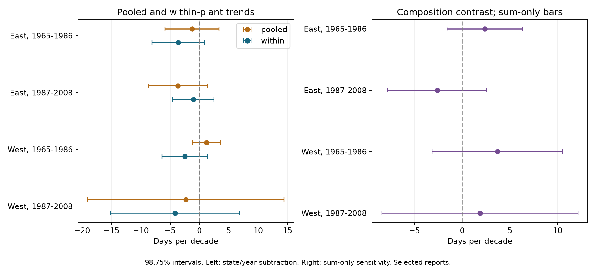
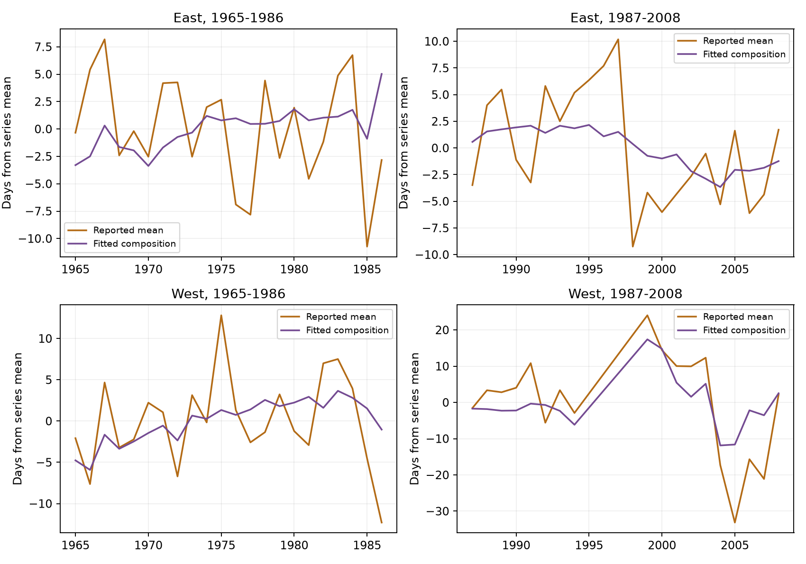

# Pooled and within-plant US lilac bloom trends differed by -2.62 to +3.70 days per decade in 1965-2008

Changes in the plants that supplied records can change an estimated bloom trend. In four selected US lilac samples, the pooled trend minus the within-plant trend ranged from -2.62 to +3.70 days per decade. The early western point estimates had opposite signs. These are fitted differences in this archive, not proof of a bias of that size in a national climate indicator. Statistical support was weak under a conservative uncertainty check. Temperature adjustment reduced the fitted composition component in all four samples.

## Question and prior work

We asked how much the changing set of reporting plants contributed to a linear trend in reported first bloom. This question matters when records from an open observation network are used to describe climate responses. A network can gain or lose plants with different mean bloom dates.

Rosemartin et al. describe these public records and their observation limits (doi:10.1038/sdata.2015.38). Schwartz et al. describe changes in the historical network (doi:10.1890/110281). Thus the general sampling problem is known. Our contribution is a four-sample numerical check, an exact model decomposition, and reproducible evidence for this archive subset. It is not a new estimate of national spring change.

We searched published campaign results before we chose the question. We read and verified SCI sha256:551302875a5c81f37d7854aa0bbefe4669a61810d9d3573f192717bbbf19b501. We use its first-bloom panel and raw-data builder. That study tested winter and spring interactions. The present question concerns reporting composition and linear trends. The observations overlap; this is not independent replication of that study. Search terms and primary sources are in files/search_notes.txt. The design was saved before the trend fits in files/design.txt. The sum-only uncertainty check was added after a negative variance appeared.

## Data and scope

The USA-NPN v13 workbook has 116,662 rows. The source builder selects legacy dataset IDs 7 or 8, first bloom, years 1965-2008, valid US coordinates and state, day of year 1-250, and unique plant-years. It removes all rows in ambiguous plant-years. The plant key joins site, individual, and species. East uses cloned lilac (species 35) at or east of longitude -100. West uses common lilac (species 36) west of that line. These are different plant types. We do not interpret regional differences as species effects.

We split years at 1986 and require at least five reported years per plant within each period. The main analysis has 9,015 plant-years. It does not require leaf or full-bloom reports. It does not fill missing years. Separate regions and periods test repeatability across settings. They share some plants between periods and correlated weather; they are not independent experiments.

files/provenance.json lists the exact shared paths, source URLs, versions, byte counts and SHA-256 hashes. We reuse raw files in place. The signed panel preserves the input to every fit. files/rebuild_check.json records comparison with a new raw-source build. No new data download was needed.

## Method

We fit two models in each sample, with one row per reported plant-year and time in decades:

```
Pooled:        bloom = intercept + pooled_trend * time + error
Within plant: bloom = plant_intercept + within_trend * time + error
```

The second model assumes a common linear trend across the selected plants. A plant intercept controls fixed differences among sites and plants. It cannot control plant age, observer changes, care, or changing visit schedules. Under this additive model, the pooled trend equals the within trend plus the trend in the fitted plant intercepts represented by the changing records. The identity holds exactly because the fitted residual has zero weighted linear time trend. We call the difference the composition contribution. This is a model decomposition, not a causal effect of plants entering or leaving the network. Different plant trends and uneven time coverage can also enter this component.

Primary uncertainty uses paired regression influence scores for the pooled and within estimates. We add state-cluster and year-cluster score covariance, then subtract state-year covariance. Each equation has its own finite sample factor, with its fitted parameter count. We use a t reference with the smaller cluster count minus one. The four primary contrast intervals have 98.75% marginal coverage targets by a Bonferroni rule. This does not give joint coverage for every reported term or sensitivity result.

This covariance estimate can fail with few or unequal clusters. We retain missing intervals when its variance is nonpositive. After this failure, we also report a sum-only check that adds state and year covariance without subtraction. It gives wider intervals here. It is an uncertainty sensitivity check, not a guaranteed coverage procedure. There are only 10-24 state clusters, 18-22 year clusters, and cross-state weather dependence. All intervals are approximate.

Sensitivity fits give each observed year equal total weight, remove flagged reports, require ten or three years per plant, or add seasonal temperature. The weather extension uses the nearest NOAA GHCN CAMS 0.5-degree cell, version 3.01. Spring is March-April; winter is previous December-February. Both are equal-month means in C. This model splits the pooled trend into a remaining time trend, weather contribution, and fitted composition contribution. These monthly windows can extend beyond bloom and are not causal exposures.

## Results

All slopes and intervals below are days per decade. A positive contrast makes the pooled trend later than the within-plant trend.

| Sample | Records / plants | Pooled | Within plant | Composition contrast | Primary contrast interval | Sum-only interval |
| --- | ---: | ---: | ---: | ---: | --- | --- |
| East, 1965-1986 | 2,679 / 220 | -1.25 | -3.61 | +2.36 | +0.39 to +4.33 | -1.58 to +6.31 |
| East, 1987-2008 | 723 / 58 | -3.66 | -1.04 | -2.62 | -7.00 to +1.76 | -7.81 to +2.58 |
| West, 1965-1986 | 5,085 / 503 | +1.22 | -2.48 | +3.70 | Unavailable: nonpositive variance | -3.13 to +10.54 |
| West, 1987-2008 | 528 / 74 | -2.29 | -4.15 | +1.86 | +0.34 to +3.38 | -8.43 to +12.15 |



The point contrast is positive in three samples and negative in one. Two primary contrast intervals exclude zero. All four sum-only intervals include zero. Thus this check does not establish a common population composition effect. The early western sign reversal is a point-estimate diagnostic; neither of its two trend intervals excludes zero. All eight main pooled and within-trend intervals include zero under the stated correction.

Equal year weighting gives contrasts of +2.29, -2.39, +3.35, and +0.88 in table order. Their primary intervals do not establish a contrast in any sample; the early western variance remains nonpositive. With ten reported years required, contrasts are +1.28, -0.91, +1.98, and -2.38. The late western sign changes. These checks show dependence on which plants and years receive weight.

With seasonal temperature included, the fitted composition components are +1.41, +0.10, +1.61, and +0.48. Weather contributions are -0.10, -3.59, -0.48, and +2.34. The remaining time trends are -2.56, -0.17, +0.10, and -5.12. Each set sums to the corresponding pooled trend. We do not attach the pooled-minus-remaining-trend interval to the weather-adjusted composition component: these are different quantities. Much of the unadjusted contrast can reflect weather that covaries with reporting composition. The data do not separate that explanation from nonrandom reporting or model error.



files/results.csv contains all fits and intervals. files/annual.csv contains observed annual mean bloom, fitted mean plant intercept, time component, and residual. The decomposition error is below 2e-13 days per decade. Independent sparse regressions with explicit plant indicators confirm the four main within slopes within 1e-7. These checks establish calculation consistency, not ecological validity.

## Limits and use

These selected long records are not a random sample of US plants. Missing visits and missing plant-years remain unresolved. Some legacy reports can represent groups of plants. Region and plant type are confounded. The late western sample has only 528 records and 18 represented years. Common slopes can hide different plant trends. Composition contrasts do not identify why records appeared or disappeared.

The analysis shows why a pooled archive trend needs a fixed-plant comparison and a weight check. It does not show that the within trend is the true regional trend. It does not measure species distributions, biodiversity loss, daily weather extremes, pollution, or human-caused climate change. It addresses ecological timing and observation bias within the broader research objective. A stronger test needs comparable plants across regions, documented visits and absences, and an external stable monitoring network.

## Reproduction and worker record

See files/REPRODUCE.md for offline fitting and raw-data rebuilding. Code, package versions, source hashes, panel, full results, validation checks and figures are included. The baseline license covers our text, figures, code and derived evidence. Source data retain their original terms.

Campaign: 11_07_2026. Job: sci-1107-dell-climate-pollution-biodiversity-007f6b03874c. Topic: climate-pollution-biodiversity. Machine: dell. Account: codex-andrii. Model: gpt-6.1-sol, high reasoning effort, through T3 Code and the Codex harness. Date: 2026-11-08 UTC. The campaign-machine signature is not a personal authorship claim. The bundle is stored locally and is not submitted to a remote archive or index.
