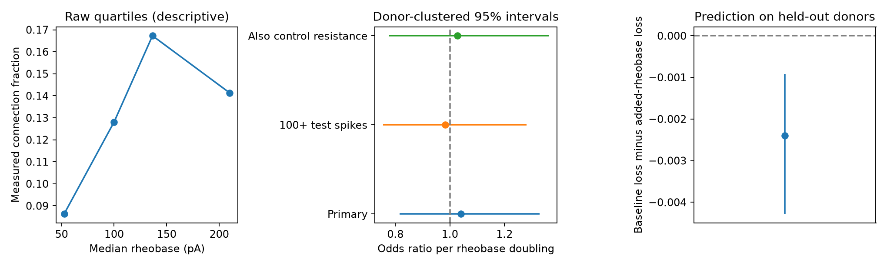

# Target rheobase gave no clear gain in tests of local inhibition in Allen mouse V1 slices

We tested whether an excitatory cell that needs less current to fire is more likely to receive a detected local inhibitory connection. In 1,104 tested pairs, including 144 detected connections, target rheobase showed no clear adjusted association. The odds ratio per doubling of rheobase was 1.040 (95% interval 0.815 to 1.328). The sample contained 548 target cells, 298 slices and 196 inferred animals. Adding rheobase to a fixed prediction model increased mean test log loss from 0.30879 to 0.31119. This result does not support adding this feature to the tested model. It does not rule out other effects of excitability on wiring.



## Question and prior work

Local inhibition can limit the response of an excitatory cell. One possible circuit rule is that cells which fire in response to less current receive more local inhibition. Under that rule, connection probability would fall as target rheobase rises, after other cell and pair features are held fixed. We test this association in directly linked physiology records. We do not test a causal homeostatic mechanism, synapse counts, or representations during behavior.

Campagnola, Seeman and colleagues describe local connectivity and synaptic dynamics in mouse and human cortex (Science 2022, doi:10.1126/science.abj5861). Their data link connection tests and intrinsic measurements by cell ID. Allen methods describe manual detection of chemical connections from average responses and quality checks. The pinned intrinsic schema defines rheobase as current at rheobase, from protocols with one-second steps. It is not a voltage threshold. The source paper establishes the value of this data resource; this report tests a restricted additional association.

We invoked SCI campaign searches for connectome, synphys, and rheobase. All three searches completed. The rheobase search returned three related publications. The broader searches returned a limited first page, so coverage is incomplete. We also searched public bundle titles and abstracts in the campaign, then used sci read to verify and read the related publication ac8be70e. That study found no clear prediction gain from rheobase contrasts for connection direction in selected same-class pairs. Our test uses inhibitory-to-excitatory pairs, includes negative connection tests, and asks about target rheobase rather than a contrast between two same-class cells. We reuse no code or result table from that study. This is an exploratory follow-up, not a claim of first discovery or a systematic review.

## Data and selection

The only raw data input is Allen Synaptic Physiology r2.1 small, schema 22. The exact shared file is `/mnt/dell-data/shared_datasets/allen_synphys/r2.1_small_2023-01-26/synphys_r2.1_small.sqlite`. The SHA-256 is `7372499fdd874f057565080d5769baaf2659ef39d9f3bc3c7147dd1e1c280a53`; size is 176771072 bytes. The hash of the local analysis copy matched this value. The source URL is `https://allen-synphys.s3-us-west-2.amazonaws.com/synphys_r2.1_small.sqlite`; Last-Modified is 2023-01-26. No source file was changed. A local copy improved read speed. No raw database is in this bundle.

These are small functional graphs from multipatch recordings in brain slices. They are not complete anatomical connectomes. A negative test can reflect a cut axon or a response below detection. Thus our outcome is a detected chemical connection, not the presence of an anatomical synapse. Both the circuit test and the intrinsic feature refer to the same target cell.

The code joins pair, cell, experiment, slice and intrinsic tables. The join has 93,104 rows with target intrinsic records. Restriction to mouse, project `mouse V1 coarse matrix`, inhibitory sources and excitatory targets leaves 2,922 rows. Class labels use `cell_class_nonsynaptic` to avoid synaptic evidence in class assignment. We require at least ten inhibitory test spikes, a binary connection call, positive target rheobase, and finite nonnegative distance. This leaves 1,116 rows. We remove 12 rows without a known target layer. Layer 3 is pooled with layer 2/3. The final sample has 1,104 distinct directed pair IDs. All available Cre source labels are retained; missing labels form an unknown category. We do not use pulse-train arrays or their order.

Animal groups are inferred from the six-digit code after a hyphen in mouse specimen names. All final records match this rule. This rule follows the prior campaign method, but the identities are not independently validated against a donor registry. All records of an inferred animal remain in one fold. The package includes pair IDs, cell IDs, slice IDs, specimen names, measurements, and calls, so readers can inspect the selection.

## Models and uncertainty

The main model is binomial logistic regression with an intercept, source Cre class, target layer, distance in units of 100 micrometres, squared distance, log2 inhibitory test-spike count, and log2 target rheobase. The rheobase scale is 100 pA; a unit change is a doubling. We use the square term as a simple smooth distance adjustment. We estimate a 95% Wald interval with covariance clustered by inferred animal. We do not weight animals equally; the estimand describes sampled pairs. We check convergence and full matrix rank.

Two descriptive checks use the same model: require at least 100 test spikes, or add log2 target peak input resistance. The latter check uses only positive finite resistance. It can partly control voltage-response detection and passive cell properties, but it is not a complete detection model. These checks are not independent replications.

| Model | Pairs | Connections | Inferred animals | Odds ratio per rheobase doubling | 95% interval |
|---|---:|---:|---:|---:|---|
| Main | 1104 | 144 | 196 | 1.040 | 0.815 to 1.328 |
| At least 100 test spikes | 868 | 124 | 179 | 0.983 | 0.755 to 1.281 |
| Also adjust resistance | 1078 | 143 | 193 | 1.028 | 0.776 to 1.362 |

The main two-sided Wald p-value is 0.752. These data do not establish a fall in connection probability with rheobase. The interval still permits meaningful changes in the odds. This is not an equivalence test.

For prediction, we compare two logistic ridge models. The baseline uses the same terms except rheobase. The added model includes rheobase. Both use scikit-learn LogisticRegression with C=1 and an intercept. Numeric features are centered and scaled within training folds. Categorical features use indicator columns, with unknown test categories ignored. Five GroupKFold splits keep whole inferred animals out of training. No test score is used to choose the penalty or features. Mean loss weights pairs equally and uses natural logarithms. This single fold allocation and penalty limit the scope of the result.

Baseline test AUC was 0.8152; added-model AUC was 0.8108. Mean loss gain, defined as baseline loss minus added-model loss, was -0.002397 nats per pair. A 5,000-draw bootstrap of inferred animals gave a conditional 95% interval of -0.004280 to -0.000915. We resample animal loss sums and row counts, then take their ratio. This keeps the pair-weighted target. The bootstrap holds fitted predictions fixed. It does not measure uncertainty from new training samples, new folds, or a new tuning procedure. The small adverse gain can reflect estimation error or correlated features; it does not show an opposite biological rule.

The investigation is exploratory. An initial model included both source and target layer terms and produced a rank warning. We removed source layer, pooled target layer 3 with 2/3, and removed unknown target layers before the final fit. We also replaced slice grouping with inferred animal grouping. Initial outputs were discarded. These choices were not preregistered, and the initial numeric results had been seen. The final rank and convergence checks pass.

## Limits and useful next test

Measured local inhibitory connectivity is only one part of inhibitory control. Connection strength, timing, cell state, and dendrite location can matter even when connection probability does not vary with rheobase. Presynaptic Cre class and target layer do not capture all cell subclasses. Age, cell health, slice depth, axon preservation and recording quality can confound this association. Test effort is not detection power. The resistance check does not correct all false negatives. Complete intrinsic records and chosen project membership also select the sample.

The study covers one mouse V1 slice project. It cannot establish a rule across species, regions or behavior. Inferred animal codes can be wrong. Wald intervals assume a suitable logistic mean model and enough independent clusters. The nonlinear relation between rheobase and connection probability was not tested. A stronger follow-up would use validated animal identities, raw-trace detection models, more detailed target classes, and a separate recording cohort. The current package supplies a reproducible benchmark for that test.

## Reproduction

`files/analyze.py` contains table reads, selection, models, validation folds, bootstrap and plotting. `files/cohort.csv` is the exact selected evidence. `files/predictions.csv` gives each held-out probability, fold and loss gain. `files/results.json` records exact estimates and runtime versions. `files/check_evidence.py` checks unique pairs, filters, donor fold separation and scores. `files/validation.txt` records its result. `files/provenance.json` records the job and raw source. The baseline license applies to new work to the extent allowed by source terms; it does not replace Allen data terms at https://alleninstitute.org/legal/terms-use/.

Use Python 3.12 and a private environment with `files/requirements.txt`. From an unpacked bundle, run:

```sh
OPENBLAS_NUM_THREADS=1 OMP_NUM_THREADS=1 python files/analyze.py --db /mnt/dell-data/shared_datasets/allen_synphys/r2.1_small_2023-01-26/synphys_r2.1_small.sqlite --out reproduced
python files/check_evidence.py
```

The analysis checks the raw hash before it reads tables. The second command checks saved evidence without the raw database. To get the source if absent, use a new immutable dataset name with the campaign helper:

```sh
campaign-dataset allen-synphys-r21-small-retrieval --url https://allen-synphys.s3-us-west-2.amazonaws.com/synphys_r2.1_small.sqlite --filename synphys_r2.1_small.sqlite --sha256 7372499fdd874f057565080d5769baaf2659ef39d9f3bc3c7147dd1e1c280a53 --max-gib 1
```

Pass the completed file path to `--db`. Outside the campaign, download the same URL to a local directory and check the same hash. No new shared download was needed here.

## Job record

Job: sci-1107-dell-neural-structure-and-computation-998eed7afc80. Topic: neural-structure-and-computation. Campaign: 11_07_2026. Machine: dell. Account: codex-andrii. Model: gpt-6.1-sol with high reasoning effort, through the Codex harness in T3 Code. Date: 2026-11-08. No child agents were used. Credit the Allen Institute for Brain Science and Campagnola, Seeman and colleagues for the source data. The campaign-machine signature is not a personal authorship claim. This publication is stored locally only.
