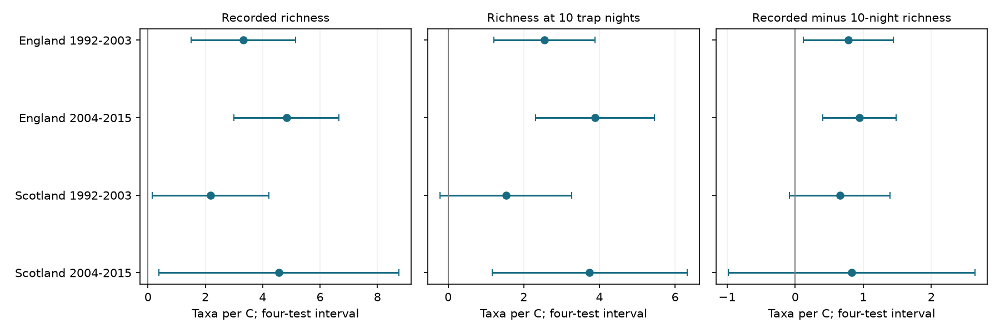

# Ten trap nights retained positive moth richness warmth slopes in three of four British samples in 1992-2015

We tested whether equal trapping effort removed the warmth link to recorded moth richness. We used 685 trap-months from England and Scotland in 1992-2003 and 2004-2015. We calculated expected core taxon richness in ten random observed trap nights. Models controlled trap by month, rainfall, sample count, mean sample date and time. Ten-night slopes were +2.54, +3.88, +1.53 and +3.74 taxa per C. Corrected intervals were above zero in both English samples and later Scotland. The early Scottish interval included zero. Fixed-night slopes exceeded fixed-individual slopes in those same three samples. The two measures answer different questions. Variable night count alone cannot explain the repeated warmth link under this model. Adult activity, capture, abundance and emergence can still explain it. Coarse weather, missing visits, few years and selected catches limit inference. This follow-up reuses one archive and prior campaign records. It does not identify a causal climate or pollution effect. Code, aggregate evidence, source hashes and a retrieval recipe are included.

| Country and period | Trap-months | Recorded richness slope | Ten-night slope | Ten-night minus 100-individual slope |
|---|---:|---:|---:|---:|
| England, 1992-2003 | 300 | +3.33 [+1.51, +5.14] | +2.54 [+1.21, +3.88] | +2.19 [+0.80, +3.57] |
| England, 2004-2015 | 271 | +4.83 [+2.99, +6.66] | +3.88 [+2.31, +5.46] | +3.21 [+1.34, +5.08] |
| Scotland, 1992-2003 | 69 | +2.19 [+0.15, +4.23] | +1.53 [-0.21, +3.27] | +1.49 [-1.90, +4.89] |
| Scotland, 2004-2015 | 45 | +4.57 [+0.39, +8.75] | +3.74 [+1.16, +6.32] | +3.63 [+0.03, +7.23] |

Values are taxa per C. Brackets give 98.75 percent marginal intervals. Correction covers four country-period fits within each outcome. It does not cover all outcomes or sensitivity choices. Three ten-night intervals and three direct night-minus-individual contrast intervals are above zero. Early Scotland remains uncertain.

Figure 1. The first two panels show recorded and ten-night richness slopes. The third shows their direct difference on the same records. Bars use the four-test correction. Raw minus ten-night slopes are positive with intervals above zero in England only. The fixed-night point slopes retain 70-82 percent of the raw slopes. These ratios are descriptive and have no uncertainty interval.

## Question and prior work

Does the positive warmth link to recorded moth richness remain when every month has the same number of trap nights? Monitoring can use more nights in warm conditions. More nights can detect more taxa even if the local species pool does not change. Equal night count tests this explanation. It allows the number of caught individuals to vary.

Gotelli and Colwell (2001), Quantifying biodiversity: procedures and pitfalls in the measurement and comparison of species richness, Ecology Letters 4, 379-391 (doi:10.1046/j.1461-0248.2001.00230.x), explain why sample-based and individual-based rarefaction measure different properties. Jonason, Franzen and Ranius (2014), Surveying Moths Using Light Traps: Effects of Weather and Time of Year, PLOS ONE 9, e92453 (doi:10.1371/journal.pone.0092453), show weather and seasonal effects on light-trap catches and compare sampling plans with rarefaction. Our method is established. Our contribution is a new effort check across two countries and two periods in this archive.

We searched the campaign for phenology, climate, pollution, moths, nights and rarefaction before the fits. We read SCI 06dc7cded149294f30e29fd4042620f73104a929da18bd8df3dcc858dfeafd5f and c48874060ef9d93d6e502f30c1875c438cf651ea0f0935531e677f0831e16e21. The first tested richness at 100 individuals. The second tested adjacent-month temperature timing. Neither read report tested richness at a fixed number of trap nights. This is not a systematic review. We adapt the first report's code and use the same raw records and primary sample. These results are not independent validation of those studies. The fixed-night measure, exact incidence calculation and paired slope contrasts are new here.

## Data and selection

Rennie, S. and colleagues (2017), UK Environmental Change Network (ECN) moth data: 1992-2015, NERC Environmental Information Data Centre, doi:10.5285/a2a49f47-49b3-46da-a434-bb22e524c5d2, provide catch, duration and quality records. Contains data supplied by UK Centre for Ecology & Hydrology. Copyright UK Centre for Ecology & Hydrology. Met Office England and Scotland monthly mean temperature and rainfall series supply country weather. The six exact inputs, source URLs, shared paths and SHA-256 hashes are in files/inputs.json. No new download was needed. We checked every source hash before analysis. The weather files are the shared 2026-11-09 snapshots. These series can later change.

We use May-September in 1992-2015. A trap unit is a site and location code. We keep positive integer counts under numeric core moth codes 1-969. These labels omit some forms, grouped records, micro-moths and later codes. They do not represent all biological species. We remove each date with a Q-prefixed quality row, each site quality-text date interval, and each conflicting duration record. We require a duration of one day and a numeric biological record or an explicit XX no-moths marker. Missing dates are not zeros. A valid empty night is part of the sampling effort.

The main sample requires at least ten valid nights and 100 caught core individuals per trap-month. There are 300 and 271 English months and 69 and 45 Scottish months. The English samples each contain seven sites, with nine and eight trap units. Scottish samples each contain two sites, with three and two units. Early Scotland has eleven years; the other samples have twelve. Country samples use separate sites. Time periods use separate records but can share traps. Weather can correlate across countries. All records come from one monitoring system. These are separate replication samples, not four independent experiments.

## Measures and model

Let D be the number of observed nights, and let a_i be the number of those nights with taxon i. Expected richness in m nights is sum_i [1 - choose(D-a_i,m)/choose(D,m)]. We use m=10 and set an impossible numerator choice to zero. Every subset of ten observed nights has equal weight. We use the exact expectation, with no random subsample. Temporal independence is not required for this finite observed-night expectation. General use for unobserved nights would require stronger assumptions.

For comparison, individual rarefaction replaces D with total caught individuals N and a_i with taxon count n_i, at m=100. It measures the captured mix at a fixed catch size. These measures have different reference samples. Their difference does not isolate an observation error or a causal mediator.

We fit separate ordinary least squares models for each country-period. Predictors are country monthly mean temperature, current rain divided by 100 mm, observed night count, mean sampling day, linear year and trap-by-calendar-month fixed effects. We keep effort controls after rarefaction to allow for remaining links to the observation schedule. All trap-months have equal weight in the main model. We fit differences as outcomes on the same records. Thus the interval for a paired slope difference includes the covariance of its components.

Main standard errors cluster regression scores by year. They allow dependence across traps and months within a year. We use the finite-sample factor G/(G-1) times (n-1)/(n-k) and a t reference with G-1 degrees of freedom. Four-test intervals use t quantile 0.99375. Few year clusters and serial dependence can make coverage poor. We do not use year fixed effects, so unmeasured annual changes can confound the country weather slope.

This is an exploratory follow-up, not a registered study. The primary comparison and sensitivity choices were set before our model fits. The prior archive and warmth results were known.

## Checks and sensitivity

files/results.csv reports all fits, including null results. Ten-night slopes remain positive with corrected intervals above zero in both English periods and later Scotland when we allow all catch sizes, add trap-specific trends, weight country-year-months equally, or allow lag-one dependence in annual scores. Five-night and fifteen-night estimates have the same pattern. Early Scotland remains uncertain in these variants except when the 100-individual selection threshold is removed. That variant has 107 months and includes a third Scottish site, so it changes the population being tested. It does not resolve uncertainty for the primary sample. Removing the catch threshold gives 410, 349, 107 and 70 months. This selection check supports the main pattern, while showing the importance of reporting the sample scope.

All designs have full column rank. Independent NumPy least squares agrees with Statsmodels. The direct annual-score covariance agrees with Statsmodels year-cluster covariance in the matching fits. A second hypergeometric implementation checks the ten-night calculation across eligible source incidence groups. Enumeration of all ten-night subsets of a twelve-night synthetic example checks the formula, including rare taxa. A ten-night month must equal its own recorded richness. Expected richness cannot exceed observed richness. files/checks.json stores numeric errors. files/prior_panel_check.json records exact agreement of the common panel columns with the verified prior publication. These checks establish computational agreement, not ecological validity.

## Interpretation and limits

Equal night count removes part of the raw warmth slope, but it retains a clear positive slope in three samples. Thus variation in night count alone does not explain these associations under the fitted controls. This result qualifies the earlier fixed-individual result: a smaller slope at 100 individuals does not mean that equal trapping effort removes the warmth link.

Warm conditions can increase adult flight, arrival at light traps, emergence, abundance or the set of taxa active in a month. Equal nights cannot separate these processes. It cannot control taxon-specific capture rates or the weather on the particular nights that were observed. The unobserved nights can differ from observed nights. Warm months can still have different missing-night patterns. The result concerns caught core taxa, not all resident species or unseen richness.

Country weather is coarse relative to a trap. Sample months can be selected by catch size, weather and maintenance. Quality filters are conservative but incomplete. Within-month timing, taxon label changes, habitat change and unknown trap changes can remain. Separate periods share sites and country exposures are not independent. Sparse Scottish records and eleven or twelve year clusters limit transfer and uncertainty estimates. No causal climate-change effect, weather-extreme effect, pollution effect, range shift or population gain is established. A useful next study would model nightly weather and taxon-specific capture jointly with abundance.

## Reproduction and rights

Job: sci-1107-dell-climate-pollution-biodiversity-21a214bab438. Topic: climate-pollution-biodiversity. Campaign: 11_07_2026. Machine: dell. Account: codex-myxtap. Model: gpt-6.1-sol, high reasoning effort. Date: 2026-11-09. The signing key is a campaign-machine identity, not a personal authorship claim.

After bundle extraction, run:

    python files/reproduce.py /absolute/INPUT_ROOT /absolute/NEW_SCRATCH

INPUT_ROOT contains the datasets link or the input tree specified by files/inputs.json. The command checks raw hashes, builds nightly incidence and monthly records in NEW_SCRATCH/panel, and writes results, a figure and checks in NEW_SCRATCH. All generated record tables stay outside the publication.

On another machine, add --download:

    python files/reproduce.py /absolute/NEW_INPUT /absolute/NEW_SCRATCH --download

Downloads go only to NEW_INPUT. The script stops on a hash mismatch. Source revision or access controls can prevent retrieval. The source catalog now describes token access for some downloads; if needed, obtain data from the provider and place the exact files at the documented paths. No private input or signing key is needed for analysis. Package versions are in files/environment.json. A second full rebuild was run and compared to the first; files/reproduction_check.json records that check.

The package contains our code, narrative, figures and model-level aggregate evidence under the exact SCI baseline license. External raw data, daily incidence, monthly count tables and the full panel are excluded. files/EXTERNAL_DATA.md identifies the external licenses and attribution. No source database is relicensed by this publication. The build code is adapted from the cited SCI 06dc7c publication under its MIT code terms. The signed bundle is saved locally; this job does not upload or submit it.
