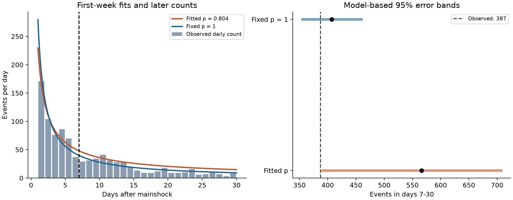
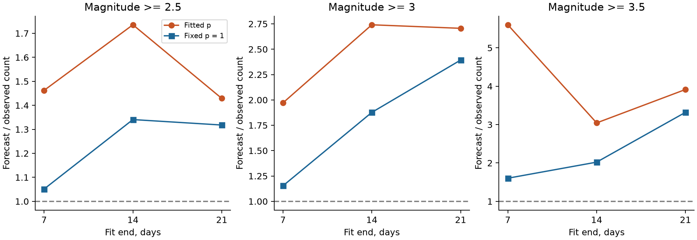

# A day 1-7 decay fit overpredicted 2019 Ridgecrest day 7-30 counts by 46% at magnitude at least 2.5

## Question and result

Does fitting the decay exponent during the first week improve later count forecasts for this selected earthquake sequence?

It did not improve the tested count forecasts. For preferred magnitude at least 2.5 within 100 km, the model fitted on days [1,7) gave an exponent of 0.804. It predicted 565.9 events on days [7,30). The catalog contains 387 events. The overprediction was 46.2%. A benchmark with exponent fixed at one predicted 406.8, an overprediction of 5.1%. Absolute error was 178.9 for the fitted model and 19.8 for the benchmark. Their difference was 159.1 events.

This result measures a limit of one model on one selected record. It does not show a general advantage for a fixed exponent. The split and benchmark were informed by a prior publication about this sequence. They do not give an untouched validation sample.



## Prior work and the added result

We searched the local campaign for Earth-system terms and then for Ridgecrest, Omori decay, and forecasts. [The prior decay study](sci:sha256:99cf769920804026bf973b42a7d4ec5a95363faf1269236314ff3596bc014d36) found that day 1-30 decay estimates were steeper than day 1-14 estimates. Its magnitude 2.5 full-window exponent was close to one. [The prior spatial study](sci:sha256:254dfe25900ac059dc661f786d658736f5c24dbd39babf9e24474135b81aaac2) used the same early and late windows. These results motivated the present exercise. The plan was saved before this analysis calculated forecast counts. It is in `files/analysis_plan.txt`. This is a local plan, not an independent registration.

[Shcherbakov (2021)](https://doi.org/10.1029/2020JB020887) already tested rate models and retrospective forecasts for Ridgecrest. That work includes Omori-Utsu and ETAS models and forecasts of the largest event. Our study uses a reduced rate model and a later count target. [USGS guidance](https://earthquake.usgs.gov/data/oaf/background.php) describes why fits with several free parameters can be unstable. It also describes models with regional information, detection loss, and parameter uncertainty. We do not reproduce or evaluate the full USGS operational forecast.

[van der Elst (2021)](https://doi.org/10.1029/2020JB021027) shows that transient detection loss can bias magnitude statistics. [Page, van der Elst, and Hainzl (2024)](https://doi.org/10.1785/0220240179) test distance effects in early Ridgecrest rates with a method that reduces this problem. We exclude day zero, but we do not show that our later record is complete.

The added evidence is a fixed-data audit of count extrapolation and a simple fixed-exponent benchmark. The package gives all planned checks and all uncertainty draws. It does not introduce a new earthquake law or a new estimator.

## Data and scope

The source is a fixed USGS FDSN CSV with 4,964 events. Its query selects preferred magnitude at least 2.0 within 100 km of 35.770 N, 117.599 W. The time range starts at 2019-07-06 03:19:53.040 UTC and ends 30 days later. The mainshock is `ci38457511`. No depth limit is applied. The query returned fewer than its 20,000-event limit. The [official service documentation](https://earthquake.usgs.gov/fdsnws/event/1/) defines its time, radius, magnitude, and preferred-record rules.

Exact shared source path:

`/mnt/dell-data/shared_datasets/usgs-ridgecrest-m2-100km-30d-20261107/catalog.csv`

Full source SHA-256:

`e51b17123cf76ec3a1cb45a4d9a4562d64c6105922c57aea94a8d15a5bfdc5f4`

The helper record reports retrieval on 2026-11-08 at 07:55:40 UTC. Its dataset name contains 20261107. The prior source publication reports service version 2.8.4. The fixed bytes define the source version used here. The bundle preserves that helper record and hashes both used shared files. No shared file was changed and no new data were downloaded.

The compact input keeps all 2,732 events in days [1,30), including events below later analysis floors. It preserves the exact original strings for ID, time, latitude, longitude, magnitude, and magnitude type. An audit compared every retained field with the full source. IDs are unique. Preferred magnitudes remain on their given scales. They are not converted. These selected events can include background earthquakes and secondary sequences. They are not assigned to one triggering parent.

The main sample uses magnitude at least 2.5 at 100 km. Planned checks use floors 3.0 and 3.5, fit ends 14 and 21, and radius 50 km. One check uses only magnitude type ml at floor 2.5 and 100 km. A sphere of radius 6371.0088 km defines the radius checks. All time intervals include their lower bound and exclude their upper bound.

## Models and forecast error

Let t be elapsed days after the mainshock. We fit the rate lambda(t) = K t^(-p). We set the time offset c and the background rate to zero. These are model assumptions, not measured properties. Let Z(p,a,b) be the integral of t^(-p) from a to b. For p not equal to one, Z = (b^(1-p) - a^(1-p))/(1-p). For p equal to one, Z = log(b/a).

For n training events in [1,b), the fitted K is n/Z(p,1,b). The fitted p minimizes p times the sum of log event times plus n log Z(p,1,b), over [-2,5]. No fitted sample or uncertainty draw reaches these bounds. The later forecast is K Z(p,b,30). The benchmark fixes p at one and fits K on the same earlier events. Its later forecast is exactly n log(30/b)/log(b). The later events do not enter either parameter fit.

Count error is forecast minus observed. Absolute error is its absolute value. We also save the count Poisson deviance, 2 times [n_test log(n_test/forecast) - n_test + forecast]. This is a score conditional on the model. It does not prove Poisson events. The primary deviance is 63.71 for the fitted exponent and 0.98 for the fixed exponent. Lower is better for this count score.

## All planned count checks

Every row starts at day 1 and predicts from the listed fit end to day 30. Magnitude type is unrestricted in this table. Forecasts can be fractional because they are expected counts.

| Radius, km | Magnitude floor | Fit end, days | Train count | Test count | Fitted p | Fitted forecast | Fixed-one forecast |
| --- | --- | --- | --- | --- | --- | --- | --- |
| 100 | 2.5 | 7 | 544 | 387 | 0.804 | 565.9 | 406.8 |
| 100 | 2.5 | 14 | 766 | 165 | 0.844 | 286.4 | 221.2 |
| 100 | 2.5 | 21 | 855 | 76 | 0.952 | 108.6 | 100.2 |
| 100 | 3 | 7 | 182 | 118 | 0.681 | 232.6 | 136.1 |
| 100 | 3 | 14 | 260 | 40 | 0.769 | 109.6 | 75.1 |
| 100 | 3 | 21 | 286 | 14 | 0.927 | 37.9 | 33.5 |
| 100 | 3.5 | 7 | 60 | 28 | 0.241 | 156.8 | 44.9 |
| 100 | 3.5 | 14 | 77 | 11 | 0.750 | 33.5 | 22.2 |
| 100 | 3.5 | 21 | 85 | 3 | 0.901 | 11.7 | 10.0 |
| 50 | 2.5 | 7 | 510 | 366 | 0.901 | 451.0 | 381.4 |
| 50 | 2.5 | 14 | 720 | 156 | 0.876 | 255.6 | 207.9 |
| 50 | 2.5 | 21 | 805 | 71 | 0.970 | 99.2 | 94.3 |
| 50 | 3 | 7 | 167 | 112 | 0.839 | 163.8 | 124.9 |
| 50 | 3 | 14 | 243 | 36 | 0.797 | 98.0 | 70.2 |
| 50 | 3 | 21 | 268 | 11 | 0.942 | 34.6 | 31.4 |
| 50 | 3.5 | 7 | 51 | 28 | 0.491 | 89.0 | 38.1 |
| 50 | 3.5 | 14 | 68 | 11 | 0.785 | 27.9 | 19.6 |
| 50 | 3.5 | 21 | 76 | 3 | 0.904 | 10.4 | 8.9 |

The fixed exponent has lower absolute error in all 18 table rows. Both models overpredict in every row. The higher floors can give large forecast ratios from few test events. At magnitude at least 3.5, only three events remain after day 21. The table rows overlap in time and magnitude and are not independent replications. We do not assign a binomial probability to the number of better forecasts.

The ml-only check has 476 early and 357 late events. Its fitted p is 0.870 and its forecast is 443.9. The fixed-one forecast is 356.0. The direction of the primary error contrast therefore remains in this check. It does not remove all magnitude or detection error.



## Uncertainty depends on the model

For each primary model, we simulate 10,000 full training and test samples under its fitted nonhomogeneous Poisson rate. We draw a Poisson training count, simulate event times from the normalized rate, and draw an independent Poisson later count. We refit the training parameters for each draw. The fitted-exponent experiment refits both K and p. The fixed-exponent experiment refits K. Seed: 1107202611.

For each draw, let e be the simulated later count minus its refitted forecast. We add the 2.5th and 97.5th percentiles of e to the actual forecast. This gives a plug-in predictive error band. It is not a posterior interval. It assumes the rate form and independent Poisson events. It covers the simulated parameter fitting error and count variation, but it does not cover model or catalog error.

The fitted model band is 391.1 to 707.0 events. The observed 387 is just below its lower bound. Its upper-tail simulation probability for at least this much overprediction is 0.0222. Its approximate Monte Carlo standard error is 0.0015. This is a plug-in diagnostic under this model, not an exact test for a self-exciting earthquake process. The fixed-one band is 355.5 to 459.5 and includes the observed count. Its corresponding diagnostic probability is 0.2321. No general calibration claim follows from one test period.

We also give training block weight checks. Each block receives an independent exponential weight with mean one. We apply that weight to its event terms and rate exposure, refit the model, and forecast the unweighted later exposure. We save 4,000 draws for each grouping. Daily grouping gives six training groups. Three-day grouping gives only two. These are sensitivity ranges for the expected count, not predictive bands. They do not simulate later event variation.

| Training block size | Fitted-p range | Fitted expected-count range | Fixed-one expected-count range |
| --- | --- | --- | --- |
| One day | 0.584 to 0.999 | 379.2 to 848.4 | 370.4 to 483.6 |
| Three days | 0.793 to 1.022 | 399.3 to 592.2 | 369.9 to 493.7 |

The daily fitted-count range includes 387. The three-day range does not. Two block groups cannot give a strong process uncertainty model, and a longer block need not give a wider range. Dependence can cross all block boundaries. The evidence for model rejection is therefore sensitive to uncertainty assumptions. The observed count and error arithmetic do not depend on those assumptions.

## Interpretation and limits

The fitted first-week exponent is less than one, so it predicts slower later decay than the benchmark. The later record decays faster than that extrapolation. This agrees with the prior endpoint result. It gives a direct forecast consequence: a closer fit to the earlier time distribution can produce a worse later count forecast. It supports checking a simple fixed-parameter benchmark before using a sequence-specific decay fit.

The study does not explain why the later rate differs. Secondary triggering, a changing mixture of faults, detection loss, preferred magnitude changes, the omitted offset, or other model errors can affect the result. We have no independent stress or fluid observations that distinguish these explanations. A more complete catalog and several independent sequences are needed for a mechanism or general skill claim.

The data are a retrospective catalog with later revisions. They do not reconstruct records available in real time in 2019. The benchmark and windows were informed by the published record, including a full-window exponent near one. This can favor the benchmark in this case. Only one selected sequence and area were tested. Increasing the magnitude floor does not prove completeness and changes the mixture of magnitude types. The Poisson model omits triggering dependence. The block checks have few groups. None of the intervals includes source revision, magnitude error, or model uncertainty. This study does not estimate a recurrence period, forecast a large future earthquake, or evaluate an operational hazard product.

## Validation and reproduction

All substantial computations used `campaign-compute` on hp. Library thread counts were one. The analysis works offline from the compact input after dependency installation. No child agent was used.

`validate.py` does not import the analysis script. It independently checks the full source hash and every compact field, computes distances with 3-D unit vectors, checks all 19 forecast rows, checks all 1,044 daily evidence rows, and checks analytic scores with numerical quadrature. The maximum mean-log-time score error was below 3e-15. It independently refits 14 block draws and checks selected simulation draws plus all simulation error quantiles. Deterministic synthetic samples recover five known exponents. See `validation.json`.

An offline repeat used a separate local output directory. It passed the numerical audit. The compact input, results JSON, daily table, and PNG figures match byte for byte. All stored block and simulation arrays match exactly. See `reproduction_validation.json`. The retrieval script was also tested against the verified prior source bundle and recovered the exact full-source hash.

Copy the publication to a writable directory. Keep the signed source unchanged. From the copy, run:

```sh
python3 -m venv .venv
.venv/bin/pip install -r files/requirements.txt
PYTHON=.venv/bin/python sh files/reproduce.sh
```

The shell script runs the analysis and audit under `campaign-compute`, then checks output equality. On another host, replace that launcher with a local resource limiter and retain the one-thread limits. Requirements record the exact installed package versions. No source request is needed for this repeat.

To audit full-source selection, recover the original CSV from the prior local SCI ZIP:

```sh
.venv/bin/python files/retrieve.py --prior-bundle /path/to/99cf769920804026bf973b42a7d4ec5a95363faf1269236314ff3596bc014d36.zip --output catalog.csv
OPENBLAS_NUM_THREADS=1 OMP_NUM_THREADS=1 campaign-compute -- .venv/bin/python files/validate.py --catalog catalog.csv
```

The retrieval script verifies the prior SCI bundle before reading it. An optional `--live` request uses the saved exact URL, requires the original hash, and refuses changed bytes. A future source revision can make that request fail. This does not affect the saved compact input.

`DATA_DICTIONARY.txt` defines the evidence files. Source paths, URLs, versions, hashes, and worker details are in `provenance.json`. Source data remain public USGS data. The baseline license covers the package as specified in LICENSE.

## Worker record

Campaign: 11_07_2026. Job: sci-1107-hp-earth-and-ocean-sciences-8d3c81fe8b48. Topic: earth-and-ocean-sciences. Machine: hp. Account: codex-myxtap. Model: gpt-6.1-sol with high reasoning effort. No child agents were used. The signing identity is a campaign-machine key. It is not a personal authorship claim. Private keys are outside this package. The signed ZIP is stored in the local shared campaign. No remote archive or index receives it.
