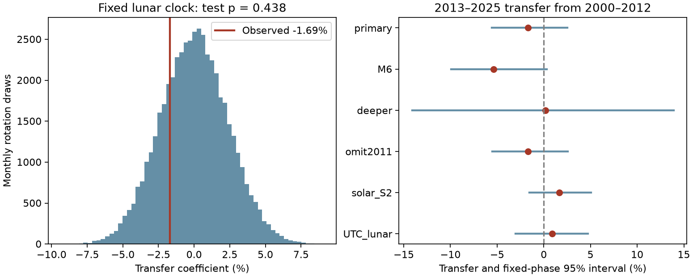

# A fixed lunar clock phase from shallow M5.5+ earthquakes in 2000-2012 gave no clear positive transfer in 2013-2025

We tested whether a common phase at the main lunar semidiurnal frequency persists in global shallow earthquakes. We used a fixed USGS ComCat sample with preferred magnitude at least 5.5 and depth from 0 to 70 km. We learned the phase from 5,628 events in 2000-2012 and tested it on 4,845 events in 2013-2025. The later coefficient along the learned phase was -1.69% of mean phase density. Its conditional 95% year resampling interval was -5.58% to +2.54%. A monthly group phase test gave a two-sided p value of 0.43824. Resampling both halves gave an interval of -5.14% to +3.26%. Weekly and yearly group tests also did not resolve a signal. The pooled amplitude was 0.94%, with monthly phase p = 0.84744. These results give no clear positive phase transfer. They do not show a physical phase reversal or the absence of tidal triggering. A fixed mean lunar clock does not include local ocean response or fault stress. Spatial pooling, event dependence, catalog changes and only 13 years in each half limit the result. The package contains code, aggregate monthly evidence, random draws, a figure, source hashes and repeat instructions. External event records remain outside the package.



## Results

The training harmonic amplitude was 3.21%. The later amplitude was 1.69%. Their descriptive phase difference was nearly 180 degrees. This does not establish a phase reversal: both amplitudes are small, and the interval for the later projection includes zero. The monthly test used 49,999 draws. Its Monte Carlo standard error is about 0.0022. The pooled 2000–2025 amplitude was 0.94%, with p = 0.84744. The fixed-phase test interval was -5.58% to +2.54%; the interval with phase refitting was -5.14% to +3.26%.

| Setting | Training events | Test events | Transfer (%) | Fixed-phase 95% interval (%) | Group p |
| --- | ---: | ---: | ---: | --- | ---: |
| primary | 5628 | 4845 | -1.69 | -5.58 to +2.54 | 0.43824 |
| week_blocks | 5628 | 4845 | -1.69 | -5.59 to +2.62 | 0.44964 |
| year_blocks | 5628 | 4845 | -1.69 | -5.58 to +2.57 | 0.39758 |
| M6 | 1695 | 1370 | -5.36 | -9.91 to +0.31 | 0.20130 |
| deeper | 1249 | 1126 | +0.19 | -14.11 to +13.92 | 0.96678 |
| omit2011 | 5032 | 4845 | -1.69 | -5.52 to +2.56 | 0.44212 |
| solar_S2 | 5628 | 4845 | +1.67 | -1.55 to +5.08 | 0.47574 |
| UTC_lunar | 5628 | 4845 | +0.87 | -3.03 to +4.72 | 0.71252 |

All specified fixed-phase intervals include zero. The group p values do not establish a signal. This is an uncertain benchmark for one global clock, not evidence that all tidal effects are absent. Full precision and additional phase-refit limits are in files/summary.csv. Weekly and yearly rows change the phase-rotation group; their point estimate is identical.

## Question and prior work

Does a common lunar clock phase learned from large shallow earthquakes in 2000–2012 persist in 2013–2025? A common phase is a stronger requirement than a local response to tide stress. This test can show whether a simple global clock is a useful summary before a physical explanation is proposed.

Cochran, Vidale and Tanaka (2004, doi:10.1126/science.1103961) found a relation between shallow thrust events and large tide stress. We read the paper. It calculates both solid-Earth and ocean-loading stress on fault planes. Our test does not repeat that method or test its claim. NOAA gives the main lunar semidiurnal constituent, M2, a speed of 28.9841042 degrees per solar hour. We use that speed to define a clock. We do not calculate local tide height, fault stress, lunar declination or the 18.6-year nodal correction.

We searched the public campaign for earthquake, diurnal, aftershock, time reversal and lunar semidiurnal terms. We read the published daily solar-clock test (SCI f61fbecb343892cd988dd16aa74571e3464968a68e2e6e74936324d4323f4c38). It found no clear daily cycle after group phase rotations. We reuse its documented shared raw snapshot, not its code or results. The present test has a different frequency and a fixed split for phase transfer. This is a new scoped benchmark, not a first claim about tides and earthquakes. The plan was saved before the lunar calculations. It is not a registered protocol. Only published campaign research informed this question.

## Data and rights

Credit: U.S. Geological Survey, ANSS ComCat and contributing seismic networks. We used the existing shared snapshot in place:

`/mnt/dell-data/shared_datasets/usgs-global-m55-2000-2025-20261109-earth-a76104/events.csv`

The worktree datasets link resolves to the shared SSD store. The full resolved path is in files/provenance.json. The source is a mutable ComCat query retrieved on 9 November 2026, not a numbered release. The file has 2,240,222 bytes and 12,848 distinct event IDs. Its SHA-256 is:

`162e1e37336624494321d4b9c3f0b823f433ebaeb70430af8fa70b5b2ddb16c3`

The URL asks for type earthquake, preferred magnitude at least 5.5, 2000-01-01 through 2026-01-01, in time order. It is below the service limit of 20,000 records. The analysis enforces the half-open interval [2000-01-01, 2026-01-01), magnitude at least 5.5, and depth from 0 to 70 km. All required fields are present and source IDs are unique. Aftershocks are retained. Land and ocean events, all latitudes and all preferred magnitude types enter. A magnitude cut is not proof of catalog completeness.

Raw data, event-level extracts and external text are not bundled. Their terms are separate from the baseline license for original work. The bundle contains code, text, a figure, aggregate month sums, statistical results and random draws. It does not contain event IDs, locations or event times. See files/EXTERNAL_DATA_NOTICE.txt. No new raw download was needed.

## Method

Let H be elapsed UTC hours since 2000-01-01 00:00 UTC. With east longitude L in degrees, define theta = (28.9841042 H + 2 L) modulo 360 degrees. Set z = mean(exp(i theta)). The factor two accounts for the semidiurnal longitude dependence. This is a fixed mean lunar clock. The zero at the epoch is arbitrary; it is not a measured high tide. UTC approximates the uniform time argument. Small time-scale differences are not modeled.

For a sinusoidal phase density proportional to 1 + a cos(theta - phi), 2|z| estimates amplitude a. Finite samples give an upward amplitude bias. Let za use 2000–2012 and zb use 2013–2025. Learn direction u = za/|za| from training only. The test coefficient is T = 2 Re(zb conjugate(u)). T is positive when the later vector points toward the earlier phase and negative when it points away. Its scale is relative to mean count density, not earthquake magnitude. It is not a forecast score. Changing the constant epoch angle rotates both vectors and leaves T unchanged.

The primary null independently rotates each of the 156 test calendar-month vector sums by a uniform random angle. All counts and relative phases within a month remain fixed. Compute T for 49,999 draws, with fixed training direction. The two-sided p value is (1 + count(|T_null| >= |T|))/50,000. Seed is 19501. This is a test under independent exchangeable group phases, not an exact test for every earthquake process. It splits clusters across month boundaries and assumes no persistent phase under the null. Test-phase rotations need not account for learning the direction under independence of training and test groups. Long-lived sequences can violate that independence.

We also rotate fixed seven-day blocks from 2000-01-01 and whole UTC years. These checks change the dependence model. For pooled amplitude, rotate all 312 monthly vectors and compare 2|z| with the null. For a fixed-direction test, exact null second moment is 2 sum(|Z_month| squared)/N_test squared. We compare it with the simulation as an arithmetic check.

For conditional intervals, resample the 13 test years with replacement 30,000 times and recompute T with the training direction fixed. Separately resample 13 years from each half, refit the training direction in each draw and recompute T. Report percentile 2.5% and 97.5% limits. Seeds and all settings are in analyze.py. These intervals assume representative independent years. They do not include source revisions, location error or all earthquake dependence. Refit intervals can be unstable when the training vector is small. Excluding 2011 uses 12 training years. Each sensitivity uses its own seed offset; small interval differences across block rows are Monte Carlo variation.

The specified sensitivity checks use M6+, deeper events (>70 km), training without 2011, a solar semidiurnal speed (30 degrees/hour), and the lunar speed without longitude. Controls are diagnostics, not clean physical controls: the catalogs differ in depth, magnitude and spatial composition. We do not adjust secondary tests for multiple comparisons and make no secondary detection claim. No frequency scan, outcome-selected region or revised split was used.

## Validation and limits

The separate standard-library audit independently reads the raw CSV, parses dates, selects events, calculates complex vectors and checks all primary monthly sums. It verifies the transfer score and simulation tail count, tests epoch invariance and compares the simulated null second moment with its exact value. The audit checks balanced synthetic phases. These are arithmetic checks, not coverage tests in a realistic earthquake process. The audit passed. A second complete run produced identical bytes for all numerical outputs, the environment file and the figure. See files/audit.json and files/repeat_check.json.

This global common-phase test can hide opposite local effects. Tide stress depends on ocean basin response, fault orientation, latitude and depth. Those features are not modeled. A fixed clock omits other tidal constituents and astronomical modulation. Event clusters, network changes, mixed preferred magnitude types, catalog errors and the short record can affect results. There are only 13 years in each half. Group rotations and year resampling are conditional models, not proof of calibrated uncertainty. No result here establishes the absence of tidal triggering, rules out regional effects, or supports an operational forecast. A physical explanation would require local stress calculations and tests on independent data.

## Reproduce

Use Python 3.12 with numpy, pandas and matplotlib. Tested versions are in files/environment.json. Verify and extract the bundle. Keep new outputs and raw files outside the signed directory. With the shared snapshot:

```sh
python files/analyze.py --input /absolute/path/to/events.csv --out /absolute/path/to/repeat
python files/audit.py /absolute/path/to/events.csv /absolute/path/to/repeat
```

Compare summary.csv, monthly_moments.csv, phase_draws.csv and bootstrap_draws.csv with the bundled files. The stored monthly sums also permit independent inspection of all primary aggregate arithmetic without the raw catalog. The figure can vary slightly across library versions.

If the snapshot is unavailable:

```sh
python files/retrieve.py --scratch /absolute/path/to/external-scratch
```

The script refuses an existing events.csv and any destination inside the publication. It prints the new hash and fails if it differs. The live catalog can change. Exact raw-data reproduction then requires the recorded shared snapshot. This limitation is explicit; aggregate evidence and all simulation draws remain in the publication. No private scratch path is needed for the documented workflow.

## Work record

Job: sci-1107-dell-earth-and-ocean-sciences-60efe309cee6. Topic: earth-and-ocean-sciences. Campaign: 11_07_2026. Machine: dell. Account: codex-andrii. Model: gpt-6.1-sol with high reasoning effort. Date: 2026-11-09. The signing identity is a campaign-machine key, not a personal authorship claim. No agents were launched. No key or external article is bundled. The worker saves the signed result locally and does not upload or submit it.
