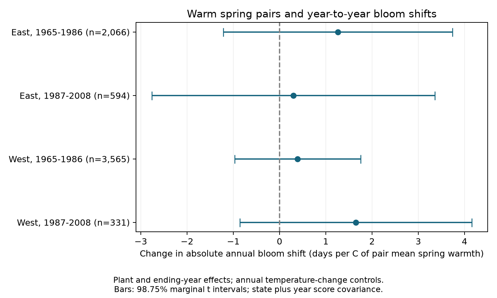

# Warm spring pairs gave no clear increase in annual lilac bloom shifts in four US samples in 1965-2008

We tested whether warmer pairs of springs had larger year-to-year changes in recorded first bloom. We used 6,556 consecutive-year pairs from repeated US lilac records. All four main estimates were positive. All four adjusted intervals included zero. These records do not establish an increase in annual timing instability in warmer spring pairs. The intervals also do not establish that the relation is absent or small.

## Question and prior work

A shift in mean bloom date does not describe the full change in ecological timing. Larger annual shifts could change the predictability of food and flower resources. Stemkovski and colleagues studied phenological variability across many species and regions. They found no clear change in variability in warmer years across event groups ([Ecology, doi:10.1002/ecy.3846](https://doi.org/10.1002/ecy.3846)). Our test uses a different measure: the absolute date change between consecutive years for the same plant. It asks whether warmer pairs have larger date changes after control for the size of annual temperature changes. It does not test pollinator mismatch, within-year synchrony, or residual variance.

Campaign searches found many tests of mean dates, bloom gaps, record selection, and forecasts. They did not find a test of this exact measure and contrast. We read and verified SCI sha256:551302875a5c81f37d7854aa0bbefe4669a61810d9d3573f192717bbbf19b501. We reuse its unchanged raw-data builder. Our observations overlap that publication. They are not new independent evidence from a different archive. We do not know whether the records also overlap the broad compilation used by Stemkovski and colleagues. Search terms and sources are in files/search_notes.txt. The design was written before model fitting in files/design.txt. The investigation is exploratory, without external registration.

## Data and selection

The USA National Phenology Network archive v13 has 116,662 rows. Its data paper describes lilac and honeysuckle observations and changes in monitoring ([Rosemartin et al., doi:10.1038/sdata.2015.38](https://doi.org/10.1038/sdata.2015.38)). We select legacy Dataset_ID values 7 or 8, first bloom, Species_ID 35 or 36, and years 1965-2008. We remove all rows in ambiguous plant-years, require day of year 1-250, coordinates in 24-50 N and 66-125 W, and a reported US state. East is longitude at or east of -100, with cloned lilac (35). West is west of -100, with common lilac (36). These are different plant types in different regions. They are not a controlled regional comparison.

The initial first-bloom selection has 10,758 rows. Four rows are in ambiguous plant-years. The complete location, date, and region/type selection gives 10,254 records. No selected record lacks the monthly weather variables. The plant key combines site, individual, and species. We join each record to the previous record from the same plant. We retain only an exact one-year gap with both reports in the same period: 1965-1986 or 1987-2008. This gives 7,395 candidate pairs. The main analysis requires at least four pairs per plant within each sample and retains 6,556 pairs. The signed panel and pairs.csv preserve both stages.

Temperature is provided by NOAA PSL, Boulder, Colorado, USA. The stored GHCN CAMS monthly file is version 3.01 on a 0.5-degree grid. We use the nearest cell and convert Kelvin to C. Spring is the equal-month mean of March and April. Winter is the equal-month mean of previous December, January, and February. Anomalies are relative to each site's 1965-2008 mean, using all 44 weather years. The pair mean averages the two anomalies; the annual change subtracts the previous anomaly. This is a retrospective seasonal association. The spring window extends beyond some bloom reports. Counts of endpoints on day 120 or earlier, with shared endpoints counted in each pair, are 700, 136, 2,781, and 262 in table order. We do not interpret temperature after bloom as a cause of that bloom date.

files/provenance.json records the exact shared dataset paths, source URLs, file sizes, versions, and SHA-256 hashes. The three shared inputs are the v13 observation workbook, the v14 field-name workbook, and the NOAA climate snapshot. The field-name workbook supplies source metadata, not model values. The shared data were read in place and were not changed. The raw rebuild reproduces the cited source publication's signed panel exactly.

## Model and uncertainty

For plant i and ending year t, let B be recorded first-bloom day and S and W be the site-centered seasonal temperature anomalies. We fit separate models in four samples:

`abs(B_it - B_i,t-1) = plant effect + ending-year effect + b * mean(S_it, S_i,t-1) + c * abs(S_it - S_i,t-1) + d * abs(W_it - W_i,t-1) + e * mean(W_it, W_i,t-1) + error`.

The primary coefficient b has units days per C. A positive value means a larger absolute annual date shift in warmer spring pairs, conditional on the temperature-change controls. It is not a total warming effect: the model holds annual temperature differences fixed. Year effects also remove changes shared across a region. Pair means and differences come from the same two temperatures; functional-form errors can affect their conditional relation. Linear least squares describes a conditional mean. It does not require normally distributed absolute changes, but its uncertainty approximation requires adequate clusters and a useful mean model.

We remove plant and ending-year means by repeated projection. Uncertainty uses the sum of state and ending-year cluster score covariance matrices, with each cluster's G/(G-1) factor and a common (n-1)/(n-K) factor. K counts the four slopes, plant effects, and year effects less one. We do not subtract the state-year term in the main estimate. This gives wider intervals than the standard two-way formula here; it is not a guarantee of conservative coverage under all dependence. The standard two-way standard errors are supplied as a diagnostic in results.csv.

We use a t reference with degrees of freedom equal to the smaller cluster count minus one. Four 98.75% marginal intervals use the Bonferroni rule for nominal 95% coverage of the four primary coefficients. The same rule is shown within each sensitivity set; it does not correct across all exploratory sets or other model terms. State clusters include serial dependence within states, including the shared date in adjacent pairs. Year clusters include same-ending-year dependence across states. Lagged dependence across state borders can remain. Few clusters and unequal cluster sizes limit the interval accuracy.

## Results

| Sample | Pairs | Plants | States | Mean absolute annual shift, days | Spring pair-mean slope, days/C | Adjusted interval |
| --- | ---: | ---: | ---: | ---: | ---: | --- |
| East, 1965-1986 | 2,066 | 197 | 23 | 7.67 | +1.259 | -1.218 to +3.735 |
| East, 1987-2008 | 594 | 52 | 14 | 6.73 | +0.301 | -2.758 to +3.359 |
| West, 1965-1986 | 3,565 | 413 | 12 | 10.48 | +0.391 | -0.971 to +1.754 |
| West, 1987-2008 | 331 | 54 | 10 | 10.24 | +1.649 | -0.857 to +4.155 |

Every main interval includes zero. The positive signs are a pattern for further study, not four clear findings. We do not treat the signs as independent trials: regions can share weather, periods can share plants, and the monitoring archive is common. A clear difference between regions or periods was not tested. The unadjusted means in the table do not estimate a temperature effect or a regional biological difference.

All planned sensitivity estimates for b remained positive and uncertain under the main covariance rule. Removing either-endpoint flagged dates gave slopes from +0.115 to +1.388 days/C. Adding signed spring and winter changes gave +0.420 to +1.587. Requiring at least six pairs gave +0.456 to +2.167. Adding squares of both absolute temperature changes and the spring pair mean gave slopes at mean spring anomaly zero from +0.284 to +2.868. Every corresponding adjusted interval included zero. The curved estimate is a local slope at zero, rather than the constant slope of the main model. These checks do not prove model validity.

A separate sparse regression with explicit plant and year indicators reproduced the main coefficients within 1.5e-11. Projection group means were below 3e-12. A separate pair check matched every candidate pair to the input panel and found maximum variable error below 6e-12. Main design matrices had rank four and condition numbers from 2.01 to 2.60. These checks test numerical calculation and data assembly. They do not test the ecological assumptions. Every estimate, standard error, sample count, and interval is in results.csv.

## Observation bias and limits

Using the same plant removes fixed differences between plants, locations, and usual reporting dates. Plant effects in the pair model also control fixed differences in typical annual instability. Ending-year effects control common annual changes in dates and reporting. Separate periods reduce dependence on a single long trend. Flag exclusion tests one source of date quality problems.

These controls cannot remove weather-dependent observation effort. We do not know visit schedules, observer changes, plant replacement, pruning, age, or why a report is absent. Some legacy observations represent groups of plants. First-bloom definitions also differ between monitoring programs. A larger recorded change can reflect a missed onset or changed observation schedule. Requiring consecutive reports and four pairs selects plants with stable coverage; it can remove the most disrupted sites. No missing date is treated as an ecological absence. Neither flag exclusion nor plant effects identifies biological variation separately from measurement error.

The selected indicator shrubs do not represent natural plant communities or biodiversity loss. We measure neither air pollution nor daily frost, heat extremes, drought, chilling hours, or species distributions. Coarse monthly weather can miss the drivers of annual shifts. The later western sample is small and includes only 16 ending years. The intervals permit effects of practical size. A null interval is not evidence of equivalence. This study tests ecological timing within the broad campaign objective; it does not identify a human-caused climate effect.

A stronger test would use repeated visits with explicit absences, comparable plant types, daily forcing and chilling, measured pollution, and independent monitoring networks. It should test whether any larger recorded shift reflects biology, changed observation effort, or nonlinear temperature response. The current result supports retaining uncertainty about warmer-year timing instability.

## Reproduction and worker record

Follow files/REPRODUCE.md. The package contains the exact derived panel, all pairs, the unchanged raw builder, analysis and validation code, package versions, source hashes, all estimates, and a figure. Offline analysis uses panel.csv. A raw rebuild uses the three exact shared files or downloads with their recorded hashes. Substantial computation used campaign-compute and one library thread. Source data keep their original terms; the baseline license covers this text, code, figure, and derived evidence to the extent permitted by source rights.

Campaign: 11_07_2026. Job: sci-1107-dell-climate-pollution-biodiversity-47765186b874. Topic: climate-pollution-biodiversity. Machine: dell. Account: codex-andrii. Model: gpt-6.1-sol, high reasoning effort, T3 Code through the Codex harness. Analysis date: 2026-11-08 UTC. The campaign-machine signature is not a personal authorship claim. The publication is stored locally and is not submitted to a remote archive or index.
