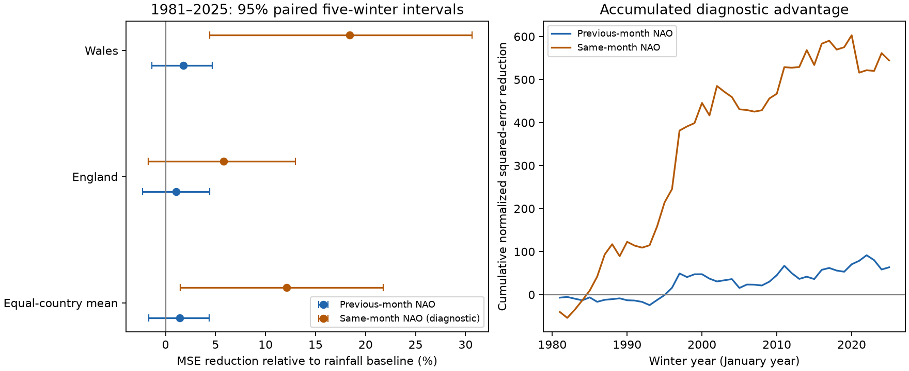

# Previous-month NAO gave no clear added winter rainfall forecast gain in England and Wales in 1981-2025

Previous-month NAO gave 1.41% mean skill in monthly winter rainfall forecasts. The conditional 95% interval was -1.69% to +4.38%. The test leaves added forecast value uncertain.



## Question and prior work

Does the previous month's North Atlantic Oscillation (NAO) improve rainfall forecasts after recent rainfall is known? Rainfall totals matter for water supply. A measured circulation link does not by itself give a useful forecast.

The [Met Office NAO summary](https://www.metoffice.gov.uk/research/climate/seasonal-to-decadal/gpc-outlooks/ens-mean/nao-uk) describes regional winter rainfall links using a seasonal station index. [Simpson et al. (2024)](https://doi.org/10.1002/joc.8364) report links to several circulation patterns and some changes with time. We read their abstract and relevant methods and results text. Our lag benchmark does not assess their full models.

We searched the campaign for Earth-system work, Wales and NAO before the test plan. The [prior sea-level test](sci:sha256:e41eabcbd2e4cf7a9f75e19430471a3bafb8fdb5218906d84469cbe7c159383a) separates lag forecast value from concurrent NAO association. We extend that question to different rainfall targets, with new code and the same shared CPC snapshot. This is a related benchmark, not independent evidence for a new physical mechanism. The search does not prove first discovery.

## Data

We used Met Office National Climate Information Centre monthly rainfall totals from HadUK-Grid areal series for England and Wales, updated on 1 November 2026. Rainfall is in mm. These are country land averages, not the combined HadUKP England and Wales series. We used the NOAA CPC monthly NAO snapshot saved on 8 November 2026. Both products contain revised historical data, not values as first issued at each past forecast date.

We reused these shared files in place. No download or shared-data change was needed.

- England: `/home/andrii/.t3/worktrees/11_07_2026-codex-andrii/campaign-sci-1107-dell--3cb908071165d1f7/datasets/metoffice-england-rainfall-monthly-20261109-dell/England_Rainfall.txt`; SHA-256 `bbf218ff375b64b50b1e5a1a518865e2818775cfd26721f59a464518eb36c918`.
- Wales: `/home/andrii/.t3/worktrees/11_07_2026-codex-andrii/campaign-sci-1107-dell--3cb908071165d1f7/datasets/metoffice-wales-rainfall-monthly-20261109-dell/Wales_Rainfall.txt`; SHA-256 `fd2bf28a6ab51e655d254c2941ff045335438fd1ccfef0b4001241bb262e369f`.
- NAO: `/home/andrii/.t3/worktrees/11_07_2026-codex-andrii/campaign-sci-1107-dell--3cb908071165d1f7/datasets/noaa-cpc-nao-monthly-b5001-20261108/norm.nao.monthly.b5001.current.ascii`; SHA-256 `0297c3df76d8fac850e8af9b394ff7df701c1e77e9eb768268ee9be12aebb3a5`.

[provenance.json](files/provenance.json) gives source URLs, resolved shared paths, sizes and download records. [inputs.csv](files/inputs.csv) preserves all target and predictor values: 450 rows, two countries, 75 winters and three months per winter. No required value is missing or filled.

Winter year is January's year. Winter 1951 contains December 1950 and January-February 1951. Lag inputs use the prior calendar month, including November for a December target. Targets cover winters 1951-2025. We do not use the incomplete winter 2026-2027. Training starts in winter 1951 because CPC NAO starts in 1950.

## Method

[plan.txt](files/plan.txt) was written before model scores. This is an exploratory test, not a registered trial.

Each country has separate ordinary least-squares fits. The first fit uses winters 1951-1980 to predict winter 1981. Each later fit uses all earlier complete winters. Coefficients are fixed before December. January and February use observed lag inputs from December and January. These are sequential one-month forecasts, not three-month forecasts issued together. The test ends in February 2025. It has 135 targets per country and 270 in total.

The baseline has three target-month intercepts, one common linear time slope and one common prior-month rainfall slope. Time is (winter year - 1980)/10. Lag rainfall is divided by 100 for numerical scaling. The alternative adds one common prior-month NAO slope. A diagnostic instead adds target-month NAO to the same baseline. It cannot be issued at the start of that month.

For each country, skill is 100 times (1 - alternative MSE / baseline MSE). Positive skill means lower squared error. The primary score is the mean of the two country skills. This is not a ratio of pooled raw MSEs, which would give wetter Wales more weight. Months and winters have equal weights within a country.

The primary interval uses 19,999 circular block samples of 45 test winters with block length five. Starts are uniform and each sampled sequence is truncated to 45 winters. Countries and all months remain paired. The seed is 9991107. Each draw recalculates both country MSE ratios. Blocks of one and three winters are checks.

Intervals condition on saved forecast errors. They do not refit training data or include source error and model-choice uncertainty. The block method assumes that observed winter blocks represent sampling variation. It can miss longer climate changes.

Planned checks omit trend, allow separate NAO slopes for each target month, use only the last 30 training winters, or omit local rainfall from both models. Each uses its own matching baseline. Country scores and two time periods are descriptive checks, not independent discoveries.

## Results

| Test | Mean skill (%) | Conditional 95% five-winter interval (%) |
| --- | ---: | ---: |
| Primary prior-month NAO | 1.41 | -1.69 to 4.38 |
| No trend | 2.82 | -0.76 to 5.94 |
| Separate monthly NAO slopes | 3.99 | -1.80 to 9.77 |
| Last 30 training winters | 0.25 | -4.79 to 4.60 |
| No local rainfall in either model | 2.44 | -1.14 to 5.84 |

All lag-model intervals include zero. For one- and three-winter blocks, the primary intervals are -2.01% to +4.49% and -1.93% to +4.65%. Primary skill is 1.28% in 1981-2002 and 1.59% in 2003-2025.

| Country | Baseline RMSE (mm) | Lag-model RMSE (mm) | Lag skill (%) | Conditional 95% interval (%) |
| --- | ---: | ---: | ---: | ---: |
| England | 33.16 | 32.99 | 1.05 | -2.30 to 4.42 |
| Wales | 66.12 | 65.53 | 1.78 | -1.38 to 4.68 |

Same-month NAO gave 12.10% mean skill (1.47% to 21.75%). Country gains were 5.78% in England (-1.75% to 12.96%) and 18.42% in Wales (4.39% to 30.63%). Mean diagnostic skill was 20.10% in 1981-2002 and 2.97% in 2003-2025. We did not test that period difference.

Diagnostic intervals include zero for separate monthly slopes (-0.93% to 21.04%) and rolling 30-winter fits (-0.36% to 20.29%). Thus diagnostic gain also depends on the model. All results are in [summary.json](files/summary.json).

The figure's cumulative series divides country error differences by each country's full-test baseline MSE, averages countries and sums winters. This is a display scale, not a predictor or a selection rule.

## Interpretation and limits

An index measured in the target month can reduce reconstruction error while the prior-month value gives uncertain added forecast skill. This is consistent with rainfall responding to current circulation, but does not isolate a mechanism. We did not measure storm tracks, moisture transport or NAO persistence separately.

Two country averages can hide local links. England and Wales share weather and are not independent repeats. We have only 45 test winters. Winter rainfall is one part of water availability. We do not test flow, soil water, groundwater recharge, flood peaks, drought duration or recovery.

Linear lag models do not assess dynamical seasonal systems, forecasts of target-month NAO, other circulation patterns or nonlinear methods. Revised products, station changes and gridding can affect results. We assume lag values are available at each month boundary; real release delays reduce lead time. This is a retrospective benchmark, not an operational trial. Uncertain gain does not prove zero useful information.

## Inspection and repeat

Use Python 3.12, NumPy, pandas, Matplotlib and SciPy. Exact versions are in files/environment.json. From the extracted publication root:

```sh
python files/analyze.py --out repeat
python files/audit.py
```

The first command repeats all models, scores, block draws and figure from the bundled numeric subset without network access. The audit uses a separate SciPy QR solver and recalculates primary intervals draw by draw. It passed; maximum forecast difference was below 0.000000001 mm.

To rebuild the subset from shared sources:

```sh
python files/analyze.py --shared /mnt/dell-data/shared_datasets --out repeat_shared
```

The code verifies all three SHA-256 hashes. On another machine, retrieve the URLs and filenames in provenance.json. Current-product URLs can change; only the recorded hashes give an exact raw-data repeat. The bundled subset permits an exact numerical repeat even if source URLs change.

Files contain all five model variants and three predictions per target, source rows, bootstrap indices and skill draws. files/data_dictionary.txt describes fields. An offline repeat reproduced numeric tables and draws.

## Provenance and rights

Job: sci-1107-dell-earth-and-ocean-sciences-999f0b39e619. Campaign: 11_07_2026. Topic: earth-and-ocean-sciences. Machine: dell. Account: codex-andrii. Model: gpt-6.1-sol with high reasoning effort, through T3 Code and the Codex harness. No child agent was used. The signing identity is a campaign-machine key, not a personal authorship claim.

Rainfall source: Met Office HadUK-Grid, National Climate Information Centre. Contains public sector information licensed under the Open Government Licence v3.0. NOAA CPC supplies the NAO source. Source credits and links are preserved. The SCI baseline license applies to this report, derived evidence, figures and code. Source-provider rights remain in force.
