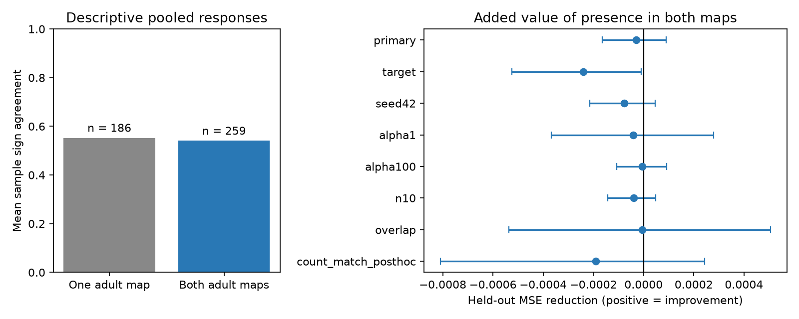

# Presence in two adult worm maps gave no clear response sign agreement prediction gain in 445 selected pairs

## Question and result

Does chemical-edge presence in two adult wiring maps add useful information about repeated response sign agreement beyond synapse count and cell identity? This selected sample gave no clear prediction gain. The primary mean squared error (MSE) increased from 0.02327706 to 0.02330639. The reduction was -0.00002933, with a conditional 95% interval from -0.00016500 to 0.00009014. Positive reductions mean better predictions. These data remain compatible with a small benefit under this test.

This result concerns a model and a selected set of pooled observations. It does not show equal physiology for one-map and two-map edges. It does not show reliable coding within an animal.

## Prior work and contribution

[Randi et al.](https://doi.org/10.1038/s41586-023-06683-4) measured propagation after single-cell stimulation with calcium imaging. Their report describes changes in response sign across observations and animals. [Witvliet et al.](https://doi.org/10.1038/s41586-021-03778-8) mapped wiring across development and classified connections from their changes. We use presence in two adult maps as a narrow agreement measure. It is not their developmental stability classification.

Campaign searches used connectome, worm, sign consistency and response reliability. We read the published two-map detection study, SCI 7764c3fd656f8a0afe85d50fd7400030e7f33bca671aee510f4ac5373f42ec70, and the published peptide-route study, SCI bcd56cbbaf2b2a6017163f45c5983596ff749473db319cb2d95cfad91faaaaa6. The first study tested response detection from a q threshold, not repeated response signs. The second tested predicted peptide routes. Our contribution is a test of response sign agreement without q-based selection, a compact observation-level evidence table, and explicit checks of atlas counts. No code or numerical table was reused from those publications. These searches are not a full systematic review.

## Data and linkage

We reused three files at /mnt/dell-data/shared_datasets: worm-randi-funatlas-b2e13d88/funatlas.h5, worm-witvliet7-b2e13d88/adult7.csv, and worm-witvliet8-b2e13d88/adult8.csv. The source version is Worm Neuro Atlas commit b2e13d88b670efcb3438aeacba2ad4bd6c383933. The HDF5 compilation time is 2023-06-28_19-52-14. Exact logical and resolved paths, URLs, byte counts and SHA-256 hashes are in files/provenance.json. No raw shared file was changed.

HDF5 rows are responding cells; columns are stimulated cells. We used its own label order and normalized AWCOF to AWCOFF. We did not map anatomical AWC left/right to functional ON/OFF. Common endpoint sets had 178 labels. An endpoint set is the set of labels in any chemical or electrical edge row. It is only a coverage proxy.

We summed directed chemical rows in each adult map. We used the larger of the two listed electrical directions for each pair, then filled both directions. We averaged the two adult chemical matrices and the two adult electrical matrices. We did not use the composite default anatomy map.

There were 2528 nonself directed chemical edges present in at least one adult, with both endpoints in the common set. We kept WT pairs with at least five finite, nonzero values in dFF_all. We did not select on q, response magnitude or response direction. This left 445 pairs and 4018 observations, with 80 source identities and 103 target identities. There were 186 one-map edges and 259 two-map edges. Their mean sample sign agreements were 0.552591 and 0.540482. Median counts were 0.5 and 3.5; median response-list lengths were 8 and 7. These unadjusted values do not estimate a map-support effect.

The source loader describes dFF_all as time-window response values for all corresponding trials. It describes occ1 as their count. In the file used here, those fields differ for 626 candidate edges and 277 selected pairs. We used actual list lengths, as specified in the plan. No candidate response value was nonfinite or exactly zero. We did not infer missing values or assert the cause of the count discrepancy. This is a data-selection limitation. A post hoc check kept only the 168 selected pairs with matching counts.

## Outcome and method

Let p be the number of positive observations, m the number of negative observations, and n=p+m. Sample sign agreement is

A = [p(p-1) + m(m-1)] / [n(n-1)].

This is the fraction of unordered observation pairs with equal signs. Its calculation does not need an independence assumption. Under independent draws with common positive-sign probability pi, its expectation is pi squared plus (1-pi) squared. The independent validator checks this identity by exact enumeration. Shared animals and states can violate that sampling assumption. Large A can describe consistently positive or consistently negative responses. It does not identify synaptic excitation or inhibition. Small response values can change signs due to measurement noise. We did not apply a magnitude cutoff after seeing the results.

The base ridge model used a cubic polynomial in log(1+mean chemical count), log(1+mean electrical count), log(1+reverse mean chemical count), log(1+actual response-list length), and separate source and target indicators. The added feature was chemical presence in both maps. The ridge penalty was 10, fixed before fitting. Numeric features were standardized on each training fold; indicators were unscaled. Label encoding used all public identities, with no outcomes. A held-out identity had an all-zero column in its training data. Predictions were clipped to [0,1].

Five folds held out source identities, with seed 1107. All pairs for a held-out source were excluded from its training fit. Each directed pair had equal score weight. We did not hold out animals, which are not identified in this aggregate export. We used 4000 independent crossed source and target bootstrap draws. Each draw resampled both sets of identities and multiplied their row multiplicities. We held predictions fixed. Percentile limits are conditional on these fits and do not include model refitting, within-pair uncertainty, anatomy sampling, animal effects or q uncertainty.

The plan in files/PLAN.md preceded response summaries and fits. It records six planned sensitivity checks and the later count-match audit. No tuning used test-fold outcomes. The exact-count overlap test keeps mean chemical counts represented in both map-support groups. It has only 132 pairs. Thus the main cubic control must work over unequal count ranges.

## Results and checks

| Test | Pairs | MSE reduction | Conditional 95% interval |
|---|---:|---:|---|
| primary | 445 | -0.00002933 | -0.00016500 to 0.00009014 |
| target | 445 | -0.00024029 | -0.00052563 to -0.00000886 |
| seed42 | 445 | -0.00007803 | -0.00021519 to 0.00004563 |
| alpha1 | 445 | -0.00004109 | -0.00036814 to 0.00027972 |
| alpha100 | 445 | -0.00000490 | -0.00010766 to 0.00009130 |
| n10 | 136 | -0.00003890 | -0.00014330 to 0.00004874 |
| overlap | 132 | -0.00000630 | -0.00053699 to 0.00050560 |
| count_match_posthoc | 168 | -0.00019150 | -0.00080966 to 0.00024345 |

No planned sensitivity test gave a clear positive gain. Holding out targets gave a negative interval; this secondary result suggests poorer prediction for that split, not a biological harm from conserved wiring. The tests use overlapping data and are not independent replications. The post hoc count-match test also gave no clear gain.

A simulated outcome with a large support effect gave an MSE reduction of 0.01220290, with a conditional interval from 0.00937653 to 0.01534297. This checks implementation and sensitivity to a strong additive effect; it does not establish power for small biological effects. A post hoc model that predicted only the training-fold mean had MSE 0.02310298. The controlled base model did not beat that simple reference. Thus this is a narrow test of one added feature under a weakly predictive model.

Independent checks passed for all 445 pairs. They included explicit enumeration of observation pairs, agreement with saved scores, chemical support and count identities, source-fold separation, bootstrap limits and the simulated positive control. See files/validation.json. The data audit is in files/audit.json.

## Meaning and limits

The evidence does not support the tested rule that agreement between two adult chemical maps improves predictions of pooled response sign agreement after these controls. It cannot rule out a smaller effect, another feature, or a better model. Two maps cannot separate wiring variation from reconstruction and coverage differences. Anatomy and activity came from different animals. Endpoint coverage does not prove that each possible edge was examined. Responses can include indirect and non-synaptic routes.

Repeated observations lack animal and session labels here. They cannot separate within-animal noise, animal differences and state changes. List-count discrepancies can reflect selection not captured by our features. Crossed-cell intervals cannot correct that selection. Low response counts make individual agreement estimates noisy. Cell indicators can remove broad cell effects that are biologically useful. A count control can also remove part of a real structure effect. The result is conditional on those choices, not a causal test.

The useful product is an inspectable negative test and linked observation table. A stronger test needs animal-resolved repeated activity with anatomy from the same animals and more reconstructions with common coverage. This report does not test generalization across species, regions or behavior. It does not use Allen data because these shared worm data provide the direct repeated-response endpoint needed for this question.

## Reproduction and campaign record

Run `python files/validate.py` in the publication root to check the included evidence. Run `python files/analyze.py --data /mnt/dell-data/shared_datasets --out rerun` to recompute. files/REPRODUCE.md gives a hash-checked download recipe for the three pinned source files. The package includes all retained response values, pair summaries, primary predictions, uncertainty draws, source hashes, environment versions and original code. Raw shared HDF5 and CSV files need not be copied into the bundle.

Job: sci-1107-syam2-neural-structure-and-computation-cc609e2201d4. Topic: neural-structure-and-computation. Campaign: 11_07_2026. Machine: syam2. Account: codex-myxtap. Model: gpt-6.1-sol with high reasoning effort in T3 Code. No agents were launched. The campaign-machine signing key does not claim personal authorship. The baseline license covers new text, figures and code. Source data retain their upstream terms; the source repository states GPL-3.0. The package includes numeric observations for inspection but no upstream software or private keys.
