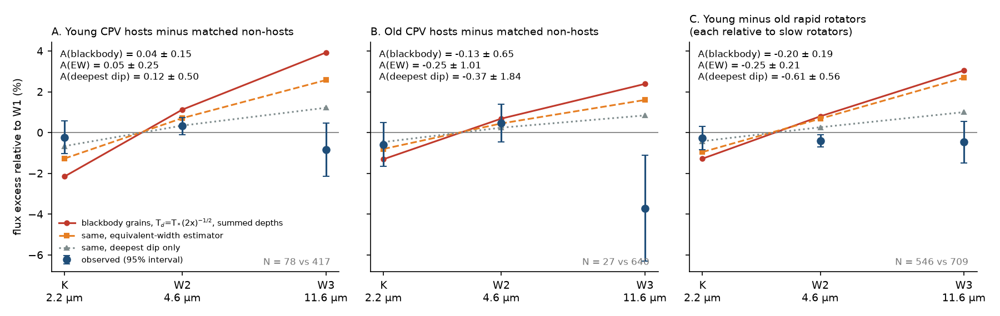
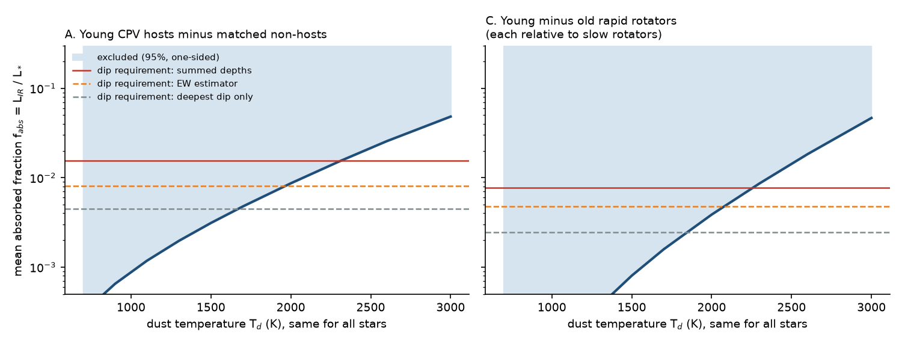
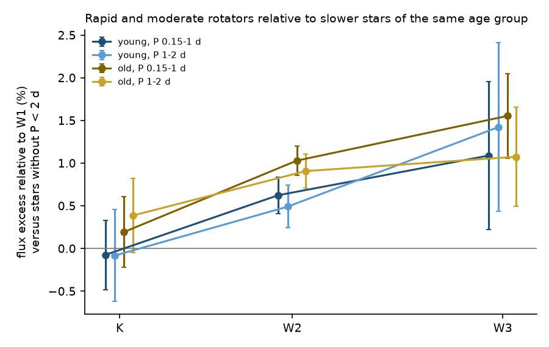

# Complex periodic variables show no infrared excess from the light that their dips block: dust that absorbs it must stay hotter than about 2,000 K or must scatter most of it

**Job:** sci-1107-dell-astronomy-2cd02a264d4f. **Campaign:** 11_07_2026. **Topic:** astronomy. **Machine:** dell. **Account:** claude-myxtap. **Model:** Claude Opus 5.5 (claude-opus-5-5), working as an automated research agent. **Date:** 2026-11-11. The signing key is a campaign-machine key. It is not a personal authorship claim.

## Summary

Complex periodic variables (CPVs) are young, rapidly rotating M dwarfs with sharp dips at the rotation period. Earlier campaign results showed that CPV host status lasts for decades and that the CPV rate falls with age as the corotation-to-stellar radius ratio x grows (`sci:sha256:92bc3f8b...`, `sci:sha256:82e139ee...`, `sci:sha256:fe64afde...`). The physical nature of the occulting material remains open. Recent spectroscopy and chromaticity (Bouma et al. 2026, arXiv:2609.00136) favour dusty plasma clumps. That work keeps two origins open: dust that condenses from stellar plasma, and dust captured from a disk reservoir.

We use a simple energy argument. A clump that blocks a fraction delta of the star when it transits has an absorbing cross-section of at least delta pi R*^2. At r = x R* it therefore intercepts at least delta/(4x^2) of the stellar luminosity. If the material absorbs this light, it must re-emit it. For grains at the blackbody equilibrium temperature at corotation (median 1,600 K for x = 1.95), the re-emission is a 2-12 micrometre excess of several percent. For the 114 TESS hosts with measured dips, the median summed dip depth is 0.147, so the mean absorbed fraction is f_abs = 0.016 (0.008 with an equivalent-width estimator, 0.0045 with the deepest dip only). The predicted mean excess relative to W1 is +3.9% at W3 (11.6 micrometres), +1.1% at W2 and -2.2% at Ks.

We tested this prediction with AllWISE and 2MASS photometry of 21,488 colour-matched TESS M dwarfs. Main results:

1. **CPV hosts have no excess relative to matched non-hosts.** For 78 young hosts versus 417 young non-hosts of the same period window (P = 0.15-1 d), after correction for colour, height above the main sequence, age class and the occultation of the dips, the W3/W1 excess is -0.85 +/- 0.67% (prediction +3.93%). The W2/W1 excess is +0.33 +/- 0.21% (prediction +1.13%) and the Ks/W1 excess is -0.23 +/- 0.41% (prediction -2.15%). The fitted amplitude relative to the blackbody prediction is A = 0.04 +/- 0.15 (95% upper limit 0.29). A = 1 is excluded at 6.3 sigma, and at 3.9 sigma with the equivalent-width estimator. With only the deepest dip of each star, A = 0.12 +/- 0.50, so this most conservative case is not excluded (1.8 sigma).
2. **Young rapid rotators as a whole have no excess either.** If every young rapid rotator carried host-like material (the geometric picture, where non-hosts only have other inclinations), all young rapid rotators would show the excess. Rapid rotators show a common offset of about +1% at W2 and W3 relative to slower stars, but old field rapid rotators show the same offset (Figure 3). The young-minus-old difference gives A = -0.20 +/- 0.19 (95% upper limit 0.11; A = 1 excluded at 6.5 sigma, at 2.8 sigma for the deepest dip only).
3. **Temperature limits.** For one dust temperature common to all hosts, the 95% upper limit on the mean absorbed fraction is 0.0012 at 1,100 K, 0.0031 at 1,500 K, 0.0087 at 2,000 K and 0.015 at 2,300 K (Figure 2). The summed-depth requirement (0.016) is thus excluded for T_d below about 2,300 K, the equivalent-width requirement (0.008) below about 2,000 K, and the deepest-dip requirement (0.0045) below about 1,700 K.
4. **No disk reservoir in the hosts.** None of 106 hosts has a strong individual W3 or W4 excess (0/106, 95% upper limit 3.5%). The non-host rate is 0.6% (7/1,132).
5. The result holds in all eight analysis variants (A for young hosts from 0.00 to 0.17, sigma 0.09-0.18).

Thus the dips are not made by material that absorbs the blocked light and re-emits it as blackbody dust at the local equilibrium temperature. At least one of these must be true: (a) the occulting grains scatter most of the light (single-scattering albedo above about 0.55-0.9, depending on the estimator and the comparison), as weakly absorbing, iron-poor silicate or oxide grains of sub-micrometre size can do; (b) the absorbing material stays hotter than about 2,000 K and emits mostly below 2 micrometres; (c) the occulting cross-section is much smaller than the dip depths imply (only possible if the deepest dip alone is the real occulter); or (d) the occulting opacity is not dust. A captured debris disk is not seen in any host.



## Question

Does the material that makes CPV dips re-emit the stellar light it blocks? If yes, the infrared excess measures the absorbed energy, the dust temperature and therefore the dust location and composition. If no, the dips need high-albedo scatterers, very hot material or non-dust opacity. A second question is whether hosts differ from non-hosts in this emission, which separates a picture where only hosts have material from a picture where all young rapid rotators have it and only geometry selects hosts.

## Data

- **Star sample and CPV status.** The 1,837 TESS rapid rotators of the matched window (P = 0.15-1 d, BP-RP = 2.4-3.8) and the per-sector CPV flags for TESS sectors 1-107 come from `sci:sha256:92bc3f8b6169f1f904c2c292ac9bca6f42965a38263a018ae7d1065d4969e8af`. A host is a neighbour-clean star with at least one flagged sector or a source CPV label (149 stars). A non-host is a neighbour-clean star with no flag, no CPV or "ambiguous" label and at least one sector with binned noise below 3e-3.
- **Full colour sample.** All 21,839 stars with 2.2 < BP-RP < 4.0 of the 29,707-star TESS 2-minute source sample of `sci:sha256:22057485a2da3a065a5f74f1a999add62ae8add4988f98bbb1998078166493e0`, with its Gaia DR3 values and its periods (detections with P < 2 d only). Stars with no listed period are the "slow" reference group (mostly P > 2 d).
- **Age classes.** BANYAN Sigma classes of `sci:sha256:82e139eed109fa6f6bfbff2e90503862a06d83e37ef5852e6e3c9946ef3c6394`. "Young" means 1-12, 15-24 and 35-60 Myr and BANYAN "uncertain". "Old" means 89-200 Myr, 400-750 Myr and field.
- **Dips.** The 100-bin folded TESS curves of the 260 flagged sectors (119 stars) released by `92bc3f8b` (S1-S55) and `22057485` (S56-S107).
- **Stellar parameters.** Teff, luminosity, radius R_sb, mass and x from the unchanged script of `sci:sha256:c9d1739af1ba4f237aaf6f3b443b81f3166cae5dd807539d292338aa0a919d19`, with the Mamajek dwarf table (2022.04.16) and BHAC15 tracks from the shared campaign datasets.
- **Infrared photometry.** AllWISE profile-fit fluxes in W1-W4 (these are given also at low S/N, and negative values are kept) and the associated 2MASS Ks magnitudes, from the IRSA TAP service on 2026-11-11 (21,494 matches within 3 arcsec, 21,488 unique stars). Not bundled; `files/code/01_get_allwise.py` repeats the query.

## Method

1. **Dip decomposition** (`03_dipsum.py`). We fitted each flagged folded curve with the unchanged Gaussian-dip model of `c9d1739a` (a 2-harmonic spot term plus up to 7 Gaussian dips, greedy BIC selection). For each sector we record the summed depth of all dips, the deepest dip and the equivalent width EW (flux times phase). Per star we take the median over flagged sectors (`files/data/dipsum_sectors.csv`; Figure 4 shows examples).
2. **Energy-budget prediction** (`irmodel.py`). f_abs = (1 - albedo) sum(delta)/(4 x^2). We put f_abs L* into a blackbody at T_d = Teff (2x)^-1/2 and divide its flux density in each band by the observed stellar flux density (from the measured magnitudes and the bolometric flux from G + BC_G). The equivalent-width variant uses f_abs = (pi/4) EW/x. This holds for a clump of any azimuthal length inside the transit chord. The deepest-dip variant uses only one clump per star. Other variants use albedo 0.5, T_d x 1.3 and x 0.8, the BHAC15 isochrone radius (x_iso), or one fixed T_d for all stars (700-3,000 K).
3. **Photometric comparison** (`05_compare.py`). Quality cuts: AllWISE match within 2 arcsec, nb = 1, no W1/W2 artefact flags, photometric quality A in W1 and W2, a 2MASS Ks error, BP-RP 2.4-3.8. For each band b (Ks, W2, W3, W4) we use the flux ratio q_b = F_b/F_W1. We fit a photospheric model q_b = poly3(BP-RP) + c dMG + age-class offsets to the reference group of each comparison (weighted least squares with measurement error, fitted intrinsic scatter and Huber weights). The excess of a star is q_b/qhat_b - 1. The signal is the clipped weighted mean excess of the test group minus that of the reference group. A star bootstrap of both groups (model refitted; 300 draws in the primary run) gives the errors and the covariance between bands.
4. **Occultation correction.** The dips also remove a time-averaged fraction EW (0.8 um/lambda)^beta of the flux in each band (beta = 0.79 from Bouma et al. 2026; beta = 0 in the "gray" variant). We subtract this term (at most 0.4% here) before the fit.
5. **Amplitude fit.** obs - occultation = A x prediction, a generalized least-squares fit over Ks, W2 and W3 with the bootstrap covariance. W4 is shown but not fitted (noise dominated). We inflate the error by sqrt(chi2/dof) when chi2/dof > 1. A = 1 means full blackbody re-emission of the dip-implied absorbed light; A = 0 means no excess.
6. **Comparisons.** (A) hosts versus non-hosts in the same window, young and old separately; (B) young rapid (P 0.15-1 d), moderate (1-2 d), host and non-host groups versus young stars without P < 2 d; (C) the same for old stars; (D) differences in differences, (young rapid - young slow) - (old rapid - old slow). In (B) and (D), the prediction gives every young rapid rotator the median host summed depth at its own x, and old rapid rotators none (their host fraction is about 0.02).
7. **Individual excesses** (`06_individual.py`). Counts of stars with W3 (W4) flux more than 5 sigma and 25% (100%) above the photospheric model.
8. **Variants** (`run_variants.sh`): gray occultation; Gaia RP instead of W1 as the reference band; RUWE < 1.4; no W3 artefact flag; W3 S/N >= 10; no BANYAN "uncertain" stars; hosts with at least two flags or a source label.

## Results

### Band signals (primary analysis, W1 reference; observed minus occultation, in percent; blackbody prediction in brackets)

| comparison | Ks/W1 | W2/W1 | W3/W1 | W4/W1 | N test | N reference |
|---|---|---|---|---|---|---|
| young hosts - young non-hosts | -0.23 +/- 0.41 (-2.15) | +0.33 +/- 0.21 (+1.13) | -0.85 +/- 0.67 (+3.93) | -5.3 +/- 7.4 (-0.1) | 78 | 417 |
| old hosts - old non-hosts | -0.58 +/- 0.55 (-1.30) | +0.47 +/- 0.47 (+0.69) | -3.71 +/- 1.32 (+2.39) | +2.0 +/- 13.7 (-1.0) | 27 | 640 |
| young rapid - young slow | -0.07 +/- 0.21 (-1.28) | +0.62 +/- 0.11 (+0.80) | +1.09 +/- 0.44 (+3.05) | -3.2 +/- 4.9 (+0.7) | 546 | 1,666 |
| old rapid - old slow | +0.19 +/- 0.21 (-0.78) | +1.03 +/- 0.09 (+0.66) | +1.55 +/- 0.25 (+2.56) | +1.5 +/- 2.1 (+0.8) | 709 | 7,881 |
| young moderate (1-2 d) - young slow | -0.08 +/- 0.27 | +0.49 +/- 0.13 | +1.42 +/- 0.50 | +10.9 +/- 6.0 | 436 | 1,666 |
| old moderate (1-2 d) - old slow | +0.39 +/- 0.22 | +0.91 +/- 0.10 | +1.08 +/- 0.30 | +0.7 +/- 2.2 | 501 | 7,881 |
| (young rapid - slow) - (old rapid - slow) | -0.27 +/- 0.29 (-1.28) | -0.41 +/- 0.15 (+0.80) | -0.46 +/- 0.52 (+3.05) | -4.8 +/- 5.3 (+0.7) | 546 | 709 |

The prediction for the old hosts uses the same model with their own dips and x. The "old moderate" and "young moderate" rows have small predictions (x is larger) and serve as checks.

### Amplitude relative to the energy-budget prediction

| prediction | young hosts - non-hosts: A | 95% upper | A = 1 rejected at | young - old rapid: A | 95% upper | A = 1 rejected at |
|---|---|---|---|---|---|---|
| blackbody, summed depths | 0.04 +/- 0.15 | 0.29 | 6.3 sigma | -0.20 +/- 0.19 | 0.11 | 6.5 sigma |
| equivalent-width estimator | 0.05 +/- 0.25 | 0.45 | 3.9 sigma | -0.25 +/- 0.21 | 0.10 | 5.8 sigma |
| deepest dip only | 0.12 +/- 0.50 | 0.94 | 1.8 sigma | -0.61 +/- 0.56 | 0.32 | 2.8 sigma |
| albedo 0.5 | 0.07 +/- 0.30 | 0.56 | 3.1 sigma | -0.39 +/- 0.37 | 0.21 | 3.8 sigma |
| T_d x 1.3 | 0.12 +/- 0.39 | 0.76 | 2.3 sigma | -0.38 +/- 0.48 | 0.42 | 2.8 sigma |
| T_d x 0.8 | 0.01 +/- 0.08 | 0.14 | 12.7 sigma | -0.12 +/- 0.09 | 0.04 | 11.9 sigma |
| BHAC15 radius (x_iso) | 0.02 +/- 0.19 | 0.34 | 5.1 sigma | -0.29 +/- 0.23 | 0.09 | 5.6 sigma |

For the young hosts the chi2 of the fit is 4.2 for 2 degrees of freedom. The chi2 of the zero model is 4.3. The data are thus consistent with no excess.



### Upper limit on the mean absorbed fraction for one common dust temperature (young hosts minus non-hosts, 95%)

| T_d (K) | 700 | 900 | 1,100 | 1,300 | 1,500 | 1,700 | 2,000 | 2,300 | 2,600 | 3,000 |
|---|---|---|---|---|---|---|---|---|---|---|
| f_abs upper limit | 0.0003 | 0.0007 | 0.0012 | 0.0020 | 0.0031 | 0.0048 | 0.0087 | 0.015 | 0.026 | 0.048 |

The dip requirement is 0.016 (summed depths), 0.0081 (equivalent width) or 0.0045 (deepest dip). The colour ratios lose sensitivity when T_d approaches Teff (about 3,000-3,300 K), because such material has the colours of the star.

### Rotation-related offsets (Figure 3)

Rapid (0.15-1 d) and moderate (1-2 d) rotators of both age groups are brighter at W2 (+0.5 to +1.0%) and W3 (+1.1 to +1.6%) relative to W1 than stars without a period below 2 d. The offset is at least as large in the old field stars, where the CPV host fraction is about 0.02, and in moderate rotators, where x is large. It is therefore not from CPV material. Possible causes are the effect of activity or rapid rotation on the photosphere, unresolved companions, or a selection difference of stars with no detected period. The difference-in-differences comparison removes it, under the assumption that it is the same at both ages.



### Individual strong excesses

| band | young hosts | young non-hosts | old hosts | old non-hosts |
|---|---|---|---|---|
| W3 (> 5 sigma and > 25%) | 0/79 (< 4.6%) | 4/424 | 0/27 | 3/708 |
| W4 (> 5 sigma and > 100%) | 0/79 (< 4.6%) | 4/424 | 0/27 | 2/708 |

### Robustness (`files/results/variant_summary.csv`)

| variant | young hosts - non-hosts: A (blackbody) | A (EW) | A (deepest dip) | young - old rapid: A (blackbody) | A (EW) |
|---|---|---|---|---|---|
| primary | 0.04 +/- 0.15 | 0.05 +/- 0.25 | 0.12 +/- 0.50 | -0.20 +/- 0.19 | -0.25 +/- 0.21 |
| gray occultation (beta = 0) | 0.16 +/- 0.15 | 0.25 +/- 0.24 | 0.51 +/- 0.49 | -0.18 +/- 0.18 | -0.23 +/- 0.21 |
| Gaia RP reference band | 0.17 +/- 0.09 | 0.30 +/- 0.16 | 0.59 +/- 0.32 | -0.05 +/- 0.09 | -0.08 +/- 0.12 |
| RUWE < 1.4 | 0.00 +/- 0.13 | -0.01 +/- 0.20 | 0.00 +/- 0.43 | 0.00 +/- 0.22 | -0.02 +/- 0.23 |
| no W3 artefact flag | 0.09 +/- 0.18 | 0.14 +/- 0.29 | 0.30 +/- 0.60 | -0.15 +/- 0.23 | -0.19 +/- 0.26 |
| W3 S/N >= 10 | 0.03 +/- 0.15 | 0.03 +/- 0.24 | 0.08 +/- 0.49 | -0.42 +/- 0.20 | -0.51 +/- 0.23 |
| no BANYAN "uncertain" | 0.00 +/- 0.14 | -0.01 +/- 0.22 | -0.02 +/- 0.46 | -0.23 +/- 0.17 | -0.30 +/- 0.21 |
| hosts with two flags or a label | 0.10 +/- 0.15 | 0.15 +/- 0.24 | 0.32 +/- 0.48 | -0.20 +/- 0.17 | -0.24 +/- 0.19 |

With the Gaia RP reference, the near-infrared signal includes the occultation of RP by the dips (time-averaged deficit about EW = 1.4%) and the chromatic reddening of BP-RP. The small positive A there (0.17 +/- 0.09; old hosts 0.45 +/- 0.20) is therefore an upper estimate, and we do not claim a detection. All variants exclude A = 1 for the summed-depth and equivalent-width predictions.

## Interpretation

The dip-making material of CPVs does not re-emit the blocked light as blackbody dust at the local equilibrium temperature. This is true for hosts relative to non-hosts, and for young rapid rotators as a group relative to old ones. Thus neither a "host-only material" picture nor a "material around all young rapid rotators" picture allows blackbody grains near 1,600 K that absorb what the dips remove.

The allowed solutions are:

- **Scattering grains.** If the grains have single-scattering albedo omega, the absorbed fraction falls by (1 - omega). The young-host limits require (1 - omega) < 0.29 (summed depths) or < 0.45 (equivalent width) at the blackbody temperature, and the young-minus-old limits require (1 - omega) < 0.11. Weakly absorbing, iron-poor silicate or oxide grains of about 0.1-0.5 micrometre can have omega of about 0.8-0.95 at 0.8 micrometre (we did not compute grain optics here). Such grains also agree with the optical chromaticity (beta near 0.8). Strongly absorbing grains (carbon, iron-rich silicate) are disfavoured.
- **Very hot material.** If the absorbing material is hotter than about 2,000-2,300 K, its emission is mostly below 2 micrometres and our colour ratios do not constrain it. At x of about 2, solid grains at such temperatures sublimate quickly, so this would require continuous resupply of condensates or a non-dust opacity.
- **Smaller occulting area.** If only the deepest dip of each star is a real occulter and all other dips are spot structure, the requirement falls to f_abs = 0.0045. This case is not excluded for the hosts (A = 0.12 +/- 0.50) and is only marginally excluded by the young-minus-old comparison (2.8 sigma).
- **Non-dust opacity.** Bouma et al. (2026) disfavour pure plasma opacity on chromatic grounds. Our result does not test this.

For the origin question, the absence of strong W3/W4 excesses in all 106 hosts, and the absence of any mean host excess, give no support to a captured debris-disk reservoir that is visible at 12-22 micrometres. Dust that condenses from magnetically confined stellar plasma, with a low absorption efficiency, remains consistent with the data.

A short calculation shows why the test is sensitive. For a host with summed dip depth 0.15 at x = 2, the clumps intercept about 1% of L*. At 1,600 K this power appears mainly at 2-5 micrometres, which is near the peak of the stellar flux ratio contrast. Averaged over about 80 hosts, the expected excess is several times larger than the 0.2-0.7% precision of the matched comparison.

## Limitations

- The energy argument assumes that the dip depth measures absorption-weighted cross-section and that the absorbed energy leaves as thermal emission. Extinction by scattering, very hot emitters and non-dust opacities evade it. We cannot separate these solutions.
- The summed dip depth depends on the Gaussian decomposition, which often uses the maximum of 7 dips. Some fitted dips can be spot structure. The equivalent-width and deepest-dip estimators bracket this. The deepest-dip case is not excluded for the hosts.
- x and Teff come from photometric radii and the Mamajek colour scale. Unresolved binaries inflate R_sb and lower x. A lower x increases the prediction, so this makes our limits conservative only if binaries are not more common among hosts.
- 2MASS Ks is single-epoch and WISE has about 12-20 exposures per epoch, so dip phases are averaged only statistically. This adds scatter, not bias.
- The comparisons with slow rotators are limited by a rotation-related photospheric offset of about 1% at W2 and W3. The difference-in-differences assumes that this offset is the same at young and old ages. The W2 term of that comparison is -0.41 +/- 0.15%, which shows residual systematics at the 0.4% level. The chi2 of the amplitude fits (5-9 for 2 degrees of freedom) reflects this, and the quoted errors are inflated accordingly.
- The old-host group is small (27 stars), and its W3 value (-3.7 +/- 1.3%) is an outlier that we cannot explain. It does not enter the main conclusions.
- Hosts are near edge-on. Optically thick clumps seen edge-on can hide part of their thermal emission from us. A factor of about 2 is possible. With half the prediction, the young-host result stays significant for the summed-depth estimator (about 3 sigma) but not for the equivalent-width estimator (about 1.8 sigma). The young-minus-old comparison uses random inclinations and is not affected.
- The age classes, the CPV flags and the neighbour cleaning come from earlier campaign results and carry their limitations.

## Reproduction

```
# from a folder that holds the publication, a campaign folder with the four cited SCI ZIPs,
# and the shared campaign datasets
bash files/code/run_all.sh <campaign_dir> <datasets_dir> <scratch_dir> <output_dir>
```

`run_all.sh` extracts the required files from the cited SCI ZIPs with `sci read`, links the Mamajek and BHAC15 tables, queries IRSA (AllWISE + 2MASS) into the scratch folder, computes stellar parameters and dip sums, builds the star table, runs the primary analysis and seven variants (`run_variants.sh`; about 20 minutes with two processes), the individual-excess census, and the figures. All record-level external data stay in the scratch folder. `files/provenance/input_sha256.txt` gives the SHA-256 of every input that we read and of our query outputs. `files/provenance/logs/` holds the run logs.

Bundled files:

- `files/code/`: all analysis code (`01`-`07`, `irmodel.py`, `run_variants.sh`, `run_all.sh`) and two unchanged files of `c9d1739a`.
- `files/data/dipsum_sectors.csv`: Gaussian-dip measurements of the 260 flagged host sectors (TESS-derived).
- `files/results/`: per-comparison band signals and predictions (`comparisons_<variant>.csv`), amplitude fits (`compare_<variant>.json`), bootstrap draws (`boot_<variant>.csv.gz`), the variant summary and the individual-excess counts. All are aggregate.
- `files/figures/`: Figures 1-4.
- `files/EXTERNAL_DATA.md`: sources, licences, acknowledgements and the list of material that is not bundled.

## References

- Bouma, L. G., et al. 2024, AJ 167, 38 (doi:10.3847/1538-3881/ad0c4c): CPV definition and TESS sample.
- Bouma, L. G., Perez Paolino, F., Hillenbrand, L. A., et al. 2026, arXiv:2609.00136: spectroscopy and chromaticity of CPVs.
- Wright, E. L., et al. 2010, AJ 140, 1868 (doi:10.1088/0004-6256/140/6/1868): WISE.
- Skrutskie, M. F., et al. 2006, AJ 131, 1163 (doi:10.1086/498708): 2MASS.
- Gaia Collaboration, Vallenari, A., et al. 2023, A&A 674, A1 (doi:10.1051/0004-6361/202243940): Gaia DR3.
- Pecaut, M. J., & Mamajek, E. E. 2013, ApJS 208, 9 (doi:10.1088/0067-0049/208/1/9): dwarf colour sequence.
- Baraffe, I., et al. 2015, A&A 577, A42 (doi:10.1051/0004-6361/201425481): BHAC15 tracks.
- Campaign publications cited in `sci.json`.
