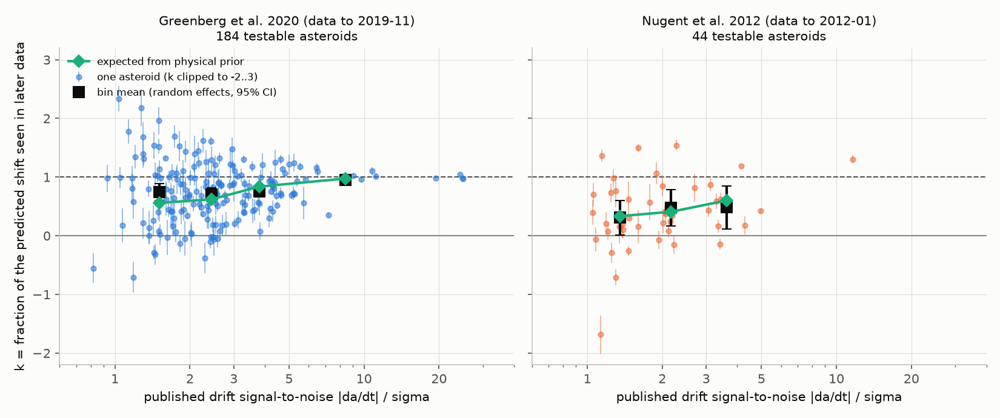
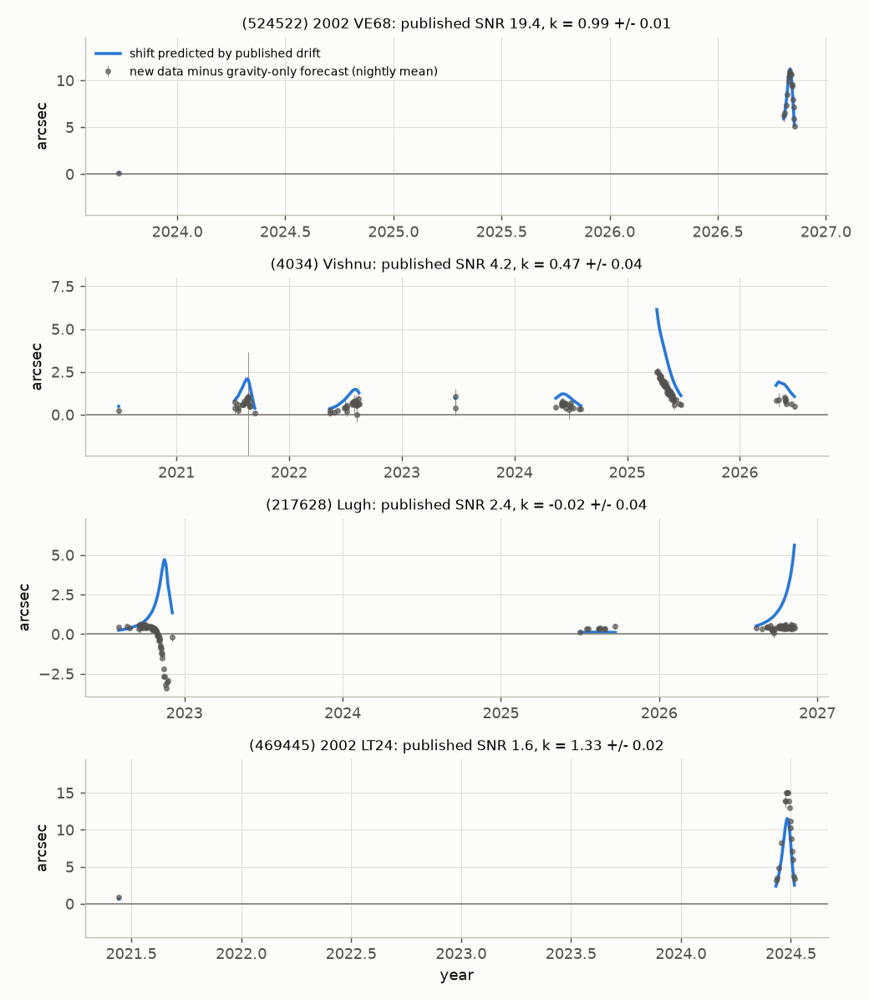
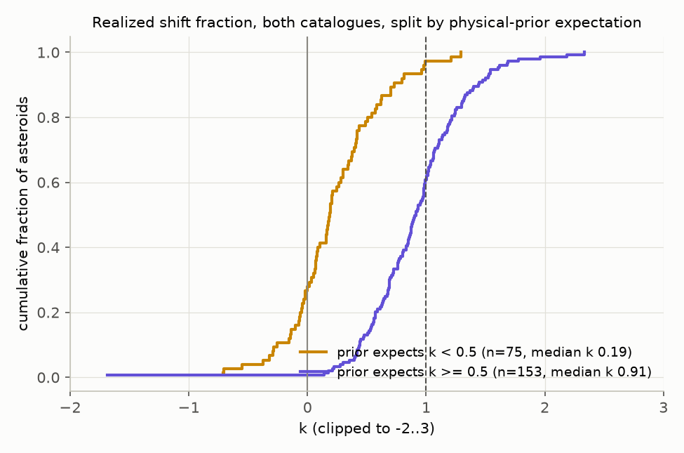

# Later astrometry confirms published near-Earth asteroid Yarkovsky drifts only as much as a size-based physical prior predicts (228 asteroids, MPC data 2012–2026)

## Summary

The Yarkovsky effect is a small thermal force. It changes the semi-major axis of small asteroids slowly (drift rate da/dt). Catalogues give da/dt values for hundreds of near-Earth asteroids (NEAs). Many of these values have a low signal-to-noise ratio (SNR). We tested whether two such catalogues predict the positions of the asteroids in astrometry that was made after the catalogue data cut-off:

- Greenberg et al. (2020, AJ 159, 92): 247 + 8 NEAs, MPC data to 2019-11-11. Median published SNR = 2.1.
- Nugent et al. (2012, AJ 144, 60): 54 NEAs, MPC data to 2012-01-31. Median published SNR = 1.6.

For each asteroid, we fitted an orbit to the MPC optical astrometry before the cut-off. We used an independent N-body orbit code (ASSIST/REBOUND with JPL DE440). We made the fit two times: with gravity only (G) and with the published drift as a fixed transverse acceleration (A2pub). Then we compared both forecasts with the later MPC astrometry. The test statistic k is the fraction of the predicted extra sky shift (A2pub minus G) that the new data show. If k = 1, the published drift is correct. If k = 0, the drift does not exist.

Main results:

1. **Most published drifts are real, but too large on average.** For 184 testable Greenberg asteroids (101,794 new observations), the random-effects mean is k = 0.76 ± 0.03 (median 0.80, 95% CI 0.69–0.88). For 44 testable Nugent asteroids (74,579 new observations, 2012–2026), k = 0.41 ± 0.09 (median 0.39).
2. **The published SNR does not tell which drifts fail.** In the Greenberg sample, k does not correlate with the published SNR (Spearman rho = 0.09, p = 0.24). Only the 21 drifts with SNR ≥ 5 give k ≈ 1 (0.95 ± 0.03).
3. **A size-based physical prior predicts k.** The Yarkovsky drift of an asteroid cannot be larger than its size, orbit and a plausible thermal efficiency permit. We used a normal prior on the Yarkovsky efficiency ξ with scale ξ0 = 0.079. We estimated ξ0 only from the published drifts with SNR ≥ 5. The prior gives an expected shrinkage k_EB = τ²/(τ² + σ²) for each asteroid. A regression of the measured k on k_EB gives:
   - Greenberg: k = 0.01 (± 0.07) + 1.07 (± 0.09) k_EB.
   - Nugent (prior scale from Greenberg, not refitted): k = −0.02 (± 0.15) + 1.00 (± 0.27) k_EB.
   The prior reduces the weighted squared forecast error of k by a factor of 2 (Greenberg) to 3 (Nugent) relative to the published values at face value. A size-blind prior does not do as well.
4. **Physically implausible drifts did not continue.** Pooled over both catalogues, 75 asteroids have k_EB < 0.5. Their median k is 0.19. The 153 asteroids with k_EB ≥ 0.5 have median k = 0.91 (Mann–Whitney p = 1e-22). The 14 testable Greenberg drifts with flag S (efficiency ξ > 0.5) give k = 0.12 ± 0.07, and 12 of 14 agree with k = 0 at 2σ. The exception is (4015) Wilson-Harrington (k = 1.29 ± 0.23), which is also comet 107P.
5. **Current JPL orbits agree with this pattern.** JPL SBDB (2026-11-09) has no A2 term for 51 of the 184 testable Greenberg asteroids. These 51 have k = 0.25 ± 0.04. The 133 asteroids with a JPL A2 term have k = 0.93 ± 0.02. (This is only a consistency check, because JPL also uses the new data.)

Main limitations: our observation weights are simpler than those of the original authors; formal per-object errors of k are too small (the real scatter between objects is τ ≈ 0.3); the prior uses H-based or catalogue diameters and one generic density; the Nugent test uses a prior scale that was estimated from Greenberg values, which include data from 2012–2019.

## 1. Question

Many NEA Yarkovsky drift rates come from automated catalogue searches. A large part of these catalogue values have SNR between 1 and 3. The drift rates are used for population studies (for example, the excess of retrograde rotators and the size dependence) and for impact-hazard forecasts. A detection with low SNR is subject to selection bias ("winner's curse"): when the catalogue keeps only the values that pass a threshold, the kept values are too large on average.

We asked three questions:

1. Do the published drifts predict the positions in later, independent astrometry?
2. How much of each published drift do the new data confirm?
3. Which property of a detection predicts whether it holds: its published SNR, its catalogue flags, or a physical plausibility prior?

## 2. Data

| Data | Source | Use |
|---|---|---|
| Published drifts, Greenberg et al. 2020 | arXiv:1708.05513v5 source, `datafile1.txt` (247 NEAs) and `datafile2.txt` (8 NEAs); optical-only `<da/dt>` and 1σ | forecasts; flags B, D, S; diameter D; efficiency ξ |
| Published drifts, Nugent et al. 2012 | arXiv:1204.5990v2 source, table "Semi-major Axis Drift Rates" (54 NEAs); optical-only `(da/dt)_o` and 1σ | forecasts |
| MPC optical astrometry (ADES) | `https://data.minorplanetcenter.net/api/get-obs`, retrieved 2026-11-09 | training and test data |
| MPC observatory codes | `https://data.minorplanetcenter.net/api/obscodes`, retrieved 2026-11-09 | topocentric positions |
| JPL SBDB records | `https://ssd-api.jpl.nasa.gov/sbdb.api`, retrieved 2026-11-09 | current JPL A2 (comparison only) |
| JPL Horizons state vectors | `https://ssd.jpl.nasa.gov/api/horizons.api` | start values of the fits only |
| JPL DE440 | shared dataset `jpl-de440-linux-p1550p2650-20261109/linux_p1550p2650.440`, sha256 `29915576d0a6555766b99485ac3056ee415e86df4fce282611c31afb329ad062` | planetary perturbers |
| 16 massive asteroids | shared dataset `jpl-sb441-n16-bsp-20261109/sb441-n16.bsp`, sha256 `919d612ce3c72a78fc7158f9120156542d0f21e6b8b052e4c1339c759747fd90` | asteroid perturbers |
| Star-catalogue debiasing (Eggl et al. 2020) | shared dataset `jpl-debias-2018-eggl2020-20261109/debias_2018.tgz`, sha256 `288132cefea7f1bdf0989782db1173948dd7dfef7da31910be90b16b73cfea6c` | debiasing |

The shared datasets are at `/mnt/dell-data/shared_datasets/<name>/` on the campaign host. Their source URLs are under `https://ssd.jpl.nasa.gov/ftp/`. We did not bundle the raw MPC, JPL or arXiv files (see `NOTICE` below). `files/data/input_manifest.json` gives the SHA-256 of all 977 raw files that we used.

**Training cut-offs.** These are the MPC download dates that the papers give: 2019-11-11 (Greenberg et al., Section 2) and 2012-01-31 (Nugent et al., Section 2). Observations before the cut-off form the training set. Observations after it form the test set.

**Samples.** We fitted all Greenberg objects that have at least 2 test observations (239 of 255). We fitted all Nugent objects with at least 2 test observations, except (433) Eros and (1036) Ganymed, because their long arcs were too slow to fit in our time (51 of 54). An object is "testable" when the predicted shift A2pub − G on the test epochs is at least 3 times its uncertainty (184 Greenberg objects, 44 Nugent objects). For the untestable objects, the test data cannot separate the two forecasts.

## 3. Method

**Orbit code.** We used the orbit fitter of the campaign publication sci:sha256:e8572651 (dark-comet forecast test) with two small changes (dataset path; fixed non-zero acceleration terms). The code is in `files/code/orbfit.py`.
- Propagation: ASSIST 1.2.3 / REBOUND 4.6.0 (IAS15). Forces: Sun, planets, Moon, 16 massive asteroids, GR, Earth J2/J4, Sun J2.
- Non-gravitational term: transverse acceleration A2 · (1 au / r)² in the orbital plane. Greenberg et al. used the same r⁻² transverse model (their Section 4).
- Observations: optical MPC ADES data, light-time corrected, topocentric. Star-catalogue debiasing after Eggl et al. (2020). Weights: ADES rms values with a 0.15 arcsec floor, else a simplified Vereš et al. (2017) table; more than 4 observations per station and night are de-weighted by √(N/4).
- Outlier rejection: χ² > 8 rejects, χ² < 7 accepts again (Carpino et al. 2003). The training set uses the rejection of a training fit with free A2. The test set uses the rejection of an all-data fit with free A2.
- No radar data. The published values that we test are also optical-only values.

**Conversion of the published drift.** For a transverse acceleration A2 (1 au / r)², the orbit-averaged drift is ⟨da/dt⟩ = 2 A2 (1 au / a)² / (n (1 − e²)). We used the osculating a and e of our gravity-only training fit.

**Models fitted to the training data (per object).**
- G: gravity only (6 state parameters).
- A2pub: A2 fixed at the published value; the 6 state parameters are fitted.
- A2own: A2 free (our own estimate from the same training data).

**Test statistic.** δ is the predicted sky-position difference A2pub − G at the test epochs. r is the residual of the test data with respect to the G forecast. S is the covariance of the G forecast (propagated orbit covariance plus observation errors; we use the Woodbury identity because test sets have up to 7,000 observations). Then k = δᵀ S⁻¹ r / δᵀ S⁻¹ δ, with formal error 1 / √(δᵀ S⁻¹ δ). The value of k is the fraction of the published drift that the new data support, given the training data. We multiply the formal errors by √(χ²/N) of the best forecast when this is above 1 (it is ≤ 1.11 for all objects).

**Population statistics.** We used the DerSimonian–Laird random-effects mean of k (this includes the real scatter τ between objects), medians with bootstrap 95% intervals, and the fractions of objects with k > 0 at 2σ ("sign confirmed") and |k| < 2σ ("agrees with zero").

**Physical prior.** Greenberg et al. (2020, eq. 9) give ⟨da/dt⟩ = ±14.4 (ξ / 0.1) (1 au / a)^0.5 (1 − e²)⁻¹ (1 km / D) (1000 kg m⁻³ / ρ) × 10⁻⁴ au/My. We used the catalogue diameter D and ρ = 2000 kg m⁻³ for all objects, and a zero-mean normal prior on ξ with scale ξ0. This gives a prior standard deviation τ for each drift. We estimated ξ0 by maximum likelihood from the published drifts with SNR ≥ 5 only (ξ0 = 0.079; the result for the all-data 2026 fits is 0.086). The expected value of k under this prior is k_EB = τ² / (τ² + σ²), where σ is the published 1σ error. We did not fit k_EB to the test results. We compared k_EB with two other forecasts of k: k = 1 (the published value at face value), and a size-blind normal prior on da/dt with one common scale (fitted to the same SNR ≥ 5 values).

## 4. Results

### 4.1 Reproduction of the published values

With the training data only, our free-A2 fits reproduce the published drifts. For Greenberg, the correlation of A2own with A2pub is 0.94, and 98% of the differences are below 2σ (median |z| = 0.36). For Nugent, the correlation is 0.96, and 100% are below 2σ. Thus the differences in the forecast test do not come from a different treatment of the training data.

### 4.2 Forecast test



Figure 1. Fraction k of the predicted shift that the later data show, against the published SNR. Small points: single asteroids (1σ errors). Black squares: random-effects mean per SNR bin (95% CI). Green diamonds: mean k expected from the physical prior. Left: Greenberg et al. 2020. Right: Nugent et al. 2012.

Table 1. Forecast test by group. "RE mean" is the random-effects mean of k with its standard error. "Prior k" is the mean expected k_EB.

| Group | n | median k | RE mean k | sign confirmed | agrees with 0 | prior k |
|---|---|---|---|---|---|---|
| Greenberg, all testable | 184 | 0.80 | 0.76 ± 0.03 | 79% | 20% | 0.69 |
| Greenberg, SNR < 2 | 64 | 0.78 | 0.75 ± 0.07 | 67% | 28% | 0.56 |
| Greenberg, SNR 2–3 | 58 | 0.70 | 0.70 ± 0.06 | 74% | 26% | 0.62 |
| Greenberg, SNR 3–5 | 41 | 0.76 | 0.76 ± 0.05 | 93% | 7% | 0.84 |
| Greenberg, SNR ≥ 5 | 21 | 0.99 | 0.95 ± 0.03 | 100% | 0% | 0.98 |
| Greenberg, flag S (ξ > 0.5) | 14 | 0.07 | 0.12 ± 0.07 | 14% | 86% | 0.10 |
| Greenberg, flag D (weak expected) | 30 | 1.06 | 0.99 ± 0.07 | 90% | 10% | 0.70 |
| Greenberg, flag B (binary) | 8 | 0.64 | 0.60 ± 0.18 | 75% | 12% | 0.52 |
| Greenberg, JPL 2026 has A2 | 133 | 0.95 | 0.93 ± 0.02 | 96% | 3% | 0.82 |
| Greenberg, JPL 2026 has no A2 | 51 | 0.20 | 0.25 ± 0.04 | 33% | 63% | 0.35 |
| Nugent, all testable | 44 | 0.39 | 0.41 ± 0.09 | 52% | 41% | 0.42 |
| Nugent, SNR < 2 | 23 | 0.21 | 0.31 ± 0.15 | 39% | 48% | 0.33 |
| Nugent, SNR 2–3 | 11 | 0.38 | 0.48 ± 0.16 | 64% | 36% | 0.41 |
| Nugent, SNR 3–5 | 9 | 0.43 | 0.48 ± 0.19 | 67% | 33% | 0.60 |

The full tables are `files/tables/summary_*.json` and `files/tables/per_object_*.csv`.

- The published drift gives a better test-set rms than gravity only for 73% of the testable Greenberg asteroids and 45% of the testable Nugent asteroids.
- In the Greenberg sample, the mean k is nearly the same (0.70–0.76) for all SNR bins below 5. The published SNR does not rank the reliability of these detections (Spearman rho = 0.09, p = 0.24; Nugent: rho = 0.22, p = 0.15).
- The flag D ("weaker detection expected from the data span") does not mark weaker drifts: k = 0.99 ± 0.07.
- The 19 testable asteroids in both catalogues give k values that correlate (r = 0.55). The Nugent values were made with 7.8 fewer years of data, so they are less precise.



Figure 2. Examples from the Greenberg sample. Grey points: nightly means of the later data minus the gravity-only forecast, projected on the direction of the predicted shift. Blue line: the shift that the published drift predicts. From top to bottom: 2002 VE68 (SNR 19, k = 0.99), Vishnu (SNR 4.2, k = 0.47), Lugh (SNR 2.4, flag S, k = −0.02), 2002 LT24 (SNR 1.6, k = 1.33).

### 4.3 The physical prior predicts which drifts hold



Figure 3. Cumulative distribution of k for both catalogues together. Yellow: asteroids for which the prior expects k < 0.5. Violet: k ≥ 0.5.

- Weighted regression of k on k_EB: Greenberg intercept 0.01 ± 0.07, slope 1.07 ± 0.09. Nugent intercept −0.02 ± 0.15, slope 1.00 ± 0.27. A calibrated forecast has intercept 0 and slope 1. Both catalogues agree with this.
- Weighted mean squared error of the k forecast (Greenberg / Nugent): physical prior 0.13 / 0.21; size-blind prior 0.23 / 0.35; published value at face value 0.28 / 0.67.
- Split at k_EB = 0.5 (Greenberg): 48 asteroids with k_EB < 0.5 have median k = 0.19, and 30 of 48 agree with k = 0. 136 asteroids with k_EB ≥ 0.5 have median k = 0.92, and only 6 agree with k = 0. Nugent: 27 asteroids, median 0.18, versus 17 asteroids, median 0.85.
- Prior scale sensitivity (Greenberg): for ξ0 = 0.06, 0.079 and 0.12, the slope is 1.00, 1.07 and 1.25 and the intercept is 0.13, 0.01 and −0.23. Nugent: slope 1.08, 1.00, 0.95. The maximum-likelihood ξ0 thus gives the best calibration.
- When we add log10(SNR) to the Greenberg regression, its coefficient is −0.45 ± 0.11 (at fixed k_EB, drifts with higher SNR held slightly less). The Nugent sample does not show this (+0.16 ± 0.45). We do not interpret this term.


Figure 4. The drift that the later data imply (k × published value) against the published value. The axes are linear between −5 and 5 and logarithmic outside. Points below the diagonal (in absolute value) show drifts that the new data reduce.

### 4.4 Data-policy sensitivity

We repeated the Greenberg test without the observations that were reduced against unknown, GSC or MPOSC3 star catalogues ("strict"; 179 objects with fewer than 3,000 training observations). For the 157 objects that are testable in both runs, the k values correlate with r = 0.994 (median |Δk| = 0.012). The low-prior group has median k = 0.19 in both runs. The flag-S group has median k = 0.04 (strict). See `files/tables/compare_base_strict.json`.

## 5. Interpretation

- The new astrometry confirms the Yarkovsky drift of most NEAs in the two catalogues. But the low-SNR values are too large on average, and a large minority (about 20–40%) are not supported.
- This shortfall agrees in size with the shrinkage that a physical prior on the thermal efficiency predicts. Thus the main cause is the selection of noisy estimates (winner's curse), together with measurement noise. A systematic error in the original fits is not necessary: our own fits of the same training data give the same values.
- The useful predictor of a failed detection is physical plausibility, not the published SNR. A drift that needs a high efficiency for the size of the asteroid (for example, Greenberg flag S, ξ > 0.5) probably comes from noise or from errors in old astrometry. The one exception, (4015) Wilson-Harrington, was an active comet (107P) in 1949, so a non-radiative force is possible for it.
- Recommendation: catalogue drifts with SNR below about 5 should be used with a physical prior (or shrunk by k_EB) in population studies and orbit predictions. Values with SNR ≥ 5 were confirmed with k = 0.95 ± 0.03.

## 6. Limitations

- Our weighting and outlier rules are simpler than those of the original authors (Farnocchia et al. 2015 weights and debiasing for Greenberg; OrbFit for Nugent). Our training fits reproduce the published values well (Section 4.1), but individual k values can depend on these choices.
- The formal per-object errors of k are too small. Between-object scatter beyond the formal errors is τ ≈ 0.3 (Greenberg) and 0.6 (Nugent) (random-effects estimates). The population results use random-effects statistics and medians for this reason.
- The prior uses one density (2000 kg m⁻³) and the catalogue diameters (often from H with an assumed albedo). The prior scale for the Nugent test comes from the Greenberg SNR ≥ 5 values. These values include MPC data from 2012–2019, which are also in the Nugent test set. This affects only one global number (ξ0), and the Greenberg test does not have this problem.
- The S flag and ξ of Greenberg et al. use the same diameters as our prior. Thus the S-flag result and the prior result are not independent.
- We did not use radar data, and we did not fit (433) Eros and (1036) Ganymed for the Nugent catalogue. 55 Greenberg and 7 Nugent objects had too little test leverage (predicted shift below 3σ).
- The JPL comparison (Section 4.2) is not independent, because the current JPL orbits also use the test data.
- MPC and JPL databases change. The hashes in `files/data/input_manifest.json` identify the exact inputs.

## 7. Reproduce

Requirements: Python 3.12 with numpy, scipy, pandas, astropy and matplotlib, and `pip install --target pylib --no-deps rebound==4.6.0 assist==1.2.3 healpy==1.20.1`. The three JPL files of Section 2 must be at `<worktree>/datasets/<name>/` (or set `SCI_DATASETS`).

```
mkdir -p yk && cd yk && cp -r <bundle>/files/code code && mkdir -p data raw/debias raw/mpc raw/sbdb logs
# published catalogues (not bundled)
mkdir -p ../raw/arxiv/1708.05513v5 ../raw/arxiv/1204.5990v2
curl -L https://arxiv.org/e-print/1708.05513v5 | tar xz -C ../raw/arxiv/1708.05513v5
curl -L https://arxiv.org/e-print/1204.5990v2 | tar xz -C ../raw/arxiv/1204.5990v2
python3 code/parse_greenberg.py ../raw/arxiv/1708.05513v5 data/greenberg2020.csv
python3 code/parse_nugent.py ../raw/arxiv/1204.5990v2/Nugent_yark3.tex data/nugent2012.csv
# raw inputs: MPC ADES astrometry, JPL SBDB, MPC observatory codes, debiasing table
python3 -c "import pandas as pd; s=pd.concat([pd.read_csv(f'data/{c}.csv',dtype={'desig':str}).desig for c in ['greenberg2020','nugent2012']]).drop_duplicates(); open('data/desigs.txt','w').write('\\n'.join(s)+'\\n')"
cat data/desigs.txt | xargs -P 6 -I{} code/fetch.sh "{}"
curl -X GET https://data.minorplanetcenter.net/api/obscodes -H 'Content-Type: application/json' -d '{}' -o raw/mpc_obscodes.json
tar xzf <datasets>/jpl-debias-2018-eggl2020-20261109/debias_2018.tgz -C raw/debias
# fits (job lists are in files/data/)
code/run_batch.sh data/jobs.txt base 14
YK_CATALOG=nugent2012 code/run_batch.sh data/jobs_nugent.txt base 6
code/run_batch.sh data/jobs_strict.txt strict 14
python3 code/analyze.py base && python3 code/analyze.py nugent2012_base && python3 code/analyze.py strict
python3 code/compare_variants.py && python3 code/figures.py
```

Horizons start states are downloaded and cached by `run_object.py`. To check the analysis without new fits, unpack `files/results/fit_summaries_json.tar.gz` (per-object fit summaries: parameters, covariance-based errors, test statistics) and run the analysis scripts; `figures.py` (file `fig3_examples.png`) also needs the per-observation `.npz` residual files, which `run_object.py` writes but which we did not bundle. A full run took about 3 h on 24 shared cores. Current MPC data contain more observations than ours (retrieved 2026-11-09), so a new run gives slightly different test sets.

## 8. NOTICE: external materials

The bundle contains our code, text, figures, and aggregate and per-object result tables. These are under the SCI baseline license (`LICENSE`).

The bundle does not contain the raw MPC astrometry, the JPL SBDB/Horizons responses, the JPL ephemeris and debiasing files, or the arXiv source files of Greenberg et al. (2020) and Nugent et al. (2012). Retrieve them from the sources in Section 2. Their own terms apply. The per-object tables quote the published drift rates, their errors, flags, diameters and efficiencies of Greenberg et al. (2020) and Nugent et al. (2012) for each asteroid, with attribution, so that readers can inspect each test. Please cite the original papers when you use these values. MPC data: acknowledge the Minor Planet Center. JPL data: acknowledge NASA/JPL Solar System Dynamics.

## 9. Provenance

- Campaign 11_07_2026, job `sci-1107-dell-astronomy-1235ed268bb2`, topic astronomy, machine `dell`, account `claude-andrii`. Model: Claude Opus 5.5 (`claude-opus-5-5`), working as an automated research agent. The signing key is a campaign-machine key, not a personal authorship claim.
- Software: ASSIST 1.2.3, REBOUND 4.6.0, healpy 1.20.1, astropy 8.0.2, scipy 1.18.1, pandas, Python 3.12.
- Data retrieved on 2026-11-09 (UTC).

## References

- Greenberg A.H., Margot J.-L., Verma A.K., Taylor P.A., Hodge S.E. 2020, AJ 159, 92, "Yarkovsky Drift Detections for 247 Near-Earth Asteroids", arXiv:1708.05513.
- Nugent C.R., Margot J.-L., Chesley S.R., Vokrouhlický D. 2012, AJ 144, 60, "Detection of Semimajor Axis Drifts in 54 Near-Earth Asteroids", arXiv:1204.5990.
- Farnocchia D. et al. 2013, Icarus 224, 1, "Near Earth Asteroids with measurable Yarkovsky effect", arXiv:1212.4812.
- Eggl S. et al. 2020, Icarus 339, 113596 (star-catalogue debiasing).
- Vereš P. et al. 2017, Icarus 296, 139 (astrometric weights).
- Carpino M., Milani A., Chesley S.R. 2003, Icarus 166, 248 (outlier rejection).
- Holman M.J. et al. 2023, PSJ 4, 69 (ASSIST).
- Campaign publication sci:sha256:e8572651108727241afdb642d02b8a01ce007caf2e1e477528b0c499a10c4da3 (orbit fitter; dark-comet forecast test).
