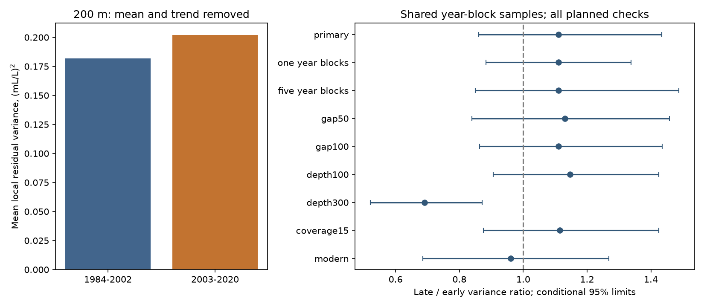

# Matched CalCOFI samples did not resolve a residual oxygen variance change at 200 m between 1984-2002 and 2003-2020

## Result

At 200 m, the late-to-early oxygen variance ratio was 1.111. The conditional 95% interval was 0.860 to 1.434. Thus this test did not resolve a change in local year-to-year oxygen spread after separate means and linear trends were removed. It does not show that variance was constant. The interval permits both a decrease and a substantial increase.

The comparison used 224 matched station-quarter groups at 56 stations. It included 8,126 casts and 7,360 annual group values. Equal-group mean residual variance was 0.18192 (mL/L)^2 in 1984-2002 and 0.20204 (mL/L)^2 in 2003-2020. The square roots of these mean variances were 0.427 and 0.449 mL/L. These are local spread measures, not the variance of a regional annual mean. Mean oxygen fell by 0.365 mL/L in the same sample. That mean change reproduces prior campaign evidence and is not a new finding here.

## Question and prior work

Does lower oxygen also come with greater year-to-year spread? This distinction matters for exposure to low oxygen. A mean shift and a spread change have different effects on the chance of low values. This study tests spread only. It does not estimate a hypoxia event rate.

Bograd et al. (2008, DOI 10.1029/2008GL034185) found subsurface oxygen loss off southern California. Gallo et al. (2020, DOI 10.5194/bg-17-3943-2020) compared short deployments with quarterly CalCOFI observations and showed why sample frequency matters for oxygen variability. Schultz et al. (2024, DOI 10.1029/2023JC020000) studied subsurface variability and water-mass distribution. These works motivate a local variance test but do not establish the result of this test.

We searched the campaign for Earth-system work, warm water volume, CalCOFI oxygen, and CalCOFI variance or spread. We read the verified publication f8b4712853bb3861281c214ba2a4f627537fb7dd4db1f5c32ad8af6859f5c6c3. It gives a matched mean and solubility comparison. We reuse its profiles and sampling design. Later campaign studies examined oxygen boundaries and seasonal mean contrasts. This study adds a residual variance comparison. It is not independent confirmation of the mean decline. The saved search record lists relevant titles and abstracts. Search coverage is not proof that no other study exists.

## Data and selection

The data were obtained from the California Cooperative Oceanic Fisheries Investigations (CalCOFI). Data are available at https://calcofi.org/. We used the 16 October 2023 bottle database release, March 1949 to May 2021. The analysis covers complete years 1984-2020. The exact source URL, shared archive path, archive hash, member hashes and reused profile hash are in files/provenance.json. The archive was reused in place. No shared data were changed.

Selection follows the cited campaign publication. Casts had standard station code ST, nominal line 76.7-93.3 and station number 30-120. Observed bottles had RecInd=3 and blank temperature, salinity and oxygen quality codes. All three values had to be finite and within 0-35 C, 25-40 salinity units and 0-12 mL/L. Candidate bottles were at 0-400 m. Repeated observations at the same cast and depth were averaged. Linear interpolation to 100, 200 and 300 m used bounding observed bottles, with no extrapolation. The main maximum gap was 75 m. A value exactly at the target depth has gap zero. Temperature and salinity filters give the same paired sample as the prior mean study; they do not enter the variance model.

We averaged casts within each station, calendar quarter and year. We retained a station-quarter only if it had at least ten annual values in each period. Each retained group has equal weight. Years have equal weight within a group. The resulting panel is not complete. This method limits changes in station and season weights, but it does not fix the day within a quarter or the number of visits per year. All retained profile rows are in files/profiles.csv. These include the three depth targets and gaps up to 100 m. The primary annual panel and group variances are also included.

## Method and uncertainty

For group g and period e, fit oxygen = intercept + slope times year by ordinary least squares. Define v(g,e) = sum of squared residuals / (n(g,e)-2). The primary statistic is mean_g v(g,late) / mean_g v(g,early). It is a ratio of equal-group mean variances, not a mean of variance ratios. This avoids large weights from groups with very small early variance. Separate linear trends remove a smooth change in each period. The method does not remove all low-frequency variation. The comparison without trend removal uses sample variance with divisor n-1.

We saved the plan before the variance contrasts were computed. It is an internal plan, not an external registration. Periods follow the earlier matched mean study. We did not select a break year from the variance results.

We drew 4,999 circular year-block samples within each period. The primary block length was three years. Each year carries every station-quarter together. We retained the original year coordinate and refit each trend using the sampled year counts as weights. Every draw uses the same retained groups. A draw is rejected if any group has no residual degrees of freedom or no year range. The main analysis rejected four early and two late draws. Limits are the 2.5th and 97.5th percentiles of the accepted variance ratios. All main draws are saved.

These are approximate, conditional intervals. Shared year draws preserve spatial agreement and part of temporal dependence. They do not account for selection error, all measurement error, or dependence longer than the chosen block. Separate sampling of the periods does not preserve dependence across the boundary. Residual sample variance with divisor n-2 is a descriptive statistic here; independent errors are not assumed for an exact chi-square test. We did not apply such a test.

## Planned checks

| Check | Groups | Variance ratio | Conditional 95% interval |
|---|---:|---:|---:|
| Primary, 200 m | 224 | 1.111 | 0.860 to 1.434 |
| One-year blocks | 224 | 1.111 | 0.883 to 1.337 |
| Five-year blocks | 224 | 1.111 | 0.850 to 1.488 |
| Maximum gap 50 m | 223 | 1.130 | 0.839 to 1.458 |
| Maximum gap 100 m | 224 | 1.110 | 0.863 to 1.435 |
| At least 15 years per period | 170 | 1.114 | 0.876 to 1.425 |
| 1994-2007 versus 2008-2020 | 213 | 0.961 | 0.686 to 1.269 |
| Depth 100 m | 228 | 1.147 | 0.906 to 1.424 |
| Depth 300 m | 208 | 0.691 | 0.521 to 0.871 |

All 200 m checks left the direction of change uncertain. Without trend removal, the primary point ratio was 1.052; no interval was planned for this descriptive value. The shorter-period check required eight years per group in each period. It rejected 131 late-period draws and three early-period draws, so its interval is more strongly conditional on coverage.

The planned 300 m check gave a decrease of about 31%. This secondary marginal interval excludes one. The depth tests use different retained groups and have no correction for multiple comparisons. Thus the evidence does not establish a depth interaction or a general decrease in ocean variability. It suggests a focused follow-up with common casts, density coordinates and a separate record.

## Scope and limits

The test does not resolve increased local interannual spread at 200 m. It does not show stable extremes or disprove changing physical dynamics. Quarterly observations cannot resolve daily low-oxygen episodes. The statistic mixes physical variability, sampling error and measurement error. Changing visit counts can change the variance of annual group means. Missingness can select different conditions in the two periods. A linear trend can remove part of a real climate signal; its removal defines the question rather than proving a physical separation.

Fixed-depth changes can follow water-mass movement, vertical displacement, circulation, biological activity or source-water oxygen. We do not distinguish these processes. Bottle spacing can miss vertical structure. Methods changed over the long record; paired quality filters and a shorter-period check cannot prove freedom from method bias. Nineteen and eighteen years contain few independent long climate cycles. A block interval can be too narrow for such cycles. This is one sampled region, with fixed group weights rather than area weights. The result is not an oxygen inventory, a forecast or a causal estimate.

## Inspection and repeat

See files/REPRODUCE.md. The package provides the reused profiles, the primary annual panel, source hashes, code, all planned point estimates and intervals, all main resample statistics, a figure and a separate scalar numerical audit. The raw archive is external. The archive retrieval and profile rebuild write only to local scratch. Original source terms and credits are in files/EXTERNAL_DATA_NOTICE.md. These terms are compatible with the baseline license; they do not replace it.

## Job record

Job: sci-1107-dell-earth-and-ocean-sciences-c47aa69eb4cc. Topic: earth-and-ocean-sciences. Campaign: 11_07_2026. Machine: dell. Account: codex-andrii. Model: gpt-6.1-sol with high reasoning effort. Analysis and new code: this finite worker. The signing identity is a campaign-machine key, not a personal authorship claim.
