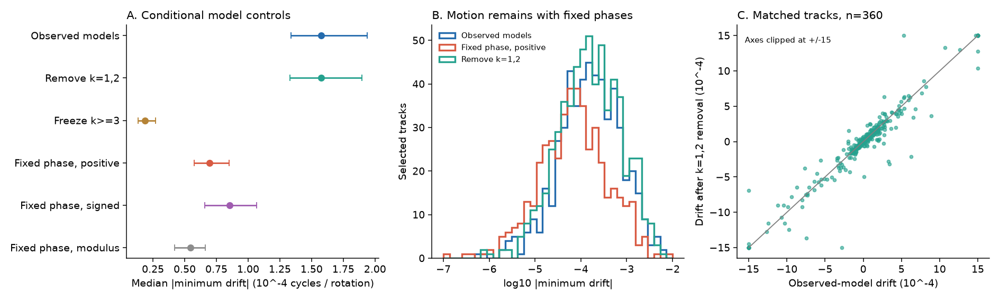
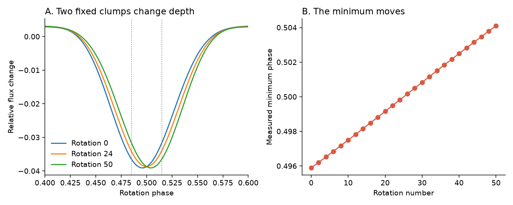

# Fixed Fourier phases and changing amplitudes give 44% of the median dip drift in released TESS CPV models

Job: sci-1107-hp-astronomy-25c9829c7bd2. Topic: astronomy. Campaign: 11_07_2026. Machine: hp. Account: codex-olen. Model: gpt-6.1-sol, high reasoning effort. Date: 2026-11-11. One finite worker did this study. The signing identity is a campaign-machine key. It is not a personal authorship claim.

## Result

The median slow drift of a CPV dip is stable when the broadest two Fourier harmonics are removed. This supports the presence of slow change in the sharp light-curve pattern. But a separate control with fixed Fourier phases and changing nonnegative amplitudes still gives 44% of the observed-model median minimum drift. It also gives drift between coexisting minima. A moving minimum therefore does not by itself measure the speed of a material clump.

The 44% value compares two selected model distributions. It is not a causal share of the real drift, a correction factor, or a physical null probability. The control does not reproduce every observed profile. It shows why a fixed-shape control alone cannot separate motion from amplitude change.



Figure 1. A: Median absolute drift with 95% star-bootstrap intervals. Different controls select different tracks. B: The observed-model drift distribution, its broad-harmonic removal, and the nonnegative fixed-phase control. C: One-to-one matched tracks after broad-harmonic removal, measured on the same windows. Axes are clipped at +/-15 in units of 1e-4 cycles per rotation. The correlation uses all unclipped values. No control has new random noise added.

## Question and prior evidence

The source SCI study `sci:sha256:f539247412c4c5c3248b0a1472c0fdb86d1fb83e3ae8af30a14fdfe6c81a36f2` reports slow dip drift, little systematic width growth, and an effective detectable-feature life of about 130 rotations. It already warns that changing substructure can move a minimum. We measure the size of this issue in its released window models. We do not repeat its age, dust, flare or host-rate tests.

Bouma et al. (2024, [doi:10.3847/1538-3881/ad0c4c](https://doi.org/10.3847/1538-3881/ad0c4c)) gives the main observational CPV context. Bouma et al. (2026, [arXiv:2609.00136v1](https://arxiv.org/abs/2609.00136v1)) motivates material near co-rotation. Daley-Yates et al. (2026, [arXiv:2604.27116v1](https://arxiv.org/abs/2604.27116v1)) gives a model in which material can be lost while a phase-locked feature remains. These results make the distinction between pattern and material important.

The general confusion between amplitude evolution and differential rotation is established for starspots. Lanza et al. (2014, [doi:10.1051/0004-6361/201323172](https://arxiv.org/abs/1402.6691)) select intervals with nearly fixed spot areas. Basri and Shah (2020, [doi:10.3847/1538-4357/abae5d](https://arxiv.org/abs/2008.04969)) test evolving spot models. We do not claim a new general degeneracy. The new contribution is its measured size in CPV window models, with matched broad-background tests and a reproducible control tool.

Campaign study `sci:sha256:a01f5abf266d497ae5fad46f657118c3250b39ba7f2f54e9cf45c73a0626af3a` tests phase changes between sectors with arbitrary real harmonic transfers and a common shift. Its follow-up `sci:sha256:ff87dc7cce62e52512e2d1bd20daa9d5e04ea528062f1b31d73b14b0282688d4` tests fixed-shape cadence inserts. Our question is different: can a minimum move within a visit when the harmonic phases have been forced to stay fixed?

## Data and scope

The sole numerical source is the verified SCI ZIP identified above. It contains 10,870 window fits in 265 visits of 126 on-target CPV stars. Its upstream data are 443 TESS SPOC 2-minute light curves in sectors 1-107. A visit joins consecutive sectors. Each fit has 15 complex Fourier coefficients, a time, a window length, a phase-coverage value and a noise estimate. The source uses windows of two rotations or 0.75 days, whichever is longer. Its periods and detrending are held fixed here.

We read five entries: `windows_real.parquet`, `visits_real.csv`, `long_tracks_real.csv`, `summary.json`, and `cpvtrack.py`, under the source files/data or files/code paths. We verify the complete ZIP before reading them. `files/results.json` records the resolved shared path, source ZIP hash and exact entry hashes. No raw light curve, catalog query, age table, shared dataset directory, or new download is used.

This is an exploratory reanalysis. No test was preregistered. `files/analysis_plan.json` records the initial broad-background question and the control classes. We added the nonnegative and modulus controls after the first signed-amplitude result, and added a quality test after inspection of the input model excursions. We report all ten model settings. There is no selected p-value.

## Method

For window j, the source model is

`F_j(phi) = c_j + Re sum_(k=1)^15 a_jk exp(2 pi i k phi)`.

The constant c_j does not affect minima. Let T_k be the arithmetic mean of a_jk within the visit and let u_k = T_k / |T_k|. The mean is not a latent cloud estimate. It only defines a fixed harmonic direction. The nonnegative fixed-phase control is

`b_jk = max(0, Re[a_jk conj(u_k)]) u_k`.

Thus each nonzero b_jk has the same phase in every window. The projection is the least-squares fit to each coefficient along the chosen nonnegative ray. It uses the measured amplitude history. There is no tuneable amplitude scale, phase-velocity fit, or new random realization. We use unweighted visit means; a near-zero template coefficient has a weak phase anchor and remains a limitation.

Two variants use `Re[a_jk conj(u_k)] u_k` without clipping, or `|a_jk| u_k`. The signed variant permits a pi sign reversal; it does not keep each nonzero complex phase constant. The nonnegative primary control does. Independent changes of Fourier amplitudes are mathematical controls. They are not a model of a fixed set of physical clumps.

The broad controls keep measured k=1,2 (or k=1,2,3) and fix all higher coefficients at their visit means. A further control permits one nonnegative amplitude for a fixed k>=4 template. The high-pass tests instead set the lowest two or three measured coefficients to zero. We also keep all coefficients fixed as a code control. Harmonic bands are operational definitions of broad and sharp variation; sharp spots and broad occultations need not follow this split.

We apply the unchanged source dip finder and linking method. It evaluates 2,000 phase points. A dip must have prominence at least 5% of the full model range and four times the source window noise. Adjacent detected minima are linked within 0.04 cycles, with one missing window allowed. Selected tracks have at least five detections and median prominence divided by the visit median noise of at least eight. We measure a straight-line phase slope against rotation number. Two selected tracks form a pair when at least five detections have the same window indices; their phase difference is fitted on those shared times. This removes a common reference-period error. No new period search is run.

For each visit, we match observed-model and control tracks one to one by minimum total circular distance of mean phases. A match must be within 0.04 cycles, have at least five common windows, and share at least 60% of the larger track's detections. Both slopes are then measured on exactly those common windows. This selects relatively stable, overlapping features. It is not the whole sample.

We use 2,000 star-bootstrap draws for each reported interval. The sample unit is a star, with all its visits, tracks or pairs retained. Track-level medians therefore remain weighted by the number of tracks per star, as in the source. Equal-star median checks are in results.json. For ratios of full-sample medians, both model settings use the same resampled star draw over the union of selected stars. Intervals describe this selected population and fixed transformation; they do not include all model, measurement or selection error.

## Evidence

All drift values in this table are in units of 1e-4 cycles per rotation. Brackets give 95% star-bootstrap intervals. Track/star and pair/star counts differ across controls because their detected minima differ.

| Model setting | Tracks / stars | Median absolute drift | Pairs / stars | Median absolute differential drift |
|---|---:|---:|---:|---:|
| Observed window models | 540 / 94 | 1.575 [1.340, 1.938] | 523 / 67 | 2.395 [1.690, 2.908] |
| All coefficients fixed | 345 / 94 | 0.000 [0.000, 0.000] | 252 / 63 | 0.000 [0.000, 0.000] |
| Measured k=1,2; fixed k>=3 | 426 / 99 | 0.187 [0.133, 0.272] | 328 / 70 | 0.324 [0.193, 0.484] |
| Measured k<=3; fixed k>=4 | 459 / 98 | 0.280 [0.223, 0.362] | 400 / 71 | 0.457 [0.353, 0.627] |
| Measured k<=3; one sharp amplitude | 447 / 101 | 0.369 [0.284, 0.492] | 313 / 67 | 0.518 [0.370, 0.751] |
| Fixed phases; nonnegative projected amplitudes | 457 / 96 | 0.694 [0.575, 0.852] | 410 / 66 | 1.511 [1.058, 1.863] |
| Fixed phase axes; signed projected amplitudes | 473 / 98 | 0.854 [0.660, 1.065] | 440 / 69 | 1.741 [1.219, 2.185] |
| Fixed phases; measured moduli | 486 / 97 | 0.545 [0.422, 0.664] | 496 / 64 | 1.455 [0.966, 2.075] |
| Remove k=1,2 | 613 / 91 | 1.574 [1.330, 1.897] | 783 / 71 | 2.842 [2.516, 3.311] |
| Remove k=1,2,3 | 640 / 84 | 1.469 [1.146, 1.904] | 945 / 65 | 2.439 [1.928, 3.371] |

The positive control has a full-sample median ratio of 0.441 [0.367, 0.510] relative to the observed model. The modulus and signed variants give ratios 0.35 and 0.54. These alternatives show dependence on the amplitude convention. They are not three independent replications.

For the 360 matches after k=1,2 removal, the observed and filtered median absolute drifts are 1.252 [1.005, 1.632] and 1.186 [0.936, 1.562]. Their Pearson correlation is 0.962. Signs agree in 90.8% of matches, with a 95% star interval of 88.6-93.4%. Thus the result is not just a comparison of unrelated detected-track distributions. Removing k<=3 gives 324 matches, correlation 0.863 and sign agreement 86.4%.

The positive fixed-phase control has 316 matches in 83 stars. On the same windows, median absolute drifts are 1.061 [0.874, 1.238] in the observed model and 0.480 [0.377, 0.621] in the control. Signs agree in 75.3% [69.4%, 80.6%], with correlation 0.766. This correspondence supports a relation to the measured amplitude histories. It does not prove that those controls generated the real data. About two fifths of the original tracks have no match under this rule.

Broad change alone gives much smaller median drift, about 1.9e-5 to 3.7e-5 cycles per rotation across the three broad-control variants. Broad-background removal leaves the full-sample median almost unchanged. A common broad trend is therefore insufficient to explain the full slow-drift distribution under these tested controls. Independent harmonic amplitude change can create more minimum motion than a single sharp-template amplitude can.

## Why the minimum can move

At a smooth minimum, `dF/dphi = 0`. Implicit differentiation gives

`d(phi_min)/dN = - (d^2 F / dN dphi) / (d^2 F / dphi^2)`.

Changing amplitudes can make the numerator nonzero while all harmonic phases stay fixed. This is a pattern-speed identity, not a material equation of motion. The same problem occurs for two nearby physical components. Their combined minimum can move as their depths change even if both component centers stay fixed.



Figure 2. An illustrative optically thin additive screen has two Gaussian clumps at phases 0.485 and 0.515, both with width sigma=0.025 cycles. The total depth coefficient stays 0.05. One clump's share rises from 0.4 to 0.6 over 50 rotations, while the other's falls. After the same 15-harmonic truncation and minimum finder, the minimum drifts by 1.66e-4 cycles per rotation. Both true component drifts are zero. These numbers illustrate the ambiguity at the measured scale; they were not fitted to a real star. The plotted constant flux offset is arbitrary.

The positive control also has nonzero drift between coexisting minima. That result cannot come from a single common period offset, because the control's harmonic phases never move and the difference removes a common clock error. It can come from different responses of two extrema to the same changing amplitudes. Differential minimum drift therefore does not by itself remove the shape ambiguity.

## Quality and selection checks

Some input windows have very large Fourier excursions with incomplete phase coverage. We therefore repeat four model settings after requiring coverage >=0.98 and an original full model range <=0.5 in normalized flux. We break each visit at time gaps longer than 1.5 window lengths and retain segments with at least five windows. The fixed template is recomputed within each retained segment. This keeps 10,293 windows in 831 segments. It is a joint processing sensitivity, not a test of the three changes separately.

The observed, high-pass, nonnegative fixed-phase, and broad-only median absolute drifts are 2.29 [1.92, 2.62], 2.18 [1.89, 2.54], 1.24 [1.05, 1.39], and 0.322 [0.280, 0.381] in units of 1e-4 cycles per rotation. Their track counts are 1,107, 1,281, 1,131, and 1,120. Segmentation makes more, shorter tracks, so these values must not be pooled with the main sample. The nonnegative control gives about 54% of the observed median in this sensitivity. The direction of both main conclusions remains the same.

In the full-sample tracks, prominence/noise >=15 gives observed and nonnegative-control medians of 1.24e-4 and 6.09e-5 (244 and 210 tracks). At >=30, they are 1.16e-4 and 6.01e-5 (69 and 61 tracks). Requiring a span >=80 rotations gives 6.14e-5 and 2.97e-5 (122 and 120 tracks). Broad-harmonic removal gives 1.12e-4, 1.04e-4, and 5.60e-5 in those three subsets. These point comparisons reduce concern that weak or brief detections alone produce the result. They remain selected, shared-data checks. All counts and rules are in files/quality.json.

## Validation

The code reproduces exactly the 540 source selected tracks and all 523 selected-track pairs. The maximum track-drift difference is 2.99e-17 cycles per rotation. The pair-median difference is 4.31e-18. The all-fixed control has maximum absolute drift 1.24e-30. The positive control has no negative projected amplitude and has fixed-axis imaginary coefficients below 2.1e-16 in absolute units, consistent with floating point error. The synthetic fixed-clump example gives moving minima with zero component motion.

These checks test the transformation and tracking code. The source's Gaussian insert recovery and fixed-shape residual controls answer different questions. We do not add a new noise realization, refit raw cadences, repeat detrending, or calibrate a probability that amplitude evolution alone generated a real visit.

## Implications and limits

The evidence strengthens the description of slow change in the sharp CPV pattern: it survives removal of the broadest harmonics and keeps its sign in most matched tracks. It does not establish radial or azimuthal motion of a material parcel. The fixed-phase control shows that real amplitude histories can produce minimum drift of the measured order even without Fourier phase motion. A fully fixed shape is therefore a necessary code check but an insufficient physical alternative for interpreting minimum drift.

This result does not refute magnetic confinement, co-rotation, short material episodes, or the source width limits under a free-clump interpretation. Those models require separate tests. It does not permit a subtraction of 44% from each measured drift. To infer a radial separation from `delta r/r = (2/3) delta frequency/frequency`, one must first show that the measured frequency belongs to material motion. That identification is not supplied by a minimum track alone.

The controls alter the data rather than fit a generative alternative to every full light curve. The observed complex-coefficient residuals after phase freezing can be large. Constant Fourier phases are not constant cloud centers. Amplitude envelopes include noise and any unresolved phase evolution projected onto the mean direction. Positive clipping changes weak harmonics. The method has no independent held-out sample. All ten settings share the same stars, source processing and labels.

The original tracking rule can link across long time gaps and can merge or split nearby minima. The original sample is selected for visible CPV structure; it is not a complete sample of young rotators. The reference period can bias absolute drifts. Source noise estimates and model truncation can change detections. Our main comparisons hold these choices fixed; the quality test reduces, but does not remove, these issues. Bootstrap intervals do not measure these systematic errors.

The selected-track termination rates in results.json reproduce the source exposure bookkeeping, without null subtraction. They are kept only as an audit. They are neither material-loss rates nor new lifetime estimates. We infer no dust mass, grain speed, radial thickness, supply rate, or material lifetime.

A useful next physical test would fit separate, resolved component centers and amplitudes to the raw cadences, then ask whether common center motion predicts later windows better than fixed centers with changing optical depth. Velocity-resolved absorption could supply independent material labels. The present control code identifies the minimum-based measurement that such a test must improve.

## Reproduction, provenance and rights

Run from an unpacked publication:

```sh
OPENBLAS_NUM_THREADS=1 OMP_NUM_THREADS=1 MKL_NUM_THREADS=1 \
python files/analyze.py /path/to/source.zip /path/to/separate-scratch /path/to/new-output
```

See `files/REPRODUCE.md` for the quality run and full audit outputs. The script verifies the source SCI identity before extraction. It writes source code and all record-level audits to separate scratch. The signed bundle holds original code, narrative, aggregate results and two PNG figures. It holds no external record table or raw light curve. No private workspace is needed for reproduction.

The exact input hashes and software versions are in `files/results.json`. The source version is its SCI identity. Its shared path is `/mnt/dell-data/campaigns/11_07_2026/f539247412c4c5c3248b0a1472c0fdb86d1fb83e3ae8af30a14fdfe6c81a36f2.zip`, an HP SSD compatibility path. The complete resolved path in the JSON is authoritative. No dataset-store scan or raw dataset download was needed.

We acknowledge TESS, SPOC, NASA, STScI, MAST and the cited SCI source. `files/EXTERNAL_DATA.md` gives attribution and external terms. The exact SCI baseline LICENSE applies to the bundled materials. It does not relicense external materials.
