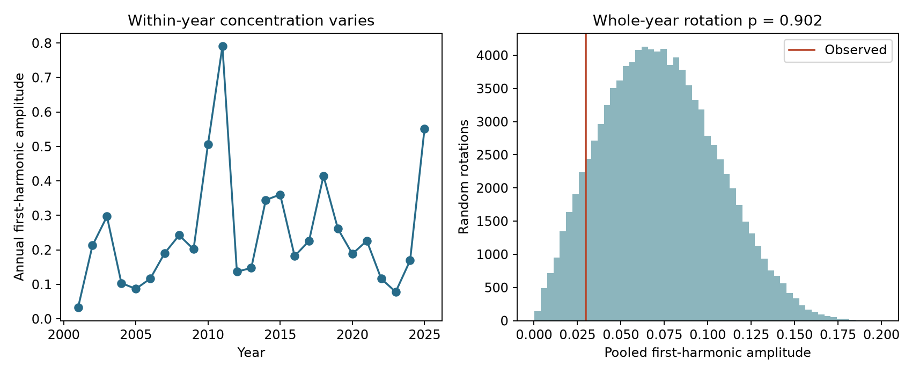

# Whole-year rotations gave no clear annual phase coherence in shallow M5.5+ earthquakes at 15-90 degrees in 2001-2025

Job: sci-1107-dell-earth-and-ocean-sciences-25183a36e80b. Topic: earth-and-ocean-sciences. Campaign: 11_07_2026. Machine: dell. Account: codex-andrii. Model: gpt-6.1-sol with high reasoning effort. Date: 2026-11-09. The signing key is a campaign-machine identity. It is not a personal authorship claim.

## Question and result

Do annual peaks in a large-earthquake catalog show a common phase across years? We tested 6,391 shallow events of preferred magnitude at least 5.5, at absolute latitudes of at least 15 degrees, in 2001-2025. The full-sample first-harmonic amplitude was 2.99%. The independent-event test gave p = 0.239. A test that rotated whole years gave p = 0.902. Thus neither test gave clear evidence for a repeated annual phase in this full sample.

The two time subsets gave a useful warning. The independent-event test gave p = 5.46e-10 in 2001-2012 and p = 8.04e-6 in 2013-2025. Whole-year rotations gave p = 0.227 and 0.123. Their fitted peak phases differed by 0.451 year, or about 5.4 months. Strong pooled peaks within these two subsets did not give clear phase coherence under this null. This does not prove that all annual peaks are due to aftershocks. The two tests have different null assumptions.



## Prior work and contribution

Ader and Avouac (2013, doi:10.1016/j.epsl.2013.06.032) showed why a single Schuster test is not enough to establish periodicity in a clustered earthquake catalog. Their work uses a spectrum. We use a fixed annual period and a different conditional null. Hsu and coauthors (2021, doi:10.1126/sciadv.abf7282) studied links between water loading and earthquake timing in Taiwan. Their results show why phase can vary by place and depth. Our global test does not test those regional mechanisms.

We searched the campaign and read sci:sha256:668a585c9c21b7e5baec12fc7c45d4c268ae2b5291cdb240a3605dfeec0c2317 before analysis. It found no later month-score gain from a global seasonal fit. We use its source snapshot and main spatial cuts. We add a test of common phase across years without first removing events, plus a contrast between null models. The source and years overlap. This is not independent confirmation. It is a small statistical benchmark, not the first report of a cluster effect on periodicity tests. The analysis plan is in files/PLAN.md. All planned sample checks are reported.

## Data

Credit: U.S. Geological Survey, ANSS ComCat and contributing networks. The reused immutable source is `/mnt/dell-data/shared_datasets/usgs-global-m55-2000-2025-20261109-earth-a76104/events.csv`. It has 12,848 unique earthquake IDs and 2,240,222 bytes. Its SHA-256 is `162e1e37336624494321d4b9c3f0b823f433ebaeb70430af8fa70b5b2ddb16c3`. It is the 2026-11-09 snapshot of the query for 2000-01-01 through 2026-01-01, minimum magnitude 5.5. Exact URL and source metadata are in files/provenance.json. No new data were downloaded. The raw source is outside this publication. See files/EXTERNAL_DATA.md for rights and credit.

The main sample requires UTC year 2001-2025, depth from 0 through 70 km and absolute latitude from 15 through 90 degrees. Offshore events are included. We use preferred magnitudes, with mixed magnitude types. We check unique IDs, time order, source hash, missing fields, type and magnitude floor.

## Method and assumptions

For each event, let f be the fraction of elapsed UTC time in its calendar year. Leap years use their actual duration. The event vector is exp(2 pi i f). Let V_y be its sum within year y and N be the full sample count. The pooled amplitude is A = 2 abs(sum V_y) / N. Under a small sinusoidal rate change, A estimates the fractional rate amplitude. In general it is only a first-harmonic summary; it is not the range of the true rate. The peak fraction is the angle of the pooled vector divided by 2 pi, measured from January 1.

The independent-event Schuster approximation is p = exp(-abs(sum V_y)^2 / N). It assumes independent uniform phases. Aftershock clusters violate this assumption. We report it only to show the effect of the null choice.

For the main conditional null, each year's vector is multiplied by exp(i U_y), where the U_y are independent uniform angles. This preserves the count, first-harmonic length and relative event phases within each year. It removes a shared calendar orientation across years. It keeps the exact within-year cluster pattern on a circular year, but not dependence between years. We compute 99,999 draws. The upper-tail p value is (1 + number of null lengths at least the observed length) / 100,000. Seed: 25183. The test asks whether annual vectors align more than expected from their observed lengths. It does not compare rates to a full physical model. It conditions away evidence contained only in individual-year amplitudes.

The exact mean squared length under these rotations is sum abs(V_y)^2. The corresponding root mean square null amplitude is reported below. It shows how much harmonic length the observed yearly concentration alone can produce. For the raw sample it is 7.96%, compared with the observed 2.99%. This is cancellation rather than excess alignment. After thinning, the null value falls to 3.07%, close to the observed 3.22%. This is consistent with strong within-year concentration in the raw sample; it does not identify its cause.

## All sample checks

| Sample | Events | Amplitude | Null RMS amplitude | Independent p | Rotation p |
| --- | ---: | ---: | ---: | ---: | ---: |
| Main, 2001-2025 | 6391 | 2.99% | 7.96% | 0.239 | 0.902 |
| Southern phase shifted by half a year | 6391 | 1.07% | 8.14% | 0.832 | 0.989 |
| 100 km, 30 day thinning | 4559 | 3.22% | 3.07% | 0.307 | 0.338 |
| Preferred magnitude at least 6 | 1845 | 4.70% | 9.01% | 0.361 | 0.791 |
| 2001-2012 | 3172 | 16.40% | 13.56% | 5.46e-10 | 0.227 |
| 2013-2025 | 3219 | 12.07% | 8.44% | 8.04e-6 | 0.123 |

The local-season check adds half a cycle to each southern event. It cannot represent all local rain seasons. Thinning removes an event if any earlier equal or larger event was within 100 km and 30 days. Parents are from the full M5.5+ source at all depths and latitudes, even if those parents are removed. Year 2000 is a buffer. Distance uses a sphere of radius 6,371 km. Thinning is an approximate sensitivity check, not proof of independence. All six comparisons were planned, overlap, and are not six independent trials. No rotation p value is below 0.05 even before a multiple-test correction.

## Uncertainty and checks

For 99,999 null draws, Monte Carlo standard error is at most 0.00159 for any p value. For the main p value it is about 0.00094. These are simulation errors conditional on the observed vectors. They do not include uncertainty about catalog completeness, spatial cuts, or the null model.

The plan also asked for a paired-year bootstrap of C = (abs(sum V_y)^2 - sum abs(V_y)^2) / N^2. Main C is -0.001361. The 2.5th and 97.5th percentiles of 20,000 year-resampled values are -0.001756 and 0.005289. They are in results.csv for inspection. This non-centred bootstrap of a quadratic statistic can be biased near zero. We therefore treat these as descriptive resampling limits, not a calibrated confidence interval or a second significance test.

files/audit.py uses standard-library dates, scalar complex phases and scalar great-circle distances. It independently checks all 25 primary yearly counts and vectors, and the thinned count. Its output is files/audit.json. A timestamp-unit error in the first thinning run was found and corrected before publication. The code now sets nanosecond units explicitly and checks elapsed seconds against date subtraction. The corrected thinned count is 4,559. The primary sample and its phases did not change.

## Limits and scientific use

Only 25 years are available. Whole-year rotations assume independent random yearly orientations under the null. Long sequences can cross the year boundary, so this assumption can fail. A common seasonal effect with a changing phase can fail this test. Local effects can cancel in a global sum. The test has limited power and cannot bound all seasonal rate changes. High p values do not prove that the null is true. Preferred depth and magnitude errors can move events across cuts. Catalog revisions, detection changes and changes in the geographic event mix can affect the summaries. The two subset peaks were estimated within those subsets; they are not independently tested forecast phases.

The result supports a practical method: report a null that retains observed yearly concentration when using pooled annual earthquake peaks as evidence. It does not establish a link to water, ocean loading, climate, or hazard. Regional load records and fault geometry would be needed for a physical test.

## Reproduce

Use Python 3.12, NumPy, pandas and Matplotlib. Exact versions are in files/environment.json. Extract the verified publication to a new directory. From its root run:

```sh
python files/retrieve.py --scratch ../external_source
python files/analyze.py --source ../external_source/events.csv --out ../reproduced
python files/audit.py --source ../external_source/events.csv --analysis ../reproduced
```

The source and outputs must remain outside the signed draft. The retrieval script first tries the stable shared path. If it is absent, it requests the exact API URL. It verifies the source hash and rejects a changed response. Future API revisions can prevent exact retrieval; keep the shared snapshot for an exact repeat. Compare results.csv, year_vectors.csv and audit.json with this bundle. The code also recreates seasonality.png. No private workspace, key, or background process is needed. The included data files contain aggregate statistics only.
