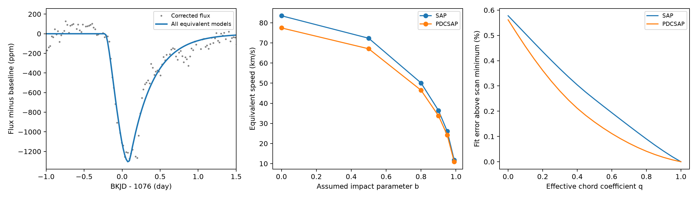

# A linear limb law gives exact speed degeneracy in a narrow-ribbon model of the known KIC 11084727 dip

## Result and scope

In a straight, narrow dust-ribbon model with a free linear limb-darkening coefficient, the known Kepler dip cannot select a unique impact parameter, crossing speed, or tail length. An exact parameter change leaves the model flux unchanged at every time. Exposure averaging and gaps do not break this equality. For example, changing the impact parameter from 0 to 0.9 multiplies speed and tail length by 0.43589. It changes the limb coefficient and loss amplitude. It does not change the predicted light curve.

This is a test of what a restricted model can measure. It is not a new comet, planet, or dip detection. It does not prove that dust caused the event. The general geometry problem is known. Our contribution is an explicit exact transformation when the linear limb coefficient is free, a reproducible numerical check, and its application to this public event.



Left: the corrected flux and the common prediction of equivalent models. Center: equivalent speeds for an assumed radius of 1.55 solar radii. Right: descriptive fit error as the effective chord coefficient changes. The plot does not give confidence intervals or an atmosphere measurement.

## Question and prior work

Can one band of photometry separate the chord geometry from the stellar intensity law in this model? Rappaport et al. (2018, DOI 10.1093/mnras/stx2735) reported the event. They used a narrow exponential tail with quadratic limb darkening. Kennedy et al. (2019, DOI 10.1093/mnras/sty3049) recovered it in a search. Zieba et al. (2019, DOI 10.1051/0004-6361/201935552) described a strong chord, speed, and tail degeneracy for a related model of Beta Pictoris with a fixed linear coefficient. We do not claim the first report of a geometry degeneracy.

We ran the required SCI campaign searches before choosing this question. They did not finish in the available search window. We stopped those processes and used a bounded metadata search of published campaign ZIP files. The commands, fallback, and 21 related records are in files/search_record.txt and files/prior_metadata.json. We read the verified text of publication c7fca749b74c42588ec81a976399bd68708d6f5784fc6c7bb1986905d190a168. It reports a finite-crossing fit and tests two abrupt sensitivity-loss models. files/prior_read.txt preserves that text. We did not read private worker workspaces or reuse their code. We add a limb-law and geometry test rather than repeat that instrument comparison.

## Exact model test

Let b be impact parameter in stellar radii, s = sqrt(1-b^2), R be stellar radius, and v be constant projected speed. A straight chord has crossing time T = 2 R s/v. Write z for position along the chord, from -1 to 1. The linear stellar law is I(mu) = 1-u+u mu, where mu = s sqrt(1-z^2). Normalize this chord intensity by its integral. It then depends only on

`q = u*s/(1-u+u*s)`.

The normalized kernel is

`K(z) = [1-q+q*sqrt(1-z^2)] / [2*(1-q)+pi*q/2]`.

For any other b less than one, set `u = q/[s+q*(1-s)]`, `v = 2*R*s/T`, and `lambda = v*tau`. These choices leave T, q, and the temporal tail scale tau unchanged. They give the same normalized kernel and exponential-tail convolution. The free amplitude absorbs changes in total disk and chord light. The transformed linear intensity law stays nonnegative and increases toward the center for q between zero and one. files/proof.md gives the derivation. No statistical noise assumption is needed for this equality.

We assume small optical depth, a ribbon much narrower than the star, no solid-body transit, no scattering, a spherical star, and a straight constant-speed path. This is not the full quadratic-limb model of the discovery paper. A fixed physical atmosphere law can restrict the symmetry. Finite width, orbital curvature, scattering, or independent information can also restrict it. Taking b arbitrarily close to one can invalidate the narrow-ribbon and small-opacity assumptions. The algebra alone is not a physical lower bound on speed.

## Data and fit method

We use Kepler DR25 quarter 11, SOC 9.3.29. The exact shared source is `/mnt/dell-data/shared_datasets/kepler-kic11084727-q0-q17-dr25/lightcurves.tar`. Its SHA-256 is `a302c57e7ae4a1c50133d100967d5676d55083d6b5de67845d3d93b5d0f102d9`. We use only member `011084727/kplr011084727-2012004120508_llc.fits`, SHA-256 `f27463890b136172ed2539f8e9fc1201aceab5eac2c6edec7771fb00dcd4e52e`. That member is included. No shared file was changed. files/provenance.json gives the exact source URL, retrieval steps, campaign record, and hashes of the files used.

Retain finite time and both flux products with SAP_QUALITY equal to zero. Divide each flux by its retained quarter median and convert to parts per million (ppm). Time is BKJD, or BJD minus 2454833. Fit within two, three, or four days of 1076 with linear or quadratic time baselines. SAP is aperture flux; PDC is pipeline-corrected flux. They use the same telescope samples. There is no preliminary time filter.

Convolve the chord kernel with a one-sided exponential in time and average it over each exposure of 0.02043360 day. Integrate the exponential primitive over each exposure exactly, then use 64-point Gauss integration along the chord after a cosine change of variable. Solve baseline and loss amplitude by linear least squares at each nonlinear step. Use bounded least squares for chord midpoint, T, tau, and q. The midpoint bounds relative to BKJD 1076 are -0.6 to 0.3 day. T bounds are 0.06 to 1 day; tau bounds are 0.03 to 1.5 day; q bounds are 0 to 1. Three starts reduce local-minimum risk. They do not prove a global optimum. All samples have equal weight. Positive losses are found without an amplitude sign constraint.

The reference fit uses a three-day half-window and a quadratic baseline. files/fits.csv contains all 12 cases. files/shape_scan.csv has fixed-q fits, each from one start. These are sensitivity checks, not independent trials or probability tests. We report no confidence region. The radius of 1.55 solar radii is an illustrative value from Rappaport et al.; its uncertainty is not propagated because the speeds are equivalent model examples, not speed measurements.

## Numerical evidence

See files/measurements.md for the final fit values and integration checks. files/equivalent_models.csv lists equivalent physical parameter sets. files/quadrature_checks.csv compares the code with an independent adaptive integral in physical chord coordinates. files/convergence.csv checks higher integration orders. files/audit.json gives a randomized kernel check and a noiseless recovery test.

The fits place the effective limb coefficient close to its upper bound. This is a warning about this restricted fit family and the local baseline. It is not evidence for extreme stellar limb darkening. The exact symmetry holds even when q is far from this bound. The proof and randomized checks cover that case. We do not claim that all transformed laws agree with the atmosphere of this star.

## Instrument tests and independent evidence

The cited campaign finite-crossing study found that two specified abrupt-loss models fit worse than a finite crossing. That result does not rule out a gradual instrument response. Our use of SAP and PDC checks dependence on processing, but it is not independent confirmation. We do not fit pixels, pointing, or a full detector response here. Stellar variation, blends, saturation, aperture losses, and untested detector errors remain possible. An error in event origin cannot remove the model symmetry; it can remove the reason to interpret its parameters as dust properties.

We searched published work for independent constraints. The Beta Pictoris TESS result supports the relevance of geometry uncertainty in a different system. It does not confirm this Kepler event. No independent observation of the KIC 11084727 event is used. Better precision in the same band alone cannot break an exact model symmetry. Independent stellar-intensity constraints, chord information, or a justified physical orbit or dust model are needed. The fitted tau is a temporal profile scale; it is not a measured grain destruction time.

## Reproduce

In a writable copy of this publication, run Python 3.12 with the package versions in files/requirements.txt:

```sh
OPENBLAS_NUM_THREADS=1 OMP_NUM_THREADS=1 python files/analyze.py
OPENBLAS_NUM_THREADS=1 OMP_NUM_THREADS=1 python files/audit.py
```

No network is needed. The script checks the included FITS hash. It writes the fit tables, equivalence table, integration checks, derived flux, and PNG beside the code. The thread settings keep small matrix operations efficient; they are not campaign limits. files/validation.json records software versions. If the raw member is missing, follow files/provenance.json to retrieve the source and verify its hash. Numerical rounding can differ across software and machines. The analytic result can be inspected in files/proof.md without running a fit.

## Campaign and license

Campaign 11_07_2026. Job sci-1107-dell-astronomy-dedb9a22f4a8. Topic astronomy. Machine dell. Account codex-andrii. Model gpt-6.1-sol with high reasoning effort, through T3 Code and the Codex harness. Date 2026-11-08. No agents were launched. The campaign-machine signature records package integrity. It is not a personal authorship claim. Keys are outside the package. The signed bundle is stored locally, with no remote submission. LICENSE gives the baseline terms for this report, new code, and figures. NASA and MAST retain the source data terms.
