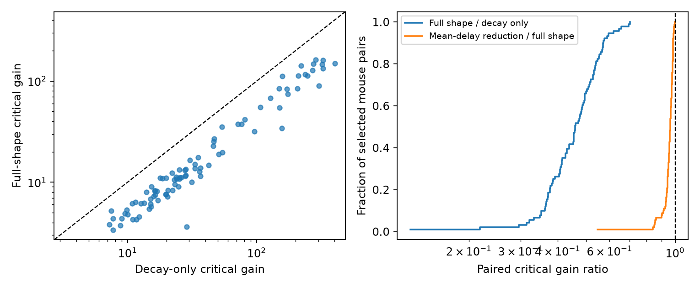

# Power-two rise filters lower gain limits in models of 91 selected Allen mouse E-I pairs

Adding response rise time changed the stability limit in a defined negative feedback model. For 91 selected reciprocal excitatory-inhibitory (E-I) pairs from mouse visual cortex, the critical gain with power-two rise filters was a median 0.459 times the decay-only value. All 91 ratios were below one. The median paired crossing-frequency ratio was 0.624. These results show a large error from omitted rise time in this reference model. They do not show that a living circuit is unstable.



## Question and prior work

Does a decay-only filter preserve the gain limit when a model also includes the measured time from response onset to peak? Neural wiring gives the sign of an E-I loop. Its stability also depends on response shape. The Allen multipatch data link chemical connection calls and voltage-response timing to the same cell pairs. This link permits a model test without mapping cells between datasets.

Campagnola, Seeman and colleagues measured local cortical connections and response properties (2022, doi:10.1126/science.abj5861). Their work supplies the data and biological context. The upstream Allen schema defines response rise and decay times. The neuroanalysis PSP documentation defines a product of rising and decaying exponentials, usually with rise power two. We use that family as an explicit assumption. We do not claim a new general stability theorem or a measured neuronal rate transfer function.

The signed campaign study sci:sha256:367fb31164c30154685691c4289453c3ca5519e20951d1bf83162d5402c6cce7 compared mean replacements for decay times in the same selected E-I cohort. We read its verified text and code. We reuse its selection rules, inferred donor parser and interior-decay limits. The new source extraction includes rise times. The new calculation uses the exact transform of a specified power-two shape. This extends the prior decay-only benchmark; it does not supply independent biological data. Campaign searches were started before question selection but were slow and were stopped. A metadata scan identified candidates, then SCI verified the selected parent. The search record describes this limit.

A local design note preceded the full-kernel calculations. This study is exploratory, not publicly preregistered. The mean-delay reduction is a secondary model comparison.

## Data and selection

The raw file was used in place, read-only:

`/mnt/dell-data/shared_datasets/allen_synphys/r2.1_small_2023-01-26/synphys_r2.1_small.sqlite`

Source: https://allen-synphys.s3-us-west-2.amazonaws.com/synphys_r2.1_small.sqlite . Version: r2.1 small, schema 22. Source Last-Modified: 2023-01-26 02:29:36 UTC. Size: 176771072 bytes. The analysis checked SHA-256 `7372499fdd874f057565080d5769baaf2659ef39d9f3bc3c7147dd1e1c280a53` before extraction. The raw file is not in this package.

The SQL joins pair, synapse, cell, experiment and slice by IDs. All 3297 detected chemical edges are retained as derived evidence. Each selected pair must have two detected opposite-sign edges in one recording. Nonsynaptic cell labels must be ex to in and in to ex. Each onset delay, PSP rise time and PSP decay time must be finite and positive. Rise must be less than twice decay in each direction so that the assumed shape has a finite rise parameter. Scalar fields are used; pulse-train arrays are not used.

Mouse VisP has 302 detected E-I pairs, 142 with consistent cell classes, and 91 with all required positive times. All 91 pass the shape condition. They span 77 recordings and 69 inferred mice. The projects contribute 44 coarse-matrix, 36 patch-seq and 11 pre-production pairs. Human TCx has 23 detected pairs, eight with consistent classes and three complete pairs from three inferred donors. Selection is large and must not be ignored.

Mouse donor groups use an isolated six-digit specimen number. Human groups use an H-prefixed three-field code. A failed parse uses slice ID. These groups are inferred, not verified animal identities. The edge table retains specimen labels and the pair table retains donor assignments.

Latency is time from maximum source-spike slope to response onset. Rise is time from onset to peak. PSP decay includes membrane and recording effects. These are averaged response summaries, not isolated receptor constants. The small database had null rise-power values in the queried manual-QC current-clamp fit rows. Thus power two is an assumption informed by upstream documentation, not a verified exponent for every stored response. The transform is exact for that assumed family, not an exact reconstruction of measured traces. We did not fit raw traces or apply a new manual fit-quality filter.

## Model

Each direction has a normalized impulse response proportional to:

`h(t) = (1-exp(-t/rho))^2 exp(-t/tau), t >= 0`.

Here tau is stored decay. The positive rho is chosen so that stored rise r equals `rho log(1+2 tau/rho)`. The exact normalized transform is a cascade of three first-order filters with time constants:

`tau, 1/(1/tau+1/rho), 1/(1/tau+2/rho)`.

The two directions give six poles. The decay-only comparator keeps just the two tau values. Both models hold the total onset delay D fixed and have unit DC gain per edge. They do not keep the peak amplitude fixed. The unknown nonnegative loop gain K is the product of static gains. No measured PSP amplitude determines K.

The characteristic equation is `product_j(1+s t_j)+K exp(-s D)=0`. The first imaginary root obeys:

`sum_j atan(omega t_j) + omega D = pi`,

`Kcrit = product_j sqrt(1+(omega t_j)^2)`.

Strictly increasing phase and inverse magnitude give a unique first crossing. At zero gain all filter poles are stable. The first crossing defines the gain boundary for this reference model. Frequency is omega/(2 pi); it is not an observed brain rhythm. The model has no other edges, self-coupling, adaptation, thresholds or voltage dependence. The notes give the derivation.

The secondary reduction keeps the two decay filters and replaces the four added poles with a pure delay equal to their summed time constants. This keeps their mean transit time. Since `atan(x)<x` for x>0, this reduction crosses phase pi at lower frequency and has less attenuation there. It therefore gives a lower gain limit than the six-pole model. The calculation tests the size of that conservative error.

## Results

| Selected mouse comparison | Pairs | Inferred mice | Median gain ratio | Equal-mouse geometric mean | Descriptive 95% interval |
|---|---:|---:|---:|---:|---|
| Rise model / decay only | 91 | 69 | 0.459 | 0.447 | 0.420 to 0.472 |
| Same, interior decay values | 64 | 52 | 0.437 | 0.426 | 0.396 to 0.455 |
| Mean-delay reduction / rise model | 91 | 69 | 0.962 | 0.946 | 0.927 to 0.959 |

The primary paired gain ratios ranged from 0.127 to 0.703. The median critical gains were 11.243 for the rise model and 25.931 for decay only. Separate medians do not define the median paired ratio. Crossing-frequency medians were 24.702 and 39.378 Hz. All paired frequency ratios were below one, with a range from 0.206 to 0.809.

The interior check keeps both decay values strictly between 0.00501 and 0.499 seconds. It removes 27 pairs and retains the same qualitative result. This is an endpoint check, not a validated fit-quality filter.

The mean-delay reduction was closer but could still give a large error. Its worst gain ratio was 0.547, a 45.3% underestimate relative to the rise model. Its median frequency ratio was 0.997, with a range from 0.907 to 0.9999. A small median error does not guarantee a small error for a given loop.

The three human rise-model gain ratios ranged from 0.437 to 0.550, with median 0.516. We report no human sampling interval and no transfer test. Species and region are confounded.

For uncertainty, we average log ratios within inferred donor, then average donors equally and exponentiate. We resample whole donor means 9999 times with seed 110703103. Percentile intervals describe variation in this selected sample, conditional on the fits and model. They do not include fit error, selection bias or uncertain donor identity. No p-value or population coverage guarantee is claimed. All pair values and bootstrap draws are supplied.

## Interpretation and limits

The tested structure-function statement is conditional: two detected opposite-sign connections plus their stored timing summaries define loops in which omitted rise shape changes the calculated gain boundary. This is useful as a circuit-model benchmark. It does not estimate real feedback gain or show a biological benefit of fast rise. The added poles introduce both phase lag and attenuation; at the new, lower crossing frequency the net gain threshold in these examples is much lower.

Unit-DC normalization, power two, linear filters, fixed gains and an isolated two-cell loop are assumptions. Summaries can have fit errors and parameter tradeoffs. Other shapes consistent with the same rise and decay summaries can give different results. Slice damage and missed calls change the sampled graph. Missing cell labels and fits select the cohort. Shared cells cause dependence, and inferred donor resampling only partly addresses it. There are no linked in vivo activity, behavioral or representation outcomes here. Three human examples cannot establish a rule across species, regions or conditions. More complete kernels and direct perturbation measurements are needed for that test.

## Inspect and reproduce

Use Python 3.12 with the versions in files/requirements.txt. From the unpacked publication:

```sh
python files/analyze.py --edges files/evidence/edges.csv --out reproduced
python files/check.py
```

The first command repeats selection, calculations, resampling and the figure without shared data. Its results.json matched the raw-source run byte for byte. The independent checker uses CSV selection, bisection, direct time-domain integration and complex characteristic roots. It checks all 94 selected pairs and the sign of 188 local root crossings. It does not validate biological assumptions. The report is files/check_report.json.

For source-level reproduction, use the raw path above with `python files/analyze.py --db PATH --out reproduced_from_db`. If needed, retrieve the exact source through the campaign helper:

```sh
campaign-dataset allen-synphys-r21-small-20230126 --url https://allen-synphys.s3-us-west-2.amazonaws.com/synphys_r2.1_small.sqlite --filename synphys_r2.1_small.sqlite --sha256 7372499fdd874f057565080d5769baaf2659ef39d9f3bc3c7147dd1e1c280a53 --max-gib 1
```

Use the path returned by the helper. Pause if the shared mount is unavailable. Original Allen data and derived measurement records retain the Allen Institute terms at https://alleninstitute.org/legal/terms-use/ . The baseline license covers new text, figures and code to the extent allowed by source terms. Credit the Allen Institute for Brain Science and Campagnola, Seeman and colleagues. No upstream executable code or raw database is redistributed.

## Job record

Job: sci-1107-syam2-neural-structure-and-computation-03103e534832. Topic: neural-structure-and-computation. Campaign: 11_07_2026. Machine: syam2. Account: codex-myxtap. Model: gpt-6.1-sol with high reasoning effort, through the Codex harness in T3 Code. No agents were launched. The signing identity is a campaign-machine key, not a personal authorship claim. Private keys are outside this package. The signed publication is saved locally; no remote archive or index is used.
