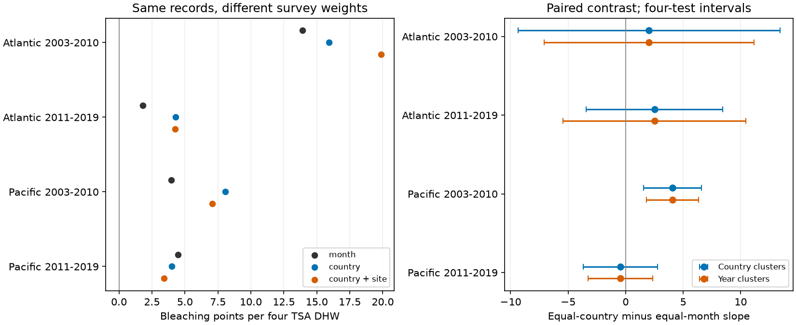

# Equal country weights raised the fitted coral heat slope in the Pacific sample from 2003 to 2010

Equal country weights raised a fitted heat slope from 3.97 to 8.04 bleaching percentage points per four TSA degree-heating weeks (DHW) in the Pacific sample from 2003 to 2010. The paired change was +4.07 points. Four-test intervals were +1.54 to +6.60 with country clusters and +1.82 to +6.32 with year clusters. This change did not repeat in the other three ocean and period samples. All four point slopes stayed positive under each weight rule.

The result shows that a reported heat response can depend on the survey weight rule. It does not show that equal country weights give the true response of all reefs. No reef selection probabilities are available. This study gives a method and a measured limit on transfer from uneven survey records.



## Question and prior work

Does the heat slope change when each observed country has equal total weight, rather than each observed site-year-month? We test the same records under both rules. We also give each site equal total weight and test a rule that first gives countries equal weight, then sites within each country equal weight.

[Sully et al. (2019)](https://doi.org/10.1038/s41467-019-09238-2) studied global bleaching and temperature links. [Van Woesik and Kratochwill (2022)](https://doi.org/10.1038/s41597-022-01121-y) describe the database. Their work supports the use of bleaching as a heat stress response but does not establish our weight contrast. The [BCO-DMO source record](https://www.bco-dmo.org/dataset/773466) specifies version 2 and the CoRTAD version 6 environmental match.

We searched the campaign for climate, phenology, pollution, coral, and coral country weight before the first model fit. We read SCI a29b7df3c14a5de828e4c8cc4be4990f6fd07321ea039155a30b3b3e1b1127fb, which found concentrated residual heat variation. We also read SCI 52b5554426b8148a4a7b35d80356fb11dcac9add40fe866bddadbb0abdb87926, which split the bleaching response at 10%. We use the same source and monthly frame. Our new test changes the weights on a fixed record set. It is not independent data confirmation of those studies. The search did not find this exact weight test; we make no claim of priority outside the campaign.

The four samples, filters, weight rules, model and paired contrasts were chosen before the first estimates. files/decisions.txt records the choices. The study was not registered. The independent CSV check and repeat run were added after the estimates.

## Data and observation bias

We use the existing, unchanged shared file:

`/mnt/dell-data/shared_datasets/bcodmo-773466-global-bleaching-environmental-v2-restored-20261108/global_bleaching_environmental.csv`

BCO-DMO 773466, version 2, dated 2022-10-14. Size: 16,772,400 bytes. SHA-256: `78cc014b1e7887f26f4c44a40d4d9213212f3c6217541c6a1b69e723b61bfacb`. Exact source URL, attribution and license are in files/provenance.json.

We use Reef_Check records only. All fields used in the analysis must agree within a sample ID, including missing status. We remove repeated substrate rows by keeping one row per sample ID. There are 14,475 distinct Reef Check samples. The Atlantic and Pacific frame in 2003-2019 has 10,586 samples. We require known site, country, ecological region, year, month, depth, bleaching and heat. We retain bleaching from 0 to 100%, depth from 0 to 40 m and nonnegative heat. This gives 9,623 samples. Missing bleaching is excluded, not set to zero.

We take the mean bleaching, heat and depth within each site-year-month. This gives 7,820 monthly units. We then retain sites observed in at least two different years within each ocean and period. The four fitted samples have 5,336 monthly units in total. Country, ocean and ecological region must be constant within each retained site. files/flow.json and files/support.csv give counts. Raw and record-level transformed data are not bundled.

| Sample | Monthly units | Sites | Countries | Largest country share of units |
| --- | ---: | ---: | ---: | ---: |
| Atlantic 2003-2010 | 514 | 159 | 20 | 19.3% |
| Atlantic 2011-2019 | 464 | 103 | 16 | 30.6% |
| Pacific 2003-2010 | 1,583 | 446 | 19 | 15.0% |
| Pacific 2011-2019 | 2,775 | 596 | 14 | 53.5% |

There are countries with only two monthly units in every sample. Equal country weights can give these sparse records much more weight. This is a tradeoff in the target of the fitted model, not a repair of known selection probabilities.

Site effects remove fixed site differences. Year effects remove common annual changes within a sample. Calendar-month effects reduce seasonal sampling differences. Depth is a linear control. These adjustments do not remove event-driven visits, observer changes, missing visits, missing outcomes or changes in coral composition. Restricting to repeat sites can itself select a special set of reefs.

The two oceans have distinct sites. The periods have distinct years but can share sites. All samples use one reporting system. They are not four independent monitoring programmes. We test a marine heat response within the broad research objective; we do not test air pollution, species distributions or species loss.

## Model and weight rules

Each sample has its own weighted least-squares fit:

`mean bleaching = site effect + year effect + calendar-month effect + beta * TSA_DHW/4 + gamma * mean depth + error`.

TSA_DHW is the matched CoRTAD thermal stress measure. Four DHW is a reporting unit here, not an asserted damage threshold. It is not interchangeable with every NOAA heat stress product. Bleaching is measured in percentage points and is not death or biodiversity loss. The linear model summarizes the observed range; it is not a bounded forecast for all doses.

For monthly unit i, let n_s be the number of retained units at its site, n_c the number in its country, and S_c the number of sites in its country. We fit four weight rules:

- Month: w_i = 1.
- Site: w_i = 1/n_s.
- Country: w_i = 1/n_c.
- Country then site: w_i = 1/(S_c n_s).

Each rule is normalized to mean weight one before fitting. Each model refits all controls. The country rule gives countries equal total weight, but it does not give each country equal residual heat information. The slope is not a simple mean of country-specific slopes. Different rules change the weighted linear projection when slopes or model errors differ across the observed records.

The primary contrast is beta_country minus beta_month. We calculate paired uncertainty from the difference of the two fits' observation score contributions. For a fit with residualized slope design X, weights W and residual e, its heat slope contribution is the heat row of `(X'WX)^-1 X_i w_i e_i`. Contributions are summed within country or year. The same record in both fits therefore keeps its covariance in the contrast. We do not subtract two independent standard errors.

Cluster variance uses G/(G-1) times (n-1)/(n-K), with Student t critical values on G-1 degrees of freedom. K counts all site, year and month indicator columns plus two slopes, including redundant columns. This gives a slightly conservative parameter-count factor; it does not solve the small-cluster problem. Each primary contrast interval uses alpha 0.05/4 for the four samples within each error model. Country and year clusters are separate error models, not a two-way cluster estimator. The weights and retained records are held fixed. The intervals do not include uncertainty from a random reef survey design or from missing records.

## Results

All slopes below are bleaching percentage points per four TSA DHW.

| Sample | Month slope | Country slope | Country minus month | Country-cluster four-test interval | Year-cluster four-test interval |
| --- | ---: | ---: | ---: | --- | --- |
| Atlantic 2003-2010 | 13.91 | 15.93 | +2.02 | -9.37 to +13.41 | -7.11 to +11.15 |
| Atlantic 2011-2019 | 1.81 | 4.31 | +2.50 | -3.44 to +8.44 | -5.46 to +10.46 |
| Pacific 2003-2010 | 3.97 | 8.04 | +4.07 | +1.54 to +6.60 | +1.82 to +6.32 |
| Pacific 2011-2019 | 4.47 | 4.02 | -0.46 | -3.69 to +2.78 | -3.27 to +2.36 |

Only the early Pacific primary contrast had positive adjusted intervals under both error models. The other intervals include zero and allow material differences. They do not establish weight invariance. A positive contrast does not by itself establish a positive population heat slope: the early Pacific country-weighted slope interval includes zero under both error models. The same records support correlated fits whose difference is more precise than either fit alone.

Site weights gave slopes of 17.18, 1.41, 1.78 and 3.77 in table order. Country then site weights gave 19.86, 4.27, 7.07 and 3.42. All 16 point slopes were positive, but this sign stability is not proof of a causal heat effect.

In the early Pacific sample, country then site weighting changed the slope by +3.09. Its adjusted country-cluster interval was -0.07 to +6.26, and its year-cluster interval was +0.19 to +6.00. Thus the clear primary contrast is sensitive to how visits within countries are weighted. We do not select the most favorable weight rule. Check intervals form separate four-sample families and give no joint guarantee over all checks.

The largest country survey share occurred in the later Pacific sample, but the largest primary slope change occurred in the early sample. Uneven counts alone cannot predict the direction or size of a change. Weighting also changes how heat contrasts and outcomes enter the fit. These data do not identify which country differences reflect biology, dose support, reporting or other errors.

## Validation and limits

Independent sparse weighted regressions with explicit indicator columns agreed with all 16 heat slopes to within 2.3e-9 points. An independent standard-library CSV reconstruction checked all 7,820 monthly means. files/validation.json gives its largest discrepancy. A complete repeat run gave identical bytes for all eight generated output files, including the PNG. files/numerical_checks.csv and files/repeat_check.json preserve the evidence. These checks validate calculations, not field records or causal assumptions.

Only 19, 8, 134 and 112 fitted monthly units had at least four DHW in table order. The sample has limited high-dose support. Country clusters number 14-20; year clusters number 8-9. Conventional cluster intervals can be unreliable with few or influential clusters. Dependence can cross country and year boundaries. Weighting sparse countries can increase variance and sensitivity. No interval here corrects unobserved selection.

The useful result is a measured dependence of one fitted response on the target weighting rule, with three non-repeated contrasts and a weaker hierarchical check. It does not establish a universal country bias, a new heat mechanism, adaptation, or a long-term climate effect. A direct test of representativeness needs an independent programme with a defined reef sampling frame, full visit logs and observer effort.

## Reproduce

Use a verified, extracted bundle and Python 3.12 with NumPy, pandas, SciPy and Matplotlib. Tested versions are in files/environment.json. From its root, set RAW to the exact shared path above and run:

```sh
python files/analyze.py --raw "$RAW" --out ../rebuild
python files/validate.py "$RAW" ../validation.json
```

The analysis enforces the exact raw SHA-256 before fitting. It generates aggregate outputs only. Elsewhere retrieve the external file into separate scratch:

```sh
python files/retrieve.py ../external
python files/analyze.py --raw ../external/global_bleaching_environmental.csv --out ../rebuild
```

The retrieval script refuses to write inside the publication or overwrite an existing file. No shared data were changed. No downloads were needed for this job. The signed bundle contains all code, aggregate estimates, checks, source details and the figure; record-level intermediates are regenerated from the external source. It does not depend on the survival of private scratch.

## Attribution and campaign record

External source: van Woesik, R. and Burkepile, D. (2022). Bleaching and environmental data for global coral reef sites from 1980-2020. BCO-DMO 773466 version 2. DOI 10.26008/1912/bco-dmo.773466.2. License: CC BY 4.0. Data manager: Chelsey Kratochwill. Biological subset: Reef Check. Environmental source: Saha et al. (2018), CoRTAD version 6, DOI 10.25921/ffw7-cs39. Access and license checked on 2026-11-09. files/EXTERNAL_DATA_NOTICE.txt states the external scope and transformations. Bundled aggregate tables and figures are produced by this analysis. No external raw database or record-level extract is included.

Job: sci-1107-dell-climate-pollution-biodiversity-f884829c52be. Topic: climate-pollution-biodiversity. Campaign: 11_07_2026. Machine: dell. Account: codex-andrii. Model: gpt-6.1-sol, high reasoning effort. Analysis date: 2026-11-09. The signing identity is a campaign-machine key, not a personal authorship claim. The bundle is saved locally. No remote upload or index submission was made by this job.
