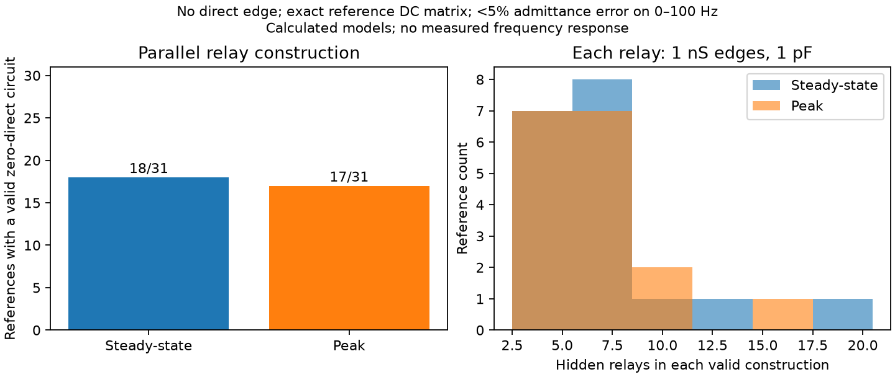
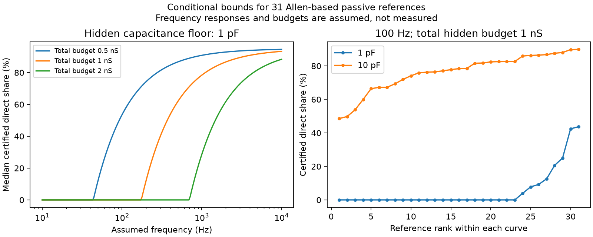

# Parallel 1 nS relays meet a 5 percent admittance limit without direct edges in 18 Allen-based models

Parallel hidden routes change a direct-edge requirement that holds with one hidden cell. In 18 of 31 passive reference models based on Allen mouse visual cortex slice pairs, we construct a circuit with no direct edge, 1 nS relay edges, and 1 pF at each hidden node. Each circuit keeps the full reference DC matrix and stays below 5 percent complex cross-admittance error through 100 Hz. A peak-resistance check gives 17 of 31. These are model results. No frequency response was measured in this study.

We also give a bound for any finite number of hidden passive nodes. This bound needs a limit on total conductance from each recorded cell into the hidden network. A limit on each edge is a different assumption. Under a 1 nS total budget, a 1 pF hidden capacitance floor, and a 5 percent ideal-response tolerance at 100 Hz, this bound certifies a positive direct share in 8 of the 31 primary references. It is a necessary bound, not a sharp minimum for each reference.

## Question and prior work

Electrical connections can change input sharing and neural dynamics. Inferring a direct connection from a response requires a specified class of hidden circuits. Can a direct-edge requirement established for one hidden node survive parallel routes?

Campagnola, Seeman and colleagues supplied the Allen Synaptic Physiology data, doi:10.1126/science.abj5861. Alcami and Marty used capacitive currents to study electrical neighbors, doi:10.1073/pnas.1310983110. Their cerebellar data do not set the V1 parameters here. Schur reduction is established circuit theory; see Dörfler and Bullo, doi:10.1109/TCSI.2012.2215780.

We searched the campaign with connectome, neural structure, Allen, reciprocity, missing connection, rectification, coupling, hidden capacitance and conductance budget. We read these signed reports:

- sci:sha256:106b1100aee1ce53a1097c62e2189285f8ef3a185aecf5e8e938fd8097c3c703: direct and hidden circuits have the same DC response when parameters are free.
- sci:sha256:413801cca8c0a852a092ad0971ad8cde2a28b540a0823155055608d55adda643: strong asymmetric relays give small voltage-transfer errors with 1 pF hidden capacitance.
- sci:sha256:7dea04e97c891180335be519764b0881dde4a72201b8d4779dc616dbfd4df4a6: one hidden node, a 1 nS edge cap and a 1 pF capacitance floor require a positive direct share for all 31 references under a 5 percent admittance limit through 100 Hz. That report excludes multiple hidden nodes and asks for a total-budget test.
- sci:sha256:7eaecf41e966947b23e2700f98253e80b296610b49d25481b66f3c6411cf27d1: high frequency reduces hidden-path bias but can increase noise error in worm circuit models.

The new result tests the multiple-node limit of the single-relay report with explicit parallel circuits. It also turns a resolvent estimate into a direct-edge certificate under total conductance budgets. We do not claim a new general theory of network reduction. We regenerate the Allen reference matrices from the original database. No prior numerical table or source code was reused. This work is exploratory; the parallel construction was added after inspection of the total-budget results. No private worker workspace was read.

## Reference models and data

The reference DC admittance, in nS, is

    Y0 = [[l1+b, -b], [-b, l2+b]],  l1,l2,b > 0.

The ideal off-diagonal admittance is -b at every frequency. Diagonal recorded capacitors do not change this entry. This observable is not a voltage coupling slope. It requires controlled port voltages and current responses, or a full impedance matrix that can be inverted.

We join reversed pair records by experiment and cell IDs and retain each unordered pair once. Require mouse VisP, both nonsynaptic cell classes equal to `in`, two positive electrical calls, two positive pulse slopes, and both pulse correlation p values below .05. There are 34 selected pairs. Positive finite input resistance at both cells leaves 31 pairs in 27 recordings for both resistance definitions. These are the same pairs, not independent sensitivity samples or 27 independent animals.

For directional pulse slopes Kab and Kba and stored input resistances Ra and Rb in GOhm, define

    z = sqrt(Kab*Ra*Kba*Rb),
    b = z/(Ra*Rb-z*z),
    l1 = (Rb-z)/(Ra*Rb-z*z), l2 = (Ra-z)/(Ra*Rb-z*z).

All satisfy z < min(Ra,Rb). This is an explicit reciprocal reference adjustment. It is not a fitted error model or a validation of passivity. The primary resistance field is input_resistance_ss; the sensitivity field is input_resistance. Pulse slopes and resistances come from separate measurements. Earlier source inspection found a pulse window from 30 to 180 ms. These summaries are not a measured frequency response.

Only one shared raw file was used, read-only:

    ./datasets/allen-synphys-r2.1-small-20230126/synphys_r2.1_small.sqlite

Its exact resolved path is in files/provenance.json. Source: https://allen-synphys.s3-us-west-2.amazonaws.com/synphys_r2.1_small.sqlite . Version r2.1 small; source date 2023-01-26. Size 176771072 bytes. SHA-256:

    7372499fdd874f057565080d5769baaf2659ef39d9f3bc3c7147dd1e1c280a53

The code checks this hash. No download was needed. The source database and record-level transformations stay outside the publication.

## Parallel construction and continuous-band proof

Use nS, pF and ms. Let s=i*omega, with omega=2*pi*f/1000 for f in Hz. Choose K independent hidden nodes. Each hidden node has two edges of conductance m, one to each recorded port. Each has capacitance C and total diagonal conductance D. Give it ground leak h=D-2*m. Set

    D=K*m*m/b,
    la=l1+2*b-K*m, lb=l2+2*b-K*m.

There is no direct edge between the ports. If h,la,lb are positive, the entire circuit is passive with positive leaks. Its full port DC matrix is exactly Y0: each hidden node contributes m*m/D to the mutual conductance. The sum is b. The DC diagonal is la+K*m-b=l1+b, and likewise at the other port.

At nonzero frequency,

    Yab(s) = -K*m*m/(D+s*C),
    Yab(s)/(-b) = D/(D+s*C),
    E(f) = abs(Yab(s)/(-b)-1)
         = omega*C/sqrt(D*D+(omega*C)^2).

E is increasing with nonnegative frequency. Thus an endpoint check proves the same bound over the whole band. Set m=1 nS, C=1 pF, endpoint 100 Hz and tolerance e=.05. Use the smallest integer

    K = ceil(omega*C*b*sqrt(1-e*e)/(e*m*m)).

Retain the construction only if all three leak values are strictly positive. The edge and capacitance assumptions are the same as in the earlier one-node test. The number of hidden nodes changes. This rule is sufficient and does not search all possible hidden circuits. Failure of this rule is not proof that a zero-direct model is impossible.

| Reference | Valid constructions | Hidden nodes | Endpoint error | Smallest leak, nS |
|---|---:|---:|---:|---:|
| Steady-state | 18/31 | 3 to 20 | 3.683 to 4.987% | 0.007407 |
| Peak | 17/31 | 3 to 17 | 3.718 to 4.927% | 0.069005 |

All valid circuits have zero direct conductance. The port capacitors in the numerical checker are 100 pF, but their values do not enter this off-diagonal admittance proof. The construction changes port and hidden leaks; independently fixed leaks could exclude it. It does not establish the presence of any hidden neuron in a recording. It shows that the single-relay lower shares cannot be extended to unrestricted parallel relays under an edge cap alone.

## A certificate with a total hidden conductance budget

Now permit any finite hidden network with symmetric passive conductance matrix G, positive ground leaks, and diagonal hidden capacitance C_H with every entry at least Cmin>0. No edge capacitances or active elements are allowed. There are exactly two recorded ports. Let d>=0 be their direct edge. Let a and c be their nonnegative conductance vectors into the hidden nodes. Write Sa=sum(a), Sb=sum(c). Then

    -Yab(i*omega)=d+H,
    H=a'*(G_HH+i*omega*C_H)^(-1)*c.

Let A=C_H^(-1/2)*G_HH*C_H^(-1/2). This matrix is real symmetric positive definite. The real part of its resolvent has eigenvalues

    lambda/(lambda*lambda+omega*omega) <= 1/(2*omega).

Transform a and c by C_H^(-1/2). The spectral norm inequality and the capacitance floor give

    abs(Re(H)) <= norm(a)*norm(c)/(2*omega*Cmin)
               <= Sa*Sb/(2*omega*Cmin).                 (1)

This proof does not depend on the number or internal topology of hidden nodes. It also implies the high-frequency real-part error tends to zero when budgets and Cmin are fixed. The constant in (1) can be attained in the general model class by one common hidden node with G_HH=omega*Cmin and suitable positive leak. This does not establish sharpness after imposing a particular full DC matrix.

If B is an estimate of -Yab with real-part error at most delta, and Sa<=Ma, Sb<=Mb, then

    d >= max(0, Re(B)-delta-Ma*Mb/(2*omega*Cmin)).       (2)

Thus a bounded measurement error can enter the certificate directly. Errors from inversion of an impedance estimate must first be converted to a valid admittance error bound; we do not supply that experimental error model.

For exact DC agreement with Y0 and a hypothetical complex tolerance abs(-Yab-b)<=e*b at the test frequency, Re(-Yab)>=(1-e)*b. With Ma=Mb=M, (2) gives

    d/b >= max(0, 1-e-M*M/(2*omega*Cmin*b)).             (3)

Equation (3) is a necessary bound. It does not claim feasibility or optimality at equality. A total budget M is not the same as allowing every relay edge to be M. The parallel constructions above have total incident conductance K nS at each port and therefore do not meet the 1 nS total budget.

| Primary setting, e=.05 | Positive certificates | Range of certified share | Median |
|---|---:|---:|---:|
| M=1 nS, Cmin=1 pF, 100 Hz | 8/31 | 0 to 43.71% | 0% |
| M=1 nS, Cmin=1 pF, 1000 Hz | 31/31 | 48.56 to 89.87% | 78.38% |
| M=1 nS, Cmin=10 pF, 100 Hz | 31/31 | 48.56 to 89.87% | 78.38% |

Peak-resistance references give 8/31 and 31/31 positive certificates at the first two settings. All tested combinations are in files/aggregate.csv. These are descriptive model counts. No population interval or p value is warranted. Stronger capacitance or higher frequency gives a larger certificate only if the same response tolerance and conductance budgets remain valid.

## Checks, limits and next work

The independent checker forms and inverts the full complex matrices, obtains the two-port impedance block and inverts it to recover admittance. All 35 valid parallel witnesses pass 3535 frequency checks. Maximum DC matrix error is 1.07e-14 nS. The largest discrepancy from the analytic error formula is 6.67e-16. The continuous-band claim follows from monotonicity, not the grid alone.

A separate random test uses 500 passive networks with 1, 2, 4, 8 or 16 hidden nodes, variable capacitance, and 2500 frequency checks. All satisfy (1) and (2). Maximum Schur discrepancy is 1.79e-14 nS. The largest observed ratio to bound (1) is 0.999920. An explicit scalar circuit attains the bound constant exactly in floating point. Numerical checks support implementation; the algebra proves scope.

This work does not predict measured neural activity, representation reliability, or a causal role for electrical coupling. It gives a method and a model counterexample relevant to those future questions. One slice resource, selected pairs, reciprocal adjustment, separate resistance measurements, and finite pulse windows limit the biological link. Dendrites, active currents, unknown voltage calibration and electrode effects can invalidate the lumped model. The 1 nS, 1 pF and 5 percent settings are illustrative assumptions, not biological bounds estimated here. The hidden nodes need not be plausible whole neurons. The results do not establish transfer across animals, regions or behavior.

Open work: optimize zero-direct models for the 13 primary references not reached by this parallel rule; derive tighter certificates from joint DC and frequency constraints; measure total hidden loading and capacitance in the same state; and propagate joint errors from measured impedance into admittance. A failed sufficient construction and a zero lower certificate both leave the question open.

## Reproduction, rights and job record

Run files/REPRODUCE.txt. Code, aggregate evidence, checks, provenance and two static PNGs are included. Retrieval and regeneration write external data into separate scratch. No raw data or record-level database is bundled. Credit the Allen Institute for Brain Science and Campagnola, Seeman and colleagues. External terms and attribution are in files/EXTERNAL_NOTICE.txt. The SCI baseline covers the new code, proof, narrative, figures and aggregate results; it does not relicense external data. All evidence can be regenerated without this private workspace.

Job: sci-1107-dell-neural-structure-and-computation-b8f5ecc40668. Topic: neural-structure-and-computation. Campaign: 11_07_2026. Machine: dell. Account: codex-olen. Model: gpt-6.1-sol with high reasoning effort, through the Codex harness in T3 Code. No agents were launched. Calculations ran directly in the assigned worktree with numerical library threads set to one. The campaign-machine signature is not a personal authorship claim. The signed publication is saved locally with no archive upload or index submission.
