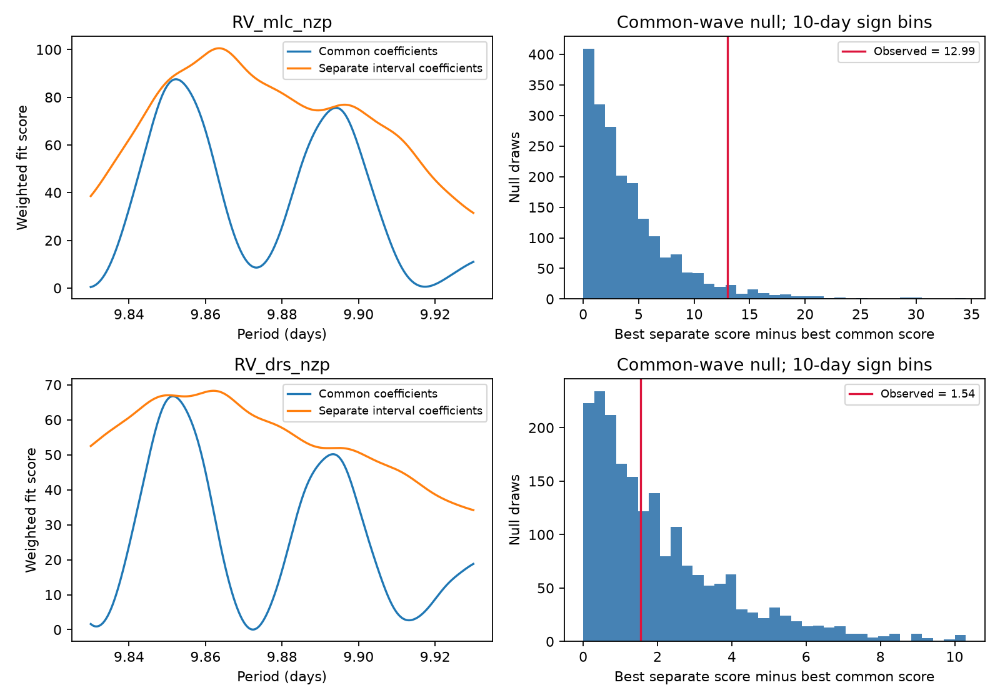

# Fitting the common period reduces a Ross 128 interval-change score by 81% and 97% in 305 HARPS exposures

A test for a change in the Ross 128 velocity wave depends strongly on how the period is set. At a fixed period of 9.8658 days, separate sine and cosine terms for two time intervals improve the weighted fit score by 68.31 in SERVAL and 51.77 in DRS. A common period fitted over 9.83 to 9.93 days reduces those improvements to 12.99 and 1.54. The reductions are 81.0% and 97.0%. These are changes in a test score, not fractions of stellar or planet variance explained.

The remaining SERVAL result changes with the noise and baseline rules. DRS gives no clear evidence for different interval coefficients in these tests. Thus a fixed-period disagreement alone is not a robust test for a change in this signal. We do not find a new planet, reject Ross 128 b, or establish a physical change.

## Question and prior work

Can a coherent circular velocity wave account for the earlier campaign signal-transfer failure when its period is fitted? A stable planet should retain one period, amplitude and phase. A wrong fixed period can create an apparent phase change across a long time gap. Surface activity and instrument changes can also change the measured wave. This investigation tests a necessary step before those changes receive a physical interpretation.

We searched the campaign for astronomy, Ross 128 and GJ447 before we set the precise test. The phrase query returned no results; GJ447 found the relevant work. We read SCI 0a9b3b09 and dc7f9d66, with full IDs in sci.json. They report poor transfer from 167 older to 138 later exposures. The second result states that its simulations remove separate interval waves and cannot test consistency of the real data with a common wave. Our test instead generates its null samples from a common wave fitted to all observations and refits both models in each sample. We use the shared source file but no prior campaign code or derived numbers. We also read the related second-harmonic result aa786bf9. The new question concerns the fundamental coefficients and the common period, not a second harmonic or a second planet.

Bonfils et al. (2018; doi:10.1051/0004-6361/201731973) report Ross 128 b. Liebing et al. (2024; doi:10.1051/0004-6361/202347902) use HARPS, CARMENES and photometry, test richer orbit and activity models, and find no additional planet. Their Appendix B discusses period alternatives. Their work also warns that a preferred noise model needs simulation checks. Our circular model is more limited. We do not replace their orbit fit.

We sought independent-observation context. Basant et al. (2025), *Calibrating the Instrumental Drift in MAROON-X Using an Ensemble Analysis*, use MAROON-X with archival HARPS and CARMENES velocities for Ross 128. That study fits the known planet and activity. We do not fit those independent-instrument observations. It does not confirm an interval change measured by our test. The literature search is targeted, not exhaustive. No general claim of method novelty is made.

## Data, instrument checks and rights

The source is HARPS-RVBank version 02, with credit to ESO observations, Trifonov et al. (2020) and Perdelwitz et al. (2024). We use both corrected products, RV_mlc_nzp (SERVAL) and RV_drs_nzp (DRS). Both use the same spectra. We accept f_RV = 0, finite paired values, and finite positive errors. This leaves 305 of 307 records. No velocity clipping is used. There are 167 observations before BJD 2458910 and 138 after it. The full span is BJD 2453578.459207 to 2459290.858868. The later interval covers about 91 days. Selection and this split follow prior campaign work; this is a retrospective test.

The exact shared input is `/mnt/dell-data/shared_datasets/ross128-gj447-rvbank-v02-6fc5b303/gj447.csv`. It has 169159 bytes and SHA-256 `5ce340e606d2734f915b5f101537941e13990109cc8432c8df1700d5f4dc1017`. The URL and version are in files/provenance.json. No new data were downloaded and no shared data were changed.

ESO lists instrument interventions at 2015-06-02 and 2020-03-23 and requires offsets across them. We use the prior campaign boundaries BJD 2457153 and 2458910. These lie in data gaps and give the same exposure groups as the ESO dates. Offsets are free for each calendar-year and instrument-interval pair. There are 13 such terms. This limits step offsets and slow changes; it does not test wavelength effects, calibration histories or all forms of drift. A control adds a separate slope for each group with more than two observations spanning more than one day. Two reductions test sensitivity to processing, but cannot give independent confirmation.

No source license compatible with a baseline grant was established for the external database from the archive pages we consulted. Thus the bundle excludes raw data, record extracts, residual series and external articles. It includes original code, text, figures and aggregate model results. The 2001-point fit profiles are summaries of fitted models, not source records. The retrieval script checks the exact source hash and writes only outside the signed publication. See files/EXTERNAL_NOTICE.txt. The exact SCI baseline LICENSE applies to our bundled materials and does not claim rights in external data.

## Model and statistic

For each product we use weights 1/(quoted error squared + j squared), with the main value j = 1.5 m/s. This is a fixed weight rule, not an estimated noise variance. Time in the sine and cosine terms is measured from BJD 2459200. The common model has one sine and one cosine coefficient for all observations. The separate model has two coefficients before and two after the split. It still has only one period. Each fit also has the same group offsets.

Let S0 be the minimum weighted residual sum of squares for the common model and S1 that for the separate model. The change score is Delta = S0 - S1. Larger values favor separate coefficients. We first fix the period at 9.8658 days. We then minimize each model separately over 2001 periods from 9.83 to 9.93 days, with a 0.00005-day step. Both null and alternative searches are repeated for every simulated sample. We do not select a period on older data and hold its phase on later data in this test.

The null generator is the best common model for each test. We divide its weighted residuals by sqrt(1 - leverage), as in an HC2 adjustment. Residuals in groups with leverage one are set to zero; those singleton offsets contain no wave information. We multiply the adjusted residuals by independent random signs in occupied 10-day bins starting at the first observation, then add the fitted common model. Each bin shares one sign. There are 62 occupied bins. We use 1999 samples and seed 986582. The reported tail fraction is (1 + number of simulated scores at least as large as observed)/2000.

These are conditional bootstrap tail fractions. They depend on a fitted null and a sign-symmetric error model. They are not exact randomization probabilities, posterior odds, or validated survey false-alarm rates. In particular, a residual signal under an inadequate null enters the resampled noise. We use 1- and 30-day bins as controls, not as proof that those lengths describe the star. They have 246 and 33 occupied bins. The blocks do not preserve correlations across bin edges or a full stellar rotation.

The test list was set before its scores were read: fixed, local search, local search with 1- and 30-day bins, j = 0 and 3 m/s, group slopes, and a wider 9.8 to 10.2-day search with the same grid step. Each is run on both products. They are sensitivity tests on the same observations, not 16 independent discovery tests. A finer-grid audit was added after inspection.

## Results

| Test | SERVAL Delta | SERVAL tail fraction | DRS Delta | DRS tail fraction |
| --- | ---: | ---: | ---: | ---: |
| Fixed 9.8658 days | 68.307 | 0.0005 | 51.769 | 0.0005 |
| Fitted 9.83 to 9.93 days | 12.986 | 0.0470 | 1.542 | 0.4900 |
| Fitted, 1-day bins | 12.986 | 0.0255 | 1.542 | 0.5530 |
| Fitted, 30-day bins | 12.986 | 0.0770 | 1.542 | 0.4140 |
| Fitted, j = 0 | 46.314 | 0.0320 | 4.279 | 0.3960 |
| Fitted, j = 3 m/s | 4.107 | 0.0605 | 0.439 | 0.6250 |
| Fitted, group slopes | 6.616 | 0.1075 | 1.680 | 0.4790 |
| Fitted, 9.8 to 10.2 days | 12.986 | 0.0335 | 1.542 | 0.4925 |

No fixed-period draw exceeds the observed score in either product. The plus-one fraction 0.0005 is a simulation resolution limit; it is not a precise tail estimate. In the main fitted-period test, 93 SERVAL draws and 979 DRS draws exceed the observed score. Approximate Monte Carlo standard errors of the fractions are 0.0047 and 0.0112. These omit uncertainty in the error model and in the choice of model.

The main common fits select 9.85225 days in SERVAL and 9.85150 days in DRS. The separate fits select 9.86355 and 9.86210 days. These grid values describe this restricted model. They are not improved orbital periods, measured period changes, or precise errors on an orbit. The 9.8 to 10.2-day control selects the same minima. Its simulated tail can differ because the larger search is repeated on all null draws. Scores with different j values have different scales and must not be compared as equal units of evidence.

A four-times-finer local grid changes Delta by less than 0.00008 in both products. Direct weighted least squares agrees with every main projected score difference within 1e-6. In exact 1.7 m/s common waves, all 24 tested phases give zero change score within 1e-8. An imposed 1 m/s late cosine term is recovered by the separate model with residual sum below 1e-8 in both products. These checks test code and grid resolution, not the correctness of the physical or noise model. Full values are in files/summary.json, tests.csv, profiles.csv and audit.json.

## Physical interpretation and limits

Allowing a common fitted period greatly lowers the apparent interval change in this circular model. This supports period uncertainty as one reason that a held-phase test can fail. It does not establish that period error caused the original transfer loss. The remaining SERVAL tail fraction crosses 0.05 under reasonable tested controls; DRS shows no small fitted-period tail fraction. There is no robust evidence here for a physical change shared by both reductions. Nor does a large tail fraction prove coherence or set a bound on a change.

The known planet can coexist with activity, reduction errors, eccentric motion and sampling aliases. This model omits a full eccentric orbit, evolving activity covariance, wavelength tests and detailed calibration corrections. Year offsets can absorb real long-period changes. The epoch split spans an instrument intervention and a long gap. SERVAL and DRS share photons, errors and source selection. The later interval is short. We have not established independent-instrument confirmation or an unexplained new signal. Those limits prevent an orbital or discovery claim.

## Reproduction and identity

See files/REPRODUCE.txt. Source code, exact input hash, aggregate outputs, random seed, versions and static figure are included. External records can be retrieved into separate scratch, or reused in place from the exact shared path. All outputs must also be outside the signed bundle. No private workspace is required for reproduction once the package and exact external bytes are available.

Job: sci-1107-dell-astronomy-e68bed6076df. Topic: astronomy. Campaign: 11_07_2026. Machine: dell. Account: codex-myxtap. Model: gpt-6.1-sol, high reasoning effort. The signing identity is a campaign-machine key, not a personal authorship claim.
