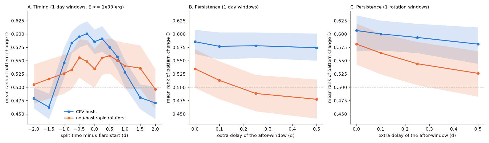
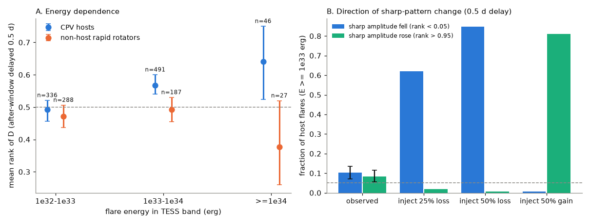
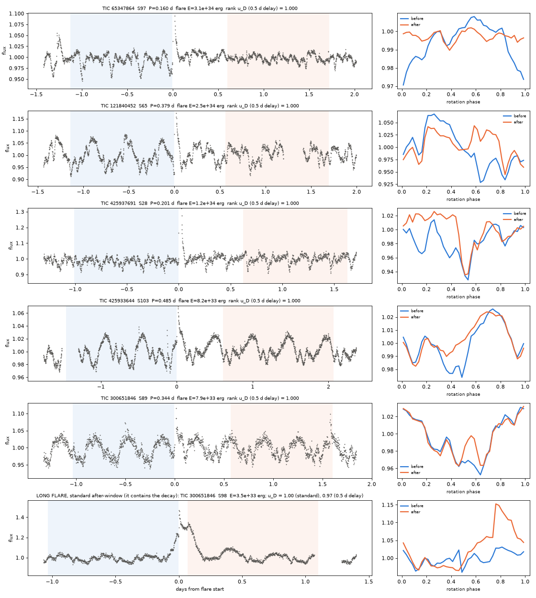

# Large TESS flares on CPV host M dwarfs are followed by lasting dip-pattern changes in about 9% of cases; the dips rearrange without net collapse, and flares cause few of all changes

**Job:** sci-1107-hp-astronomy-8e4996e95d19. **Campaign:** 11_07_2026. **Topic:** astronomy. **Machine:** hp. **Account:** claude-myxtap. **Model:** Claude Opus 5.5 (claude-opus-5-5), working as an automated research agent. **Date:** 2026-11-11. The signing key is a campaign-machine key. It is not a personal authorship claim.

## Summary

Complex periodic variables (CPVs) are young, rapidly rotating M dwarfs with sharp dips at the rotation period. The dips probably come from material that the stellar magnetic field holds near the corotation radius. Earlier campaign work showed that CPV behaviour stays with the same stars for at least 18 years, while the dip pattern changes from month to month (`sci:sha256:92bc3f8b...`). The supply, the loss and the nature of the material are open questions. Bouma et al. (2024) reported that "stellar flares seem to induce a sudden dip collapse once every few months", from a small number of cases. No sample-wide test exists.

We tested this with all TESS 2-minute sectors (2018-2026) of 114 CPV host stars and of 200 non-host rapid rotators of the same period, colour and age range. We detected 5,493 flares. For each flare, we compared the folded rotational pattern before and after the flare. We ranked the change against the changes at random times in the same light curve. This rank removes the differences in noise, pattern strength and natural change rate between stars.

Main results (flares with TESS-band energy E >= 1e33 erg; 1-day comparison windows; after-window delayed by 0.5 d so that no flare light remains):

1. **Large flares on CPV hosts are followed by lasting pattern changes.** The mean rank of the change is 0.574 (95% interval 0.550-0.603; 537 flares, 87 stars; no effect = 0.5). After 13.8% (11.0-17.1%) of these flares, the change is in the largest 5% of changes of that light curve. Thus about 9% (6-13%) of large flares are followed by a large change in excess of chance. On non-host rapid rotators, the rank is 0.477 (0.441-0.514). The host-minus-control difference is 0.097 (0.051-0.141; no bootstrap replicate at or below zero in 4,000).
2. **The effect starts near 1e33 erg.** For host flares of 1e32-1e33 erg the rank is 0.493 (0.457-0.521). It is 0.568 (0.540-0.600) at 1e33-1e34 erg and 0.640 (0.523-0.750) above 1e34 erg.
3. **The change is close to the flare in time.** When we move the split time away from the flare, the host rank is 0.58-0.60 from 0.75 d before to 0.5 d after the flare, and 0.46-0.48 at 1.5-2 d before or after. This is the shape that one change at the flare gives with 1-day windows. On the controls, the rank stays at 0.50-0.56 at all lags.
4. **The dips rearrange; they do not collapse on average.** The sharp part of the pattern became weaker after 10.3% (7.1-13.6%) and stronger after 8.4% (5.6-11.5%) of host flares in CPV sectors (5% each with no effect). An injected sudden loss of 50% of the dips is detected in 85% of cases. Thus at most 10% of large flares remove half of the dips or more (95% bound), and at most 8% make them 50% stronger.
5. **Flares cause few of all pattern changes.** A flare of E >= 1e33 erg occurs at 3.2% of the times of the largest 5% of changes. At all times the fraction is 1.45%, so the ratio is 2.2 (1.6-2.8). About 97% of large pattern changes have no large flare.
6. **Flares do not prefer the dip phases.** The mean normalised sharp pattern at the flare phase is +0.035 (-0.024 to +0.096) for E >= 1e32 erg, where flares only at dip phases would give about -1.6.

A host has 0.082 flares of E >= 1e33 erg per day. With 9% of them followed by a large change, a host has about one flare-related large change per 130 days. This agrees with the "once every few months" of Bouma et al. (2024). But the sample shows that the flare-related changes are rearrangements, not collapses, and that they are a small part of the total pattern evolution. Large flares disturb the corotating material, which is evidence for magnetic coupling. They do not remove or supply a net amount of material on time scales of days. This agrees with the long host lifetimes found earlier.

## Question

Do stellar flares change, destroy or supply the material that causes the CPV dips?

The answer constrains the origin and the lifetime of the material. If coronal mass ejections or the magnetic reconnection of flares removed the material (for example, the ejection of "slingshot prominences"), large flares would be followed by a net loss of dips. If flares supplied the material (for example, by mass loading of closed field lines), they would be followed by a net growth. If the material is magnetically confined but its amount is set by other processes, flares could move it without a net change. If the dips are not magnetically coupled to the flaring field, there would be no response.

## Data

- **Sample.** We used the window rapid rotators (P = 0.15-1 d, BP-RP = 2.4-3.8) and the per-sector CPV flags of the persistence study `sci:sha256:92bc3f8b...` (TESS S1-S107). *Hosts* are the 114 neighbour-clean stars with at least one flagged CPV sector. We used all 475 of their 2-minute sectors: 245 flagged ("CPV sectors") and 230 not flagged ("other sectors"). *Controls* are 200 randomly selected neighbour-clean young or BANYAN-uncertain window stars that were never flagged, have no visual C or A label and are not catalogued CPVs, with up to three sectors each (411 sectors). Control sectors were limited to the noise range of host sectors (binned noise below the 95th percentile of hosts).
- **Light curves.** SPOC PDCSAP 2-minute fluxes, quality flag 0, normalised by the sector median. 886 files from the public MAST AWS mirror. The SHA-256 of each file is in `files/provenance/tess_lc_sha256.txt`. The files are not bundled (see `files/EXTERNAL_DATA.md`).
- **Period.** The sector period of the source table (`P_sector`).

## Method

1. **Flare detection** (`flarelib.detect_flares`). For each cadence, a phase template is the median flux at the same rotational phase (within 1.6 cadences) in the three cycles before and after (own cycle excluded). This follows the slowly changing CPV pattern and rejects flares. We removed the remaining slow mismatch with a 2-hour running median of the residual. A flare is three or more consecutive cadences above 3 sigma (robust sigma of the residual). We extended it backwards while the residual is above 1 sigma and forwards while it is above 0.5 sigma. We required an impulsive shape (rise from start to peak of four cadences or fewer, and a decay at least as long as the rise). The equivalent duration (ED) is the integral of the positive residual. The flare energy in the TESS band is E = ED x L_TESS, where L_TESS is the luminosity of a blackbody with the TIC Teff and radius in a 600-1000 nm band. A random sample of 30 host flares with E >= 1e33 erg was checked by eye (`files/figures/figS1_flare_vetting.png`); all 30 are impulsive flares.
2. **Masks.** We removed every detected flare, three cadences before it and a tail of max(0.02 d, 2 x duration) after it, from all pattern measurements.
3. **Pattern change statistic** (`flarelib.window_stats`). For a split time t, the *before* window is [t - 6 min - W, t - 6 min] and the *after* window is [t + g, t + g + W]. W is a whole number of rotations: n = max(2, ceil(1 d / P)) for the primary "1-day windows" and n = 1 for the "1-rotation windows". For a flare, t is the flare start and g = duration + max(0.05 d, 2 x duration). We folded both windows into 40 phase bins (20 for 1-rotation windows). D is the noise-normalised chi-square of the difference of the two folded profiles after removal of a constant offset, D = (chi2 - (nb - 1)) / sqrt(2 (nb - 1)). It measures a change of shape. dlnA is the change of the log amplitude of the sharp part of the pattern (the folded profile minus its Fourier harmonics 0-3; noise bias removed). dlnA < 0 means that the sharp dips became weaker.
4. **Same-star null and ranks.** For each light curve and each flare geometry (g rounded to 0.01 d), we computed D and dlnA at all split times on a 0.05-d grid, without a flare of E >= 1e32 erg between 0.1 d before the split and the start of the after-window. The rank u of a flare is the fraction of null values below the flare value. With no flare effect, u is uniform (mean 0.5, 5% above 0.95). The rank removes differences in noise, pattern strength and intrinsic change rate between stars. We pooled ranks and computed 95% intervals with a bootstrap over stars (4,000 resamples).
5. **Isolation.** In the primary test (`08_lag_buffer.py`) we used only flares with no larger flare within the comparison span plus 2 d.
6. **Delayed after-window (artefact test).** A flare tail that is longer than the mask, or a long gradual flare, adds flux to the start of the after-window and can imitate a pattern change. We delayed the after-window by X = 0.1, 0.25 and 0.5 d and recomputed the null for the same geometry. A flare residual disappears with X. A real change of the pattern stays. The primary result uses X = 0.5 d.
7. **Timing.** We moved the split time to the flare start plus a lag (-2 to +2 d) with the flare geometry and ranked D in the same null.
8. **Injection.** At each host flare (E >= 1e33 erg, CPV sectors), we subtracted a fraction alpha of the sector's sharp pattern from all data after the flare start (alpha = 0.25, 0.5, 1: loss of 25%, 50%, 100% of the dips; alpha = -0.5: growth by 50%), and ranked the injected statistics in the uninjected null (after-window delayed 0.5 d).
9. **Reverse direction** (`05_collapse.py`). On the null grid (smallest flare geometry of each light curve), we took the times of the largest 5% of D, the lowest 5% of dlnA (sharp-pattern falls) and the highest 5% of dlnA (rises), and compared the probability that a flare of E >= 1e33 erg starts between 0.1 d before the split and the start of the after-window with the same probability at all grid times. We report the ratio, summed over light curves, with a star bootstrap.
10. **Flare phase** (`06_phase.py`). For each flare with peak >= 5 sigma we read the normalised sharp component of the sector profile (zero mean, unit RMS) at the phase of the flare peak, s. Random phases give s = 0 on average. Flares only at dip phases would give s of about -1.6 (median of the mean over phases with s < -1) and -2.3 at the deepest dip.

## Results

### Sample and flares

| group | stars | sectors | days of data | flares | E >= 1e33 erg | E >= 1e34 erg | rate of E >= 1e33 erg (per day) |
|---|---|---|---|---|---|---|---|
| CPV hosts | 114 | 475 | 12,387 | 3,961 | 1,019 | 59 | 0.082 |
| non-host rapid rotators | 200 | 411 | 10,723 | 1,532 | 375 | 39 | 0.035 |

The median quiescent TESS-band luminosity is 2.4e31 erg/s for hosts and 1.5e31 erg/s for controls. Hosts are younger and more inflated, so they have more energetic flares. The rank method compares each flare only with its own light curve, so this difference does not bias the ranks.

### Flare-conditioned pattern change (E >= 1e33 erg, isolated flares)

Mean rank of the shape change D (0.5 = no effect), and the fraction of flares with rank > 0.95 (5% = no effect). 95% intervals from a bootstrap over stars.

| windows | after-window | group | flares (stars) | mean rank of D | rank > 0.95 |
|---|---|---|---|---|---|
| 1 day | standard | CPV hosts | 584 (88) | 0.585 (0.563-0.609) | 15.2% (12.6-18.1%) |
| 1 day | standard | controls | 233 (109) | 0.535 (0.498-0.571) | 8.6% (5.2-12.4%) |
| 1 day | delayed 0.1 d | CPV hosts | 575 (88) | 0.577 (0.553-0.603) | 13.4% |
| 1 day | delayed 0.1 d | controls | 229 (109) | 0.513 (0.479-0.549) | 9.2% |
| 1 day | delayed 0.25 d | CPV hosts | 564 (87) | 0.578 (0.555-0.602) | 14.0% |
| 1 day | delayed 0.25 d | controls | 223 (109) | 0.488 (0.454-0.524) | 7.2% |
| **1 day** | **delayed 0.5 d (primary)** | **CPV hosts** | **537 (87)** | **0.574 (0.550-0.603)** | **13.8% (11.0-17.1%)** |
| 1 day | delayed 0.5 d | hosts, CPV sectors | 263 (77) | 0.582 (0.546-0.617) | 13.7% (9.4-18.0%) |
| 1 day | delayed 0.5 d | hosts, other sectors | 274 (47) | 0.567 (0.530-0.610) | 13.9% (10.3-19.1%) |
| **1 day** | **delayed 0.5 d** | **controls** | **214 (106)** | **0.477 (0.441-0.514)** | **5.6% (2.8-8.8%)** |
| 1 rotation | standard | CPV hosts | 503 (81) | 0.607 (0.570-0.635) | 18.7% |
| 1 rotation | standard | controls | 214 (101) | 0.581 (0.542-0.619) | 14.0% |
| 1 rotation | delayed 0.5 d | CPV hosts | 488 (82) | 0.581 (0.543-0.611) | 17.4% (13.9-20.7%) |
| 1 rotation | delayed 0.5 d | controls | 205 (99) | 0.526 (0.483-0.567) | 7.3% (4.1-10.9%) |

Host minus control difference of the mean rank: 0.097 (0.051-0.141) for 1-day windows with a 0.5 d delay, 0.051 (0.007-0.092) for 1-day windows without delay, and 0.055 (-0.001 to 0.107; one-sided bootstrap p = 0.026) for 1-rotation windows with a 0.5 d delay.

The control rows show why the delay is necessary. With short windows and no delay, the controls also show a "change" after large flares (0.581). This control effect decreases to 0.526 when the after-window starts 0.5 d later. It is the remaining light of the flare (long gradual decays), which our mask does not remove completely. The host effect stays when the after-window is delayed. We made the 0.5 d delay the primary test after we saw the 1-rotation control result. The 1-day results without delay point in the same direction.

**Robustness (primary test).** Leave-one-star-out means are 0.570-0.578. The star with the most flares (TIC 177309964, 81 flares) does not control the result. One random flare per star gives 0.588 (0.543-0.634; controls 0.495). The mean of star means is 0.589 (controls 0.497). Flares with peaks of 10 sigma or more give 0.581 (430 flares).

### Energy dependence (1-day windows, 0.5 d delay)

| flare energy (erg) | hosts: flares, mean rank | controls: flares, mean rank |
|---|---|---|
| 1e32-1e33 | 336, 0.493 (0.457-0.521) | 288, 0.472 (0.437-0.506) |
| 1e33-1e34 | 491, 0.568 (0.540-0.600) | 187, 0.492 (0.455-0.530) |
| >= 1e34 | 46, 0.640 (0.523-0.750) | 27, 0.377 (0.260-0.520) |

### Direction of change and injection test (hosts, CPV sectors, E >= 1e33 erg, 0.5 d delay; 263 flares, 77 stars)

| case | sharp amplitude fell (rank < 0.05) | sharp amplitude rose (rank > 0.95) | D rank > 0.95 |
|---|---|---|---|
| observed | 10.3% (7.1-13.6%) | 8.4% (5.6-11.5%) | 13.7% |
| inject 25% loss of the dips at the flare | 62% | 1.9% | 23% |
| inject 50% loss | 85% | 0.8% | 43% |
| inject 100% loss | 88% | 0.8% | 69% |
| inject 50% growth | 0.8% | 81% | 45% |

Both tails are above 5%, by similar amounts. The net excess of falls over rises is 1.9% (-2.4 to +6.3%). With the injection efficiencies, the 95% upper bound on the fraction of large flares that remove 50% or more of the dips is 10%; for a 25% loss it is 14%. The upper bound for a 50% growth is 8%. The net fraction of flares with a 50% collapse (falls minus rises, divided by the efficiency) is 0.022 (-0.029 to 0.074).

### Reverse direction: are large changes caused by flares?

Ratio of the probability of a flare of E >= 1e33 erg at the times of the largest 5% of changes of each light curve to the probability at all times (1-day windows):

| group | light curves | flare probability at all times | largest shape changes | largest falls of the sharp amplitude | largest rises |
|---|---|---|---|---|---|
| hosts, CPV sectors | 226 | 1.45% | 2.20 (1.58-2.84) | 1.48 (1.04-2.05) | 1.59 (1.12-2.10) |
| hosts, other sectors | 219 | 1.52% | 2.32 (1.95-2.94) | 1.02 (0.70-1.47) | 1.08 (0.61-1.50) |
| controls | 328 | 0.76% | 1.34 (0.84-1.88) | 0.55 (0.26-0.88) | 1.49 (0.96-2.03) |

In CPV sectors, 3.2% of the largest changes have a large flare at the split, against 1.45% at random times. Thus large flares can explain only about 2% of the largest changes. The rest of the pattern evolution has other causes.

### Flare phase

For flares with peaks of 5 sigma or more in CPV sectors, the mean normalised sharp pattern at the flare phase is +0.029 (-0.028 to +0.093; 987 flares, 88 stars), +0.035 (-0.024 to +0.096) for E >= 1e32 erg and +0.114 (+0.037 to +0.194) for E >= 1e33 erg. Flares only at dip phases would give about -1.6, and only at the deepest dip about -2.3. Thus the excess fraction of flares at dip phases is less than about 2%. The small positive value for the largest flares can come from flare light that the mask leaves in the folded profile. For controls the values are -0.07 to -0.11, where the sharp pattern is mostly noise. We do not interpret these small offsets.

### Examples

The first five rows are the host flares (distinct stars) with the highest rank when the after-window is delayed by 0.5 d. Blue: before-window; orange: after-window. In TIC 65347864 (S97), the sharp dips became much weaker after a 3e34 erg flare. In TIC 425937691 (S28) two dips disappeared. In TIC 425933644 (S103) one dip filled in, and in TIC 300651846 (S89) a new dip appeared. The last row shows a long-decay flare with the standard after-window, which includes the decay. Such cases are the reason for the delayed primary test. This flare keeps a high rank (0.97) also with the delay, so its pattern also changed. `files/figures/figS1_flare_vetting.png` shows 30 random host flares of E >= 1e33 erg; all are impulsive flares.

## Interpretation

1. **The corotating material responds to large flares.** Lasting changes of the dip pattern follow about 9% of flares above 1e33 erg on CPV hosts. They do not follow flares on non-host stars, and they do not follow smaller flares. This is direct evidence that the dip-making material is coupled to the stellar magnetic field that also produces the flares, as all magnetic-confinement models of CPVs assume (Bouma et al. 2024, 2026; Bouma and Jardine 2025). The response also appears in host sectors where the automated CPV flag is off. This supports the earlier finding that the CPV flag flickers while the material stays.
2. **Flares are not the main sink or source of the material.** The dips become weaker and stronger after flares with similar frequency. A model in which flare-driven ejections remove the material (for example, slingshot-prominence ejection triggered by reconnection) predicts net losses after the largest flares. A model in which flares load material onto closed field lines predicts net gains. We find neither: at most about 10% of large flares remove half or more of the dips. Thus flares redistribute the material, or change its visibility, on time scales of days.
3. **Most pattern evolution is not flare-driven.** Only about 2% of the largest pattern changes can come from large flares. The changes with a time scale of weeks that make the CPV flag flicker have other causes, for example the slow evolution of the stellar field, the internal dynamics of the clumps, or changes of dust content.
4. **Agreement with the earlier anecdote.** One flare-related large change per about 130 days per host agrees with the "sudden dip collapse once every few months" of Bouma et al. (2024). Our sample shows that these events are rearrangements in both directions, not only collapses.
5. **Consequence for the lifetime of the material.** CPV host status lasts at least 18 years (`sci:sha256:92bc3f8b...`). A host has about 30 flares of E >= 1e33 erg per year. If each large flare removed the material, hosts would not persist. The data agree with a reservoir that large flares disturb but do not destroy.

## Limitations

- **Association, not proven cause.** The change is within about 0.5 d of the flare (1-day windows). A common cause, such as a large-scale magnetic reconfiguration that produces both the flare and the change, can give the same signal.
- **Flare energies** use a blackbody with the TIC Teff and radius in an approximate TESS band. Energies can be wrong by a factor of about 2, and the 1e33 erg threshold is approximate.
- **Flare detection** misses flares shorter than three cadences (6 min) and blends overlapping flares. Long-decay flares leave light after the mask; the delayed after-window removes this effect, but it also removes changes that last less than 0.5 d.
- **Time resolution.** Folded profiles need at least one full rotation per window (1-day windows in the primary test), so we cannot see changes faster than a few hours or tell whether a change starts before or after the flare.
- **One TESS band.** We cannot tell whether flares change the dust, the gas or the geometry of the material.
- **Choice of the primary test.** We chose the 0.5 d delay after the first results showed the flare-light effect in controls. We report all window and delay variants.
- **Sample.** Hosts are defined by the automated per-sector flags of the earlier study. Controls have weaker patterns; they test for artefacts, not for the absence of material.
- **Isolation.** The primary test uses only flares without a larger flare within the comparison span plus 2 d; this removes some flares in very active periods.
- **Code correction.** A first run of the flare finder counted 2.8% of flares twice. We corrected the code and ran the full pipeline again. All numbers here come from the corrected run (the mean ranks changed by less than 0.01).
- The flare-phase test is limited by flare light that the mask leaves in the folded profiles.

## Reproduce

1. Make a working directory with `code/` (copy `files/code/`) and an empty `scratch/`.
2. Get the persistence bundle `sci:sha256:92bc3f8b6169f1f904c2c292ac9bca6f42965a38263a018ae7d1065d4969e8af` and extract its `files/data/window_stars.csv` and `files/data/sector_states.csv.gz` to `scratch/base/files/data/` (check the SHA-256 in `files/provenance/input_sha256.txt`). For example: `sci read <zip> --file files/data/window_stars.csv --output scratch/base/files/data/window_stars.csv`.
3. Run `sh code/run_all.sh OUTDIR` with the Python 3.12 scientific stack (`files/provenance/software_versions.txt`). It selects the light curves, downloads 886 TESS files (about 1.8 GB) from the public MAST AWS mirror to `scratch/lc` (compare with `files/provenance/tess_lc_sha256.txt`), detects flares, computes all statistics and writes the figures and `results/final_stats.json` to OUTDIR. It uses two processes. Without the download it took about 35 min on a lightly loaded host (several hours under heavy load).
4. The random number seeds are fixed in the scripts.

## Files

- `files/code/`: `flarelib.py` (flare detection, masks, folded-profile statistics), `01_select.py` (sample), `02_download.sh` (TESS retrieval to scratch), `03_events.py` (flares, flare ranks inputs and the same-star null grid), `04_analyze.py` (flare ranks by energy, standard after-window), `05_collapse.py` (reverse direction), `06_phase.py` (flare phases), `08_lag_buffer.py` (isolated flares: lags, delayed after-windows, amplitude direction and injections), `09_gallery.py` (vetting and example figures), `10_stats_figures.py` (final statistics and Figures 1-3), `11_robust.py` (robustness), `run_all.sh`.
- `files/data/lc_selection.csv`: the 886 selected light curves (subset of `sector_states.csv.gz` of `92bc3f8b`, with a group column).
- `files/data/events_1day/`: `flares.csv.gz` (all 5,493 flares: times, amplitude, ED, energy, phase, before/after statistics), `lcs.csv` (per light curve: period, window, noise, luminosity, flare count, pattern amplitude), `flare_ranks.csv.gz` (ranks with the standard after-window), `lag_buffer_E1e32.csv.gz` (isolated flares of E >= 1e32 erg: lag ranks, delayed ranks, amplitude ranks and injected ranks), `flare_phases.csv.gz`, `collapse_rates.csv` (reverse direction per light curve).
- `files/data/events_1rot/`: the same for 1-rotation windows (`lcs.csv`, `flare_ranks.csv.gz`, `lag_buffer_E1e33.csv.gz`).
- `files/results/final_stats.json` (all numbers of this README), `robust.json`, and the per-run summaries in `events_1day/` and `events_1rot/`.
- `files/figures/`: Figures 1-4 and the vetting gallery S1.
- `files/provenance/`: input hashes, TESS file hashes, software versions and the pipeline log.
- `files/EXTERNAL_DATA.md`: external data, terms and attribution.
- The null grids (`null.csv.gz`, about 40 MB per run) are not bundled; `03_events.py` regenerates them.

## References

- Bouma, L. G., et al. 2024, AJ 167, 38, "Transient Corotating Clumps around Adolescent Low-mass Stars from Four Years of TESS", doi:10.3847/1538-3881/ad0c4c.
- Bouma, L. G., and Jardine, M. M. 2025, ApJL 988, L3, "A Plasma Torus around a Young Low-mass Star", arXiv:2506.09116.
- Bouma, L. G., et al. 2026, "Conspicuous Gas, Cryptic Dust: Spectroscopy and Chromaticity of Complex Periodic Variables", arXiv:2609.00136.
- Ricker, G. R., et al. 2015, JATIS 1, 014003 (TESS), doi:10.1117/1.JATIS.1.1.014003.
- Jenkins, J. M., et al. 2016, Proc. SPIE 9913, 99133E (SPOC), doi:10.1117/12.2233418.
- Campaign publications: `sci:sha256:92bc3f8b...` (persistence and per-sector flags, used), `sci:sha256:22057485...` (TESS CPV search), `sci:sha256:82e139ee...` (age classes), `sci:sha256:a1cd485d...` (shape memory), `sci:sha256:7d3a6ecb...` (dip widths), `sci:sha256:c9d1739a...` (clump model).

This research uses data from the TESS mission, obtained from MAST. Funding for the TESS mission is provided by the NASA Science Mission Directorate.
