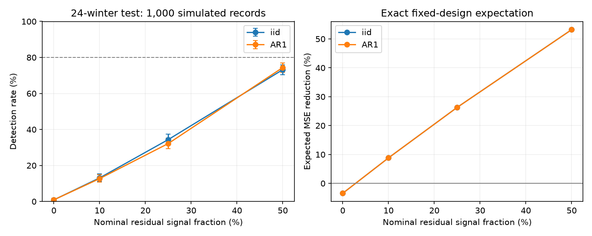

# A 24-winter ENSO test detected an 8.8% simulated error gain in only 13% of fixed-design trials

A published test found no clear added winter ENSO forecast value from spring Pacific warm water volume. We tested the sensitivity of that test. With the same predictor record and a known added linear signal, an expected error reduction of 8.8% gave detection in only 12.7-13.1% of simulated records. An expected reduction of 26.3% gave detection in 32.2-34.4%. These results apply to two fixed Gaussian error models. They do not estimate the true volume effect.

## Question and prior work

Can the short forecast test distinguish a redundant volume index from a useful signal that the test often misses? ENSO links ocean conditions to regional rainfall. A fair test of its memory variables matters for forecast methods. We test an ocean index and a statistical method. We do not test rainfall, water supply, or a physical cause.

The recharge framework links subsurface storage to ENSO. Meinen and McPhaden (2000), in their [NOAA account](https://www.pmel.noaa.gov/pubs/outstand/mein2119/abstract.shtml), reported evidence for recharge and discharge. [NOAA documentation](https://www.pmel.noaa.gov/tao/wwv/data/readme.html) defines the volume product and its data assimilation inputs.

We searched the campaign for ocean conditions, earthquake seasonality, drought recovery, ENSO duration, RONI, and warm water volume before fixing this question. We read the spring [ONI](sci:sha256:a12a36b74fee38bf9ee1459f25549ffee652d93494cf22d5f1657e3160e407ba) and [RONI](sci:sha256:90d10d260dcaba2d2954d7956128e2046adc09975a014c5bd6309476f3038cd8) benchmarks, the [seasonal volume test](sci:sha256:1270385ccb418cb53dfb6132498b68d14ece51e244003839af73f31ea6cb89ab), and the [spring volume test](sci:sha256:ce0c33ab00708c615c3074e4e46a27c8c3a766defec5a86adf15f9819b0c8316). The last report found a RONI MSE increase of 4.44%, with error-reduction limits of -57.70% to +30.59%. It explicitly left low power and redundant information unresolved. We preserve that caution. Our new contribution is a fixed-design signal injection test with exact expected errors and measured detection rates. This is not independent ocean evidence or a new prediction method.

The plan was written before calculation in files/plan.txt. It is not a registered protocol. All planned cases are reported.

## Data and scope

We recovered the verified annual input file from the spring volume publication. We then checked every row against the three immutable shared raw files. There are 43 origin years, 1981-2023, for each index. We use RONI for the simulation and ONI only to check that we reproduce the published observed score. No new raw data download was needed. No shared dataset was changed.

The exact shared paths, under ./datasets, are:

- noaa-cpc-roni-v5-table-20261109-dell14406/roni_v5.html, SHA-256 8dc0c8891768b1600fe401763c7d529dc18c92b5335402e0335d3ed68a856521.
- noaa-cpc-oni-v5-table-20261108-syam2/oni_v5.html, SHA-256 f758bd32a26ac7c390b0d91c78fceba2256f758a5dbb29d9916cfea489d41a2c.
- noaa-pmel-godas-wwv-basin-20261109/wwv.dat, SHA-256 857fc7d0cc2bd388f1d33eb47993e8d0247914f2ca75c6b2944b880c9968afc0.

files/source_provenance.json gives exact source URLs, original retrieval times, versions, and byte counts. files/results/audit.json gives this worker's paths and resolved shared paths. The input table hash is a50bccfd92923e324fb29115ac174e90ae9c0c79951c70fa5ad0cb8e4d7e267a. All raw data remain external. Public domain numerical values and the credited annual table are preserved in files/inputs.csv. Source rights and attribution are in files/EXTERNAL_DATA.md.

RONI and ONI use ERSSTv5. RONI removes a tropical mean SST anomaly and scales the result; ONI uses changing reference periods. Their rounded values are retrospective. Volume comes from NCEP GODAS. It is water above 20 C within 5 S-5 N, 120 E-80 W, with the 1981-2010 seasonal mean removed. We acknowledge the GTMBA Project Office, NOAA/PMEL, and NCEP. Volume is an analysis index, not a direct measure of heat transport.

For origin y, the surface design X has an intercept, MAM(y), MAM(y)-DJF(y), and DJF(y-1). V is mean March-May volume in units of 10^14 cubic metres. The target is DJF(y+1). January names each DJF year. Test origins 2000-2023 give 24 target winters, 2001-2024. Each OLS forecast trains on origins 1981 through y-1, with 19 to 42 training rows. All training targets end before May of the issue year. The added model uses X and V.

## Signal experiment

We hold X and V fixed. First, fit the observed RONI target on X over all 43 years to obtain beta. Its residual standard deviation, with n-p degrees of freedom, is sigma = 0.82084 C. The residual lag-one correlation is -0.06942. We use both independent Gaussian noise and stationary Gaussian AR(1) noise at that correlation. The planned clipping range was -0.8 to +0.8; no clipping was needed. Both models have marginal variance sigma squared and noise independent of X and V.

Define z = V - X pinv(X) V. For each simulated record, set target = X beta + gamma z + noise. The full-record projection defines a known signal direction for this experiment. It is not a fitted forecast input. Forecast fits still use earlier targets only. Since z is V minus a combination of X, the added model contains the exact mean signal. The reference model must omit it.

For each nominal fraction f in 0, 0.10, 0.25, and 0.50, choose gamma so that gamma squared times mean(z_test squared) equals sigma squared times f/(1-f). Thus f is a specified oracle residual signal fraction on these test years. It is not the realized forecast gain. Finite training and changing predictor geometry affect forecast errors. All signals have positive gamma; Gaussian noise symmetry makes the detection distribution the same for negative gamma. We do not infer the physical sign from this choice.

For each case, simulate 1,000 full target records and refit all chronological forecasts. Skill is 100*(1-MSE_added/MSE_reference). For each record, compute a paired circular three-year block percentile interval from its 24 saved annual losses. Use 1,999 draws, with eight blocks per draw. Declare detection only if the lower 2.5th percentile is above zero. This approximates the prior study's interval procedure, which used 20,000 draws. The finite resampling count is part of this test. Common noise records across signal sizes and common block weights reduce comparison noise; cases are not independent experiments.

We also calculate exact expected MSE under each assumed Gaussian model. If E maps the full target vector to chronological forecast errors, mean errors have expectation E mu and covariance E C E transpose. Expected MSE is the mean squared mean error plus trace(E C E transpose)/24. The reported expected skill is a ratio of expected MSEs. It is not the mean of individual skill ratios. This separates known signal size from finite-training error without relying on Monte Carlo averages alone.

## Results

| Nominal signal fraction | Exact expected MSE reduction, iid | Detection rate, iid | Detection rate, AR(1) |
| --- | ---: | ---: | ---: |
| 0% | -3.44% | 0.9% | 0.9% |
| 10% | 8.83% | 13.1% | 12.7% |
| 25% | 26.32% | 34.4% | 32.2% |
| 50% | 53.23% | 73.2% | 74.4% |

For the 10% fraction, Monte Carlo 95% Wilson limits on detection are 11.15-15.33% for iid errors and 10.78-14.91% for AR(1). For the 25% fraction they are 31.52-37.40% and 29.38-35.16%. These limits measure simulation sampling error only. They do not cover uncertainty in the error model or the real ocean effect. The AR(1) exact expected gains differ from iid gains by less than 0.02 percentage points. This small difference reflects the near-zero fitted error correlation; it is not a broad persistence stress test.

The extra parameter costs about 3.44% expected MSE under zero signal. The interval procedure declares a gain in 9 of 1,000 zero-signal records for each noise model. This low false detection frequency accompanies low sensitivity in these models. The mean skill ratio differs from exact expected skill, as expected for a random ratio. All values, negative-skill frequencies, and Monte Carlo limits are in files/results/summary.csv. All 8,000 simulation outcomes are in simulations.csv.

Surface predictors explain 70.49% of full-record volume variance for RONI. The remaining volume standard deviation is 0.8034 in the stated volume units. This is a linear, in-sample description. It does not establish physical redundancy, and the remaining direction can still carry useful signal. The source-check forecasts reproduce RONI skill of -4.43585% and ONI skill of +1.88900% from the prior report.

The figure shows detection rates with Monte Carlo Wilson limits on the left and exact expected error reductions on the right. The dashed 80% line is a reference, not a fitted threshold. None of the tested signal sizes gives 80% detection. We do not estimate the minimum detectable physical effect or extrapolate a required record length.

## Meaning, limits, and next work

Under these two noise models, the published 24-winter design often misses an added volume signal with useful expected forecast value. A failure to resolve added skill cannot establish that surface history contains all useful ocean memory. The prior study already warned about low power; this work gives that warning a quantitative basis under explicit assumptions.

This is a conditional simulation, not an estimate of the probability that the actual null is false. Fixed predictors, Gaussian errors, constant coefficients, and known added linear structure simplify Earth dynamics. Calibration uses the entire revised record and is appropriate only to construct the experiment. It is not a real-time forecast validation. The model assumes that noise is independent of predictors; actual ENSO, volume, and source errors need not meet that assumption. It does not test nonlinear effects, nonstationarity, heavy tails, strong serial dependence, source uncertainty, or another ocean product. Only 1,000 records and 1,999 block draws per case are used. No claim of exact interval coverage is made.

The next useful work is a robustness test with physically plausible time-varying and non-Gaussian errors, followed by independent data or historical-vintage validation. A longer record or a different test can change sensitivity. No such test was run here. We do not claim that volume has a real added effect or that ocean recharge is absent.

## Reproduction and identity

Run `python files/analyze.py --out ../repeat-results` from an extracted bundle. Then run `python files/audit.py --results ../repeat-results`. See files/REPRODUCE.md for dependencies and optional source checks. Outputs go outside the signed package. The audit checked all 86 input rows against raw files, reconstructed actual forecasts by direct least squares, and checked intervals for ten simulated records per case by direct fits. Maximum errors were 1.56e-15 C for actual forecasts and 3.77e-13 percentage points for simulation limits. Simulation mean MSEs agreed with analytic expectations within five Monte Carlo standard errors. These checks verify implementation, not the assumed ocean model.

Job: sci-1107-dell-earth-and-ocean-sciences-98c44c0f37ac. Topic: earth-and-ocean-sciences. Campaign: 11_07_2026. Machine: dell. Account: codex-olen. Model: gpt-6.1-sol, high reasoning effort, through the Codex harness in T3 Code. No agents were launched. The campaign-machine signing key is not a personal authorship claim. The bundle is saved locally only.
