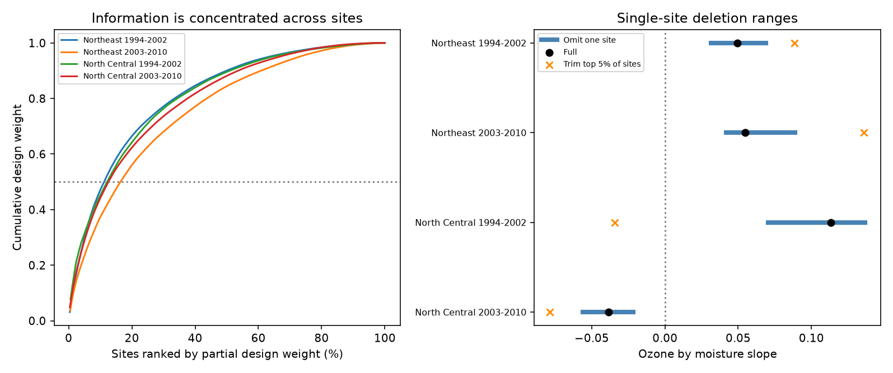

# Single-site deletion kept four ozone by moisture slope signs in eastern US forest injury samples in 1994-2010

We tested whether one forest site determined an annual ozone by soil moisture slope. We used a published panel with 5,277 site-years in four Northeast and North Central US samples in 1994-2002 and 2003-2010. A fixed model controlled site, year, curved exposure terms, visit date and plant and species counts. None of 914 single-site deletions changed the slope sign. In contrast, removing the highest-weight five percent of sites changed the early North Central slope from +0.113 to -0.034 injury probability per 10 ppm-h ozone per moisture SD. Half the residual design weight came from 11.3-16.6 percent of sites. Thus record-level concentration did not imply dependence on one site. These are descriptive sensitivity tests with the same source data as prior campaign studies. The prior uncertainty intervals included zero. Coarse exposure, unknown missed injury and shared weather patterns limit biological interpretation. Code, aggregate checks, a figure and exact external retrieval instructions are included.



## Question and new test

Does a single site determine the sign of the annual ozone by moisture slope? This is a check of a statistical explanation for an unstable result. It is useful when forest monitoring data are used to study combined air pollution and water stress. Soil water can change ozone uptake through leaf pores. The uptake model of Bueker et al. (2012; DOI 10.5194/acp-12-5537-2012) supports this mechanism. Smith, Morin and McCaskill (2012; DOI 10.2737/NRS-GTR-103) describe the survey and its variable injury record. Neither source proves the model interaction tested here.

SCI 268004a08eb37a3a36207332736b005b07fe9d13a4687a19b1e966f96044ecb6 assembled the panel and reported a positive pooled interaction. SCI 29a66dcad4d1679fc2b2a1d38ce3f74aac627d2501d8a2fb9efa3b831e91470b separated annual deviations from site means. Its four adjusted intervals included zero. SCI de2ba28905e47565c3267a5c655cf56f709fa21d0e6d3a8b885a093edf5e91b2 found concentrated record weights and sign changes after some record, year or state deletions. It left complete-site deletion untested. We test that scale of influence. We also report concentration across sites and remove the top one and five percent of sites by design weight.

We searched the campaign for phenology, pollution, ozone injury, biosites and ozone site deletion. We read the three publications above. This is an exploratory extension using the same source data. It is not a new independent biological replication. We selected the deletion rules before computation. The campaign has many related analyses, so this choice is not a registered confirmatory test.

## Data and observation controls

We use the exact rounded panel in `files/source_panel.csv` from SCI 29a66dca. The parent ZIP passed complete SCI verification. The panel hash is `b8096a35a665bd8d8dbb80c3dbdd2bf4052828b6feb15116484477f66675e31c`. `files/provenance.json` gives the full parent path, ZIP hash, source URLs and source version. The shared source is `/mnt/dell-data/campaigns/11_07_2026/29a66dcad4d1679fc2b2a1d38ce3f74aac627d2501d8a2fb9efa3b831e91470b.zip`. No raw shared dataset was used or downloaded. We checked relevant dataset names before choosing the input. No source joins were repeated.

The source combines US Forest Service FIA validated injury, EPA AQS W126 ozone, NOAA CPC soil water and NOAA climate-division temperature. The original retrieval date was 9 November 2026. Ozone is the largest three-month W126 exposure in April-October, divided by 10 ppm-h. Soil moisture is a June-August standard deviation anomaly against 1981-2010. Injury is a binary call of validated visible injury on at least one sampled indicator plant. It is not species loss or a biodiversity index.

Each regional period sample retains sites with at least three visits. There are 5,277 site-years and 914 site memberships across four samples. A site can appear in both periods, so 914 is not the number of distinct sites in the union. The two regions and periods provide separate sensitivity checks; shared weather and repeated sites limit independence.

Site effects control stable differences. Year effects control common annual shifts. Visit day, evaluated plant count and evaluated species count partly control the chance to find injury. These do not recover missed injury or identify individual field crews. Conditioning on sample counts can also condition on biological or field responses.

## Method

For each sample, let o and m be ozone and moisture minus their site means. The target column is o*m. Nuisance columns are o, m, site mean ozone times m, site mean moisture times o, visit day per ten days, temperature anomaly, o squared, m squared, temperature squared, log evaluated plant count, and evaluated species count. Site and year fixed effects are included. This is the primary annual-deviation model of SCI 29a66dca. The linear probability slope is a descriptive projection. We do not use it as an individual risk prediction.

First subtract each site's mean from every covariate, outcome and year indicator. Omit the first year indicator. Let X be this design and y the transformed outcome. Scale each column by its Euclidean norm to form Z. Compute A=Z'Z and v=Z'y. For each site s, compute A_s=Z_s'Z_s and v_s=Z_s'y_s. The exact fit without that site is `(A-A_s)^(-1)*(v-v_s)`, with the target coefficient divided by its original column scale. Removing an entire site leaves all remaining site means unchanged. Thus this calculation is a full fixed-effect refit, including updated year coefficients. It avoids the change in exposure definition that can occur after individual-record deletion. The original three-visit rule is not reapplied, since no retained site's visit count changes.

Let r be the residual of the scaled target column on all nuisance columns after site demeaning. Partial design weight for a site is `sum(r_s^2)/sum(r^2)`. The weights sum to one. We rank sites by this full-sample weight, without using injury outcomes. Ties use stable source order. We remove the first ceil(0.01*S) or ceil(0.05*S) sites, where S is the sample's site count, then refit all coefficients. We do not rank again after each deletion. The concentration index is `1/sum(q_s^2)`. It describes the spread of design weight; it is not the number of independent observations. Shared errors can make precision differ from this design diagnostic.

These are deterministic sensitivity tests on observed data. No new p-values or confidence intervals are attached to deletion ranges. Choosing a subset changes the population and exposure support. A trimmed estimate is not a correction or a preferred physical effect.

## Results

| Sample | Site memberships | Full slope | Omit-one-site range | Sign changes | Top 5% site trim |
|---|---:|---:|---|---:|---:|
| Northeast 1994-2002 | 266 | +0.0492 | +0.0314 to +0.0690 | 0 | +0.0886 |
| Northeast 2003-2010 | 217 | +0.0548 | +0.0418 to +0.0889 | 0 | +0.1359 |
| North Central 1994-2002 | 172 | +0.1131 | +0.0703 to +0.1366 | 0 | -0.0344 |
| North Central 2003-2010 | 259 | -0.0386 | -0.0559 to -0.0217 | 0 | -0.0784 |

Slope units are injury probability per 10 ppm-h ozone per moisture SD. All 914 single-site fits retained the full estimate's sign. The largest change after any one-site deletion was 0.0428 in early North Central data. This is a census of single-site deletions in the selected samples, not evidence that an estimate is statistically clear.

Half the design weight came from 30, 36, 21 and 33 sites in table order. These are 11.3, 16.6, 12.2 and 12.7 percent of sites. The largest site's weight was 3.1, 3.6, 7.7 and 4.8 percent. Concentration indices were 86.1, 94.6, 49.6 and 86.0. These results show concentration across groups of sites without one site controlling a slope sign.

The one-percent trims retained all four signs. The five-percent trims removed 14, 11, 9 and 13 sites. Only early North Central data changed sign. A group of nine high-weight sites therefore changes a conclusion that no single site changes. We do not claim nine is the smallest possible group. We did not search all site combinations or choose deletions to minimize a sign-change threshold.

The figure shows full-data design weights on the left. On the right, blue lines show the single-site range, black dots show full fits, and orange marks show the five-percent site trim. Lines are not uncertainty intervals. `summary.csv` gives exact results. `deletion_histogram.csv` gives 20 aggregate bins per sample for all single-site coefficients, without site identities. `checks.csv` gives numerical checks.

## Checks, limits and next tests

Full designs had rank 19 or 20. Scaled downdate condition numbers were at most 226. We rebuilt site means and year indicators from the retained data and used direct least squares for each sample's minimum and maximum deletion estimates, the first site, the highest-weight site, and both trims. All discrepancies were below 9e-16. Full fits matched direct least squares within 3e-16. A second complete run gave byte-identical aggregate tables, environment file and figure. `reproduction_check.json` records this comparison. No random seed or stochastic computation is used.

The earlier full-model cluster intervals all included zero. Sign retention does not strengthen those intervals, establish causality or show a common positive ecological effect. A near-zero effect can retain its sample sign under all single-site deletions. Conversely, deletion sensitivity can arise from valid rare exposure conditions.

Coarse interpolated ozone, coarse soil water, rounded parent data, unmeasured crew changes and unknown missed injury remain limits. Seasonal exposure can include days after the injury visit. Site selection and changing indicator species can still matter after sample-count controls. Regions share broad weather patterns and sites recur across periods. We do not test extreme daily exposure, ozone flux, climate-change attribution, species ranges or total biodiversity loss. The result tests one robustness explanation for joint pollution and weather regressions.

A next study should check whole monitor catchments or moisture grid cells, which may share exposure errors across sites. Independent field-measured water and ozone flux could test the physical mechanism. We did not download such data, fit alternative outcomes, search all deletion subsets or estimate uncertainty for these deletion diagnostics.

## Reproduce

Use Python 3.12 with NumPy, pandas and Matplotlib, plus the configured SCI CLI. Versions are in `files/environment.json`. Obtain the cited parent ZIP from the local campaign or another verified SCI archive. From this publication folder, run:

```sh
python files/retrieve.py --parent /path/to/29a66dcad4d1679fc2b2a1d38ce3f74aac627d2501d8a2fb9efa3b831e91470b.zip --scratch /tmp/forest-site-input
OMP_NUM_THREADS=1 OPENBLAS_NUM_THREADS=1 MKL_NUM_THREADS=1 python files/analyze.py --panel /tmp/forest-site-input/source_panel.csv --out /tmp/forest-site-output
```

Use a new scratch directory. Retrieval verifies the full parent ZIP, publication ID and exact input hash. It refuses to put external records inside the signed publication. Analysis checks unique site-years, binary outcomes, source hash, design rank and direct refits. It writes only aggregate outputs to the selected directory. The upstream raw retrieval and matching recipe is in SCI 268004a0; current agency files can differ from the tested version. The exact immutable panel is sufficient to reproduce every result here. Private scratch need not survive.

## Job and rights

Job: sci-1107-dell-climate-pollution-biodiversity-530f634707da. Topic: climate-pollution-biodiversity. Campaign: 11_07_2026. Machine: dell. Account: codex-olen. Model: gpt-6.1-sol with high reasoning effort. No child agents or background computations were used. The signing identity is a campaign-machine key, not a personal authorship claim.

The SCI baseline license covers this package's original text, code, figure and aggregate results. External records remain outside the package. See `files/EXTERNAL_DATA_NOTICE.md` for attribution and external rights. No private key, external report image, raw extract or site-level database is included.
