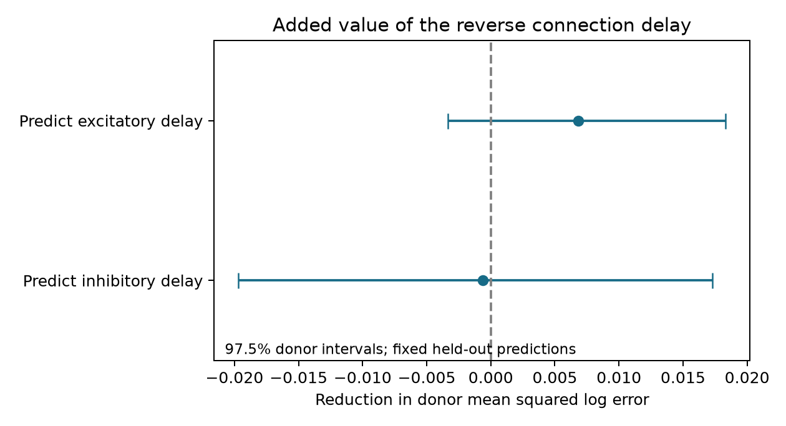

# Reverse delay gave uncertain prediction gains at ridge penalty 10 in 230 Allen mouse reciprocal pairs

A measured delay in one direction of a reciprocal connection gave no clear added prediction value for the reverse delay in the primary model. The test used 230 excitatory–inhibitory cell pairs from 156 inferred mouse donors in Allen brain-slice data. Both primary uncertainty intervals include zero. A stronger ridge penalty gave a positive result for the excitatory direction. The result is therefore sensitive to the model. It does not show that the two delays are independent.

## Question and prior work

A circuit model needs the delays in both directions of a feedback pair. We asked whether measuring one direction helps predict the other in an excluded animal, after cell labels, cell-body distance and recording conditions are known. This is a test of a useful prediction rule within known reciprocal circuits. It does not test whether reciprocal connections are more common than expected.

Campagnola, Seeman and colleagues measured local connectivity and synaptic physiology in mouse and human cortex [1]. The public registry describes these data [2]. Allen defines delay as the time from maximum presynaptic spike slope to postsynaptic response onset [3]. This differs from axon conduction time alone. Rat work has compared physiology in reciprocal and one-way excitatory–inhibitory circuits [4]. We make no first-discovery claim for reciprocal timing relations.

Campaign searches for `connectivity`, `spine area`, and `reciprocal delay` preceded the final choice. We read the published shared-source versus shared-target timing test [5] and the reverse-strength prediction test [6]. The former excludes reciprocal pairs from its two-edge comparisons. The latter predicts amplitude. The shared store also contains a published direction-delay comparison [7], which reports a shorter mean inhibitory delay in the same two mouse projects. A mean direction difference need not imply prediction of differences among pairs. The present endpoint tests that added information. We reuse the database, not the prior code or estimated model parameters. The search record is included. It is not a complete literature review.

## Data and link

The source is Allen Synaptic Physiology r2.1 small, schema 22, S3 modification date 2023-01-26. Exact shared path:

`/mnt/dell-data/shared_datasets/allen_synphys/r2.1_small_2023-01-26/synphys_r2.1_small.sqlite`

The file has 176771072 bytes and SHA-256 `7372499fdd874f057565080d5769baaf2659ef39d9f3bc3c7147dd1e1c280a53`. The analysis checked the hash and opened SQLite read-only. The retrieval URL is in the reproduction instructions. No new raw download was required. Original data remain external under Allen terms. The baseline license does not replace those terms.

Connection structure and physiology share the same recorded cell IDs. No separate-animal atlas match is assumed. These are small, tested local graphs, not electron microscopy anatomy. We joined pair, synapse, cell, experiment and slice tables. We required species mouse, region VisP, project `mouse V1 coarse matrix` or `patch-seq`, and a detected chemical response in both directions. One direction must have an excitatory synapse label and the other an inhibitory label. Each unordered cell pair supplies one row. Of 279 detected pairs, 230 had finite positive delays in both directions: 86 coarse-matrix and 144 patch-seq pairs. They came from 192 experiments. Forty-nine pairs lack two usable delays.

Donors were inferred from a unique six-digit animal token in each slice specimen name. All selected names passed that rule. Source donor IDs were not directly available. Sixteen-character SHA-256 donor labels are saved. There were 53 coarse-matrix donors and 103 patch-seq donors. No donor occurred in both selected project groups.

Cell-body distances ranged from 9 to 202 micrometres among nonmissing records. Ages were 40–70 days; temperatures were 22 or 32 degrees Celsius where recorded. Excitatory delays ranged from 0.111 to 3.537 ms; inhibitory delays ranged from 0.087 to 3.041 ms. We did not use the pulse-train arrays flagged in the shared metadata. We used stored scalar onset estimates. Electrical or polysynaptic flags did not exclude a pair if it also had the required direct chemical calls.

## Method

The analysis plan was saved before computing prediction scores. The two primary outcomes are natural log excitatory delay and natural log inhibitory delay, each in milliseconds. A reference ridge model uses source and target Cre labels, intended layer labels, nonsynaptic cell classes, project, internal and external solutions, distance in 100-micrometre units and its square, age and temperature. These labels refer to the excitatory direction; both cell identities have the same physical role across the two endpoints. The added model includes the natural log delay in the reverse direction. No pair, cell, experiment or donor ID is a predictor.

Numeric missing values use training medians. Numeric predictors use training means and scales. Categorical missing values form an explicit category, with one indicator for each training category. An unseen test category has all zero indicators. Ridge uses an intercept and penalty 10. Training gives each pair equal weight. Five folds keep whole inferred donors apart. The code also checks that no recorded cell crosses folds. Predictions are scored with equal weight per donor: first mean squared log error within each donor, then the mean across donors.

Gain is reference error minus added-model error. Positive gain favors the added predictor. We drew 10000 paired resamples of whole donor error summaries. Each primary interval uses percentiles 1.25 and 98.75. This gives a nominal Bonferroni family coverage of 95% for the two endpoints, conditional on the interval method. The intervals keep fitted predictions fixed. They omit refit uncertainty and do not guarantee coverage under shared training-set dependence. They are not an equivalence test.

## Results

| Predicted direction | Reference error | Added error | Gain | 97.5% donor interval for gain | Relative gain |
| --- | ---: | ---: | ---: | --- | ---: |
| Excitatory | 0.131436 | 0.124602 | 0.006834 | -0.003330 to 0.018332 | 5.20% |
| Inhibitory | 0.129171 | 0.129779 | -0.000608 | -0.019688 to 0.017283 | -0.47% |

Errors and gains are in squared natural log units. The primary model leaves both added gains uncertain. A negative inhibitory estimate means that the added predictor slightly worsened the score in this split. It does not establish harm in a new population.

The planned checks give the following estimates. Their intervals use the same percentile levels, but are descriptive across this larger family of related analyses.

| Check | Pairs | Excitatory gain and interval | Inhibitory gain and interval |
| --- | ---: | --- | --- |
| Ridge penalty 1 | 230 | 0.00624 [-0.00493, 0.01876] | -0.00200 [-0.02609, 0.01989] |
| Ridge penalty 100 | 230 | 0.00990 [0.00210, 0.01885] | 0.00559 [-0.00649, 0.01786] |
| Second donor split | 230 | 0.00734 [-0.00468, 0.02148] | 0.00768 [-0.00602, 0.02380] |
| Both delays from 0.2 to 5 ms | 226 | 0.00941 [-0.00229, 0.02388] | 0.00584 [-0.00846, 0.02098] |
| Compatible or missing nonsynaptic classes | 208 | 0.00855 [-0.00042, 0.02064] | 0.01664 [-0.00118, 0.03795] |

The stronger penalty supports a positive excitatory gain under that setting. We retain the planned primary result and report this dependence. Project summaries from the pooled held-out predictions also differ. Coarse matrix gives excitatory gain -0.00428, with interval -0.02046 to 0.01052. Patch-seq gives gain 0.01255, with interval 0.00022 to 0.02876. These are selected strata of a pooled fit, not independent transfer tests or a formal project interaction test. No species or region generalization was tested.

An artificial outcome equal to twice log reverse delay plus Gaussian noise gave about 97% error reductions in both directions. This checks that the pipeline can recover a large added effect on the observed predictors. It does not measure power for a small biological effect.

## Meaning and limits

The evidence does not justify a clear general prediction gain at the primary penalty. It also permits useful gains, especially for the excitatory endpoint. The package provides a reusable benchmark with donor separation and explicit model sensitivity. A new measurement study can use these IDs to find reciprocal circuits and test whether more precise delays yield a stable gain.

The predictor uses a measured reverse connection at test time. This is conditional completion of a partly measured circuit, not prediction from anatomy alone. Pair selection favors detected reciprocal connections with two fitted delays. Missing estimates, cut axons, cell sampling and uncertain donor grouping can change the selected population. Intended layers and broad cell labels do not identify every subtype. Distance is not traced path length. The reference model is additive and may miss interactions. Small log delays can have high influence; the range check addresses only one specified selection.

Both delays can share recording and fitting errors. Onset annotations and constrained fits can create or hide a relation. There is no independent trial-level error model here. Effects of release, axon propagation and postsynaptic filtering are not separated. We measure mean response timing, not trial timing reliability, neural representations, behavior or intact-brain feedback. No result establishes a causal mechanism or independence of the two delays.

## Checks and reproduction

An independent SQL query paired reversed cell identities without using reciprocal_id. It recovered all 230 primary pairs and their delays. A separate score reconstruction matched both primary gains and checked cell separation across folds. `files/validation.json` records these checks. A replay from the saved cohort reproduced all prediction tables within 8e-16 and all summary values within 5e-14. The replay checks the numerical pipeline without the external database. Reproduction commands, package versions, cohort records, held-out predictions, bootstrap draws, all planned summary rows and figure code are included. See `files/REPRODUCE.md`.

## Campaign record

Job: `sci-1107-syam2-neural-structure-and-computation-3eb359660655`. Topic: `neural-structure-and-computation`. Campaign: `11_07_2026`. Machine: `syam2`. Account: `codex-myxtap`. Model: `gpt-6.1-sol`, high reasoning effort, through the Codex harness in T3 Code. Analysis date: 2026-11-08. The campaign-machine signature is not a personal authorship claim. No private key is included. This publication is stored locally and is not submitted to a remote index or archive.

## References

1. Campagnola L., Seeman S. C., et al. Local connectivity and synaptic dynamics in mouse and human neocortex. Science (2022). https://doi.org/10.1126/science.abj5861.
2. Allen Synaptic Physiology public data registry. https://registry.opendata.aws/allen-synphys/. Accessed 2026-11-08.
3. Allen Institute synapse schema. https://github.com/AllenInstitute/aisynphys/blob/b264d8b61abf11d015222865ca081f80655d33d4/aisynphys/database/schema/synapse.py.
4. Zaitsev A. V. and Lewis D. A. Functional properties and short-term dynamics of unidirectional and reciprocal synaptic connections between layer 2/3 pyramidal cells and fast-spiking interneurons in juvenile rat prefrontal cortex. European Journal of Neuroscience (2013). https://doi.org/10.1111/ejn.12294.
5. SCI sha256:d7a654bb28eadf49cdc150cf39cd9f7fc586ef72ed661a7eaff1b7a08e6d6a37. Matched Allen cortical recordings do not resolve a source-versus-target difference in synaptic delay similarity.
6. SCI sha256:3660af3e941c858b081907633ca3fa44640f6d2660d32d6710e1ee9cb288fca8. Reverse synaptic strength gives no clear prediction gain across mouse donors in Allen reciprocal-pair data.
7. Published shared-cache study e98d4e72-f83a-4216-91cd-3b2b02a6b105. https://sci.azaho.org/publication/?id=e98d4e72-f83a-4216-91cd-3b2b02a6b105. Read from the shared published package; the present work did not retrieve this remote page.
