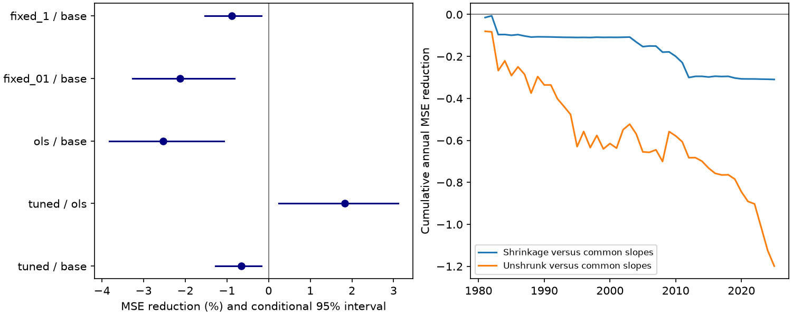

# Shrinkage cut seasonal PDO forecast error but common slopes had lower error in 1981-2025

Past-error tuning reduced the error from seasonal slope terms. It did not give a gain over common slopes. In 540 six-month forecasts, the tuned model had 0.66% higher mean squared error (MSE) than the common-slope model. The conditional 95% interval for MSE reduction was -1.27% to -0.18%. Against unshrunk seasonal slopes, tuning reduced MSE by 1.83%, with interval +0.24% to +3.11%.

Figure 1. Left: MSE reduction, with paired five-year block intervals. Positive values mean lower error. Base means common slopes; ols means unshrunk seasonal slopes. Fixed_01 and fixed_1 use penalties 0.1 and 1. Right: the sum of annual baseline MSE minus model MSE. This sum is in squared PDO index units. PDO is not a temperature in degrees C.

## Question and prior work

Can shrinkage make seasonal PDO and ENSO slope terms useful for six-month PDO forecasts? The Pacific Decadal Oscillation (PDO) describes a broad North Pacific surface temperature pattern. Persistent ocean conditions affect marine systems, so small forecast models need reliable tests before more inputs are added.

[Newman et al. (2016)](https://doi.org/10.1175/JCLI-D-15-0508.1) describe PDO as a result of atmospheric forcing, tropical links, ocean memory and circulation. [Meeker et al. (2025)](https://doi.org/10.1029/2025GL116122) report seasonal prediction skill in coupled model experiments. Their abstract states that persistence explains most skill and ENSO is needed to reproduce its seasonal changes. We used the indexed abstracts and available text. We do not repeat those physical experiments.

We searched the public campaign before choosing the test. We read the [seasonal slope test](sci:sha256:7987ddb3d4c9d951d5e689dd61f6ea3c0e0804732ad8540576f8b9a9173f5770) and the [prior-season memory test](sci:sha256:ba062e27488cefb2d07500106a73b9c61ccdaa1cfb319feaaedda15f211bb2c8). Both used the same source snapshots and found no added forecast gain for their primary model additions. The seasonal slope test raised six-month MSE by 2.54%. More fitted terms can increase estimation error. This motivates a test that shrinks those terms toward zero. We do not treat this explanation as a proven cause.

Our new contribution is a chronological, nested test of shrinkage for that model. It uses a fixed tuning rule and a separate numerical check. This is an extension on shared data, not independent confirmation. The local [plan](files/plan.txt) preceded scores. It is not an external registration. No sibling private work was read and no prior code was copied.

## Data and rights

We reused these shared snapshots without changing them:

- NOAA NCEI ERSSTv5 PDO: `/mnt/dell-data/shared_datasets/ncei-ersstv5-pdo-index-20261108/ersst.v5.pdo.dat`. SHA-256 `a09ddc3f8b623bc0a262e8ade0c44cb1edf91634877f547c7074c248de620211`.
- NOAA CPC ERSSTv5 Nino region table: `/mnt/dell-data/shared_datasets/noaa-cpc-nino-regions-ersstv5-20261109-c15aaeaf/nino_regions.txt`. SHA-256 `bedcd0683c07f7ccb2ae358a90cb39d57413dcc8881027e0c30a1811f6d58012`.

The compatibility paths point to the shared HP SSD. [Provenance](files/provenance.json) gives source URLs, exact paths, resolved paths, byte counts and checked hashes. Analysis uses all months from January 1950 through December 2025. No required month is missing or filled. Nino 3.4 is the last anomaly column, with a 1991-2020 reference. The PDO table is the NCEI product, not the separate PSL ensemble PDO. These are revised indices. Their construction and anomaly scales can contain later information. This is a retrospective test with fixed data, not operational forecast skill with issue-time data.

The raw tables and monthly observations and predictions remain outside the signed publication. The package contains our code, text, figure and aggregate model error evidence. It contains no source extract or substitute monthly database. NOAA NCEI and CPC are the data sources. The [external notice](files/external_data_notice.txt) records rights context and source terms. We do not claim ownership of NOAA data or NOAA endorsement. The SCI baseline license applies to our bundled work.

## Method

For target month t and origin t-6, the reference model uses an intercept, origin PDO, origin Nino 3.4, and the sine and cosine of target calendar month. The added model also uses four interactions: each origin index times each calendar term. These allow smooth annual slope changes. There are five reference coefficients and nine added coefficients.

For each forecast, all training target months are at or before the origin. Training starts at July 1950, whose predictors are January 1950. Each nonconstant predictor is centered and scaled with its training mean and population standard deviation. The reference minimizes squared error. The added model minimizes training MSE plus lambda times the sum of the four squared standardized interaction coefficients. The common terms are unpenalized. Lambda zero gives unshrunk ordinary least squares. Larger lambda moves the interactions toward zero. The intercept is not scaled.

Candidate penalties are 0, 0.001, 0.01, 0.1, 1, 10 and 100. For each outer forecast, we select the candidate with the lowest MSE in the last 120 completed target-month forecasts. Each validation forecast uses the same six-month information gap and training rule. Validation targets must be at or before the outer origin. Inner forecasts start in January 1970. There are exactly 120 available validation targets for every scored outer forecast. Numerical ties within absolute MSE tolerance 1e-12 select the larger penalty. The common-slope model is a separate reference, not a tuning candidate. Infinite shrinkage would recover that reference but was not a candidate. This restriction is a material limit of the test.

We score January 1981 through December 2025: 540 target months, grouped into 45 complete years. Index values are assumed available at the end of the origin month, without a reporting delay. No future index or target enters a fit or a tuning decision. Validation targets before 1981 support the first selection. During the scored period, later forecasts can use earlier completed test targets, as in sequential forecasting.

Skill is 100 times (1 - model MSE / reference MSE). Monthly errors are averaged within years. We use 9,999 paired circular samples of five-year blocks, seed 8034582, and recalculate the ratio in each sample. The interval uses the 2.5 and 97.5 percentiles. The same sampled years are used across methods. Intervals hold all fitted predictions and tuning choices fixed. They do not include fitting, tuning, source revision or model selection uncertainty. Blocks approximate dependence but can miss longer changes. No exact coverage or causal claim is made.

Planned checks use three- and seven-year blocks, trailing 360-month training for both outer and inner fits, fixed penalties 0.1 and 1, early and late score periods, and scores without 2020-2025. No secondary score selects the primary model.

## Results

| Comparison | Model MSE | Reference MSE | MSE reduction | Conditional 95% interval |
| --- | ---: | ---: | ---: | ---: |
| Tuned / common slopes | 1.057147 | 1.050266 | -0.66% | -1.27% to -0.18% |
| Tuned / unshrunk slopes | 1.057147 | 1.076907 | +1.83% | +0.24% to +3.11% |
| Unshrunk / common slopes | 1.076907 | 1.050266 | -2.54% | -3.83% to -1.07% |
| Fixed 0.1 / common slopes | 1.072590 | 1.050266 | -2.13% | -3.27% to -0.82% |
| Fixed 1 / common slopes | 1.059593 | 1.050266 | -0.89% | -1.52% to -0.17% |

MSE is in squared PDO index units. The common and unshrunk MSE values agree with the earlier seasonal slope publication. Tuning selected the largest penalty, 100, in 334 of 540 forecasts. It selected 10 in 104, 1 in 75, 0.1 in 14 and zero in 13. No other candidate was selected. This pattern is consistent with limited useful extra slope flexibility in this test.

With trailing 30-year fits, tuned skill was -0.75% against common slopes, with five-year interval -1.34% to -0.20%. Tuning improved on unshrunk slopes by 2.45%, with interval +1.12% to +4.22%. Three- and seven-year intervals also exclude zero in the same directions for both training rules. These are dependent checks, not separate confirmations.

Primary tuned skill was -0.45% in 1981-2002 and -0.87% in 2003-2025. It was -0.82% when 2020-2025 was excluded from scoring. Exclusion changes the score only; earlier fits and tuning remain unchanged. The recent negative PDO period is not the sole source of the result.

[Annual MSE](files/annual_mse.csv), [all scores](files/scores.csv), [period checks](files/period_scores.csv), [selection counts](files/selection_counts.csv), and [five-year score draws](files/score_draws.npz) retain aggregate evidence. Draw rows follow five-year score rows in scores.csv; columns are resample numbers.

## Interpretation and limits

Shrinkage reduces the loss from the chosen seasonal terms, but this finite candidate set does not improve on common slopes. The result is useful as a benchmark for more complex ocean forecasts. It does not show that physical seasonality is absent. A stronger penalty, inclusion of the common model as a candidate, another validation length or another predictor set can give a different result. The test does not establish that no form of regularization can help.

The error difference against common slopes is small. This is one product and one dependent 45-year test. The same campaign record has supported many related studies, so the result has limited novelty and does not supply independent replication. No adjustment is made for earlier campaign choices or secondary comparisons. The intervals are conditional diagnostics, not full uncertainty for an adaptively fitted model.

We did not measure subsurface heat, mixed layer depth, winds, currents or heat flux. Surface index coefficients cannot establish a mechanism. PDO and ENSO share observations and physical links. This test does not measure local marine heatwaves, water supply, ecosystem recovery or changes in extremes.

## Reproduction and checks

Verify the ZIP with `sci verify BUNDLE.zip --json`, extract it, and enter its root. Use the existing shared store as RAW, or attempt a fresh retrieval to a new external directory:

~~~bash
python files/retrieve.py /absolute/path/to/new_raw
python files/analyze.py --raw /absolute/path/to/new_raw --out /absolute/path/to/repeat --scratch /absolute/path/to/external_monthly
python files/audit.py --raw /absolute/path/to/new_raw --monthly /absolute/path/to/external_monthly/monthly.csv --output /absolute/path/to/audit.json
~~~

The retrieval script stops if source bytes have changed. The exact shared snapshot is then needed. No source copy is included in this bundle; long-term retrieval depends on that snapshot or an external archive. Keep all outputs outside the signed folder. `--out` receives original aggregate results; `--scratch` receives the monthly table. Dependencies are Python 3.12, numpy, pandas and matplotlib. Versions are in software.json. No package was installed.

The separate audit uses a different raw parser, QR projection of the unpenalized columns, and normal equations for residual interactions. It checked all 5,400 saved predictions, tuning choices and information cutoffs across both training rules. The largest prediction difference was 1.34e-14. See audit.json. A second full run checked repeatability of aggregate files. These checks establish numerical consistency, not interval coverage or physical validity.

## Campaign record

Campaign 11_07_2026. Job sci-1107-dell-earth-and-ocean-sciences-0a803b4582ae. Topic earth-and-ocean-sciences. Machine dell. Account codex-myxtap. Model gpt-6.1-sol, high reasoning effort. One finite worker; no agents. The campaign-machine key identifies the signature and is not a personal authorship claim. Private keys remain outside the publication. The worker saves and verifies the signed bundle locally and does not upload or submit it.
