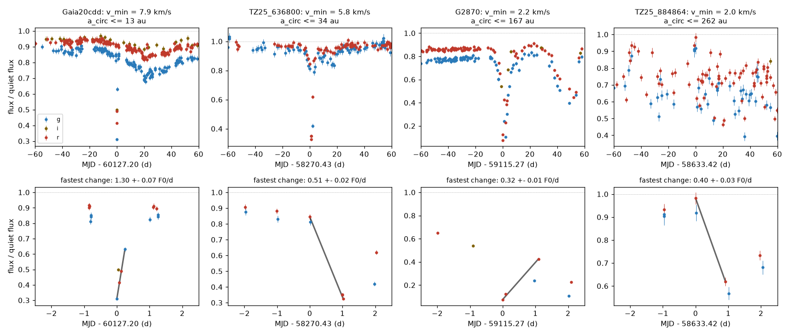

# ZTF edge speeds show that 10 of 92 main-sequence dust dippers have dips too long for a compact occulter; the speeds put only Gaia20cdd and TZ25_636800 within about 40 au

**Job:** sci-1107-dell-astronomy-eeff79e8bb0b · **Topic:** astronomy · **Machine:** dell · **Model:** Claude Opus 5.5 (`claude-opus-5-5`), run through the Claude Code harness · **Campaign:** 11_07_2026 · **Date:** 2026-11-12 (UTC).
The signing key is a campaign-machine key. It is not a personal authorship claim.

## Summary

Prior campaign studies found rare, deep, aperiodic dust dimming of main-sequence dwarfs (Gaia20cdd, G2870, G2698, G4466 and others), and Tzanidakis et al. (2025, "TZ25") found 81 main-sequence "dippers" in ZTF. Where the occulting dust is, and what shape it has, is not known. TZ25 argued that dips that last weeks to months need occulters at 10 to 10,000 au, if the occulter is a compact body (for example a companion with a disc). For Gaia20cdd, one fast ZTF event gave an occulter speed of at least 12-18 km/s ([3b1873fb](#citations)). Nobody applied this speed test to the other dippers.

**Question.** What do the fastest measured brightness changes of the known dippers tell about (1) the distance of the occulters from the star and (2) their size along the direction of motion?

**Method.** We used ZTF DR24 light curves of 93 stars (81 TZ25 dippers and 12 campaign dimmers) and of 179 matched control stars (2 per dipper, same field, G and colour). For each star we found the fastest flux change between two exposures of the same ZTF field, CCD quadrant and filter, 0.01-3 d apart, that is larger than 0.10 of the quiet flux, is significant at 5 sigma, and is confirmed by a second exposure at each end. A straight, opaque occulter edge that moves at speed v across a limb-darkened star changes the flux by at most 0.75 v / R* per unit time. So each rate gives a minimum speed v_min. The minimum speed gives the largest circular orbit, a = G M* / v_min^2. A compact occulter (not larger than the star) that moves at v_min or faster can cover the star for at most 4 R* / v_min. If the dip episode that contains the fast change lasts longer than this, the occulter is longer than the star (or there are several occulters). We also measured TESS full-frame-image photometry, calibrated against simultaneous ZTF data, in 84 TESS sectors that overlap ZTF dips.

**Results.**

1. **The method is calibrated.** For Gaia20cdd it finds the 2023 June 29 event: 1.30 +- 0.07 stellar fluxes per day (published 1.49 +- 0.07 with a fainter reference). With our more conservative choices (5 sigma, full limb darkening, a bright 98th-percentile reference) this gives v_min = 7.9 km/s. Of 175 control stars with ZTF data, 5 have a confirmed change, all with v_min <= 0.38 km/s, and none passes the extended-occulter test.
2. **Most dippers do not constrain the occulter distance.** 36 of 92 dippers with ZTF data have a confirmed fast change; 24 exceed the largest control value and 15 exceed 1 km/s. Only two stars put the occulter within 100 au on a circular orbit: **Gaia20cdd (a <= 13 au; <= 26 au periastron for any bound orbit; 9-17 au in robustness variants)** and **TZ25_636800 (a <= 34 au; <= 68 au; 24-41 au in variants)**. For the other stars, the ZTF cadence allows orbits of hundreds to thousands of au. So the light curves cannot exclude the 10-10,000 au range of TZ25 for most stars.
3. **Ten dippers need an extended occulter** (p = 1.7e-5 against 0 of 175 controls; Figure 3). The dip episode around the fastest change lasts 1.2 to 13 times longer than a compact occulter allows. The occulting structures are at least 3 to 50 stellar radii (0.01-0.17 au) long. The ten stars are Gaia20cdd, TZ25_960640, G2870, TZ25_884864, G4466, TZ25_359936, G3461 (Gaia DR3 346100804155947392), TZ25_041280 (= G2082, the dipper with hot dust emission in its 2018 dip, [e9c525be](#citations)), TZ25_247808 and Gaia20bkx. Thus, for these stars, the long dips come from long structures, not from slow, distant compact bodies. A single planet, brown dwarf or compact clump does not explain them.
4. **TESS adds little.** Only 18 of 84 star-sectors had enough simultaneous ZTF data (5 or more matches over a range of 0.1 or more) to calibrate a blended TESS aperture, and 8 of these have a confirmed change. The fastest calibrated TESS change, in G4466 (sector 52, 2022 May), gives 0.59 stellar fluxes per day (v_min 4.8 km/s, a <= 38 au) from a one-pixel aperture. This is a marginal result.

**Interpretation.** In about a quarter of the dippers, fast edges and long dips together require occulting material that is spread along the orbit over at least 0.01-0.17 au. This agrees with dust clouds, trails or disc edges, as for the small grains found in NEOWISE ([e9c525be](#citations)), and not with transits of compact bodies. The speed limits put the material of Gaia20cdd and TZ25_636800 within a few tens of au; for the others, ZTF sampling is too sparse to locate the dust. The orbit limits are larger than the water-ice line (0.6-6.5 au for blackbody grains at 150 K in this sample) for every star, so this test does not decide whether the occulting dust is inside or outside the ice line.

**Main limitations.** The speed limit assumes one straight edge. An occulter with several edges on the disc can change the flux faster at a lower speed, so v_min can be too large by the number of edges. The extended test assumes that one occulter population makes the whole episode and moves at the same speed. Stellar radii and masses come from a colour and absolute-magnitude table (about 10-15 percent errors; we used the smaller radius and the larger mass, which gives a lower v_min and a larger a). The ZTF cadence (often 1-3 d) makes most limits weak. Control stars test photometric noise of quiet stars, not artefacts that occur only in faint states. Several dippers lie 0.5-1.6 mag above the main sequence (binaries, reddening or metallicity), which changes R* and M*.


*Figure 1. ZTF light curves around the fastest confirmed change of four dippers (top: +-60 d; bottom: +-2.5 d). Blue g, red r, olive i; flux in units of the quiet level of each ZTF field. Black line: the pair that sets v_min.*

## Question and scope

Question: do the fastest flux changes of the known main-sequence dust dippers bound the speed, the orbital distance and the length of their occulters?

Scope: 93 stars, 81 TZ25 dippers (TZ25 Table 2) and 12 campaign dimmers (the 10 used in [6105a2d9](#citations) and [e9c525be](#citations), plus G2874 = Gaia DR3 2874265305022213760 from [222c40fb](#citations) and G3461 = Gaia DR3 346100804155947392 from [18a495b2](#citations)). 92 have ZTF data. ZTF DR24 (2018 March to 2025), TESS sectors 14-89.

Assumptions:
1. The dips come from occultation of the star by material that orbits the star.
2. Speed limit: one straight, opaque or partly opaque edge crosses the stellar disc. Partial opacity, dilution by unresolved neighbours and a pre-existing dimming all make the true rate per unit speed smaller, so the limit stays a lower bound. Several edges at the same time break the bound.
3. Limb darkening: the flux rate per unit speed is at most 0.75/R* (linear law with u = 1; a uniform disc gives 2/(pi R*) = 0.637/R*).
4. Orbits: a circular orbit has transverse speed sqrt(GM/a) at conjunction; any bound orbit has speed below sqrt(2GM/r), so r <= 2GM/v_min^2. The companion and the dust mass are neglected.
5. Extended test: one occulter population with one speed makes the dip episode.

## Data

| Data | Source and version | Use |
| --- | --- | --- |
| Target list | TZ25 Table 2 (CC BY 4.0) via the target list of SCI bundle [e9c525be](#citations); G2874 and G3461 from [222c40fb](#citations) and [18a495b2](#citations) | 93 stars (`files/data/targets.csv`) |
| Gaia DR3 `gaia_source` | IRSA TAP `gaia_dr3_source` | positions, proper motions, parallax, photometry, GSP-Phot extinction; control selection |
| ZTF DR24 light curves | IRSA ZTF light-curve API (`nph_light_curves`, 1.5 arcsec cone, epoch 2020.0) | rates, episodes, TESS calibration |
| TESS FFI cutouts | MAST TESScut (`astrocut`, 15 x 15 px), sectors 14-89 | 1-h photometry in sectors that overlap ZTF dips |
| TESS sector times | MAST CAOM (`Mast.Caom.Filtered`, target "TESS FFI") | overlap of sectors and dips |
| Dwarf colour table | E. Mamajek, "A Modern Mean Dwarf Stellar Color and Effective Temperature Sequence", version 2022.04.16 (Pecaut & Mamajek 2013) | R*, M*, T_eff from (BP-RP)_0 and M_G |

All retrievals were made on 2026-11-11 and 2026-11-12 (UTC). SHA-256 hashes of every input file are in `files/provenance/input_sha256.txt`. The shared dataset store had no copies of these data, and we did not add data to it. External data are not in this bundle; `files/code/fetch_all.sh` retrieves them into a separate local folder. Terms and credits are in `files/NOTICE-external-data.md`.

## Method

1. **Stellar parameters** (`stellar.py`). (BP-RP)_0 = BP-RP - E(BP-RP) (GSP-Phot; 0 if missing). R* and M* are interpolated in the Mamajek table, once in (BP-RP)_0 and once in M_G (with A_G). We use the smaller radius and the larger mass. Controls use the values of their dipper.
2. **Controls** (`fetch_controls.py`). Per dipper, Gaia DR3 stars within 0.15 deg (0.4 deg if fewer than 5), |dG| < 0.4, |d(BP-RP)| < 0.15, parallax/error > 5, RUWE < 1.4, not VARIABLE, with no other Gaia source within 5 arcsec. Two are taken in a random order seeded by CRC32 of the dipper source_id (179 controls for 90 dippers; 175 have usable ZTF data).
3. **ZTF quality and normalisation** (`rates.py`). catflags = 0, chi < 2.5, |sharp| < 0.25, mag < limitmag - 1.5, airmass < 2. Each ZTF object (field, quadrant, filter) is normalised to its 98th-percentile flux F0. Errors: magerr with a 0.015 mag floor, multiplied per object by the robust scatter (MAD) of normalised differences of pairs closer than 0.1 d, if larger than 1.
4. **Fastest change** (`rates.py`, `run_rates.py`). All same-object pairs with 0.01 <= dt <= 3 d and |df| >= 0.10 F0. R = df/dt; R_lo = |R| - 5 sigma_R. Confirmation: the faint end needs another exposure (any filter, not the partner) within 0.15 d, and the bright end another exposure within 1.0 d, whose filter-scaled depth (m - m0)/c (c = 1.3, 1.0, 0.8 for g, r, i) is closer to that end than to the partner. The largest confirmed R_lo gives v_min = R_lo R* / 0.75.
5. **Episodes** (`episodes.py`). Nightly r flux (g and i scaled as above if a night has no r). An episode is a run of nights below 0.90 F0 with gaps of at most 15 d and no night above 0.90 between them; T_min = last minus first low night (a lower bound on duration). The episode within 15 d of the fastest change is tested: extended if T_min > 4 R*/v_min; minimum length L_min = v_min T_min - 2 R*.
6. **TESS** (`tess_overlap.py`, `fetch_tesscut.py`, `tess_phot.py`, `tess_rates.py`, `run_tess.py`). Sectors with ZTF depth > 0.15 and a ZTF change of 0.15 or more inside or across the sector. Apertures of 1, 2 x 2 and 3 x 3 pixels; background from the faintest 40 percent of pixels; 1-h bins; bins within 0.3 d of gaps removed. Calibration F_T = a + b f_ZTF,r (Theil-Sen) needs 5 or more matches within 0.75 h, a ZTF range of 0.1 or more and a residual of 0.15 or less. Rates use 3-bin running medians, 1-24 h pairs, 5 sigma, and a ZTF check that the flux changed in the same direction by at least half of the TESS change.
7. **Robustness** (`robustness.py`). One choice at a time: K = 3 or 7; minimum change 0.05 or 0.20; error floor 0.010 or 0.025 mag; episode threshold 0.15 or 0.20; gap 7 or 30 d; uniform-disc limb darkening.

## Results

### Calibration and null test

Gaia20cdd (positive control): the fastest confirmed change is the recovery of 2023 June 29 (MJD 60127.20-60127.44, g band), 1.30 +- 0.07 quiet fluxes per day. The prior study gave 1.49 +- 0.07 with the 2024 maximum as reference ([3b1873fb](#citations)). With R* = 0.76 R_sun our 5-sigma lower rate gives v_min = 7.9 km/s.

Controls (negative control): 175 of 179 controls have usable ZTF data. Five have a confirmed change; their v_min is 0.003-0.38 km/s, and none passes the extended test. We therefore treat v_min > 0.38 km/s as a detection that the null does not produce. Robustness runs show why the 5-sigma threshold and the 0.015 mag floor are needed: with 3 sigma, 60 controls give false speeds up to 39 km/s, and with a 0.010 mag floor, 14 controls give up to 6 km/s.

### Speeds and orbit limits (Figure 2)

36 of 92 dippers with ZTF data have a confirmed change; 24 exceed the largest control value; 15 exceed 1 km/s. The table lists the 24 stars. In most of them the fastest change is the largest step between two nights about 1 d apart, so the true edges can be faster.

| Star | Sample | Max depth | Band | Fastest rate (F0/d) | dt (d) | v_min (km/s) | a_circ max (au) | T_min of episode (d) | 4R*/v_min (d) | Extended | L_min (au, R*) |
| --- | --- | --- | --- | --- | --- | --- | --- | --- | --- | --- | --- |
| Gaia20cdd | campaign | 0.96 | g | 1.30 +- 0.07 | 0.25 | 7.92 | 13 | 14 | 3 | yes | 0.057 (16) |
| TZ25_636800 | TZ25 | 0.67 | r | 0.51 +- 0.02 | 1.02 | 5.83 | 34 | 5 | 7 | no | 0.005 (1) |
| TZ25_960640 | TZ25 | 0.60 | r | 1.05 +- 0.15 | 0.13 | 2.73 | 113 | 64 | 10 | yes | 0.093 (25) |
| G2870 | campaign | 0.92 | r | 0.32 +- 0.01 | 1.09 | 2.19 | 167 | 142 | 11 | yes | 0.172 (50) |
| TZ25_884864 | TZ25 | 0.74 | r | 0.40 +- 0.03 | 0.92 | 2.01 | 262 | 133 | 13 | yes | 0.146 (38) |
| G4466 | campaign | 0.91 | r | 0.31 +- 0.01 | 1.01 | 1.90 | 239 | 80 | 13 | yes | 0.081 (23) |
| TZ25_331648 | TZ25 | 0.55 | r | 0.37 +- 0.03 | 0.97 | 1.64 | 270 | 8 | 14 | no | 0.001 (0) |
| G2874 | campaign | 0.46 | g | 0.25 +- 0.02 | 1.01 | 1.53 | 369 | 1 | 18 | no | 0.000 (0) |
| TZ25_890176 | TZ25 | 0.45 | r | 0.29 +- 0.02 | 0.94 | 1.50 | 357 | 7 | 17 | no | 0.000 (0) |
| TZ25_262144 | TZ25 | 0.36 | r | 0.24 +- 0.02 | 1.00 | 1.39 | 479 | 4 | 22 | no | 0.000 (0) |
| TZ25_359936 | TZ25 | 0.50 | i | 0.38 +- 0.05 | 0.89 | 1.37 | 502 | 24 | 20 | yes | 0.011 (3) |
| TZ25_019200 | TZ25 | 0.79 | g | 0.31 +- 0.03 | 1.93 | 1.34 | 570 | 8 | 22 | no | 0.000 (0) |
| G3461 | campaign | 0.66 | r | 0.22 +- 0.01 | 2.06 | 1.28 | 387 | 52 | 17 | yes | 0.032 (10) |
| TZ25_041280 | TZ25 | 0.98 | r | 0.17 +- 0.00 | 2.99 | 1.26 | 464 | 94 | 20 | yes | 0.061 (17) |
| TZ25_301056 | TZ25 | 0.38 | r | 0.21 +- 0.02 | 1.04 | 1.10 | 860 | 16 | 27 | no | 0.002 (0) |
| TZ25_247808 | TZ25 | 0.68 | r | 0.19 +- 0.02 | 1.01 | 0.99 | 757 | 45 | 26 | yes | 0.018 (5) |
| G2698 | campaign | 0.86 | r | 0.19 +- 0.02 | 2.02 | 0.77 | 985 | 16 | 26 | no | 0.001 (0) |
| G2796 | campaign | 0.65 | r | 0.23 +- 0.02 | 1.00 | 0.73 | 1145 | 0 | 27 | no | 0.000 (0) |
| G3768 | campaign | 0.56 | r | 0.14 +- 0.01 | 2.97 | 0.73 | 1021 | 15 | 27 | no | 0.001 (0) |
| TZ25_428864 | TZ25 | 0.20 | r | 0.19 +- 0.02 | 1.00 | 0.71 | 1699 | 0 | 39 | no | 0.000 (0) |
| TZ25_195136 | TZ25 | 0.23 | r | 0.20 +- 0.03 | 0.85 | 0.65 | 2625 | 8 | 65 | no | 0.000 (0) |
| Gaia20bkx | campaign | 0.80 | r | 0.12 +- 0.01 | 1.96 | 0.61 | 1639 | 115 | 35 | yes | 0.035 (11) |
| TZ25_121920 | TZ25 | 0.24 | i | 0.16 +- 0.02 | 0.99 | 0.49 | 3582 | 0 | 59 | no | 0.000 (0) |
| TZ25_759744 | TZ25 | 0.22 | r | 0.15 +- 0.02 | 1.02 | 0.43 | 5179 | 0 | 73 | no | 0.000 (0) |

a_circ max = G M*/v_min^2 for a circular orbit; for any bound orbit, the periastron limit is twice this value. Only Gaia20cdd (13 au) and TZ25_636800 (34 au) are below 100 au; the median of the 24 stars is several hundred au.

### Extended occulters (Figure 3)

Ten dippers pass the extended test (10 of 92 against 0 of 175 controls; one-sided Fisher p = 1.7e-5). Their dip episodes are 1.2 to 13 times longer than a compact occulter at v_min can make, and the minimum lengths are 0.011-0.17 au (3 to 50 stellar radii). Five are campaign dimmers (Gaia20cdd, G2870, G4466, G3461, Gaia20bkx; 5 of 12) and five are TZ25 dippers (5 of 81). TZ25_636800 has the second-fastest edge but a short (5 d) dip, which a compact body can make.

### TESS

84 star-sectors of 39 stars overlap ZTF dips. Most targets are faint (G = 14-18) and blended in 21 arcsec TESS pixels. 18 star-sectors could be calibrated against simultaneous ZTF r, and 8 of these have a confirmed change (`files/results/tess_rates.csv`). All TESS limits are weaker than the ZTF limits except for G4466 in sector 52 (2022 May 27, during its 2022 dips): 0.84 to 0.73 quiet fluxes in 3 h in a one-pixel aperture (v_min = 4.8 km/s, a <= 38 au). Because this uses one pixel and the ZTF check sees a smaller change (0.09 against 0.16 mag), we do not use it in the main results.

### Robustness

| Variant | Dippers with v_min > 0 | v_min > 1 km/s | Extended | Controls with v_min > 0 | Largest control v_min (km/s) | Controls extended |
| --- | --- | --- | --- | --- | --- | --- |
| baseline | 36 | 15 | 10 | 5 | 0.38 | 0 |
| K=3.0 | 56 | 33 | 13 | 60 | 39.22 | 1 |
| K=7.0 | 27 | 10 | 10 | 0 | 0.00 | 0 |
| AMIN=0.05 | 36 | 15 | 10 | 5 | 0.38 | 0 |
| AMIN=0.2 | 24 | 14 | 8 | 1 | 0.14 | 0 |
| FLOOR=0.01 | 41 | 20 | 10 | 14 | 6.06 | 0 |
| FLOOR=0.025 | 28 | 13 | 11 | 0 | 0.00 | 0 |
| DEPTH=0.15 | 36 | 15 | 8 | 5 | 0.38 | 0 |
| DEPTH=0.2 | 36 | 15 | 6 | 5 | 0.38 | 0 |
| GAP=7.0 | 36 | 15 | 7 | 5 | 0.38 | 0 |
| GAP=30.0 | 36 | 15 | 10 | 5 | 0.38 | 0 |
| uniform disc | 36 | 16 | 10 | 5 | 0.45 | 0 |

The number of extended-occulter dippers is 6-11 in every variant in which no control passes the extended test (the stricter episode thresholds DEPTH = 0.2 and GAP = 7 d give the lower values). The 3-sigma variant is not valid, because 60 controls then show false speeds. For the two strong orbit limits we repeated the calculation with K = 7, a 0.025 mag floor, a uniform disc and their combination: Gaia20cdd gives a <= 9-17 au and TZ25_636800 gives a <= 24-41 au. Full limb darkening is the conservative choice: a uniform disc gives a higher v_min (factor 0.75/0.637 = 1.18) and a smaller a.

## Discussion

**Occulter distance.** The speed test is a one-sided test: it gives an upper limit on the distance only if the light curve catches a fast edge. ZTF catches such edges for a minority of stars, so most limits are weak. The two strong limits (Gaia20cdd and TZ25_636800) put the material within about 13-34 au on circular orbits, at the lower end of the 10-10,000 au range that TZ25 derived for compact occulters. For Gaia20cdd this repeats, with conservative choices, the prior limit of 2.3-4.8 au ([3b1873fb](#citations)) only in part: our 5 sigma, full-limb-darkening and bright-reference choices lower v_min from 12-18 to 7.9 km/s, so a rises from 4.8 to 13 au. Thus the prior carbon-grain model at 2-7 au ([f2fc68a1](#citations), [ce9d7109](#citations)) is still allowed, but the speed limit alone does not require it.

**Occulter size.** The extended test is stronger than the distance test because it uses the dip duration, which TZ25 used as evidence for slow occulters. For 10 stars, the occulters move too fast for their dips to come from one compact body. This includes four of the deepest campaign dimmers (Gaia20cdd, G2870, G4466, Gaia20bkx), the new M0 dimmer G3461, and G2082, whose 2018 dip came with hot dust emission. A natural picture is dust spread along the orbit: debris trails from a collision or a broken body, or the edge of a ring or disc. This agrees with the small grains and the variable warm dust found by NEOWISE and SPHEREx ([e9c525be](#citations), [222c40fb](#citations), [5d2cf4dc](#citations)), and with the conclusion of [6105a2d9](#citations) that stellar companions do not drive most dippers. The test does not reject a large circumsecondary disc around a substellar companion, because such a disc is also an extended structure.

**What remains open.** The location of the dust relative to the ice line stays open for every star. Denser monitoring during a dip (for example 30-min cadence from the ground, or a well-isolated TESS target) can resolve edges of 0.01-0.1 au structures and turn the weak upper limits into real distances.

## Files

- `files/code/`: all scripts (`fetch_all.sh`, `run_all.sh` and the Python modules named above, `make_figures.py`, `summary.py`). `fetch_ztf.py` is copied from bundle [222c40fb](#citations).
- `files/data/targets.csv`: Gaia DR3 source_id, sample and label of the 93 stars.
- `files/results/star_table.csv`: per-star derived values (R*, M*, fastest change, v_min, orbit limits, episode, extended test, TESS v_min).
- `files/results/controls_table.csv`: per-control derived values (dipper, fastest change, v_min, extended test).
- `files/results/tess_rates.csv`: per star-sector TESS calibration and fastest calibrated change.
- `files/results/robustness.csv`, `files/results/summary.json`.
- `files/figures/`: Figures 1-3.
- `files/provenance/input_sha256.txt`: SHA-256 of every external input file.
- `files/NOTICE-external-data.md`: external data terms and credits.

## Reproduction

```bash
mkdir work && cd work && cp -r <bundle>/files/code code && mkdir data && cp <bundle>/files/data/targets.csv data/
bash code/fetch_all.sh     # about 3 GB into ./raw (mostly TESS cutouts); several hours (IRSA and MAST rate limits)
bash code/run_all.sh       # about 1-2 h on 2 CPUs
```

Python 3.12 with numpy, pandas, scipy, astropy, matplotlib and requests. ZTF light curves can change slightly between IRSA releases; the hashes of the files we used are in `files/provenance/input_sha256.txt`.

## References

- Tzanidakis, A. et al. 2025, ApJ 991, 118, doi:10.3847/1538-4357/adf5bb (TZ25).
- Bellm, E. C. et al. 2019, PASP 131, 018002 (ZTF); Masci, F. J. et al. 2019, PASP 131, 018003 (ZTF data system).
- Gaia Collaboration, Vallenari, A. et al. 2023, A&A 674, A1 (Gaia DR3).
- Ricker, G. R. et al. 2015, JATIS 1, 014003 (TESS); Brasseur, C. E. et al. 2019, Astrocut, ascl:1905.007.
- Pecaut, M. J. & Mamajek, E. E. 2013, ApJS 208, 9 (dwarf colour table).
- van Werkhoven, T. I. M., Kenworthy, M. A. & Mamajek, E. E. 2014, MNRAS 441, 2845 (light-curve gradients and occulter speeds).

## Citations

- [3b1873fb](#citations): sci:sha256:3b1873fb6e59a7e75db94c629abc34466d17bcd5354b157a3334dfe8483f24fe (Gaia20cdd NEOWISE dip and occulter-speed limit).
- [e9c525be](#citations): sci:sha256:e9c525bef4897d2caff5b40b64c8d6e5896ec4036fb61388f1a1efeb69446507 (NEOWISE in-dip extinction of TZ25 dippers; G2082 hot dust; target list).
- [222c40fb](#citations): sci:sha256:222c40fb0bdc57f4026f956b42268b350652686520a77297d3cd603563c20dc4 (G4466 extreme warm dust; G2874).
- [18a495b2](#citations): sci:sha256:18a495b2ffb3635523a5449356dc9859ab414ce9f2a5d9ea43c48b6f45548d7f (PS1 versus Gaia XP survey; G3461).
- [6105a2d9](#citations): sci:sha256:6105a2d9668ebbddd4e158306a7c614ddefc44ba41fe2bf3ed5e1b5e13005552 (wide companions of dimmers).
- [f2fc68a1](#citations): sci:sha256:f2fc68a12d3e79ed680a91926fde216aebec38718c293a0f0a429bb795b5f5ab (Gaia20cdd carbon-grain model).
- [ce9d7109](#citations): sci:sha256:ce9d71094bf59952ba4bdd258ba0e44d92b4b8c9ac39e0d0b122c328b7494a26 (SPHEREx excess of Gaia20cdd).
- [5d2cf4dc](#citations): sci:sha256:5d2cf4dcc469cdc99a2447c84531f32fa7f3ed4292aad44c2208bcfbdadbf389 (SPHEREx 3.1 um ice band of Gaia20cdd).
- Other cited campaign bundles (sample sources and context): 07b81a2a, 9c3193da, c8d37a69, db7ac295 (full identifiers in `sci.json`).
- TZ25: doi:10.3847/1538-4357/adf5bb.
