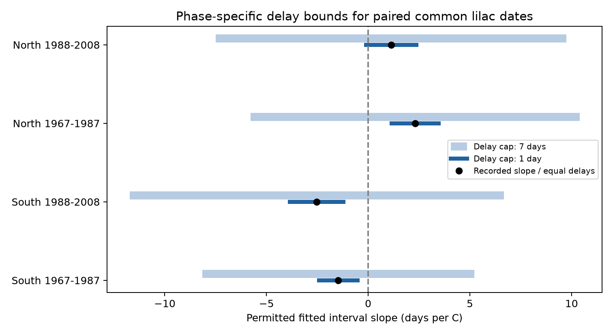

# Continuous delays below two days permit zero interval slopes in four western US lilac samples, 1967-2008

Under a model with a separate nonnegative reporting delay for each event, delay caps below two days permit a zero fitted spring-temperature slope of the leaf-to-bloom interval in four selected samples. The smallest caps are 0.918 to 1.998 days. This result still holds if the corrected bloom date must be on or after the corrected leaf date. Equal delays for the two events cancel exactly. These are exact sample sensitivity results under stated assumptions. They are not estimates of actual delay or confidence intervals.

## Question and prior work

Can shared observation delay protect a paired phenology interval from bias? How much separate delay can change its temperature slope? This study concerns observation bias in climate and ecological timing data.

Rosemartin et al. (2015, doi:10.1038/sdata.2015.38) describe the US lilac archive. Guo et al. (2023, doi:10.1016/j.cub.2023.06.064) studied leaf and flower timing in China. We use the US archive, not the Chinese records. The broad distinction between leaf and flower responses is established prior work.

The local SCI search completed with full bundle checks. It found extensive overlapping work. SCI c7e4cc8f tested seasonal interval slopes. SCI e301d9a4 bounded changes in reporting delay for absolute bloom dates. SCI 1ba88d22 tested assumptions about missing intervals. We read these three publications and preserve their verified text. This study instead compares equal phase delays with separately bounded phase delays in observed pairs. It adds an event-order constraint, sharp slope ranges, and explicit assignments that reach zero. We do not claim that regression sensitivity bounds are new mathematics. This is an exploratory extension on overlapping source data, not independent archive confirmation.

The initial design tested a general March-April interval association. We saw its pooled result before this extension: -0.183 days/C, with an approximate site-and-year cluster interval of [-1.023, 0.657]. The design changed after the campaign search revealed related work. Both designs and the initial results remain in the package. There was no external registration. The four final samples use separate rows, but share some reporting units across periods and correlated weather across regions. They are not independent experiments.

## Data and model

We used the USA-NPN version 13 workbook and its version 14 field guide. We used legacy program IDs 7 and 8, calendar years through 2008, coordinates at 24-50 N and 125-66 W, and event days 1-213. We paired first leaf and first bloom on site, individual, species and year. We used the median if a phase had duplicate dates. We removed records marked as multiple onsets. Early and late outlier flags remain: climate-based quality filtering could select on the exposure. Historical visit schedules are not available.

The raw workbook has 116,662 records. Selection gives 18,378 pairs across four shrub types before species and repeated-record selection. Common lilac, species code 36, gives 4,779 paired years at 438 reporting units after a five-year rule. The retained years are 1967-2008. The final bound analysis uses common lilac west of longitude -100. South has latitude below 43 N; North has latitude at least 43 N. Each of the four region-period samples must have five paired years per unit within that sample. There are 4,331 rows in these four samples. The later samples are small. An individual ID can represent a historical reporting unit rather than one verified plant.

NOAA PSL provided GHCN-CAMS monthly temperature, file version 3.01, snapshot 20261105. We used the nearest 0.5-degree cell and converted Kelvin to C. Spring is the equal-month March-April mean. Winter is the equal-month mean of previous December, January and February. Fixed monthly windows can extend after an event. The model therefore describes a seasonal association, not an effect of exposure entirely before an event.

Within each final sample we fit:

`bloom day - leaf day = unit effect + year effect + winter coefficient * winter temperature + beta * spring temperature + residual`.

Unit effects remove fixed local differences. Year effects remove annual changes shared across each sample. The spring slope uses remaining local weather variation. It is not a long-term national warming effect.

## Delay model and proof

Let B and L be recorded bloom and leaf dates. Let dB and dL be their reporting delays. The latent dates are B-dB and L-dL. For recorded interval G=B-L, the latent interval is `G-dB+dL`.

If `dB=dL` for every record, the interval is unchanged. This holds even if the common delay differs by unit, year or weather. The data do not show that the two delays are equal.

For separate delays we assume `0 <= dB,dL <= D`. We allow real-valued days. This is a continuous uncertainty model. It is not a claim that the archive stores fractional calendar dates. Delays can depend on weather in the worst possible way. No random-delay or statistical independence assumption is made. Records, weather and model terms remain fixed.

Residualize the spring temperature column on unit effects, year effects and winter temperature. Call this residual r and define `v = r/(r'r)`. The recorded slope is `beta=v'G`. The latent slope is `beta-v'(dB-dL)`. With no order constraint, each difference lies in [-D,D]. Thus the exact attainable slope range is:

`[beta-D*sum(abs(v)), beta+D*sum(abs(v))]`.

Each endpoint is attained by choosing phase delays of zero or D according to the sign of v. The smallest D that permits zero is `abs(beta)/sum(abs(v))`.

We also require latent bloom to be on or after latent leaf. All observed intervals are nonnegative. For each record, put `k=dB-dL`. The exact feasible interval becomes `[-D, min(D,G)]`. Each value is attained by `dB=max(k,0)` and `dL=max(-k,0)`. To minimize the slope, choose the upper limit of k when v is positive and the lower limit when v is negative. Reverse those choices to maximize the slope. The feasible set is convex, so every slope between the endpoints is attainable. We find the smallest cap that permits zero by bisection. Stored delay assignments attain zero and meet the date-order constraint.

These bounds are sharp only for this fixed model and constraint set. Equal delay and separate delay are assumptions about different error structures. The sample cannot choose between them.

## Results

| Region | Period | Rows | Units | Recorded slope, days/C | Smallest cap for zero, with date order, days | Range at a one-day cap, days/C |
| --- | --- | ---: | ---: | ---: | ---: | --- |
| South | 1967-1987 | 2076 | 225 | -1.469 | 1.538 | [-2.424, -0.514] |
| South | 1988-2008 | 166 | 25 | -2.530 | 1.925 | [-3.844, -1.216] |
| North | 1967-1987 | 1895 | 173 | +2.308 | 1.998 | [+1.153, +3.463] |
| North | 1988-2008 | 194 | 26 | +1.131 | 0.918 | [-0.101, +2.362] |

The largest unrounded threshold with date order is 1.997976 days. A one-day cap retains the recorded sign in three samples. A seven-day cap permits both signs in all four. With date order, seven-day ranges are [-8.143, +5.203], [-11.674, +6.671], [-5.772, +10.390], and [-7.484, +9.732] days/C, in table order. These are deliberately worst-case ranges. No probability is assigned to their endpoints.

Figure 1. Black points show recorded slopes, which also apply under equal phase delays. Dark and light bars give separate-delay ranges at one- and seven-day caps without date order. These are sensitivity ranges, not confidence intervals. The table and delay_bounds.csv also give bounds with date order. The changes from adding order are small in these samples.

The opposite recorded signs in North and South do not establish different biological responses. The study does not test a population difference between those slopes. The central result is the explicit delay structure needed to change a fixed fitted coefficient.

## Checks and limits

An independent sparse regression with explicit unit and year indicators agrees with residualized coefficients. Direct sparse fits of endpoint outcomes agree with the bound formula within 0.000001 days/C. Checks cover both caps, both endpoints, date order and zero-slope assignments. The evidence check reconstructs paired median dates from the source-event extract, checks interval arithmetic, and verifies stored zero-slope assignments and caps. The exact raw-file hashes and local scratch-copy hashes agreed. We built the panel from the raw workbook once; we did not complete a second independent full raw rebuild.

Unknown visits prevent an estimate of actual delay or delay correlation. Reports could also be early or use changing event definitions, which this nonnegative-delay model excludes. Missing plant-years, plant replacement, garden care and weather measurement error are outside the bound model. Five-year selection favors long records. The bounds condition on the observed sample and give no population coverage. The initial statistical intervals are secondary, approximate, and unadjusted for multiple comparisons. They do not quantify uncertainty in the delay assumptions.

The continuous model permits fractional delays. If dates must be integers, exact zero need not be attainable; the continuous set is then an outer bound. Stronger limits on delay changes over time or observed visit brackets can narrow the set. The data do not validate any chosen cap. Planted common lilac does not represent wild biodiversity, species ranges, pollinator timing or plant fitness. We do not measure air pollution, frost, daily extremes or a causal effect of human-caused climate change.

## Reproduction and campaign record

See files/REPRODUCE.txt. Included paired records permit offline reproduction. The package preserves source-event extracts, code, source hashes, source versions, all estimates, exact zero-slope assignments, checks, figures and the design change. Raw shared files remain in place. Their source rights remain in force. NOAA PSL, Boulder, Colorado, USA, provided the temperature data.

Campaign: 11_07_2026. Job: sci-1107-syam2-climate-pollution-biodiversity-9a3e93dab0d8. Topic: climate-pollution-biodiversity. Machine: syam2. Account: codex-myxtap. Model: gpt-6.1-sol, high reasoning effort, through T3 Code and the Codex harness. Date: 2026-11-08. No agents were launched. The campaign-machine key is not a personal authorship claim. No private key is included. The signed bundle is stored locally; it is not submitted remotely.
