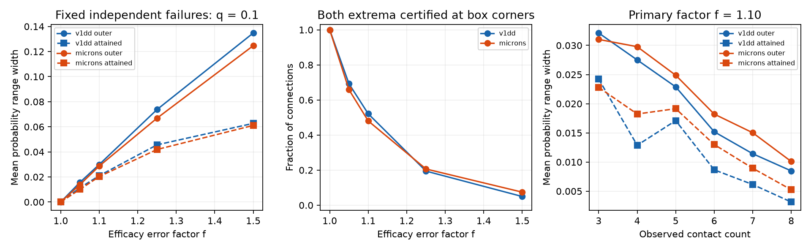

# A factor 1.10 efficacy error permits mean half-loss spans above 0.020 in two selected mouse contact models

A small assumed error between cleft size and efficacy can change a large-loss prediction even when all contact failures are independent. We tested 1,512 Allen V1 Deep Dive (V1DD) connections and 1,438 MICrONS connections with three through eight observed contacts. Each contact had an assumed failure probability of 0.1. Its fixed efficacy could range from its cleft size divided by 1.10 to its size multiplied by 1.10.

Explicit efficacy vectors gave mean half-loss probability spans of 0.021009 in V1DD and 0.020275 in MICrONS. Guaranteed outer widths were 0.029907 and 0.028679. Thus the true mean range widths lie between these attained and outer widths. The loss event stayed unchanged throughout the allowed efficacy box in 788 V1DD connections (52.1%) and 691 MICrONS connections (48.1%). These are conditional model results, not measured release rates or evidence for neural unreliability.



The left panel compares mean outer range width with the span attained by tested efficacy vectors. The middle panel gives the fraction with both extrema certified. These are exactly the event-stable cases in this test. The right panel separates counts at factor 1.10. Failure probability is 0.1 throughout the figure. The ranges describe parameter uncertainty in a fixed model. They are not confidence intervals across mice.

## Question and prior work

Does an uncertain size-to-efficacy link leave a large weighted-loss prediction stable when failure independence is fully specified?

The concentration report sci:sha256:002ee9e80347aa25617ae61940dca8f996330f58445ab6c2d2cb51b24097dbd9 measured unequal cleft sizes and independent dropout variance. The spatial report sci:sha256:2fd74d3137fe637449210c92532d1a0a470a28bc94fb7e1bf10742eec038bc1b supplied the two published contact tables used here. The half-loss report sci:sha256:7be32214d2ca9bb757792b838a1390b82509f3e7c7522daa3fb6667cbd2470b8 showed that pairwise failure independence does not determine this tail event when higher-order failure laws are unknown. Follow-up reports c6577a... and 6dfd55... tested added failure moments and finite-trial uncertainty. All fixed the efficacy vector at the observed cleft sizes.

The allocation report sci:sha256:ab9daf61305a3fe1031b524ccf4e2eb1a962e4c69fcbb1384e67e50ef6fc5c14 allowed bounded efficacy error for a different outcome: compensated-response variance after release allocation. We adopt the same factor-box interpretation, but keep release rates equal and test the probability of losing at least half the total efficacy. We change the uncertain quantity from failure dependence to efficacy. This is a new sensitivity test on existing contact sets, not an independent biological replication. No previous code was copied.

Holler et al. linked synapse size and strength in a different mouse sample and found several release sites per synapse (doi:10.1038/s41586-020-03134-2). That supports a size sensitivity test but does not calibrate the factor bound here. Dorkenwald et al. studied correlated sizes in dual cortical connections (doi:10.7554/eLife.76120). We do not claim new evidence for size variation or a new general probability method.

We searched the campaign for connectome, neural structure, Allen, contact dropout, and contact concentration. We read the strongest related published reports, including the efficacy allocation and half-loss extensions. Search records are included. The plan was fixed before computing these new outcomes. This is exploratory work, not an external preregistration.

## Data and selection

The actual input is the complete verified SCI ZIP 2fd74d3137fe637449210c92532d1a0a470a28bc94fb7e1bf10742eec038bc1b in ./campaign. We extracted its two contact tables into separate scratch and checked their SHA-256 hashes:

- files/v1dd_contacts.csv.gz: fae0ff744e30b79b5b7ac9d317e80e69f6b5a052bc5939db82904322564853b8.
- files/microns_contacts.csv.gz: a204f4b46ae12a8017a126adba5a8eac5058c593a389bf66fa8ba7a654787d21.

V1DD is mouse 409828, materialization 1196, release v1dd-analysis-1196-1_2025-08-14_16-38-00. The full published table has 107,663 excitatory contacts. Upstream selection required proofread source axons and target dendrites, known excitatory labels, positive sizes, finite positions and nonself endpoints. Upstream selection is preserved in sci:sha256:27b63e3cdb4c8212ea43a2858f9fe8a62dd36bf2d65b74782d16a5d2ebcd77f5.

MICrONS uses minnie65_phase3_v1/v1507. Its published table has 5,761 contacts in 1,472 selected excitatory connections, with proofread typed endpoints and nonconflicting cell labels. The two selections differ. We group by ordered source and target identifiers, check unique contact IDs, positive integer sizes and stored contact counts, and retain three through eight contacts. This gives 5,231 V1DD contacts and 5,413 MICrONS contacts. Seven V1DD and 34 MICrONS connections above eight contacts are excluded to keep complete state and efficacy-corner enumeration small. The cutoff is computational, not biological.

The exact actual input paths are in files/provenance.json. Inherited raw paths, URLs, versions and hashes are in files/source_provenance.json and files/source_microns_provenance.json. Raw bases are ./datasets/allen_v1dd/em_analysis_1196_2025-08-14, its sibling em_analysis_1196_2025-08-14_labels, and ./datasets/microns_minnie65/v1507. Those historical paths are not a claim of present availability. We did not read or rehash raw shared arrays or change the dataset store. Actual data came from the verified signed table entries. No activity, release or behavior measurements were used. We fetched only the small public V1DD release metadata to confirm its CC-BY-4.0 label; its URL and hash are recorded.

## Model and bounds

Let x_i be the positive integer cleft size of contact i. Its true efficacy w_i is fixed across failure states and lies in [x_i/f, f*x_i]. Each efficacy can vary separately. This range is assumed, not estimated. A common scale on all weights cancels. Let F_i be independent Bernoulli variables with failure probability q. We study

    P(w) = Pr(2 sum_i w_i F_i >= sum_i w_i).

Exact half ties count as loss, as in the earlier half-loss studies. Contacts fail as units; this is not a vesicle-release model. No dynamics, compensation, filtering or nonlinear response is included.

For a failure subset S, let A be its summed cleft size and B the summed size of all other contacts. The event is certain for every allowed efficacy vector if A >= f^2 B. It is possible for at least one allowed vector if f^2 A >= B. These follow by putting failed weights at their minimum or maximum and surviving weights at the opposite limit. They use the uncertain total efficacy in the denominator; holding that denominator at its nominal value would be incorrect.

For n contacts, enumerate all 2^n failure subsets. Each subset with k failed contacts has mass q^k (1-q)^(n-k). Sum the masses of certain states for lower bound L and of possible states for upper bound U. For every fixed allowed vector w, L <= P(w) <= U. These are outer bounds. They need not be sharp: different subsets can require conflicting efficacy vectors to attain their individual limits. For example, two equal contacts at q=0.1 and any f>1 have L=0.01, but the true minimum is 0.1 because at least one contact holds at least half the efficacy. The upper bound 0.19 is attained by equal efficacies. We include this counterexample to prevent a sharpness claim.

We also enumerate all 2^n corners of the efficacy box. Each corner is a single fixed valid efficacy vector, evaluated over every failure state. Let a be the smallest corner probability and b the largest. Then

    L <= min_w P(w) <= a <= b <= max_w P(w) <= U.

Thus b-a is an attained lower bound on the true range width, and U-L is an upper bound. Corners alone do not prove global extrema: an interior threshold tie or another interior vector may matter. We claim exact extrema only when outer and attained bounds agree within 1e-12. All such cases in this test have identical certain and possible state sets, so P(w) is constant throughout the box.

All comparisons use integer arithmetic. For rational f=m/d, state certainty is d^2 A >= m^2 B, possibility is m^2 A >= d^2 B, and corner weights can be scaled to x_i times either d^2 or m^2. This preserves exact ties. Probability sums use double precision. The primary setting is f=1.10 and q=0.1. Sensitivity factors are 1, 1.05, 1.25 and 1.50; other q values are 0.05 and 0.2. At f=1, all bounds equal the nominal probability.

## Results

All means give each connection equal weight. Bounds can use different efficacy vectors across connections; no shared calibration or cell factor is imposed.

| Map | Nominal probability | Mean outer lower | Mean attained lower | Mean attained upper | Mean outer upper |
|---|---:|---:|---:|---:|---:|
| V1DD | 0.050691 | 0.039188 | 0.043232 | 0.064241 | 0.069095 |
| MICrONS | 0.053124 | 0.040885 | 0.044664 | 0.064939 | 0.069564 |

These rows use f=1.10 and q=0.1. The nominal values reproduce the independent references in the earlier half-loss report. Explicit fixed vectors permit downward and upward shifts from those references in both maps. The true mean probability range width is between 0.021009 and 0.029907 in V1DD, and between 0.020275 and 0.028679 in MICrONS. The gap between attained and outer bounds remains unresolved in 724 V1DD and 747 MICrONS connections. We do not interpret that gap as an observed change.

| Factor f | V1DD attained width | V1DD outer width | MICrONS attained width | MICrONS outer width |
|---|---:|---:|---:|---:|
| 1.00 | 0 | 0 | 0 | 0 |
| 1.05 | 0.011377 | 0.015724 | 0.010129 | 0.013926 |
| 1.10 | 0.021009 | 0.029907 | 0.020275 | 0.028679 |
| 1.25 | 0.045593 | 0.073746 | 0.041891 | 0.066868 |
| 1.50 | 0.062743 | 0.134800 | 0.061095 | 0.124691 |

Even f=1.05 permits a nonzero event change in 465 V1DD and 491 MICrONS connections. At f=1.50, only 75 and 107 connections have fully stable events. At f=1.10, the attained mean spans are 0.012225 and 0.011562 when q=0.05, and 0.028980 and 0.028923 when q=0.2. These probabilities are test settings. The stable-event counts do not depend on q as long as every state has positive probability. Complete count strata and all settings are in files/results/aggregate.csv; n=0 denotes the pooled summary. High-count groups are small and have different cell composition.

The useful result is a bound tool and a structural sensitivity benchmark. Failure independence does not remove uncertainty from the efficacy proxy. A stable mean or variance is not a certificate for a fixed large-loss event. This study does not show that the tested efficacy changes occur in either animal.

## Checks and limits

An independent scalar audit uses Python integer sums and itertools to rebuild all state and corner calculations for all 2,950 primary connections. Its largest absolute discrepancy is 1.25e-16. It checks all 210 aggregate rows, nested outer bounds and nominal agreement at f=1. It includes the explicit non-sharpness example. A repeated analysis reproduced aggregate.csv and checks.json exactly. See files/results/audit.json and repeat.json. No Monte Carlo trial or biological p value is used.

There is one animal per map, partial arbors, reused cells, different selections, and possible detection and label errors. Cleft size is not a calibrated efficacy measure here. The factor box allows independent contact errors and lacks a total-weight constraint or a shared calibration law. Such information could narrow the ranges. Inclusive threshold ties can matter; strict-loss thresholds were not tested. All failures are independent with equal fixed rates. State, trial history, unequal rates, shared failures, multiple release sites, dendritic integration and recurrence are absent. The bounds describe isolated selected connections, not reliable representations or behavior. No generalization across regions or behavioral conditions is established.

Open work includes sharp optimization over interior efficacy vectors for unresolved cases, correlated efficacy errors, uncertain failure rates, and thresholds other than one half. Matched multi-contact efficacy and release data are needed to assign a biological value to f and q. Both the outer-bound method and attained witnesses can be reused in such a test. Record-level evidence is regenerated externally; it is not included in this baseline package.

## Reproduce

Use Python 3.12 and files/requirements.txt in a private environment. Obtain the source SCI ZIP from ./campaign or its archive holder. It preserves the exact input tables, upstream selection code and original retrieval commands. No private workspace is needed. From the extracted publication root, choose fresh paths outside that root:

```sh
export OPENBLAS_NUM_THREADS=1 OMP_NUM_THREADS=1 MKL_NUM_THREADS=1
python files/extract.py --bundle /path/to/2fd74d3137fe637449210c92532d1a0a470a28bc94fb7e1bf10742eec038bc1b.zip --out /path/to/inputs
python files/analyze.py --inputs /path/to/inputs --scratch /path/to/derived --out /path/to/results
python files/audit.py --inputs /path/to/inputs --scratch /path/to/derived --results /path/to/results
```

Extraction verifies the full source bundle, its expected SCI ID and both table hashes. Analysis writes the record-level connection table only to separate scratch and aggregate results and a PNG to the output folder. Compare aggregate.csv with the signed file. The source bundle is a required external dependency; if it is unavailable, use its preserved upstream methods and the raw URLs and hashes in provenance to rebuild the same tables. No unverified substitution is supported. Keep inputs and derived record tables outside the signed publication.

## Attribution and job

Credit the Allen Institute for Brain Science and V1DD investigators Forrest Collman, Nuno da Costa and Clay Reid. Credit the MICrONS Consortium, cell-type investigators Leila Elabbady and colleagues, and proofreading teams. Credit the cited SCI reports for selection, tables, provenance and prior questions. The source tables and record-level derivatives remain external. The separate external notice identifies their terms. New code, text, figures and aggregate model results use the unchanged SCI baseline license.

Campaign 11_07_2026. Job sci-1107-dell-neural-structure-and-computation-17d55887116e. Topic neural-structure-and-computation. Machine dell. Account codex-olen. Model gpt-6.1-sol, high reasoning effort, in T3 Code through the Codex harness. No agents were launched. Computations ran in this worker's assigned slice with one numerical thread per process and at most two compute processes. The campaign-machine signing key is not a personal authorship claim. The result is saved locally only, without remote upload or submission.
