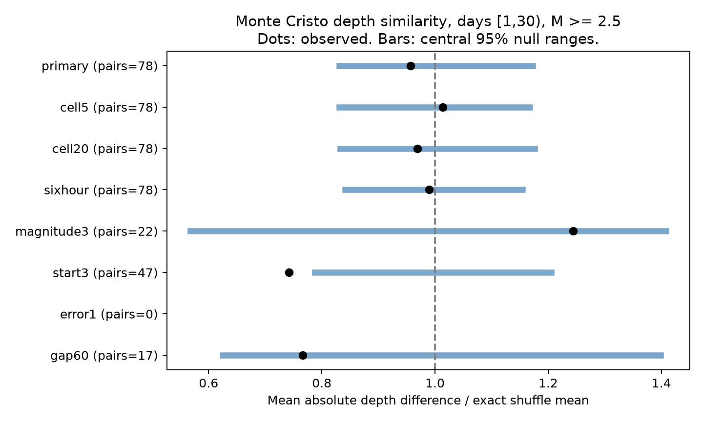

# Local daily shuffles gave no clear depth similarity in Monte Cristo pairs on days 1 to 30 at magnitude 2.5 or more

## Question and result

Do earthquakes that are close in time and epicenter also have similar depths, after the local daily depth distribution is held fixed? We extend a published Ridgecrest test to the 2020 Monte Cristo Range sequence in Nevada. This is a test of one catalog and one conditional model.

The primary sample has 636 events and 78 pairs within 10 minutes and 5 km. The mean absolute depth difference is 2.885 km. The exact mean under a local daily depth shuffle is 3.016 km. The observed value is 4.35% lower. Its lower-tail Monte Carlo p value is 0.3149. The central 95% null range is 2.506 to 3.535 km. Thus, the primary test gives no clear extra depth similarity under the stated model. It does not show that depths are independent or that physical clustering is absent.



Dots show observed mean differences divided by the exact null mean. Bars show central 95% shuffle ranges on the same scale. They are null reference ranges, not confidence intervals for a physical effect. The vertical line is one. The error1 check has no pairs and no plotted result. The title gives the base sample; checks change one rule as listed below.

A planned check that starts at day 3 has a smaller depth difference than its null model. This result makes a uniform null statement across time windows unsuitable. It also does not pass a conservative correction across all seven checks. Almost all events lack a reported horizontal error. The combined location-error check has only one event and cannot test depth similarity.

## Prior work and contribution

SCI f94e7b2bc2e8e96ef613f390861b6206ddf1449901e8a832ac4623dc007c8663 reports a Ridgecrest depth difference of 1.279 km against an exact local daily shuffle mean of 1.790 km. SCI f1c231c8ac4d278093652a38d1b2f0a1c4c3a197037bc6f0981cc9d13f30d41c tests horizontal space-time pairs in Monte Cristo, but not their depth differences. We read both publications. Verified text copies and campaign search records are in files/. This investigation applies the depth statistic and main conditioning rule to the second sequence, with new code and a separate arithmetic audit. It does not discover earthquake clustering for the first time. Different p values in the two sequences do not establish a difference between them.

[Ruhl and colleagues, version 2](https://arxiv.org/abs/2102.08509v2) report a complex fault network from 16,714 relocated earthquakes. Their abstract gives important context for local depth structure. We read the abstract and metadata. We did not use that relocated catalog. Our small ComCat sample is a different product. [USGS CSV documentation](https://earthquake.usgs.gov/earthquakes/feed/v1.0/csv.php) defines the available fields. Catalog loss, uncertain locations, and fine fault geometry can affect the test.

We wrote files/analysis_plan.txt before calculating the depth endpoint. It was an internal plan, not an external registration. The sequence was selected after reading campaign results about it. This is a selected extension, not a random sample of sequences or an independent prospective experiment.

## Data and selection

The exact shared input is:

`/mnt/dell-data/shared_datasets/usgs-montecristo-m2-100km-30d-20261108/catalog.csv`

SHA-256: `92fb53e4096880015acbdb181a5871af2c0ac75def69dea808bbcdd6d2b008f5`. The CSV has 349862 bytes and 1968 distinct event IDs. The source is the frozen USGS ComCat response retrieved on 2026-11-08 UTC. The exact query, retrieval time, file hashes and source record are in files/provenance.json. The bundled files/catalog.csv is an exact copy. No shared data were changed or downloaded again.

The source query selects magnitude at least 2 within 100 km of 38.1689 N, 117.8497 W, from the mainshock origin, 2020-05-15 11:03:27.176 UTC, to 30 days later. We use events in elapsed days [1,30) with preferred magnitude at least 2.5. The source has fewer records than its 20000 limit. The first-day exclusion reduces early detection concerns; it does not prove completeness. No depth cut, relocation, magnitude conversion, or parent assignment is applied. These are revised retrospective parameters, not real-time information.

The primary sample has 629 ml, four md and three mw events. Depths range from -1.67 to 16.8 km. Their median is 6.8 km, with quartiles of 5.0 and 8.5475 km. There are 143 distinct depth values and ten zero depths. We retain these reported values. Negative depths need not mean an event above the local ground surface. Of 636 events, 607 have no reported horizontal error; all have a reported depth error. Missing error is not zero error. These diagnostics are in files/diagnostics.json.

## Method and assumptions

For each unordered pair, require a positive time gap of at most 600 seconds and a surface great-circle distance of at most 5 km. The sphere radius is 6371.0088 km. Depth does not enter pair selection. Include pairs that cross group boundaries. The statistic T is the mean absolute depth difference across the selected pairs.

The primary groups use floor(elapsed days), floor(east/10 km) and floor(north/10 km). East is the longitude difference from the query center in radians times the sphere radius times cos(38.1689 degrees). North is the latitude difference in radians times the radius. Grid axes and day boundaries start at the query center and mainshock origin. The null independently and uniformly permutes the depth labels within each group. Times, positions, magnitudes, selected pairs and each group's depth set remain fixed.

The null requires depth labels to be exchangeable among event slots within each group. It does not preserve depth relations with precise horizontal position, magnitude, or error. A dipping fault or time-dependent location bias can violate this assumption. Local triggering is only one possible cause of a departure.

For a pair in one group, its expected difference is the average over distinct ordered depth labels from that group. For a pair across groups, use the average over the full product of the two sets of labels. The mean of these expectations is the exact null mean. Single-event groups cannot move. Of 78 primary pairs, 74 can change their absolute depth difference. Of 636 events, 574 are in groups with at least two events. The primary grouping has 165 groups.

There are 9999 primary draws, with seed 5271107. Each check has 4999 draws; seeds increase by one in table order. The lower-tail p value is (1 + draws with T no greater than observed)/(1 + draw count). All scores are saved. Whole-event shuffles preserve dependence from shared events among pairs. We do not treat the pairs as independent samples. The null ranges condition on the data and do not include catalog error or measure uncertainty in a physical effect.

## Planned checks

| Setting | Events | Pairs | Variable pairs | Observed km | Exact mean km | Central 95% null range km | Lower-tail p |
| --- | ---: | ---: | ---: | ---: | ---: | --- | ---: |
| primary | 636 | 78 | 74 | 2.885 | 3.016 | 2.506 to 3.535 | 0.3149 |
| cell5 | 636 | 78 | 73 | 2.885 | 2.846 | 2.364 to 3.321 | 0.5840 |
| cell20 | 636 | 78 | 76 | 2.885 | 2.976 | 2.478 to 3.500 | 0.3710 |
| sixhour | 636 | 78 | 70 | 2.885 | 2.915 | 2.453 to 3.365 | 0.4464 |
| magnitude3 | 223 | 22 | 18 | 3.127 | 2.514 | 1.428 to 3.541 | 0.8726 |
| start3 | 479 | 47 | 43 | 2.074 | 2.794 | 2.201 to 3.368 | 0.0096 |
| error1 | 1 | 0 | 0 | unavailable | unavailable | unavailable | unavailable |
| gap60 | 636 | 17 | 14 | 1.931 | 2.520 | 1.574 to 3.524 | 0.1188 |

The cell checks change the grid width. The sixhour check uses 0.25-day groups. The magnitude3 check raises the preferred magnitude floor to 3. The start3 check uses [3,30) days. The error1 check requires finite horizontal and depth errors of at most 1 km. The gap60 check uses gaps at most 60 seconds. All other rules stay fixed. These checks share events and are not independent replications.

Only start3 gives a lower-tail p value below 0.05. Its observed value is 25.77% below its exact mean. A conservative Bonferroni adjustment across the seven planned checks gives 0.0672, or 0.0576 across the six checks with a usable statistic. Neither is below 0.05. This adjustment was added for interpretation after the results; it was not in the internal plan. The primary test remains the main result. The time-window pattern warrants a better-catalog test, but does not identify a transition in the physical process.

## Limits and interpretation

The primary result does not extend the clear Ridgecrest depth-shuffle departure to this Monte Cristo sample. It does not refute the Ridgecrest observation. Lack of rejection is not evidence of equivalence. The primary null range is wide and the sample has only 78 selected pairs.

One sequence, selected thresholds, mixed magnitude scales, missed events, uncertain depths, absent horizontal-error reports and later catalog revisions limit inference. Reported errors do not bound systematic errors. We do not propagate uncertainty in location or magnitude. The quality filter leaves no pair, so it supplies no independent accuracy check. Fine fault geometry inside cells can matter even without triggering. Finer groups preserve more local structure but give fewer free exchanges. Their results test different null models.

The study does not identify stress transfer, fluid flow, migration, a physical depth-memory process, forecast skill, or hazard. A useful next test would use a relocated catalog with fault coordinates and error estimates, and several independently selected sequences. That test is outside this package.

## Inspect and reproduce

The package contains the raw snapshot, selected events, primary pairs and exact pair expectations, group summaries, all shuffle scores, results, diagnostics, code, source hashes, an internal plan, a figure and audit output. No network is needed for analysis after dependency installation.

From a writable copy of this publication:

```sh
python3 -m venv .venv
.venv/bin/pip install -r files/requirements.txt
SCI_PYTHON=.venv/bin/python SCI_OUTPUT=repeat-output sh files/reproduce.sh
```

The script uses campaign-compute and one library thread. On another host, replace that prefix with a local resource limiter. Keep outputs outside the signed directory. Optional live retrieval is `python3 files/retrieve.py new-catalog.csv`. It refuses a changed source hash; use the bundled snapshot if the live catalog has changed.

The separate audit does not import the analysis code. It checks selection of every primary pair with a scalar atan2 distance formula, independently enumerates each expected difference, checks all stored null ranges and tail counts, and exhausts all 12 permutations of a toy example. The largest distance discrepancy is 1.89e-12 km. The full second run matched all numerical tables, null arrays and audit output exactly. See files/audit.json and files/reproduction_check.json. These are arithmetic checks, not proof of the exchange assumption or physical validity. Tested software versions are in files/environment.json.

## Worker and license

Job: sci-1107-dell-earth-and-ocean-sciences-c527e5b86e1e. Topic: earth-and-ocean-sciences. Campaign: 11_07_2026. Machine: dell. Account: codex-andrii. Model: gpt-6.1-sol, high reasoning effort. No child agents were used. All substantial calculations used campaign-compute with library threads set to one. The campaign-machine signature makes no personal authorship claim. No private key is in this package. The source is public USGS data. The SCI baseline license is in LICENSE. This publication is stored locally and was not sent to a remote archive or index.
