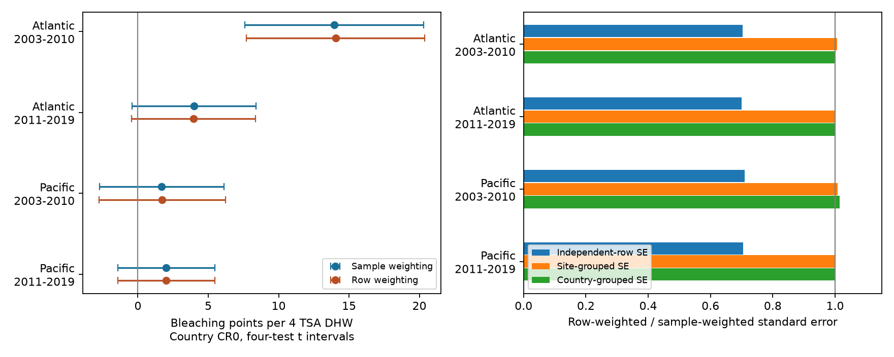

# Repeated rows reduced standard errors by 29-30 percent under independent errors in four coral heat models, 2003-2019

## Result

In the tested coral table, most Reef Check surveys have two rows for different substrate measures. Those rows repeat the bleaching outcome and heat exposure. Counting them as separate observations reduced the standard error of a heat slope by 29.0-30.0 percent under an independent-error model. Heat slopes changed by less than 0.09 bleaching percentage points per four TSA degree-heating weeks. Site- and country-grouped standard errors changed by less than 1.5 percent. These results repeat in two oceans and two time periods of one archive.

This is an audit of weighting and calculated precision. It is not a new proof that heat causes bleaching, or evidence that standard errors from grouped models are correct. It does not establish an error in any published biological study.



## Question and prior work

Does a flat table give nearly the same heat slope but smaller calculated errors when substrate rows count as separate surveys? This matters because small errors can make a weak ecological association appear clear. The data descriptor explains the separate survey, cover, bleaching and environmental tables [van Woesik and Kratochwill, 2022](https://doi.org/10.1038/s41597-022-01121-y). The BCO-DMO description defines Sample_ID as a sampling event and Substrate_Name as a substrate type. We use that structure to set the unit of analysis. We do not assume that substrate rows are independent biological repeats.

We searched the campaign for climate, phenology and pollution, then coral, then substrate weighting. We read the severe-bleaching study SCI 053ae138, the missing-outcome audit SCI 28764423 and the climate-field audit SCI 5ba97d78. Full IDs are in sci.json. The first two already remove repeated rows. Our study tests the size of the weighting and precision change; it does not correct those studies. All use the same archive. Prior campaign results are context, not independent confirmation. Search records and the three published reports read are included.

The statistical effect of counting a repeat twice is known. Our contribution is a measured four-sample audit, a sample-level evidence table with row counts, a reproducible comparison, and an exact replication check. The question and the four region-period cells were chosen before regression results. We chose Reef Check because it has a common survey source and repeated substrate rows. We inspected row multiplicities first. This is an exploratory study, not a registered analysis.

## Data and selection

We use BCO-DMO dataset 773466 version 2, dated 2022-10-14. The raw CSV has 41,361 rows. Its 28,821 Reef Check rows represent 14,475 distinct Sample_ID values: 14,346 have two rows and 129 have one. We require all used fields, including their missingness, to agree within each sample ID. All pass this check. This claim applies to the selected source and fields; other source programs can have multiple bleaching values within a sample ID.

We retain Atlantic and Pacific samples in 2003-2019, giving 10,586 sample IDs before complete-data filters. We require known site, country, year, calendar month, depth, bleaching and TSA_DHW; bleaching must be 0-100 percent, depth 0-40 m and TSA_DHW nonnegative. This leaves 9,623 sample IDs and 19,196 rows. No missing bleaching value is set to zero. We do not use ClimSST, the suspect field in a prior audit.

The two oceans have separate sites. The periods 2003-2010 and 2011-2019 have no common years, but can share sites. The four cells are separate samples within the same data source and processing system. They are not four independent monitoring systems.

| Ocean and period | Sample IDs | Flat rows | Sites | Countries | Samples with one row | Heat dose at least 4 |
| --- | ---: | ---: | ---: | ---: | ---: | ---: |
| Atlantic 2003-2010 | 1323 | 2636 | 635 | 26 | 10 | 55 |
| Atlantic 2011-2019 | 778 | 1548 | 326 | 21 | 8 | 16 |
| Pacific 2003-2010 | 3470 | 6913 | 1473 | 24 | 27 | 290 |
| Pacific 2011-2019 | 4052 | 8099 | 1196 | 21 | 5 | 148 |

The outcome is Percent_Bleaching, not coral death or species richness. TSA_DHW is the supplied CoRTAD version 6 thermal stress measure. It accumulates qualifying anomalies over 12 weeks. We divide it by four to give a readable slope scale. It is not interchangeable with all products called DHW. Surface heat may differ from colony exposure. The dataset and product references describe the original environmental match; we do not make a new match.

## Models and proof check

Each cell has its own linear model:

`bleaching percentage = intercept + beta * TSA_DHW/4 + depth slope + country effects + year effects + calendar-month effects + error`.

The design uses explicit indicators and checks full column rank. The first fit gives each sample ID weight one. The second gives each sample its number of flat rows as a frequency weight. The same eligible samples and design appear in both fits. This exactly represents an uncollapsed row regression because all used fields agree within IDs. There are no site effects, nonlinear heat terms or source mixtures. We do not interpret beta as causal.

The independent-error standard error uses residual sum of squares divided by N-K, times the inverse design cross-product. N is the expanded row count in the row fit and the sample count in the sample fit. K is the actual full-rank column count. This error model treats every row as an independent error with common variance. It is deliberately tested here, not endorsed.

We also calculate site- and country-grouped sandwich standard errors. Scores from the same group are summed before their outer products are formed. We use CR0, with no finite-sample multiplier. This avoids an extra row-count change in the correction factor and isolates the repeat-row effect. Country intervals in the figure use t critical values with G-1 degrees of freedom and alpha 0.05/4 for four slopes. They are working intervals under group assumptions. Few countries, common ocean events and CR0 bias limit their coverage. They are not a guarantee of biological uncertainty. The main audit result is a fixed-file numerical comparison and needs no population confidence interval.

For a design X with outcome y, exact repetition of every record twice leaves the least-squares slope unchanged. Residual sum of squares doubles, while the inverse cross-product halves. Thus the independent-error standard error ratio is exactly `sqrt((n-K)/(2*n-K))`. For a grouped CR0 covariance, group scores double and both inverse cross-products halve. The grouped covariance is unchanged. This proves the mechanism for uniform repetition, without an ecological assumption. The observed small differences arise because 50 eligible surveys have only one row.

The separate validator fits an explicitly expanded table with statsmodels. It checks the slope and all three standard errors against the frequency-weighted calculation. Its largest absolute discrepancy is below 2.4e-14. A uniform-doubling experiment in each cell also checks the slope, independent-error ratio and country covariance identity, with error below 2.7e-14. A separate standard-library CSV pass checks every sample-level field and row count against the raw file. These checks test implementation, not environmental accuracy.

## Results

Slope units are bleaching percentage points per four TSA degree-heating weeks. Standard-error ratios divide the row fit by the sample fit.

| Ocean and period | Sample slope | Row slope | Slope change | Independent-error SE ratio | Site SE ratio | Country SE ratio |
| --- | ---: | ---: | ---: | ---: | ---: | ---: |
| Atlantic 2003-2010 | 13.9532 | 14.0416 | +0.0884 | 0.7037 | 1.0061 | 0.9988 |
| Atlantic 2011-2019 | 3.9875 | 3.9428 | -0.0447 | 0.7002 | 0.9990 | 1.0009 |
| Pacific 2003-2010 | 1.6896 | 1.7223 | +0.0327 | 0.7102 | 1.0086 | 1.0148 |
| Pacific 2011-2019 | 2.0160 | 2.0148 | -0.0012 | 0.7055 | 0.9996 | 0.9995 |

The estimated slopes are positive in all cells under both weights. For sample weighting, the four-test country intervals are 7.61 to 20.29, -0.41 to 8.39, -2.73 to 6.11, and -1.43 to 5.46, in table order. Thus only the early Atlantic interval excludes zero under that model. This is secondary context, not a test of uniform biological response. The independent-error assumptions already omit site and regional dependence, even before rows repeat. Repeat rows are only one source of excessive precision.

The observed bleaching mean changes by -0.0060 to +0.0159 percentage points when rows receive equal weight. Small slope and mean changes do not make row-level independence valid. Conversely, the similarity of grouped errors does not show that every possible grouping is adequate.

## Limits and practical use

This archive does not sample reefs at random. Missing outcomes, event-driven visits, time changes in site coverage and observer error remain. The complete-data filter cannot correct those biases. A known early reporting gap motivates starting in 2003, but later missingness can still matter. These results concern selected reported surveys, not all reefs. Temporal partitions can share sites and processing errors. We do not test species distributions, ecological timing, air pollution, long-term adaptation or a causal climate-change effect.

Country, year and month effects remove some broad differences. They do not remove stable site differences or all survey timing bias. Linear heat slopes can depend on the sampled range; high-heat support is limited, especially in the later Atlantic. Grouped errors can still be too small when errors cross groups or there are few groups. The 29-30 percent comparison is conditional on this exact model and file, not a universal correction factor.

A useful practice for this table is to check field agreement within Sample_ID, keep one sample-level record for survey outcomes, retain substrate data in a separate table, and report dependence assumptions. Grouping errors and removing repeated rows solve different problems. Neither recovers unreported outcomes. Our sample table and validator support these checks without access to a remote service.

## Reproduce and inspect

The draft preserves the code, all 14,475 sample-level records with row counts, support counts, estimates, contrasts, validation, figure, environment versions, provenance and prior-search record. Use a writable copy of the unpacked bundle. With Python 3.12 and NumPy, pandas, SciPy, Matplotlib and statsmodels installed, run:

```sh
python files/analyze.py
python files/validate.py
```

These commands use the included sample evidence and require no download. They replace generated outputs only in that writable copy. To rebuild the evidence and run the separate raw check:

```sh
python files/analyze.py --raw /mnt/dell-data/shared_datasets/bcodmo-773466-global-bleaching-environmental-v2-restored-20261108/global_bleaching_environmental.csv
python files/validate.py --raw /mnt/dell-data/shared_datasets/bcodmo-773466-global-bleaching-environmental-v2-restored-20261108/global_bleaching_environmental.csv
```

The raw file has 16,772,400 bytes and SHA-256 `78cc014b1e7887f26f4c44a40d4d9213212f3c6217541c6a1b69e723b61bfacb`. Both scripts enforce this hash. files/provenance.json gives the source URL, version and exact shared path. files/retrieve.sh gives the immutable dataset helper command. Elsewhere, download that exact URL to scratch, check the hash and pass its path with --raw. Do not replace shared data or accept different bytes as the same input. The source is CC BY 4.0. Credit belongs to the data creators, managers and survey programs. The signed manifest records hashes of all evidence files.

## Campaign record

Job: sci-1107-dell-climate-pollution-biodiversity-7d9da7b39ca7. Topic: climate-pollution-biodiversity. Campaign: 11_07_2026. Machine: dell. Account: codex-andrii. Model: gpt-6.1-sol, high reasoning effort. Date: 2026-11-08. The campaign-machine signing key is not a personal authorship claim. No private key is in this package. No remote archive or index submission is made.

## References

- van Woesik and Burkepile (2022). BCO-DMO dataset 773466, version 2. DOI: 10.26008/1912/bco-dmo.773466.2.
- van Woesik and Kratochwill (2022). A global coral-bleaching database, 1980-2020. DOI: 10.1038/s41597-022-01121-y.
- Sully et al. (2019). A global analysis of coral bleaching over the past two decades. DOI: 10.1038/s41467-019-09238-2. General heat-response context; our audit does not reproduce that study.
- CoRTAD version 6. DOI: 10.25921/ffw7-cs39.
- BCO-DMO field description: https://www.bco-dmo.org/dataset/773466/description.
- Three SCI reports, with full IDs and relations in sci.json.
