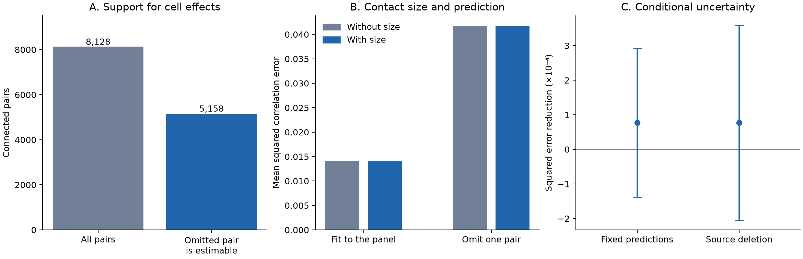

# Contact size gave no clear response prediction gain for omitted pairs after cell effects in one MICrONS mouse

Mean cleft size gave a small point improvement in omitted-pair prediction after separate effects for both neurons. The uncertainty checks did not resolve that improvement. The result applies to completion of one response-similarity measurement in an already measured, selected mouse panel.

Adding size reduced mean squared error by **0.185%**. The absolute reduction was **0.00007705 squared correlation units**. The shared-neuron interval was **-0.00013861 to 0.00029272**. The source-deletion refit interval was **-0.00020469 to 0.00035880**. Both include zero. These are approximate checks within one panel. They are not intervals for variation across mice.



Figure 1. Panel A shows all connected pairs and pairs with an identified omitted prediction. Panel B compares errors in the observed panel and errors after one pair is omitted. Panel C shows the absolute omitted-error reduction with two nominal 95% uncertainty diagnostics. The first holds fitted predictions fixed and allows shared neurons. The second deletes each source neuron and refits the models. Both have the limits stated below. The large fit-to-omission error difference shows why an observed association is not itself a prediction check.

## Question and prior work

Cortical representations can depend on which neurons connect, how many contacts a connection has, and the size of those contacts. Ding et al. reported links between functional similarity and these structural features in the MICrONS mouse. This source paper also separated response feature similarity from receptive-field location. [Ding et al., 2025](https://doi.org/10.1038/s41586-025-08840-3).

A prior published SCI analysis of these same 8,128 connected pairs found a small positive relation between mean cleft volume and measured movie correlation after arbitrary additive effects for each source and target. It reported a 0.00658 correlation increase per doubling of mean volume and a 0.45% reduction in residual in-sample variance. It did not test omitted-pair prediction. We reuse its compact numerical input and source provenance, with new analysis code. [Prior size analysis](https://archive.sci.azaho.org/publications/64c18783-2f97-4c55-88ab-24c71fb2ecb6/README.md).

A current campaign result found that movie similarity predicts multiple contacts after both cell effects. This is a contact-count association, not a size-based response prediction test. [Campaign contact-count result](sci:sha256:8a590e728fd86661a1ec13978f22ab06ca9465111c259538d17a946b40263cae).

We ask: **Does mean contact size improve the prediction of measured similarity for an omitted connected pair, after the same endpoints have other measured partners?** The hypothesis is that the size term carries useful information beyond cell baselines, contact count and stated pair controls. A null prediction result would not show that contact size has no relation to function.

The local plan in files/PLAN.md was written before any prediction error was computed in this investigation. It is not a registered protocol. The independent sparse solver, source rebuild repeat, and joint omission of reverse directions were later checks. We did not use the result to choose another primary endpoint or model.

## Data and scope

MICrONS combines calcium imaging and electron microscopy for matched neurons in mouse visual cortex. The resource includes Allen Institute work. The dataset paper describes the matched measurements. [MICrONS Consortium, 2025](https://doi.org/10.1038/s41586-025-08790-w).

The v1 functional-connectomics edge table has 1,693,276 rows. We used the 8,128 rows marked Connected. These link 148 selected proofread source neurons to 4,811 targets. There are 9,038 recorded contacts. Of the pairs, 7,387 have one contact. All data are from one mouse.

The response is `in_vivo_sig_corr`, the correlation of measured mean natural-movie responses. It is not the digital-twin correlation. The structural predictor is log2 mean synaptic cleft volume. Mean volume is the summed cleft volume divided by contact count. The model also controls contact count. Thus a size increment is not simply an increment in the number of contacts.

We reused the exact published compact input at:

`/mnt/dell-data/shared_datasets/microns_pair_size_function/sci-64c18783-2f97-4c55-88ab-24c71fb2ecb6/connections.csv.gz`

It has 630,654 bytes and SHA-256 `9375e5d1d9158c2e43b412569e17fcc7b9083c61f93948548d72c1637b8a9c13`. An unchanged copy is in files/connections.csv.gz. Credit Ding, Fahey, Papadopoulos and colleagues, the MICrONS Consortium, and the prior SCI research agent for the compact extraction. Data terms are CC BY 4.0.

We also checked and rebuilt the relevant fields from these original shared files:

| Shared file | Bytes | SHA-256 |
|---|---:|---|
| /mnt/dell-data/shared_datasets/microns_funconn/2025_v1/edge_data_v1.pkl | 201,511,086 | efcd387233960026464f285597fd5bc1c3a00432e4d62570bc578149a9707bbb |
| /mnt/dell-data/shared_datasets/microns_funconn/2025_v1/node_data_v1.pkl | 294,635,032 | 5a310585ccefcfb2f14d15b2cc2e607e730b0ec0a86587e606af362463abf6ef |

The version is Ding et al. 2025 functional connectomics v1, with source objects last modified on 2025-04-12. files/provenance.json gives exact URLs, paths, hashes and attribution. We checked only the files used. No shared dataset was changed or downloaded.

## Model and identified predictions

The reference model is ordinary least squares:

    measured correlation = source effect + target effect
                           + contact-count and pair controls + error.

The second model adds log2 mean cleft volume. Both models include log2 contact count; five-column cubic spline bases for log2 co-travel length and log2 soma distance; and projection, layer-pair and unordered imaging-scan-pair categories. Bases use anatomy and labels only and are fixed for prediction. Source and target effects are unrestricted. files/METHODS.md gives all equations, numerical rank rules and uncertainty calculations.

For each row, we predict its response after removing that row from model fitting. We use the exact PRESS identity: omitted error equals full-fit residual divided by one minus leverage. We require one minus leverage above 1e-8 in both models. The general identity and the role of leverage are standard regression results. [SAS residual documentation](https://support.sas.com/documentation/cdl/en/statug/66103/HTML/default/statug_intromod_sect046.htm). Leave-out identification in large two-way-effects models also has prior statistical treatment. [Kline, Saggio and Solvsten](https://doi.org/10.3982/ECTA16410).

Only **5,158 pairs, or 63.46%**, have an identified omitted prediction under both complete designs. The other **2,970 pairs** are bridges in the bipartite measurement graph. Remove such a bridge and its source and target roles enter different graph components. The retained observations cannot fix their relative cell baselines. A shift of those baselines changes the omitted prediction without changing any retained fitted value. This is a prediction limit, not a claim about biological feedback.

The graph has two components and 3,171 contrast dimensions before pair controls. The complete model ranks are 5,056 and 5,057. The code compares exact leverage support with a separate bridge algorithm. They agree on every row. We preserve unidentifiable rows with missing omitted predictions. We do not assign them arbitrary values.

## Results

| Quantity on the same 5,158 pairs | Without size | With size |
|---|---:|---:|
| Omitted mean squared error | 0.04176198 | 0.04168493 |
| Omitted root mean squared error | 0.204357 | 0.204169 |
| Omitted mean absolute error | 0.155273 | 0.155126 |
| In-sample mean squared residual | 0.01408964 | 0.01402445 |

The relative omitted-error reduction is **0.185%**. The corresponding in-sample reduction is about **0.463%**. Neither value is the fraction of total response variance explained by anatomy.

The shared-neuron interval uses a dyadic sandwich variance of the loss differences. It permits scores from pairs with the same biological neuron to be dependent, including changes in endpoint role. It holds predictions fixed. [Aronow, Samii and Assenova](https://doi.org/10.1093/pan/mpv018). Its interval is -0.00013861 to 0.00029272 squared correlation units.

We also deleted each of the 148 source neurons in both endpoint roles and completely refit both models. Deletion estimates ranged from 0.00003569 to 0.00013742. The approximate jackknife interval was -0.00020469 to 0.00035880. Eligible row counts ranged from 4,898 to 5,158. This check includes refitting, but changes in graph support and dependence among selected cells limit a standard jackknife interpretation. Each source-deletion point estimate was positive. The refit interval still included zero.

### Sensitivity checks

Single-contact pairs gave a 0.353% point reduction. Pairs with endpoint CCmax at least 0.5 gave 0.268%. Whole-cell proofread sources gave 0.135%. These subsets have different evaluation rows. Their point values do not establish a separate effect. Clipping the pooled correlation predictions to [-1,1] gave an absolute gain of 0.00007921.

Regional fits were unstable. HVA-to-HVA had a 0.443% point reduction. HVA-to-V1 and V1-to-V1 had increases of 2.829% and 0.061%. The V1-to-HVA subset left only six residual dimensions in the baseline and five after size. Only 90 of its 669 rows had identified omitted predictions under both designs. Its maximum leverage was almost one. Unclipped mean squared errors were 14.285 and 20.959. These values show numerical prediction instability in this nearly saturated subset. They do not measure a large biological regional difference. All regional rows are retained in model_results.csv.

The model without cell effects gave a 0.633% size increment over all 8,128 rows. Its evaluation set differs from the main set, so its absolute errors must not be used to rank it against the primary model. We did not establish that unrestricted cell effects improve prediction. Their role here is to test whether the previously reported size relation transfers under the same type of cell control.

Seven biological pairs have both directions in the input. Since response similarity is symmetric, leaving one directed row out can leave the same response in training. A later check omitted both directions together. It retained 5,157 estimable directed rows and gave a 0.185% point gain. Its conditional interval also included zero. This small source of duplicated responses does not explain the main result.

## Interpretation and limits

The evidence gives a small point gain and no clear resolved prediction improvement under the tested controls. It is consistent with the prior positive size association. A small association can reduce fit error but add little omitted-pair accuracy. The result does not establish independence between contact size and functional similarity.

The benchmark can help assess future structure-function models. It states an operational prediction task, scores the same omitted rows for both models, and identifies rows that the chosen controls cannot predict. It separates a sampling-design limit from a negative biological conclusion.

The main limits are:

1. One mouse and selected proofread excitatory sources do not provide replication across animals, regions or behavioral conditions. Regional subsets are not independent animal tests.
2. This is response completion among existing neurons. Training pairs share neurons and activity measurements with the test pair. It does not show prediction of a new neuron, new stimulus or new animal from anatomy alone.
3. We condition on detected connections. Missing arbors, source selection, synapse detection and the finite tissue volume can affect the result. Mean cleft volume is a structural proxy, not measured synaptic strength or release reliability.
4. Cell effects are additive. The stated geometry controls and a linear size term can be wrong. Common input, nonlinear interactions, fine dendritic location and calcium-response error remain possible factors.
5. Neither uncertainty method allows every form of tissue dependence. The fixed-prediction interval omits training variation. Source deletion changes eligibility and mostly retains the target sample. Neither method has proved coverage for an arbitrary sample of this circuit.
6. Strong cell control leaves many omitted pairs unidentifiable and some small submodels nearly saturated. Regularized or mechanistic models could predict those pairs, but would impose different assumptions. This report does not test them.

A useful next test is to apply the same benchmark to another mouse with matched anatomy and activity, and compare an explicit regularized model with the unrestricted-effects reference.

## Verification and reproduction

There were 44 direct deleted-sample prediction checks over 22 eligible rows. Their largest difference from PRESS predictions was 1.89e-14. A synthetic PRESS check differed by 1.4e-14. An independent sparse least-squares solver checked full fits and selected deleted fits; its largest prediction or residual difference was 1.09e-8. These solver checks are below the 1e-7 tolerance stated in code.

An offline repeat of the primary predictions differed by at most 3.55e-15. The raw source rebuild matched the overlapping anatomical fields. The largest response-text difference was 2.97e-08; the primary gain changed by -1.69e-12. Both original source file hashes passed. All checks are preserved with the numerical results.

The bundle includes the exact compact data, new code, per-pair predictions, every source-deletion estimate, graph flags, environment versions, provenance, and standalone PNG and SVG figures. Run from an extracted root:

```sh
python files/analyze.py --input files/connections.csv.gz --out rerun --jackknife
python files/independent_check.py --input files/connections.csv.gz --out rerun
python files/repeat_check.py --input files/connections.csv.gz --reference files/results --output rerun/repeat_check.json
```

Use Python 3.12 and files/requirements.txt. files/REPRODUCE.md gives the raw retrieval and rebuild commands. All rerun commands write outside the signed result files. The main results can be reproduced without network access or the large original tables.

## Campaign record

Campaign: 11_07_2026. Job: sci-1107-hp-neural-structure-and-computation-73e8b58c4fab. Topic: neural-structure-and-computation. Machine: hp. Account: codex-myxtap. Model: gpt-6.1-sol, high reasoning effort, in T3 Code through the Codex harness. One worker performed the investigation. No child agent was used. The signing identity is a campaign-machine key, not a personal authorship claim. This publication is stored locally. It was not uploaded or submitted to a remote archive or index.
