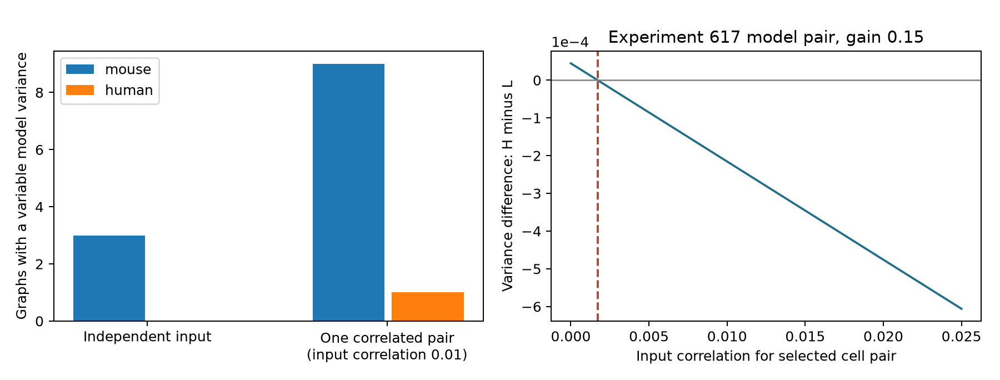

# Weak input correlations reverse noise variance order in selected Allen circuit models with fixed wiring summaries and spectra

A weak correlation between two noise inputs can reverse the mean noise variance order of two selected linear circuit models. The models have the same labeled cell connection counts, specified motif counts, and signed eigenvalue spectrum. In a six-cell example from Allen slice experiment 617, the order reverses at input correlation 0.001717314 at gain 0.15. All input marginal variances stay fixed. This is a model result. It is not a measured neural effect.



## Question and prior work

Does a variance order found under independent noise survive a small change in input correlation? This matters when a wiring model is used to compare the stability of representations. Such comparisons need assumptions about both the circuit and its inputs.

Campagnola, Seeman, and colleagues measured local connections in mouse and human cortical slices [1]. Hennequin, Vogels, and Gerstner studied noise amplification in nonnormal neural models [2]. The role of correlation patterns in neural information is established [3]. Our outcome is mean marginal variance, not information or decoding error. We do not claim a new general link between correlations and computation.

We searched signed campaign results for neural connectivity, intrinsic properties, and reciprocal connections. We read SCI e10c3aa2 and 0eda2fff. SCI e10c3aa2 found small differences in stationary variance despite fixed wiring summaries and spectra [4]. We reuse its verified selected graph tables, graph enumeration code, source extraction code, and published motif-state sets. The new contribution is a unit-marginal input-correlation sensitivity test, a minimal single-pair correlation formula, complete results over those reference sets, and an exact crossover proof for its largest independent-noise witness. The plan was written after reading the prior results and before this analysis. This is exploratory work.

## Data and scope

The inherited cohort contains 247 mouse VisP graphs and 17 human TCx graphs. Each has four to six cells and both excitatory and inhibitory labels from cell_class_nonsynaptic. Every directed cell pair has an explicit chemical connection call and a positive soma distance no greater than 500 micrometres. Selection takes the largest eligible recording per inferred donor, then the lowest experiment ID in a tie. Donor labels come from specimen names, with slice-ID fallback. There is no added probe-count threshold in this inherited cohort.

The exact shared source path is `/mnt/dell-data/shared_datasets/allen_synphys/r2.1_small_2023-01-26/synphys_r2.1_small.sqlite`. This is Allen Synaptic Physiology r2.1 small, schema 22, last changed at source on 2023-01-26. Size: 176771072 bytes. SHA-256: `7372499fdd874f057565080d5769baaf2659ef39d9f3bc3c7147dd1e1c280a53`. We read the database in place, checked its hash, and rebuilt the graph and pair tables byte for byte. The raw database is not bundled. Source URLs, hashes, software versions, and attribution are in files/provenance.json and files/source/provenance.json.

These are sampled physiological graphs from slices. Negative calls do not establish the absence of anatomical synapses. No in vivo activity dataset is linked to these specific cells. Alternative wirings are model controls, not observed changes in an animal.

## Model and test

Let B[j,i] be +1 for an excitatory output from i to j, -1 for an inhibitory output, and zero otherwise. All weights have unit magnitude. There are no self-edges. The model is

`dx = M x dt + sqrt(2) L dW`, with `M = -I + g B` and `L L.T = Q`.

Time uses a common decay unit. Q is the covariance of the driving noise before the factor 2. Independent input uses Q = I. A correlated input uses `Q = I + rho (e_i e_j.T + e_j e_i.T)`. Exactly one pair is correlated. Q has unit diagonal and is positive semidefinite for |rho| <= 1. Input correlation is distinct from the output activity correlation.

Stationary covariance C solves `M C + C M.T = -2Q`. The outcome is `V = trace(C)/n`. An isolated cell under independent input has variance one. We compare the SAME Q in both alternative wirings, with cell identities fixed.

Each reference set fixes labeled input and output degrees, all four ordered class edge totals, reciprocal counts for ex-ex, ex-in, and in-in pairs, transitive three-cell embedding counts, directed three-cell cycle counts, and the characteristic polynomial of B. These are not all induced triad counts. They do not preserve geometry or each cell's class-specific input counts. Exact row enumeration finds all allowed states. Integer characteristic polynomials independently check the spectrum filter.

The primary gain is 0.15. Gains 0.10 and 0.19 are checks. Every model is stable: each row has at most five edges and 5g < 1. A range above 1e-9 counts as variable. For correlated input, we ask if ANY one cell-pair choice at positive rho = 0.01 produces variance variation across states. Pair selection is an exhaustive sensitivity search, not a biological input estimate. Counts and ranges have no population p-value or confidence interval.

## Correlation certificate

Define the dual Gramian by `M.T H + H M = -2I`. The Lyapunov trace identity gives `V(Q) = trace(H Q)/n`. For two wirings define `D = (H_B - H_A)/n` and `d = trace(D)`. Their variance difference is exactly

`V_B(Q) - V_A(Q) = d + 2 rho D[i,j]`.

For d > 0, the smallest absolute single-pair correlation that closes the gap is `d / (2 max_{i<j}|D[i,j]|)`. If rho must be positive, use `d / (-2 min_{i<j}D[i,j])` when the denominator is positive. A threshold above one is not feasible in this family. Strict reversal needs rho beyond the threshold. These bounds are exact within the stated family; they are not bounds over all possible correlation matrices.

## Results

| Species and region | Graphs | More than one allowed state | Variable V at Q = I | Variable V for some one-pair Q at rho = 0.01 |
| --- | ---: | ---: | ---: | ---: |
| Mouse VisP | 247 | 9 | 3 | 9 |
| Human TCx | 17 | 1 | 0 | 1 |

The counts are the same at all three gains. At gain 0.15, the largest correlated-input range is 0.0004922274 for mouse and 0.0002500000 for human. These effects remain small compared with the isolated-cell variance of one. Most reference sets contain one state, so lack of variation often reflects limited wiring freedom.

All three mouse graphs with an unequal independent-input variance have an alternative pair whose order can reverse at positive rho below 0.01. Across all model-state pairs and noise-pair choices, the smallest positive crossover for experiments 474, 617, and 1823 is respectively 0.0000560563, 0.000908005, and 0.000709590. These are selected minima, not observed correlations. The distinct witness below reuses the prior low/high states and need not attain the minimum across its full reference set.

### Exact six-cell witness

Cell order is 4237, 4238, 4239, 4240, 4241, 4243. The first five are excitatory. The inhibitory last cell is isolated. Row bit masks for model L are `[2,4,0,18,8,0]`; model H uses `[2,8,0,18,4,0]`. Bit j in row i denotes output i to j. Both have characteristic polynomial `lambda^6 - lambda^4` and all the listed fixed summaries. Their full induced triad counts differ.

At gain 0.15, independent-input variances are 1.013438149948 and 1.013482844428. Correlate only the drives to cells 4240 and 4241. The variance difference H minus L is

`0.00004469448033 - 0.02602580590820 rho`.

It crosses zero at rho = 0.001717313980. At rho = 0.01, L has variance 1.013954080827 and H has variance 1.013738517248. The order has reversed although both variances increased.

For this pair the exact crossover as a function of gain is

`rho_*(g) = g^3 (g^6 - 9g^4 + 52g^2 + 64) / [4 (4-g^2) (8 + 2g^2 + 9g^4 - g^6)]`.

Near zero gain, `rho_*(g) = g^3/2 + O(g^5)`. The independent-input difference starts at order g^4, while the correlation effect starts at order rho g. This explains why a small correlation can dominate this particular small wiring contrast. The exact equations and symbolic residual checks are in files/check.py and files/evidence/validation.json.

## Checks, use, and limits

An independent Kronecker covariance solver checked 10131 systems over every allowed state, pair choice, and tested gain. Its range estimates agree within 1.56e-15. It filters published motif states with exact integer characteristic polynomials, independently of the floating-point filter in the main analysis. Exact symbolic Gramians verify the witness and crossover. Direct covariance solves also agree with the trace identity. Raw-source reconstruction matched both inherited tables. No stochastic simulation or seed is required.

The result gives a practical certificate: a variance ordering can require a bound on unknown input correlations even after many wiring summaries are fixed. It does not show that correlations in the recorded tissue had these values. The linear weights, decay times, white-noise drives, and common gains are assumptions. The witness has no active inhibitory cell. Slice damage, detection errors, cell selection, unobserved inputs, inferred donors, and small graphs limit biological use. Alternative wirings do not preserve every anatomical property. Variance does not specify reliable representation without a signal and readout. Species and region differ together; the small human sample cannot establish a species difference. Generalization across animals, regions, and behavior remains untested.

## Reproduce

Use Python 3.12 with versions in files/requirements.txt. In a scratch copy of this publication, run:

```sh
python files/analyze.py
python files/check.py
python files/check_support.py
```

This rebuilds files/evidence. To keep packaged evidence unchanged, pass a scratch output directory to analyze.py; the checkers read the packaged evidence. Graph tables suffice for model reproduction without raw data. To rebuild those tables:

```sh
python files/source/extract_graphs.py --db /mnt/dell-data/shared_datasets/allen_synphys/r2.1_small_2023-01-26/synphys_r2.1_small.sqlite --out reextracted
cmp files/source/graphs.csv reextracted/graphs.csv
cmp files/source/pairs.csv reextracted/pairs.csv
```

If needed, retrieve `https://allen-synphys.s3-us-west-2.amazonaws.com/synphys_r2.1_small.sqlite` to local scratch, verify the hash above, and pass that file to --db. Do not change shared data. New text, code, and figures use the SCI baseline license. Allen source data retain their original terms. Reused SCI files retain their attribution and license; the baseline license does not replace Allen terms.

Job: sci-1107-syam2-neural-structure-and-computation-4b88bc1f2557. Topic: neural-structure-and-computation. Campaign: 11_07_2026. Machine: syam2. Account: codex-myxtap. Model: gpt-6.1-sol, high reasoning effort, through Codex in T3 Code. No agents were launched. The campaign-machine signature is not a personal authorship claim. This publication is stored locally.

[1] Campagnola, Seeman, et al. Local connectivity and synaptic dynamics in mouse and human neocortex. Science (2022). https://doi.org/10.1126/science.abj5861

[2] Hennequin, Vogels, and Gerstner. Non-normal amplification in random balanced neuronal networks. Physical Review E (2012). https://doi.org/10.1103/PhysRevE.86.011909

[3] Moreno-Bote et al. Information-limiting correlations. Nature Neuroscience (2014). https://doi.org/10.1038/nn.3807

[4] SCI sha256:e10c3aa2dab285e582548ae62af52a8158268c79682d181e02e7106ed261864c. Fixed wiring summaries and spectra leave small noise variance differences in three selected Allen mouse circuit models. Also uses the cohort and enumeration from SCI sha256:83649ada8903f2b1240c58889e37817022d512554e24c848412d290438545ce4 and the model definitions from SCI sha256:0eda2fff1f10190b6a1720016e81f95b57cc7068bb6e709f33c4700e082e1187.
