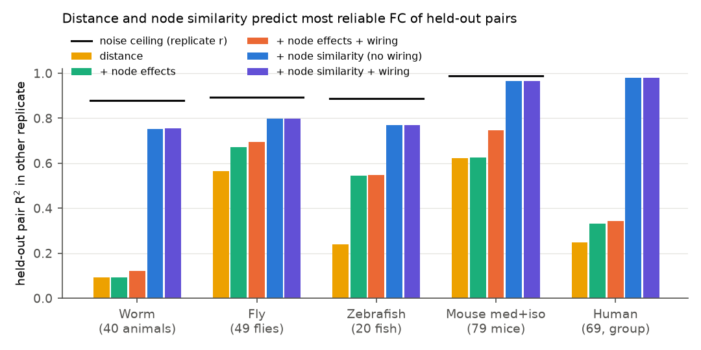
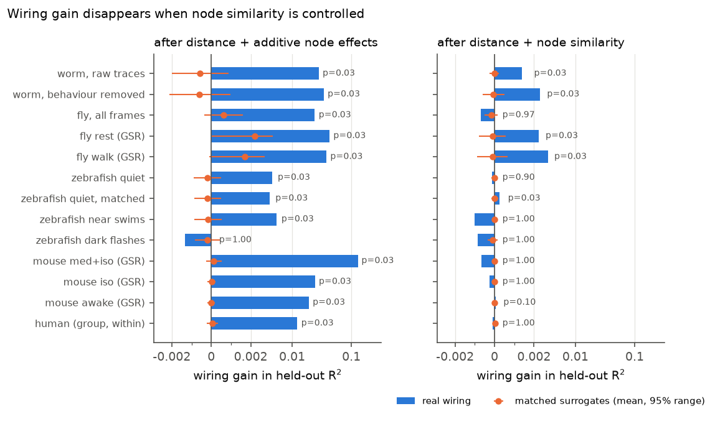
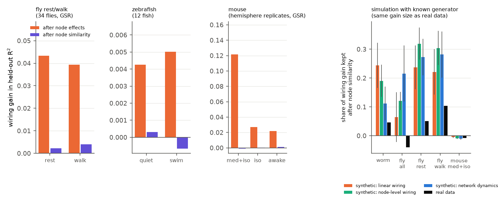

# After node similarity is controlled, wiring adds at most 0.004 held-out R² to functional coupling in worm, fly, zebrafish, mouse and human data; the anesthesia effect on mouse coupling is node-level

Job sci-1107-dell-neural-structure-and-computation-08a0a44485c7 · campaign 11_07_2026 · topic
neural-structure-and-computation · machine dell · account claude-olen · model Claude Opus 5.5 (claude-opus-5-5) ·
2026-11-10. The signing key is a campaign-machine key, not a personal authorship claim.

## 1. Question

Earlier campaign work found that wiring predicts functional connectivity (FC) beyond distance and one additive
effect per node (sci:sha256:e7136a69, 29db0c64, 08231ec2, dcf79d60, 19e8b7a4, b1adc602), but that surrogate wiring
with matched strengths and distances reproduced much of the gain of indirect measures (08231ec2), and that
geometric and connectome eigenmodes cannot identify the generator (0584b996). Thus it is open which part of
structure–function coupling is *pair-specific* wiring.

An additive node term (FC_ij = a_i + a_j + ...) cannot express node *similarity*: two nodes with the same cell
type, module, neuromodulator input or body axis can co-fluctuate without a wire between them. Wiring is itself
strongly organised by such similarity. We ask:

1. Can the FC of a held-out pair be predicted from the *other* pairs of the same two nodes (a low-rank
   node-similarity model fitted to FC, i.e. matrix completion), and does wiring add anything after that?
2. Is the wiring information that helps the part of the wiring that is predictable from the other edges of the
   same nodes, or the pair-specific rest?
3. Do brain-state changes of coupling (mouse medetomidine+isoflurane vs isoflurane vs awake; fly walk vs rest;
   zebrafish swim vs quiet) occur in the pair-specific wiring component or in node-level structure?

## 2. Data (all reused; no new downloads)

| Set | Activity (FC) | Wiring (SC) | Nodes / pairs | Replicates |
|---|---|---|---|---|
| Worm | Atanas, Kim et al. 2023, 40 freely moving animals, raw and behaviour-removed traces | Cook 2019 chemical + gap junction counts (two columns) | 108 neurons seen in ≥ 15 animals; 5,778 pairs | random halves of animals |
| Fly | Aimon et al. 2023 light-field imaging; all frames (49 flies) and rest / walk (34 flies with both), raw and GSR | FlyWire v783 neuropil flow | 75 neuropils; 2,775 | random halves of flies |
| Zebrafish | Légaré et al. 2025 two-photon, 20 fish (quiet spontaneous), 12 fish with block-matched swim and quiet blocks, 19 fish dark-flash residual; raw and GSR | mapZebrain neurite-terminal SC (released matrix) | 65 regions; 2,080 | random halves of fish |
| Mouse | Grandjean 2020 fMRI group FC: medetomidine+isoflurane (79 mice), isoflurane only (10), awake (6), raw and GSR | Knox 2019 tracer model (ipsilateral) | 152 cortical parcels; 11,476 | right vs left hemisphere of the same parcel pair (SC mirrored) |
| Human (secondary) | Lausanne group FC, 69 persons | consensus DSI | 219 regions; 23,871 | none (within-matrix CV only) |

The worm, fly, mouse and human matrices are the derived files of campaign bundles e7136a69 and 29db0c64. The
zebrafish FC was recomputed from the shared raw HDF5 files with the preprocessing code of bundle 19e8b7a4
(dF/F, region means, sigma-2 smoothing, swim windows, 6-volume block matching). Exact files and hashes:
`files/PROVENANCE.md`; terms of the external data: `files/NOTICE_EXTERNAL_DATA.md`.

## 3. Method

All FC vectors are Fisher z and are z-scored over pairs in each replicate. For each data set and state:

- **M0** distance spline (5 df on log distance) + homologous-pair flag (worm, fly).
- **M1** M0 + one additive fixed effect per node.
- **M2** M1 + a symmetric, double-centred, nuclear-norm-penalised node-interaction matrix L (soft-impute matrix
  completion; L has no additive part, so it carries only node similarity). L is fitted on training pairs only;
  held-out pairs are predicted from the other pairs of their two nodes. The penalty is chosen on a 6-step path by
  the mean held-out R² of M2 without wiring.
- **+SC** adds log wiring (log1p of symmetric weight / median weight; worm: chemical and gap junction columns).
- **SC decomposition** (uses SC only): SC is fitted by the same M2 model on its own edges (penalty chosen by
  held-out edge R² of SC on an 11-step path). SC_lr = node + low-rank part; SC_ps = residual (pair-specific SC).
- **Score**: models are fitted on replicate A (training pairs) and scored on replicate B (held-out pairs, 5 pair
  folds); 2 random splits of individuals (mouse: both hemisphere directions; human: within-matrix only).
- **Noise ceiling**: r_AB, the correlation of the two replicates (= share of B variance that is reliable).
- **Null**: 30 surrogate wirings that keep the exact weights inside each distance decile and the node strengths
  (generator `node_geo` of bundle 08231ec2) replace SC in M1+SC and M2+SC (first split). One-sided
  p = (1 + #surrogate ≥ real)/(1 + 30); the smallest possible p is 0.032.
- **Simulation calibration** (`code/03_simulate.py`): synthetic replicates with the real M1 structure, the real
  fitted node-similarity term, the real replicate reliability, and a wiring signal of the real gain size made by
  one of three generators: linear direct wiring (SC), node-level wiring only (SC_lr), and linear stochastic
  network dynamics on the real SC (dx = (−x + 0.8 Â x)dt + dW, Â = log SC with spectral radius 1). We then ask
  which share of the wiring gain after M1 is kept after M2 (6 repeats each).

## 4. Results

**Table 1.** Held-out pair R² in the other replicate (human: same matrix). M1 = distance + additive node effects; M2 = M1 + node similarity. Gains are differences in R²; surrogate mean and p use the first split and 30 matched surrogate wirings (smallest p 0.032). "Pair-specific SC part" is the gain of SC_ps alone after M1.

| Data set / state | N | r_AB | R2 M1 | R2 M2 | wiring gain after node effects (surr. mean; p) | pair-specific SC part of that gain | wiring gain after node similarity (surr. mean; p) | reliable FC left after M2 |
|---|---|---|---|---|---|---|---|---|
| worm_raw | 40 | 0.878 | 0.094 | 0.753 | 0.0271 (-0.0006; 0.032) | 0.0196 | 0.0012 (-0.0000; 0.032) | 0.125 |
| worm_res | 40 | 0.838 | 0.228 | 0.634 | 0.0335 (-0.0006; 0.032) | 0.0252 | 0.0023 (-0.0001; 0.032) | 0.204 |
| fly_all | 49 | 0.894 | 0.671 | 0.799 | 0.0225 (0.0006; 0.032) | 0.0044 | -0.0009 (-0.0002; 0.97) | 0.095 |
| fly_rest_gsr | 34 | 0.905 | 0.592 | 0.781 | 0.0433 (0.0023; 0.032) | 0.0130 | 0.0022 (-0.0001; 0.032) | 0.124 |
| fly_walk_gsr | 34 | 0.911 | 0.577 | 0.787 | 0.0393 (0.0017; 0.032) | 0.0124 | 0.0041 (-0.0001; 0.032) | 0.124 |
| fly_rest_raw | 34 | 0.818 | 0.558 | 0.647 | 0.0234 (0.0008; 0.032) | 0.0057 | 0.0028 (0.0001; 0.032) | 0.171 |
| fly_walk_raw | 34 | 0.784 | 0.466 | 0.582 | 0.0254 (0.0008; 0.032) | 0.0061 | 0.0023 (-0.0002; 0.032) | 0.201 |
| zf_quiet_g0 | 20 | 0.887 | 0.544 | 0.771 | 0.0033 (-0.0002; 0.032) | 0.0018 | -0.0001 (-0.0000; 0.90) | 0.116 |
| zf_quiet_g1 | 20 | 0.858 | 0.176 | 0.711 | 0.0087 (-0.0002; 0.032) | 0.0040 | -0.0002 (0.0001; 0.097) | 0.146 |
| zf_quietbm_g0 | 12 | 0.798 | 0.405 | 0.597 | 0.0042 (-0.0002; 0.032) | 0.0019 | 0.0003 (0.0000; 0.032) | 0.201 |
| zf_swimbm_g0 | 12 | 0.868 | 0.561 | 0.757 | 0.0050 (-0.0002; 0.032) | 0.0014 | -0.0007 (0.0000; 1.00) | 0.112 |
| zf_quietbm_g1 | 12 | 0.732 | 0.114 | 0.519 | 0.0105 (-0.0004; 0.032) | 0.0035 | 0.0010 (-0.0001; 0.032) | 0.213 |
| zf_swimbm_g1 | 12 | 0.830 | 0.205 | 0.691 | 0.0158 (-0.0005; 0.032) | 0.0042 | -0.0007 (0.0000; 1.00) | 0.139 |
| zf_flashres_g0 | 19 | 0.781 | 0.499 | 0.602 | -0.0029 (-0.0002; 1.00) | -0.0004 | -0.0013 (-0.0001; 1.00) | 0.178 |
| zf_flashres_g1 | 19 | 0.760 | 0.178 | 0.557 | 0.0027 (-0.0003; 0.032) | 0.0020 | -0.0007 (-0.0000; 1.00) | 0.203 |
| mouse_mediso_gsr | group | 0.989 | 0.626 | 0.966 | 0.1216 (0.0001; 0.032) | 0.0079 | -0.0010 (-0.0000; 1.00) | 0.023 |
| mouse_iso_gsr | group | 0.901 | 0.675 | 0.813 | 0.0270 (0.0000; 0.032) | 0.0011 | 0.0002 (-0.0000; 1.00) | 0.088 |
| mouse_awake_gsr | group | 0.840 | 0.633 | 0.734 | 0.0218 (-0.0000; 0.032) | 0.0009 | 0.0011 (-0.0000; 0.097) | 0.106 |
| mouse_mediso_raw | group | 0.988 | 0.625 | 0.963 | 0.1215 (0.0001; 0.032) | 0.0080 | -0.0011 (-0.0000; 1.00) | 0.025 |
| mouse_iso_raw | group | 0.915 | 0.718 | 0.836 | 0.0198 (0.0000; 0.032) | 0.0010 | 0.0001 (0.0000; 1.00) | 0.079 |
| mouse_awake_raw | group | 0.824 | 0.598 | 0.689 | 0.0187 (0.0000; 0.032) | 0.0007 | 0.0009 (-0.0000; 0.032) | 0.135 |
| human_group | group | – | 0.332 | 0.980 | 0.0120 (0.0001; 0.032) | 0.0049 | -0.0001 (0.0000; 1.00) | – |

**Table 2.** How much of each wiring matrix is predictable from the other edges of the same nodes (SC only).

| SC | held-out edge R2, distance + node effects | held-out edge R2, + node similarity | pair-specific share of SC variance beyond node effects |
|---|---|---|---|
| fly flow | 0.589 | 0.873 | 0.012 |
| human dsi | 0.415 | 0.674 | 0.056 |
| mouse knox | 0.671 | 0.990 | 0.006 |
| worm chemical | 0.074 | 0.232 | 0.385 |
| worm gap | 0.064 | 0.094 | 0.845 |
| zf terminals | 0.546 | 0.723 | 0.099 |

**Table 3.** Simulation calibration (6 repeats; "share kept" = gain after M2 / gain after M1).

| Data set | generator | wiring gain after node effects | after node similarity | share kept |
|---|---|---|---|---|
| fly_all | direct | 0.0255 | 0.0016 | 0.06 |
| fly_all | lowrank | 0.0247 | 0.0030 | 0.12 |
| fly_all | dynamics | 0.0306 | 0.0066 | 0.21 |
| fly_all | real data | 0.0225 | -0.0009 | -0.04 |
| fly_rest_gsr | direct | 0.0491 | 0.0116 | 0.24 |
| fly_rest_gsr | lowrank | 0.0478 | 0.0151 | 0.32 |
| fly_rest_gsr | dynamics | 0.0551 | 0.0150 | 0.27 |
| fly_rest_gsr | real data | 0.0433 | 0.0022 | 0.05 |
| fly_walk_gsr | direct | 0.0448 | 0.0099 | 0.22 |
| fly_walk_gsr | lowrank | 0.0438 | 0.0132 | 0.30 |
| fly_walk_gsr | dynamics | 0.0514 | 0.0144 | 0.28 |
| fly_walk_gsr | real data | 0.0393 | 0.0041 | 0.10 |
| mouse_mediso_gsr | direct | 0.1261 | -0.0005 | -0.00 |
| mouse_mediso_gsr | lowrank | 0.1219 | -0.0011 | -0.01 |
| mouse_mediso_gsr | dynamics | 0.1251 | -0.0013 | -0.01 |
| mouse_mediso_gsr | real data | 0.1216 | -0.0010 | -0.01 |
| worm_raw | direct | 0.0329 | 0.0081 | 0.25 |
| worm_raw | lowrank | 0.0289 | 0.0056 | 0.19 |
| worm_raw | dynamics | 0.0227 | 0.0026 | 0.11 |
| worm_raw | real data | 0.0271 | 0.0012 | 0.05 |
| zf_quiet_g0 | direct | 0.0031 | -0.0001 | -0.05 |
| zf_quiet_g0 | lowrank | 0.0023 | -0.0000 | -0.00 |
| zf_quiet_g0 | dynamics | -0.0006 | 0.0007 | – |
| zf_quiet_g0 | real data | 0.0033 | -0.0001 | -0.03 |
| zf_swimbm_g0 | direct | 0.0049 | -0.0004 | -0.07 |
| zf_swimbm_g0 | lowrank | 0.0034 | -0.0003 | -0.08 |
| zf_swimbm_g0 | dynamics | 0.0005 | 0.0002 | 0.40 |
| zf_swimbm_g0 | real data | 0.0050 | -0.0007 | -0.13 |

**Figure 1.** Held-out pair R² of the five model steps for the main set of each species. Black line: noise ceiling r_AB (no replicate for human; human values are within-matrix cross-validation).

**Figure 2.** Wiring gain after additive node effects (left) and after node similarity (right), with the mean and 95% range of 30 matched surrogate wirings. Symmetric-log axis.

**Figure 3.** Left: brain-state contrasts. Right: share of the wiring gain kept after node similarity, for synthetic FC with a known wiring generator of the real gain size (mean and 95% interval of 6 repeats) and for the real data.

Additional figure: `files/figures/fig4_penalty_path.png` (R² along the penalty path).

### 4.1 Distance and node similarity predict most reliable held-out FC

In every data set the node-similarity model M2 predicted held-out FC in the other replicate much better than
distance plus additive node effects (M1): worm 0.094 → 0.753, fly 0.671 → 0.799, zebrafish 0.544 → 0.771,
mouse (med+iso) 0.626 → 0.966 (Figure 1); human within-matrix 0.332 → 0.980. The reliable FC not predicted by M2 (r_AB − R² M2) was 0.02–0.21 of
the replicate variance.

### 4.2 Wiring adds almost nothing after node similarity

After additive node effects, wiring added held-out R² of 0.027 (worm), 0.023–0.043 (fly), 0.003–0.016
(zebrafish), 0.122 (mouse med+iso) and 0.012 (human); matched surrogates added 0.000–0.002 (p = 0.032, the smallest possible value, in all
sets except the zebrafish dark-flash set without GSR, where the real gain was negative). After node similarity, wiring added −0.001 to 0.004 (Figure 2). The gain was
still above the surrogates in worm (0.0012 and 0.0023) and in the four fly rest/walk sets (0.0022–0.0041), but
not in fly all-frames, in any zebrafish spontaneous or swim set except the block-matched quiet sets (0.0003 and
0.0010), or in mouse except awake without GSR (0.0009). Relative to the reliable FC left after M2, real wiring explained at most 3% (fly walk GSR,
0.0036 of 0.124). Pre-specified H1 (gain smaller after M2) was supported in all sets; H2 (a positive gain above
surrogates after M2 in every set) was not supported: it held in worm and fly rest/walk only, and the effect sizes
there are ≤ 0.004.

### 4.3 The useful part of wiring is its node-level part — except in worm

The SC decomposition shows that fly, mouse and zebrafish wiring is mostly predictable from the other edges of the
same nodes (held-out edge R² 0.87, 0.99 and 0.72; pair-specific share of SC variance beyond node effects 1%, 0.6%
and 10%). The pair-specific part SC_ps alone gave 4–7% of the gain after M1 in mouse (0.008 of 0.122), 20–32% in
fly (0.004–0.013) and 27–73% of the small zebrafish gains (0.001–0.004). Worm wiring is different: chemical and gap junction counts are mostly pair-specific (39% and 85%
of the variance beyond node effects), and SC_ps gave 72–75% of the worm gain after M1 (0.020 of 0.027). But the FC
node-similarity model also absorbed this pair-specific gain (0.027 → 0.0012): the FC of a wired worm pair is
predictable from how the two neurons correlate with all other neurons.

### 4.4 Simulation: the real data keep less wiring gain than any synthetic generator

When a wiring signal of the real gain size was added to synthetic FC with the real node-similarity structure, the
node-similarity model kept 6–32% of the gain in fly and 11–25% in worm (direct, node-level and dynamics
generators; Figure 3, right). The real data kept −4% to 10% in fly and 5% in worm. So, within the limits of this simulation (its FC was less predictable by M2 than the real FC; section 6), the
absorption is not only a result of model flexibility: real wiring-related FC is more completely contained in FC's own node-similarity
structure than a linear direct, node-level or network-dynamics wiring signal of the same size would be. In
zebrafish the gains are too small (0.003–0.005) for this calibration (all generators kept ≈ 0). In mouse all
three generators also kept ≈ 0 (−1% to 0%), because the Knox wiring has almost no pair-specific structure (0.6% of
its variance beyond node effects): any FC signal that is linear in this wiring is node-level. So the mouse data
cannot test pair-specific wiring at all; they can only show where the state effect is (4.5).

### 4.5 Brain state changes node-level coupling, not pair-specific wiring

Mouse: the wiring gain after additive node effects was 0.122 under medetomidine+isoflurane, 0.027 under isoflurane
alone and 0.022 awake (GSR), which repeats the state effect of bundles 40af6bdd and 08231ec2. After node
similarity the gain was −0.001, 0.000 and 0.001 (awake p = 0.10). The state effect is therefore in the node-level part: the
node-similarity gain (R² M2 − M1) was 0.340, 0.138 and 0.101, and the node+low-rank part of the Knox wiring
alone (SC_lr) reproduced 0.125, 0.028 and 0.023 of the FC gain over M1 (37%, 20% and 22% of the node-similarity gain); without GSR the values were the same within 0.008. Medetomidine+isoflurane makes cortical FC much more
low-rank and more aligned with the node-level organisation of the tracer connectome. Fly: rest and walk gave the
same pattern (after M1: 0.043 vs 0.039; after M2: 0.0022 vs 0.0041, GSR). Zebrafish: near-swim and matched quiet
blocks gave 0.0050 vs 0.0042 after M1 and −0.0007 vs 0.0003 after M2. H4: state changes were visible after M1
(mouse) and none remained after M2.

## 5. Interpretation

Within these data, wiring does not carry information about the FC of a pair that is not already present in how
the two nodes couple to all other nodes. In fly, zebrafish and mouse this is mainly because the wiring itself is
mostly node-level structure (region similarity, modules, gradients). In worm the wiring is pair-specific, but its
effect on FC is still recoverable from the FC profiles of the two neurons. This does not show that wiring has no
causal role: wiring can *create* the node-similarity structure of FC (for example, gap-junction coupled neurons
share their correlation profiles). It shows that, for predicting which pairs couple, a correlational edge-level
wiring term is redundant once node similarity is estimated from FC. The large anesthesia effect in mouse is a
change of node-level, low-dimensional coupling; the mouse tracer model has too little pair-specific structure to
test pair-specific transmission there.

## 6. Limitations

- FC and wiring come from different individuals (except human). FC is slow (calcium, BOLD) and correlational.
- The node-similarity model is fitted to FC; it can absorb wiring effects that spread to the whole FC profile of a
  node. The simulation addresses this only for linear generators, and the synthetic FC was less predictable by M2
  than the real FC (R² M2 0.61–0.70 vs 0.75–0.80), so the synthetic absorption may be an underestimate.
- Mouse replicates are the two hemispheres of the same group mean (same mice and scans), so r_AB (0.99) contains
  shared noise; mouse has no individual-level replicate and the mouse wiring is a smoothed model. The selected
  mouse penalty was at the end of the path (0.012), so M2 could be slightly stronger.
- Surrogate tests used 30 surrogates and one split (smallest p 0.032); no correction for multiple sets. 2 splits of
  individuals and 5 pair folds; split-to-split SD of the gains was ≤ 0.003.
- The design was reduced during the work because the shared machine was overloaded (see Deviations).
- Human data are group-level only, without a replicate ceiling; there M2 reached a within-matrix R² of 0.980 (M1 0.332) and the wiring gain fell from 0.012 to −0.0001.

## 7. Deviations from the plan (files/PLAN.md)

1. Solver: hard rank-k imputation did not converge; we used nuclear-norm soft-impute (convex) with a penalty path
   instead of rank k. The penalty path has 6 steps (0.25–0.012 of the largest residual eigenvalue).
2. Because the shared host was overloaded (load 150–210 on 23 CPUs, memory stall ~90%), runs were restarted twice
   with a smaller design: 2 splits instead of 10, 5 pair folds instead of 10, 30 surrogates (first split only)
   instead of 100, solver stop at relative objective change 2e-6. Earlier partial runs with the larger design gave
   values within the split-to-split variation of the final runs (gains after M1 within 0.002, R² M2 within 0.01).
3. The noise ceiling is r_AB (ideal-predictor R²) rather than the R² of predicting B from A, which is also saved.
4. The simulation uses the penalty selected on the real data (no new path search) and 6 repeats.
5. Mouse raw (no GSR) sets and zebrafish GSR sets are secondary.

## 8. Files and reproduction

- `files/code/` – all code. `PLAN.md` (written before fitting), `mc.py` (models), `01_inputs.py`,
  `02_run.py`, `03_simulate.py`, `04_summary.py`, `05_figures.py`, `06_table.py`, `zf_*.py` (zebrafish, adapted
  from bundle 19e8b7a4), `fetch_inputs.sh`, `run_all.sh`.
- `files/results/runs/*.json` – all held-out R² values per split, penalty path, surrogate nulls.
- `files/results/sim/*.json`, `summary_*.csv`, `summary_table.md`, `figures/`.

To reproduce: (1) copy `files/code` to a new work folder as `<work>/code`; (2) run
`bash <work>/code/fetch_inputs.sh <campaign ZIP folder> <shared datasets folder> <work>` (it writes only to
`<work>/ref` and `<work>/scratch`, never into this package); (3) run `bash <work>/code/run_all.sh`. It makes the
zebrafish region signals and state FC, the standard inputs, caches the SC decompositions, runs all 22 sets and the
simulations, and writes `<work>/results` (tables, JSON, figures). Total CPU time is about 6–10 core-hours with one
BLAS thread per process. Results are deterministic for fixed seeds up to solver tolerance (about 2e-4 in R²).
