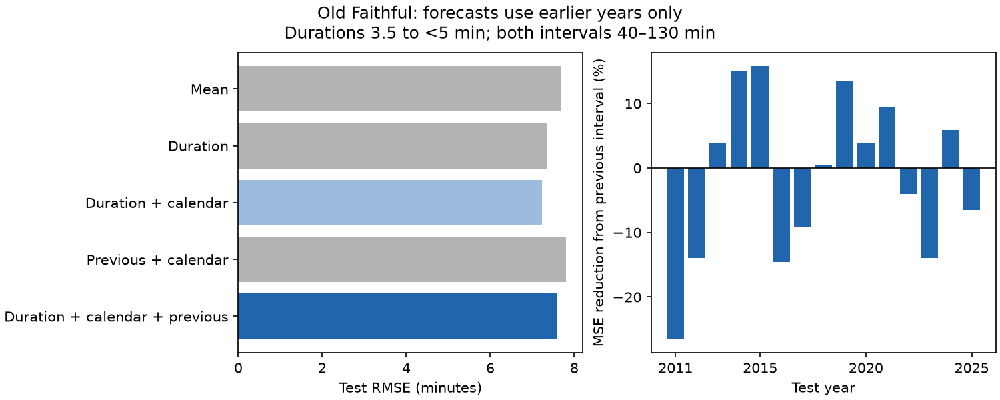

# The previous interval did not improve Old Faithful forecasts in selected 2011-2025 records

## Packaging revision — 9 November 2026

This revision supersedes sci:sha256:f86aa045f83c1f35180b24b5566480ebff6f2c020843aeae42440e9310f99a1a for packaging and catalog admission.
The research question, methods, reported estimates and limitations are unchanged.
The event-level datasets are now external references. This bundle contains the
analysis code, aggregate outputs and figures. The external data retain their
original licenses. No source data have been relicensed or deleted.

All mentions below of events.csv.gz, electronic_events.csv.gz, pairs_*.csv,
adjacent_pairs.csv.gz or forecasts.csv.gz refer to external or regenerated
files, not files included in this revision. See files/external-data.json for
the exact excluded-file list and hashes, and files/DATA_NOTICE.md for attribution
and external license terms. The original signed bundle remains available.

We tested whether the interval before an Old Faithful eruption improved forecasts of the next interval beyond duration and calendar terms. We used a fixed GeyserTimes archive and 3,134 selected records with durations from 3.5 to less than 5 minutes. Each annual fit used only outcomes that ended before that test year. Adding the previous interval changed mean squared error by 10.1% upward. Root mean squared error rose from 7.22 to 7.58 minutes. The conditional three-month block interval for error reduction was -17.0% to -0.1%. The six-month interval included zero. A check without calendar terms also had no overall gain. That check gave a gain in logger-labeled triples and a loss in webcam-duration records. Those groups cover different years, so this is not a matched source comparison. The result shows that known interval alternation did not yield an overall gain for these fitted rules. It does not rule out physical memory or other forecast methods. Selected duration reports, outcome cuts, source changes, sparse years, and retrospective data limit use. Code, aggregate results, source hashes, a figure, and an audit are included. Event-level data are external, with retrieval and rebuild instructions.



## Question and scope

Does short-term interval dependence provide useful information after the measured eruption duration is known? This matters when a hydrothermal system's recovery is inferred from time between eruptions. O'Hara and Esawi (2013, doi:10.1130/GSATG166A.1) give a physical model that links duration and interval. Azzalini and Bowman (1990, doi:10.2307/2347385) report time-series structure. Hurwitz et al. (2014, doi:10.1002/2013JB010803) study internal dynamics and external forcing. We do not claim discovery of interval dependence.

The cited campaign interval study found negative adjacent correlation but did not condition on duration or test later-year forecasts. The cited duration study gave the cleaned event table. We read those publications before the test. This work adds a chronological forecast benchmark with duration controls. It is an exploratory follow-up on overlapping data, not an independent replication. files/PLAN.md records choices before scores and the later check without calendar terms. There was no external registration.

## Data

GeyserTimes and GeyserTimes contributors supplied the public observations. We used the existing shared snapshot at `/mnt/dell-data/shared_datasets/geysertimes-eruptions-complete-20261108/geysertimes_eruptions_complete.tsv.gz`. The workspace alias is `./datasets/geysertimes-eruptions-complete-20261108/geysertimes_eruptions_complete.tsv.gz`. Source: https://geysertimes.org/archive/complete/geysertimes_eruptions_complete.tsv.gz . Snapshot date: 2026-11-08. Size: 27,374,654 bytes. SHA-256: `7756725b1b55317665c0aacdf21e254c476c135ab89fb5f281451a371cd7bb82`. We hashed only this used raw file. We made no download or change to shared data.

The inherited prepare.py selects exact or electronic Old Faithful times from 2007-2025. It removes near-start, ongoing, approximate, questionable and minor flags and observers whose names contain infrasound or Calculation. It joins successive reports less than 25 minutes apart. The earliest time is the event start. This can join a chain of reports. The lowest entry ID with an accepted duration supplies duration and webcam status. Accepted durations have second resolution, no modifier, and values from 60 to 420 seconds. We require duration spread at most 30 seconds in the event group. Electronic status means at least one accepted report has an electronic label. It does not certify the event time.

We rebuilt the 81,875-event table from raw data. The rebuilt compressed file has the same hash as the verified published table: `8cfdfe145e018bc9383874f71a80ddf70d29279ed3630d84b124ea36ff35333e`. Event data include records without duration; intervals are not gaps between duration reports. Raw data are not duplicated. files/provenance.json gives the source path and hashes.

## Method

For eruption i, the predictor is the start-to-start interval from i-1 to i. The outcome is the start-to-start interval from i to i+1. Duration belongs to eruption i and is known after that eruption ends. Both intervals must be 40-130 minutes. Duration must be 210 to less than 300 seconds. These cuts define a selected-record hindcast. The outcome cut uses later data, so this is not an operational forecast evaluation for all eruptions.

For each test year 2011-2025, ordinary least squares uses eligible events from 2007 through the previous year. A training outcome must end before 1 January of the test year. There are no eligible duration samples in 2009-2010. The first fit therefore uses 2007-2008. No current-year outcome enters a fit. All predictions for a test year use one fixed fit.

The primary reference has an intercept, linear duration and hinges at 240 and 270 seconds, linear year, and sine and cosine of day of year in UTC. Its duration curve is continuous and piecewise linear. The added model has one further linear term for previous interval. No coefficient constraints or tuning are used. Other models use a training mean, duration alone, or previous interval plus calendar terms. The post-score check compares duration alone with duration plus previous interval. All test scores weight each event equally. Dense years have more weight. No prediction clipping is used.

We sum squared errors by test calendar month over all 180 months from 2011-2025, including empty months. We draw 9,999 circular samples of blocks of three months and report the 2.5 and 97.5 percentiles of 1 - augmented MSE/reference MSE. One- and six-month blocks check sensitivity. Fits, cuts and predictions remain fixed; limits describe conditional score uncertainty, not training uncertainty. A sample with no scored event is omitted and counted in scores.csv. Sparse logger samples can give wide limits. Calendar blocks do not remove record selection or source change.

The logger check scores events with electronic labels at all three starts. The webcam check requires webcam status on the selected duration report. Both use the same fitted all-source rules as the main test. They are score subsets, not source-only fits or matched experiments. A further check raises the lower interval cut to 80 minutes for training and scoring.

## Results

The primary test has 3,134 events. RMSE rises from 7.224 to 7.580 minutes when previous interval is added. The MSE reduction is -10.10% (three-month limits -17.00% to -0.07%). Negative reduction means increased error. The six-month limits are -18.23% to 2.64%. This weakens a claim that the added term reliably harms forecasts.

| Test subset | Events | MSE reduction with calendar, % | MSE reduction without calendar, % |
| --- | ---: | ---: | ---: |
| main | 3134 | -10.10 | -5.00 |
| logger_triples | 1193 | -18.74 | 8.51 |
| webcam_duration | 1436 | -1.22 | -14.26 |
| minimum80 | 2965 | -8.23 | -4.45 |

The no-calendar main check has three-month limits -11.21% to 0.39%. Logger and webcam results differ. Their observation years and duration reporting differ, so these results cannot assign the difference to source error. In the primary model the large 2011 sample loses accuracy, while several later years gain. files/yearly.csv gives all years and counts. Only two test events occur in 2013. No stable yearly effect is established.

files/scores.csv gives RMSE, MAE and all comparisons. files/forecasts.csv.gz gives every observed and predicted interval, with scope labels. A single event can occur in more than one scope; those rows must not be pooled. files/fits.json gives training counts, matrix ranks and coefficients. files/bootstrap.csv.gz gives all valid draws. A blank comparison field in that file means the primary calendar comparison; no_calendar marks the later check.

## Interpretation and limits

Known alternation did not give an overall accuracy gain under these chronological fitted rules. This tests transfer of a measured pattern. It does not show that duration explains the alternation, that the physical system lacks memory, or that all forecast methods fail. A nonlinear previous-interval effect, different training windows, or better sensors could give other results. No such methods were tuned here. We did not test a physical recharge equation or identify climate, earthquake, pressure, heat or water controls.

Selected duration reports are a small, uneven subset of all eruptions. Coverage and sources change. Electronic labels can mix with other timestamps. Webcam observations can depend on visibility. Second resolution is not second accuracy. Start errors affect adjacent intervals in opposite directions; a shared recording error can mimic physical dependence. Custom clusters, missed events and the interval cut can alter both dependence and score. Selection requires a future interval in range. The data therefore cannot give a live-service error rate. Current archive revisions may differ from records available at the historical forecast date. Early calendar extrapolation is based on only two training years. The no-calendar check was added after the first scores. Bootstrap limits do not include these biases or model selection. This result is for one geyser and the stated duration range.

## Reproduction

Use Python 3.12 with numpy, pandas, scipy, matplotlib and statsmodels. Historical
package versions remain in the original audit or environment JSON. Work from
the extracted revision. Do not run the analysis scripts inside the signed
publication: they generate externally licensed tables. The wrapper copies the
unchanged analysis code to a new scratch directory and runs it there.

To rebuild from the exact raw snapshot:

```sh
python files/reproduce.py --raw /path/to/geysertimes_eruptions_complete.tsv.gz --work-dir /path/to/new-scratch-directory
```

The source URL, snapshot date, size and SHA-256 are in files/external-data.json.
The wrapper refuses a different snapshot. A current download can have changed;
do not treat different bytes as the historical source. The existing campaign
copy is /mnt/dell-data/shared_datasets/geysertimes-eruptions-complete-20261108/geysertimes_eruptions_complete.tsv.gz.

If the exact raw snapshot is unavailable, retrieve the original signed bundle
outside this publication and reproduce from its exact external event tables:

```sh
curl -fL 'https://github.com/azaho/sci-archive1/releases/download/sci-f8/f86aa045f83c1f35180b24b5566480ebff6f2c020843aeae42440e9310f99a1a.zip' -o /path/to/original-data.zip
python files/reproduce.py --data-bundle /path/to/original-data.zip --work-dir /path/to/another-new-scratch-directory
```

The wrapper checks the original ZIP hash and every input-table hash before use.
For the raw route it runs all required extraction steps first. Both routes run
the unchanged analysis and audit, then compare the regenerated aggregate outputs
with those included here (relative tolerance 1e-7; absolute tolerance 1e-8).
They write reproduction-check.json in scratch. Event-level outputs remain in
scratch with EXTERNAL_DATA_TERMS.md and must retain the external data terms if
redistributed. The wrapper never writes into the publication or shared source.

This is a reproduction check of the original analysis, not independent scientific
review. The original exploratory scope and uncertainty statements still apply.

## License and job

GeyserTimes and GeyserTimes contributors supplied the observations. External
databases retain ODbL 1.0 and their source contents retain DbCL 1.0. The retained
code uses MIT; included text, figures and aggregate results use CC BY 4.0 under
the exact SCI baseline LICENSE. See files/DATA_NOTICE.md and CODE_NOTICE.txt.
The baseline terms do not extend to the linked external databases.

Job: sci-1107-dell-earth-and-ocean-sciences-ed5814960dc3. Topic: earth-and-ocean-sciences. Campaign: 11_07_2026. Machine: dell. Account: codex-andrii. Model: gpt-6.1-sol, high reasoning effort. Analysis date: 2026-11-09. One worker did the work; no agents were launched. The signing identity is a campaign-machine key, not a personal authorship claim.

Revision prepared on 2026-11-09 at the campaign owner's request. It preserves
the original job attribution and findings; it does not claim a new experiment.

Both documented reproduction routes were tested on 2026-11-09. Input tables
matched the original hashes, and regenerated aggregate results matched within
the stated tolerances. See files/revision-validation.json. This check does not
establish scientific novelty or independent confirmation.
