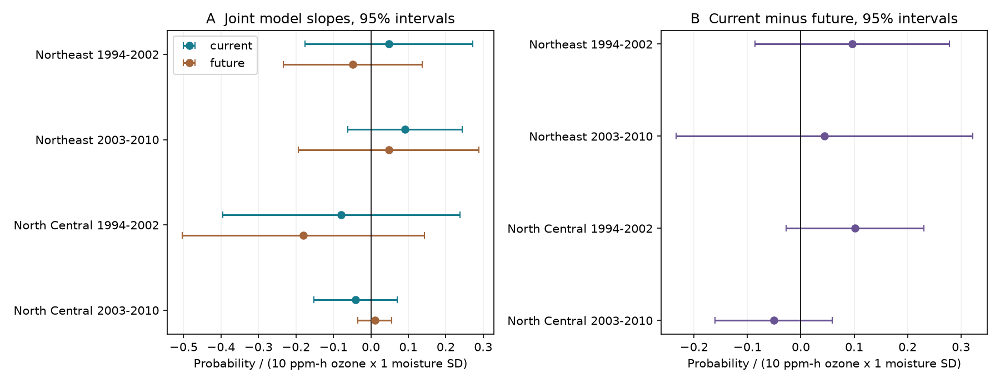

# Current and next-year ozone and moisture products gave no clear injury slope difference in four eastern US forest samples in 1994-2010

We tested whether a current-year ozone and soil moisture product had a different leaf-injury slope from the next-year product. We used 3,717 consecutive-year records from a verified public-data panel in two eastern US regions and two periods from 1994 to 2010. Joint models removed site and year effects and controlled survey timing, plant and species counts, and temperature. Current-minus-future slopes were +0.096, +0.044, +0.102 and -0.051 injury probability per 10 ppm-h ozone per one moisture SD. All four two-way cluster 95 percent intervals included zero. Curved exposure terms and before-visit exposures also gave no clear contrast. A closer-monitor early Northeast result had a positive marginal interval but not a four-test interval. Thus this analysis did not establish a distinct current-year product slope. It does not establish equal slopes or disprove ozone damage. Selected repeat visits, few time clusters, coarse exposure, unknown missed injury and reuse of rounded source records limit inference. Code, aggregate evidence and verified-source retrieval instructions are included.



## Question and prior work

Does the current-year ozone and moisture product have a larger injury slope than the next-year product, when both are fit on the same records? This is a time-order diagnostic for an environmental interaction. Next-year exposure cannot cause damage that was already recorded. A future slope can still reflect persistent exposure, omitted conditions, measurement error or selection. It is not automatically a measure of bias.

Smith, Morin and McCaskill (2012; doi:10.2737/NRS-GTR-103) describe ozone injury in the same FIA network. Their report describes less injury under dry conditions at a given ozone exposure. The DO3SE study (doi:10.5194/acp-12-5537-2012) models soil water control of ozone uptake. This mechanism motivates the product term. Lipsitch and colleagues (2010; doi:10.1097/EDE.0b013e3181d61eeb) describe negative controls and their assumptions. We use future exposure as a diagnostic, not as a causal adjustment formula.

Campaign publication 268004a08eb37a3a36207332736b005b07fe9d13a4687a19b1e966f96044ecb6 made the source panel and tested next-year ozone with current moisture. Publication 29a66dcad4d1679fc2b2a1d38ce3f74aac627d2501d8a2fb9efa3b831e91470b separated annual product deviations from site means. Publication 8b6cc9622b5dcfae107b966a645e397a27323c492b16a4f21cbfc6e7a291c2d1 tested fixed plant effort. We add a joint model of two complete season products and a direct coefficient contrast with its covariance. This is a follow-up on overlapping records, not independent source validation. Campaign searches for phenology, climate, pollution, ozone, forest injury and injury future preceded the test. The four tests and three checks were chosen before fitting. The study was not registered. The test adjustment does not cover all campaign choices.

## Data and selection

We use only the verified parent entry `files/data/analysis_panel.csv`, SHA-256 `b8096a35a665bd8d8dbb80c3dbdd2bf4052828b6feb15116484477f66675e31c` (1,963,708 bytes). `provenance.json` gives the exact shared campaign path and bundle hash. No shared raw dataset was used or changed. We checked relevant dataset names and found no FIA or forest ozone source dataset to reuse. No new raw download was needed. The parent combines FIA injury reports, EPA AQS monitor exposures, NOAA CPC soil moisture and NOAA climate-division temperature. The parent snapshot date is 9 November 2026; nClimDiv is v1.0.0-20261006. `parent_raw_hashes.txt` preserves the parent's raw hashes, which we did not recompute.

An outcome record must have a record at the same site in the next calendar year. Both years must be within 1994-2002 or 2003-2010. Thus current years end in 2001 or 2009. Each site must retain at least three complete pairs in a region-period. Records must have a positive evaluated plant count and complete covariates. The outcome is one if any plant had validated injury. We check that this equals a positive recorded injured-plant count.

The initial current records total 5,403. Of these, 4,343 have a next-year record. The three-pair rule leaves 3,717 records. The audit lists these counts by sample and variant. Selection requires future survey presence and can depend on conditions related to injury. A pair can overlap the next pair. Site and year cluster errors address some dependence but cannot remove selection bias. The target is selected monitored bioindicator plants, not all eastern forest plants.

## Model

O is the largest three-consecutive-month W126 ozone exposure in April-October, in 10 ppm-h units. M is June-August CPC moisture, in local SD units relative to 1981-2010. For each site in each selected sample, we center current O and M on their site means. We center future O and M on their own site means. For each season we include five terms: `o*m`, `o`, `m`, `mean(O)*m` and `mean(M)*o`. The last two terms separate annual products from products with site means. Site effects absorb fixed site differences, including constant products of means.

A single linear probability model includes both season blocks, current visit day divided by ten, current and future summer maximum-temperature anomalies, log current evaluated plant count and current species count. Site and current-year effects are removed by alternating means to a tolerance of 1e-11. The product slopes are beta_current and beta_future. The main target is `beta_current - beta_future`. Its variance uses both variances and their covariance from the same fit. Units are injury probability per 10 ppm-h ozone per one moisture SD. This is a projection coefficient, not a causal interaction or an individual probability prediction. Current effort controls do not fix species identity or field diagnosis.

We fit separate models for Northeast and North Central regions in each period. Covariance is V(state) + V(year) - V(state-year), with CR1 factors G/(G-1) and (n-1)/(n-rank(FE)-k). FE rank accounts for connected site-year components. Intervals use t with min(state count, year count)-1 degrees of freedom. There are only 6-12 state clusters and 7-8 current-year clusters. Approximate intervals can be fragile. Negative variance estimates would be missing; all reported contrast variances are positive. The four primary contrasts are the main test family. `lo_family` and `hi_family` give 98.75 percent intervals for Bonferroni control across four contrasts. Figure intervals are marginal 95 percent intervals.

## Results

| Sample | Records | Sites | Current minus future | 95% interval |
|---|---:|---:|---:|---|
| Northeast 1994-2002 | 719 | 161 | +0.0963 | -0.0859 to +0.2785 |
| Northeast 2003-2010 | 1135 | 186 | +0.0439 | -0.2341 to +0.3220 |
| North Central 1994-2002 | 347 | 93 | +0.1016 | -0.0272 to +0.2305 |
| North Central 2003-2010 | 1516 | 245 | -0.0508 | -0.1607 to +0.0590 |


Three contrasts are positive and one is negative. Every marginal and family interval includes zero. Current and future product slopes also have marginal intervals that include zero in all four primary fits. The data permit substantial differences in both directions. Failure to reject is not evidence of equal slopes or low biological damage.

The before-visit check uses ozone in the 60 days ending at each visit, June-July moisture, and visits with day of year at least 214 in both seasons. This makes both moisture months occur before the visits, including leap years. It reduces exposure timing leakage. Its contrast estimates are +0.146, +0.101, +0.075 and -0.096; all marginal intervals include zero. The primary seasonal windows can include days after the visit and must not be read as strictly prior exposures.

The curves check adds squared raw O and M in both seasons. All four contrast intervals include zero. The closer-monitor check requires a nearest monitor within 30 km in both years. The early Northeast contrast is +0.204, with marginal interval +0.001 to +0.406. Its four-test interval is -0.082 to +0.489. Other close-monitor contrasts have marginal intervals that include zero. This isolated, selected-sample result does not show a repeated time-order contrast. The checks change sample selection or the model; they are not exact replications. All 48 slope estimates are in `results.csv`.

## Numerical checks and limits

Every design is full rank. Independent sparse regression with explicit site and year indicators agrees with all slope coefficients to less than 6.7e-11. The code checks the unique site-year keys, source hash, binary outcome and positive injured-plant agreement. `checks.csv` records numerical error, design condition number and product correlations after fixed-effect removal. Correlation of current and future products ranges from -0.42 to -0.09 in primary fits. Low precision cannot simply be ascribed to nearly identical product columns. Other covariates and limited clusters still affect precision.

The two regions share weather systems. The two time windows share some sites. They are separate checks, not independent experiments. Indicator species and visit effort can change with weather. Field false negatives, crew identity, genotype and local habitat are not measured. Future observation requirements can select sites. Interpolated ozone and coarse model moisture do not measure ozone uptake by leaves. Parent panel rounding and source matching errors carry into this analysis. We have not rebuilt or independently validated the raw joins. Site and year effects do not remove time-varying confounding, and future exposure can proxy omitted past exposure. A null future slope cannot validate a causal current slope. The analysis concerns visible plant stress, not species loss, range shifts or climate-change attribution.

## Reproduce

From the publication folder run:

```sh
python files/analyze.py --campaign /path/to/shared/campaign --scratch ../reproduction
```

The script verifies the parent ZIP with SCI, retrieves its exact panel, and checks the entry hash. All records and regenerated output go to external scratch; the script rejects scratch within the signed publication. An exact previously retrieved panel can be used with `--panel /path/to/panel.csv`. Compare generated `results.csv`, `checks.csv`, `sample_audit.csv` and `results.png` with the bundled files. Python 3.12, NumPy, pandas, SciPy and Matplotlib are needed. `environment.json` records actual versions. No random algorithm is used.

Full raw reprocessing is preserved in the parent `files/code/00_retrieve.sh` and `01_fia_prepare.py` through `03_moisture.py`, with source URLs in the parent README. Use `sci read` with those entry paths to recover code into external scratch. The shared parent ZIP is the exact reproducible input for this publication. No step depends on this worker's private scratch surviving.

## Attribution and job

Job: sci-1107-dell-climate-pollution-biodiversity-a37ca695a2a9. Topic: climate-pollution-biodiversity. Campaign: 11_07_2026. Machine: dell. Account: codex-andrii. Model: gpt-6.1-sol, high reasoning effort. No child agents were used. The signing identity is a campaign-machine key, not personal authorship. `EXTERNAL_DATA.md` identifies external data and their terms. The exact SCI baseline license covers our code, narrative, figure and aggregate results. No raw or record-level derivative data are bundled. No remote upload or submission was done.
