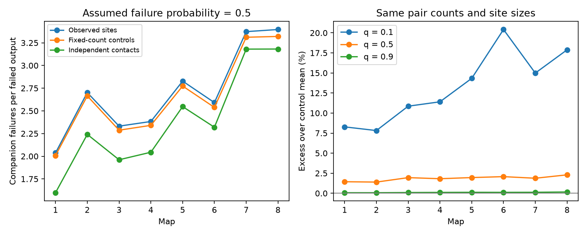

# Observed site groups raised model failure clustering by 1.4 to 2.3 percent in eight partial worm maps at failure probability 0.5

The observed site groups gave more companion connection failures than fixed-count control means in all eight maps. The excess was small at the primary assumed failure probability, 0.5. These are conditional model results. They do not measure release failures in worms.

## Question and prior work

A source cell can reach several target cells at one chemical site. If that site fails, all those contacts can fail together. Does the assignment of target identities to sites change failure clusters when every directed connection count and every site size stay fixed?

Witvliet et al. supplied the eight developmental maps [doi:10.1038/s41586-021-03778-8]. Liu et al. reported concurrent miniature currents at worm neuromuscular junctions [doi:10.1002/dneu.20307]. This motivates shared events but does not establish shared failure in the head neurons tested here.

We searched signed campaign results for connectome, Randi, and polyadic reliability. We read the site-noise study [SCI fe098e32] and the contact-loss study [SCI a7369f2c]. The first tested input covariance dimension. The second tested loss of a fraction of total contact weight. Our endpoint instead requires loss of every contact to a target. Its value depends on which targets share sites, beyond site sizes and directed pair counts. No prior code, panel or record table was reused. This is a limited search, not a full novelty review. It does not claim a new probability identity.

## Inputs and selection

We read eight DatasetN_synapses.json files in place from the shared data store. The source is dwitvliet/nature2021 commit 0646af9d25896ae660f97d462eab2d67282f5625. Exact paths, URLs, byte counts and SHA-256 hashes are in files/provenance.json. Paths use the current shared mount through /mnt/dell-data/shared_datasets; no failed disk was read. No shared data were changed or downloaded.

The common panel is the intersection of presynaptic names in all eight files: 141 cell identities. A retained site has a panel source and at least one distinct panel target other than its source. Repeated targets at one site are counted once. Distinct raw site records remain separate. Duplicate entries removed per map were 1, 4, 7, 6, 10, 10, 14 and 19 (the machine-readable summary is authoritative). The panel is based on observed output coverage. It is not an independently defined anatomical class. It excludes cells with no recorded output in any map and can include their coverage bias.

Each map is a different partial reconstruction. The maps share named cell identities, but do not give repeated measurements of one animal. We make no population age test. We use no neural activity dataset because the available site records do not identify measured release events in the activity atlases.

## Model and endpoint

For a source, let S_j be the set of sites that reach target j, m_j its size, and c_jk the number of sites shared by targets j and k. Each site fails independently with probability q. A failed site removes all its retained contacts. A target connection fails only when all of its sites fail. Thus:

    P(target j fails) = q^m_j
    P(targets j and k fail) = q^(m_j + m_k - c_jk)

Let F count failed output connections for one source event. Define:

    A = sum over sources E[F]
    B = sum over sources E[F(F-1)]
    K = B / A

K is the expected number of other failed outputs that accompany a failed output selected from a large pool of events. Every panel source is presented equally often, then each failed output has equal sampling weight. This is a failure-weighted quantity, not a mean of source-specific conditional expectations. Sources with no retained contacts contribute zero. A divided by 141 is the expected failed-output count per presented source.

For independent contact failures, the target marginals are unchanged but joint failure probability is q^(m_j+m_k). Shared sites can only increase or preserve B at fixed m_j. This direction is an algebraic result. The empirical question concerns the observed allocation compared with other legal allocations at the same counts.

The calculation uses pair probabilities, not simulated release trials. It gives exact model moments to floating-point precision. It does not specify the full failure-count distribution, the chance of any failure, or a tail probability. It cannot establish a larger risk at every failure threshold.

## Conditional controls

Within each source, we swap two target labels at different sites. We reject changes that repeat a target within one site. Sites keep their target counts and every source-target count stays fixed. All margins are therefore the same. The shared-site model and each control have exactly the same A. The independent-contact reference also stays fixed.

The proposal picks a contact uniformly, then a second contact uniformly within its source. Fixed margins make forward and reverse proposal probabilities equal. Rejections provide self-loops. The resulting swap chain has the uniform fixed-margin distribution as a stationary distribution. We do not prove mixing on the observed large tables.

Each map has two chains with separate fixed seeds. Each starts at the observed data, uses 50 attempted swaps per retained contact for burn-in, then five per contact between 200 retained draws. This gives 400 controls per map. files/control_draws.npy has shape (8,400,3), with q ordered as 0.1, 0.5 and 0.9. The first 200 draws in each map are chain 1.

Control ranges are conditional reference ranges. They are not animal confidence intervals. All eight primary observed K values exceeded every retained control value. We do not assign biological p-values from these dependent draws. Across all parameter checks, the largest absolute lag-one correlation was 0.157 and the largest difference between chain means was 0.00214. These diagnostics support, but do not prove, adequate mixing. Spatial position, branch membership, receptor class and neurite contact opportunity are not held fixed.

## Results at q = 0.5

| Map | Sites | Contacts | A / 141 | Independent K | Observed K | Control mean K | Excess (%) |
|---|---:|---:|---:|---:|---:|---:|---:|
| 1 | 560 | 967 | 1.4378 | 1.5981 | 2.0367 | 2.0078 | 1.44 |
| 2 | 773 | 1388 | 1.7123 | 2.2409 | 2.7017 | 2.6646 | 1.39 |
| 3 | 884 | 1563 | 1.7001 | 1.9614 | 2.3318 | 2.2872 | 1.95 |
| 4 | 1170 | 2030 | 1.7051 | 2.0443 | 2.3829 | 2.3404 | 1.81 |
| 5 | 1670 | 2825 | 2.1561 | 2.5473 | 2.8278 | 2.7735 | 1.96 |
| 6 | 1758 | 2958 | 1.8643 | 2.3197 | 2.5912 | 2.5385 | 2.07 |
| 7 | 2959 | 4700 | 2.5338 | 3.1803 | 3.3731 | 3.3110 | 1.87 |
| 8 | 3068 | 5105 | 2.5615 | 3.1813 | 3.3965 | 3.3202 | 2.30 |

The primary excess was 1.39 to 2.30 percent. At q = 0.1, it was 7.82 to 20.42 percent. At q = 0.9, it was 0.067 to 0.160 percent. All sensitivity observed values also exceeded all controls except map 3 at q = 0.1, where one control was at least as large. These overlapping parameter checks are not independent replications.

At q = 0.1, expected failed outputs per source were 0.232 to 0.417; at q = 0.9, they were 3.318 to 6.806. The larger relative excess at low q does not by itself establish a larger absolute burden. Full aggregate values and 95 percent central control ranges are in files/summary.json.

## Checks and meaning

A separate Python calculation rebuilt site sets from the raw files and used set unions instead of shared-site counts. It reproduced all observed metrics at all three q values with maximum absolute difference 4.50e-14. An exhaustive eight-state release example checked both moments. A six-state fixed-margin example checked proposal symmetry, self-loops and connectivity. The C++ calculation also checked all source-target margins after each chain. files/validation.json records the independent checks.

The result shows a small structural effect beyond pair counts and site sizes under one failure model. The output target identities at shared sites matter for complete connection-loss clusters. The metric provides a reproducible alternative to total-weight loss and covariance dimension.

The model assumes identical failure probabilities, perfect shared loss within each site, and independent losses across sites. These are not measured facts. Anatomical sites can contain multiple release locations. Real release can be partial, target-specific, or correlated across sites. Contact strengths, receptor signs, thresholds, recurrent paths and electrical coupling are absent. The analysis does not infer impaired coding, behavior, adaptation, or measured neuronal reliability. Geometry or annotation practice could explain the control difference. One species, selected coverage and different animals limit transfer across regions, species and conditions. A test of biological transfer requires simultaneous source and target measurements with site-resolved release information.

## Reproduction, rights and campaign record

Follow files/REPRODUCE.txt. Original analysis code, aggregate results, simulated control draws, validation, source hashes and a retrieval script are included. External raw data, cell lists and site-level extracts are excluded because their redistribution terms were not established. files/EXTERNAL_DATA.txt separates those external materials from the baseline-licensed work. Regeneration writes to separate local scratch.

Job: sci-1107-dell-neural-structure-and-computation-bb5c13051c26.
Topic: neural-structure-and-computation. Campaign: 11_07_2026.
Machine: dell. Account: codex-andrii.
Model: gpt-6.1-sol, high reasoning effort, through Codex in T3 Code.
No agents were launched. The campaign-machine key is not a personal authorship claim.
This publication is saved locally. No remote archive or index submission was made.
