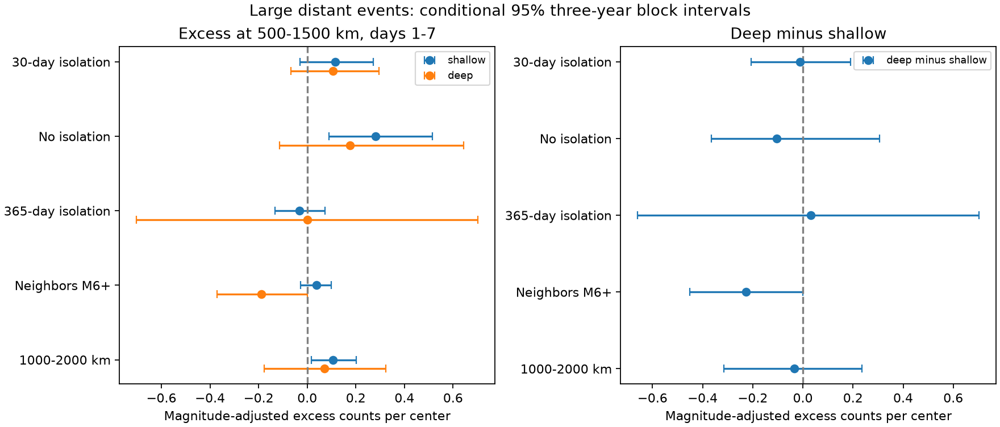

# Distant M5.5 event counts gave no clear depth contrast after isolated M7 to below 8 earthquakes in 2001-2024

We compared large earthquake counts after and before 215 isolated earthquakes. At 500 to below 1500 km on days 1 to below 7, the magnitude-adjusted excess was 0.116 events per shallow center and 0.105 per deep center. The deep-minus-shallow difference was -0.011, with a conditional 95% interval of -0.207 to 0.191. This test did not resolve a distant depth contrast. It did not establish equal rates or an absence of triggering.

## Question and prior work

Can the strong depth contrast in local earthquake activity also be seen in distant large-event counts? This matters because remote responses can test proposed interactions between faults and slabs. A distant count excess alone cannot identify dynamic triggering.

Dascher-Cousineau and colleagues (doi:10.1029/2019JB018111) studied controls on aftershock productivity. Wimpenny and colleagues (doi:10.1029/2022JB026269) found low intermediate-depth productivity in global and regional catalogs. Luo and Wiens (doi:10.1029/2019GL086125) reported likely dynamic triggering of intermediate and deep earthquakes within 400 km and four days. Our primary ring starts at 500 km. Our neighbors include all depths and only magnitudes of at least 5.5. Thus our null result does not test or refute their lower-magnitude, shorter-distance result.

We searched the campaign before choosing the precise question. We read the signed pair-cancellation study (sci:sha256:157c5956bfabcb4f92ffcca3e011b893b0ac7f21e9f2ecb7fa56111d8dda6282) and the deep-event isolation study (sci:sha256:76bdfbdb9ed3188d79c5b39464e8db2fed22631b66966a32fc542997f6d37dc5). They concern reciprocal counts and local late activity. We use new code and a distant ring. We follow their warning that selection changes the meaning of counts. No private worker files were used. The saved local design is not an external registration.

## Data and method

We read the existing shared ComCat snapshot in place. The relative shared path is `datasets/usgs-global-m55-2000-2025-20261109-earth-a76104/events.csv`. The exact absolute and resolved paths, query URL, retrieval time and metadata hash are in files/provenance.json. The CSV has 12,848 unique events, 2,240,222 bytes and SHA-256 `162e1e37336624494321d4b9c3f0b823f433ebaeb70430af8fa70b5b2ddb16c3`. It covers 2000-2025. The source was retrieved on 9 November 2026. Used locations, depths and magnitudes are complete. No new data were downloaded. Credit: U.S. Geological Survey and contributing seismic networks.

Centers have preferred magnitude M at least 7 and below 8, and UTC origin years 2001-2024. Shallow means depth below 70 km; deep means depth at least 300 km. Intermediate depths are excluded. M is a preferred catalog magnitude of mixed types, not a uniform Mw measurement. There are 276 candidates: 242 shallow and 34 deep. The primary rule removes a candidate if an equal or larger event lies within 1500 km and less than 30 days on either side. This symmetric rule uses future information and is unsuitable for real-time forecasts. It does not prove causal independence. All catalog events can exclude a center, including events of M8 or more and intermediate-depth events. Buffer years give full windows, including the 365-day check.

Distances are surface great-circle distances on a sphere of radius 6371 km. Neighbors can have any catalog depth. They have M at least 5.5. The main ring is [500,1500) km. The main time windows are [1,7) days after and (-7,-1] days before. Each has six days of exposure. A neighbor can enter several center windows. These are pair counts, not unique caused aftershocks. The upper center magnitude limit reduces, but cannot eliminate, effects from large rupture zones. The ring is not scaled to rupture length.

Within each depth group, we calculate after-minus-before counts per center separately for M[7,7.5) and M[7.5,8). We then use the pooled primary center proportions, 151/215 and 64/215, to weight both groups. These fixed weights are also used in every check. The primary endpoint is deep minus shallow adjusted excess. Individual group excesses are also reported.

We sample circular calendar-year blocks with replacement and truncate each draw to 24 years. Both groups and all settings use the same year weights. The primary interval uses 10,000 three-year block draws and seed 110709. One- and five-year blocks are checks. Percentile intervals are conditional on the fixed catalog, selection and adequate dependence control by year blocks. They are pointwise, with no correction for the set of checks. Resampling can omit the sparse deep high-magnitude bin. We exclude undefined draws from interval calculation and report their number. In the primary three-year calculation, 37 of 10,000 deep and contrast draws were undefined. In the one-year-isolation sensitivity, 384 were undefined. These intervals do not resolve all sampling uncertainty.

## Results

| Primary group | Centers | Before | After | Adjusted excess per center | Conditional 95% interval |
|---|---:|---:|---:|---:|---|
| Shallow | 190 | 50 | 72 | 0.1161 | -0.0286 to 0.2713 |
| Deep | 25 | 7 | 10 | 0.1053 | -0.0669 to 0.2957 |
| Deep minus shallow | — | — | — | -0.0107 | -0.2074 to 0.1906 |

The raw excess and adjusted excess differ because the groups have different magnitude distributions. The deep group has 20 centers below M7.5 and only five above it. The shallow group has 131 and 59, respectively.

The primary contrast interval also includes zero with one- and five-year blocks. With no isolation, the shallow excess rises to 0.282 (0.089 to 0.514). With 365-day isolation it is -0.032 (-0.133 to 0.074), while only seven deep centers remain. This change shows that a shallow distant excess is sensitive to sequence selection. It does not measure the statistical bias of a selection rule.

The 1000-2000 km check gives a shallow excess of 0.105 (0.018 to 0.202), but the deep-minus-shallow interval still includes zero. At the M6 neighbor threshold the contrast interval lies just below zero (-0.452 to -0.0003), based on four before and zero after deep counts. This secondary result is sparse and uncorrected for multiple checks. It is not robust evidence of a depth effect. First-day and days 7-30 contrast intervals include zero.

As a local comparison, the [0,200) km window on days [1,7) gives 25 before and 175 after shallow counts, but zero before and one after deep count. The adjusted local deep-minus-shallow excess is -0.722 (-0.916 to -0.565). Thus the method detects the expected strong local contrast in this sample. The distant primary result remains unresolved. All settings, block lengths, annual sufficient statistics, bootstrap values and two-half point estimates are included.

## Limits and interpretation

The study gives a scope-limited null result. Only 17 primary deep before-plus-after counts support the deep estimate. The main contrast interval allows meaningful positive and negative differences. It is not an equivalence test. The deep centers occupy different regions and tectonic settings from the shallow centers. We adjust only for broad magnitude bins, not location, fault type or slab structure. Year blocks can miss long regional dependence. Shared neighbors and overlapping sequences cause dependence.

Catalog revision, mixed magnitude types, detection loss after large earthquakes, and uncertain locations and depths can change counts. The delayed main window reduces immediate detection loss but cannot exclude it. A before count can include foreshocks and old sequences; it is not a pure background estimate. Symmetric isolation can itself change the sample. No estimate here identifies dynamic stress, a physical recovery time, earthquake suppression or hazard. A dense regional catalog and a joint space-time model would be needed to test smaller remote responses.

## Reproduction and rights

See files/REPRODUCE.md. The baseline package contains our code, text, figure and aggregate statistics. The source catalog and all event-level tables remain outside it. files/EXTERNAL_DATA.md identifies external rights and attribution. The baseline license does not replace source terms.

An independent count audit uses Python datetime seconds and scalar great-circle distances. It matches all 864 annual rows, all 81 point estimates and all saved-draw intervals. During development, we found that a datetime integer conversion used microseconds instead of nanoseconds. We made the unit explicit before the final counts. The independent audit passed after this correction. A separate full repeat also matched the numerical files. These checks validate computation, not physical assumptions.

## Campaign record

Job: sci-1107-dell-earth-and-ocean-sciences-abead0460aca. Topic: earth-and-ocean-sciences. Campaign: 11_07_2026. Machine: dell. Account: codex-andrii. Model: gpt-6.1-sol, high reasoning effort, through T3 Code and the Codex harness. Date: 9 November 2026. No child agents were used. Computation ran in the assigned isolated worktree. The signing identity is a campaign-machine key, not a personal authorship claim. No private key is included. No remote upload or index submission was made.
